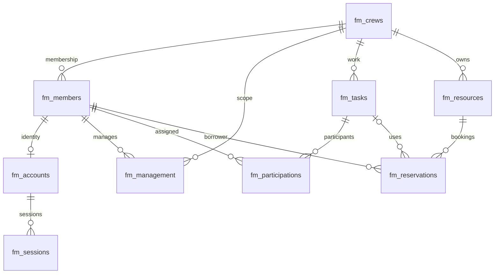

# 데이터 설계와 사전

## 관계도

MySQL의 외래키·UNIQUE·CHECK와 트랜잭션을 현재 관계/상태의 기준으로 사용한다. fm_ 접두사로 수업 데이터와 충돌을 피한다. 초기화는 CREATE IF NOT EXISTS와 INSERT IGNORE로 기존 내용을 덮어쓰지 않는다. 기존의 다른 버전 스키마를 자동 변환하는 마이그레이션 도구는 아니며 이 프로젝트가 만든 스키마를 전제로 한다.

## 공통 필드

도메인 테이블: id BIGINT UNSIGNED PK, created_at/updated_at UTC DATETIME(3), archived BOOLEAN. 확장 테이블: status VARCHAR(30) 기본 DRAFT, outcome TEXT, author_id FK members. 필수 입력은 NOT NULL, 참조 *_id는 FK. 모든 예약과 업무의 시작<종료는 CHECK로 보강한다.

## 도메인 데이터 사전

### fm_members · 구성원

범위: member.

| 필드 | 타입 | 필수 | 제한 |
|---|---|---|---|
| name | string | 예 | 100 |
| email | string | 아니오 | 254 |
| bio | string | 아니오 | 2000 |

### fm_crews · Crew

범위: crew.

| 필드 | 타입 | 필수 | 제한 |
|---|---|---|---|
| name | string | 예 | 100 |
| description | string | 아니오 | 2000 |

### fm_tasks · 업무

범위: task.

| 필드 | 타입 | 필수 | 제한 |
|---|---|---|---|
| title | string | 예 | 200 |
| description | string | 아니오 | 2000 |
| crew_id | id | 예 |  |
| starts_at | date | 예 |  |
| ends_at | date | 예 |  |
| priority | string | 아니오 | LOW, NORMAL, HIGH, URGENT |
| exclusive | boolean | 아니오 |  |

### fm_resources · 공용 자원

범위: resource.

| 필드 | 타입 | 필수 | 제한 |
|---|---|---|---|
| name | string | 예 | 150 |
| description | string | 아니오 | 2000 |
| crew_id | id | 예 |  |
| asset_tag | string | 예 | 80 |
| location | string | 아니오 | 200 |
| category_id | id | 아니오 |  |
| location_id | id | 아니오 |  |

### fm_accounts · 계정

범위: admin.

| 필드 | 타입 | 필수 | 제한 |
|---|---|---|---|
| username | string | 예 | 80 |
| member_id | id | 예 |  |
| password | string | 예 | 128 |

### fm_task_notes · 업무 협업 메모

상위 관계: task_id → fm_tasks.

| 필드 | 타입 | 필수 | 제한 |
|---|---|---|---|
| task_id | id | 예 |  |
| title | string | 예 | 150 |
| body | string | 예 | 8000 |

### fm_task_checklists · 업무 체크리스트 항목

상위 관계: task_id → fm_tasks.

| 필드 | 타입 | 필수 | 제한 |
|---|---|---|---|
| task_id | id | 예 |  |
| title | string | 예 | 200 |
| position | number | 아니오 | 999 |

### fm_task_milestones · 업무 중간 목표

상위 관계: task_id → fm_tasks.

| 필드 | 타입 | 필수 | 제한 |
|---|---|---|---|
| task_id | id | 예 |  |
| title | string | 예 | 200 |
| due_at | date | 예 |  |
| acceptance | string | 예 | 2000 |

### fm_task_dependencies · 업무 선행 조건

상위 관계: task_id → fm_tasks.

| 필드 | 타입 | 필수 | 제한 |
|---|---|---|---|
| task_id | id | 예 |  |
| predecessor_id | id | 예 |  |
| reason | string | 예 | 2000 |

### fm_task_templates · 반복 업무 서식

범위: crewChild.

| 필드 | 타입 | 필수 | 제한 |
|---|---|---|---|
| crew_id | id | 예 |  |
| title | string | 예 | 200 |
| instructions | string | 예 | 8000 |
| duration_minutes | number | 예 | 43200 |

### fm_task_deliverables · 업무 산출물 참조

상위 관계: task_id → fm_tasks.

| 필드 | 타입 | 필수 | 제한 |
|---|---|---|---|
| task_id | id | 예 |  |
| title | string | 예 | 200 |
| reference | string | 예 | 1000 |
| description | string | 아니오 | 2000 |

### fm_task_risks · 업무 위험 및 대응

상위 관계: task_id → fm_tasks.

| 필드 | 타입 | 필수 | 제한 |
|---|---|---|---|
| task_id | id | 예 |  |
| title | string | 예 | 200 |
| likelihood | number | 예 | 5 |
| impact | number | 예 | 5 |
| mitigation | string | 예 | 2000 |

### fm_resource_inspections · 자원 점검표

상위 관계: resource_id → fm_resources.

| 필드 | 타입 | 필수 | 제한 |
|---|---|---|---|
| resource_id | id | 예 |  |
| title | string | 예 | 200 |
| due_at | date | 예 |  |
| criteria | string | 예 | 8000 |

### fm_resource_maintenance · 자원 정비 작업

상위 관계: resource_id → fm_resources.

| 필드 | 타입 | 필수 | 제한 |
|---|---|---|---|
| resource_id | id | 예 |  |
| title | string | 예 | 200 |
| starts_at | date | 예 |  |
| ends_at | date | 예 |  |
| instructions | string | 예 | 2000 |

### fm_resource_incidents · 자원 장애 신고

상위 관계: resource_id → fm_resources.

| 필드 | 타입 | 필수 | 제한 |
|---|---|---|---|
| resource_id | id | 예 |  |
| title | string | 예 | 200 |
| severity | string | 예 | LOW, MEDIUM, HIGH |
| description | string | 예 | 2000 |

### fm_resource_categories · 자원 분류 기준

범위: crewChild.

| 필드 | 타입 | 필수 | 제한 |
|---|---|---|---|
| crew_id | id | 예 |  |
| title | string | 예 | 120 |
| handling_rules | string | 예 | 2000 |
| inspection_days | number | 예 | 3650 |

### fm_resource_locations · 자원 보관 장소

범위: crewChild.

| 필드 | 타입 | 필수 | 제한 |
|---|---|---|---|
| crew_id | id | 예 |  |
| title | string | 예 | 120 |
| address | string | 예 | 300 |
| access_instructions | string | 예 | 2000 |

### fm_member_skills · 구성원 역량

상위 관계: member_id → fm_members.

| 필드 | 타입 | 필수 | 제한 |
|---|---|---|---|
| member_id | id | 예 |  |
| title | string | 예 | 150 |
| level | number | 예 | 5 |
| evidence | string | 예 | 2000 |

### fm_member_certifications · 구성원 자격

상위 관계: member_id → fm_members.

| 필드 | 타입 | 필수 | 제한 |
|---|---|---|---|
| member_id | id | 예 |  |
| title | string | 예 | 150 |
| issuer | string | 예 | 150 |
| expires_at | date | 예 |  |
| reference | string | 예 | 300 |

### fm_member_availability · 구성원 부재 시간

상위 관계: member_id → fm_members.

| 필드 | 타입 | 필수 | 제한 |
|---|---|---|---|
| member_id | id | 예 |  |
| title | string | 예 | 150 |
| starts_at | date | 예 |  |
| ends_at | date | 예 |  |
| reason | string | 예 | 2000 |

### fm_leave_requests · 활동 휴가 신청

상위 관계: member_id → fm_members.

| 필드 | 타입 | 필수 | 제한 |
|---|---|---|---|
| member_id | id | 예 |  |
| title | string | 예 | 150 |
| starts_at | date | 예 |  |
| ends_at | date | 예 |  |
| reason | string | 예 | 2000 |

### fm_crew_announcements · Crew 운영 공지

범위: crewChild.

| 필드 | 타입 | 필수 | 제한 |
|---|---|---|---|
| crew_id | id | 예 |  |
| title | string | 예 | 200 |
| body | string | 예 | 8000 |
| expires_at | date | 예 |  |

### fm_crew_meetings · Crew 운영 회의

범위: crewChild.

| 필드 | 타입 | 필수 | 제한 |
|---|---|---|---|
| crew_id | id | 예 |  |
| title | string | 예 | 200 |
| starts_at | date | 예 |  |
| ends_at | date | 예 |  |
| location | string | 예 | 200 |

### fm_meeting_agenda · 회의 안건

상위 관계: meeting_id → fm_crew_meetings.

| 필드 | 타입 | 필수 | 제한 |
|---|---|---|---|
| meeting_id | id | 예 |  |
| title | string | 예 | 200 |
| proposal | string | 예 | 8000 |
| position | number | 아니오 | 999 |

### fm_meeting_minutes · 회의 결정 기록

상위 관계: meeting_id → fm_crew_meetings.

| 필드 | 타입 | 필수 | 제한 |
|---|---|---|---|
| meeting_id | id | 예 |  |
| title | string | 예 | 200 |
| decision | string | 예 | 8000 |
| follow_up | string | 아니오 | 2000 |

### fm_operating_guidelines · Crew 운영 지침

범위: crewChild.

| 필드 | 타입 | 필수 | 제한 |
|---|---|---|---|
| crew_id | id | 예 |  |
| title | string | 예 | 200 |
| body | string | 예 | 12000 |
| effective_at | date | 예 |  |

### fm_onboarding_plans · 구성원 적응 계획

상위 관계: member_id → fm_members.

| 필드 | 타입 | 필수 | 제한 |
|---|---|---|---|
| member_id | id | 예 |  |
| title | string | 예 | 200 |
| due_at | date | 예 |  |
| objectives | string | 예 | 2000 |

### fm_onboarding_steps · 적응 계획 실습 항목

상위 관계: plan_id → fm_onboarding_plans.

| 필드 | 타입 | 필수 | 제한 |
|---|---|---|---|
| plan_id | id | 예 |  |
| title | string | 예 | 200 |
| instructions | string | 예 | 2000 |
| position | number | 아니오 | 999 |

### fm_training_sessions · 조직 운영 교육

범위: crewChild.

| 필드 | 타입 | 필수 | 제한 |
|---|---|---|---|
| crew_id | id | 예 |  |
| title | string | 예 | 200 |
| starts_at | date | 예 |  |
| ends_at | date | 예 |  |
| capacity | number | 예 | 1000 |
| syllabus | string | 예 | 2000 |

### fm_training_enrollments · 교육 참가 신청

상위 관계: training_id → fm_training_sessions.

| 필드 | 타입 | 필수 | 제한 |
|---|---|---|---|
| training_id | id | 예 |  |
| member_id | id | 예 |  |
| title | string | 예 | 150 |
| goal | string | 예 | 2000 |

## 추가 저장 필드 및 제약

- fm_members: role FK fm_roles, status, crew_id nullable FK. 단일 컬럼으로 BR-01 보장. crew_id/status 인덱스.
- fm_crews: leader_id nullable FK fm_members (서비스에서 해당 Crew의 ACTIVE Capo만 지정), status.
- fm_accounts: username UNIQUE, member_id UNIQUE FK, password_hash (password 입력을 해시로 변환), status, version, failed_attempts, locked_until.
- fm_tasks: status, result, exclusive, priority, crew_id/status/starts_at 인덱스.
- fm_participations: task_id/member_id 복합 UNIQUE 및 FK, status, contribution.
- fm_resources: asset_tag UNIQUE, status, category_id/location_id nullable FK, crew_id/status 인덱스.
- fm_reservations: resource_id/task_id nullable/member_id FK, starts_at/ends_at, status, checked_out_at, returned_at, reason. resource_id/status/starts_at 인덱스.
- fm_management: member_id/crew_id 복합 PK와 FK.
- fm_roles: name PK, description. fm_role_permissions: role/permission 복합 PK, role FK. 고정 정책 초기화 자료.
- fm_sessions: sid PK, data JSON 문자열, expires epoch ms, account_id와 expires 인덱스.
- fm_outbox: id PK, event_id UNIQUE UUID, collection_name, payload JSON, delivered_at, attempts, last_error, next_attempt, created_at. 전달 대기 인덱스.
- fm_mutex: id=1 쓰기 직렬화 게이트. fm_settings: name PK/value, 데모 시드 완료 표식.
- fm_task_dependencies: task_id/predecessor_id UNIQUE, 서비스에서 순환 탐색.
- fm_training_enrollments: training_id/member_id UNIQUE, 서비스에서 정원과 활동 상태 검증.

## MongoDB 컬렉션

fm_activity, fm_member_history, fm_task_history, fm_resource_history, fm_audit: eventId UNIQUE, actor, action, entity, targetId, crewId, memberId, taskId, resourceId, occurredAt, reason, before, after. entity/targetId/occurredAt와 crewId/memberId/occurredAt 인덱스. 암호/토큰/비밀키 제거.

fm_evaluations: ObjectId, memberId, taskId, crewId, score(1~5), body, status(DRAFT/PUBLISHED/RETRACTED), version, createdAt/updatedAt, revisions[{version,actor,action,reason,previous,score,body,status,at}]. memberId/taskId/createdAt 인덱스. 단일 문서 원자 갱신으로 현재 값과 수정 이력을 함께 보존한다.

SQL 테이블 전체 DDL은 src/database/schema.js를 기준으로 한다. 컬렉션/인덱스 생성은 src/database/index.js에 있으며 서버 실행 전에는 수행하지 않았다.
