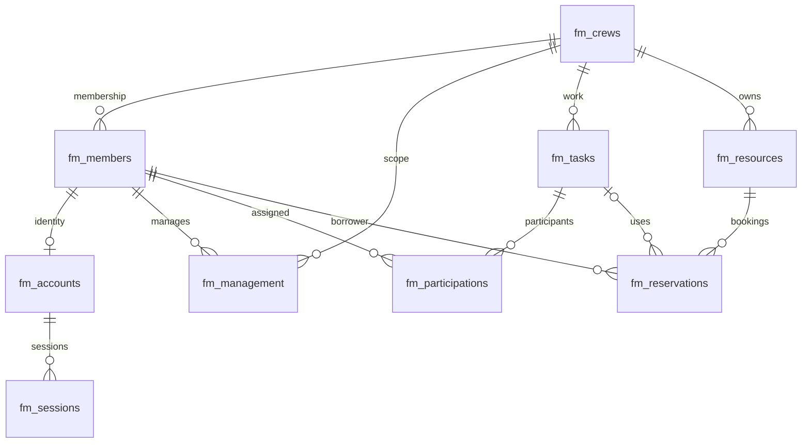

# The Family 기술 보고서 초안

학번: 202211205. 목적: 구성원·Crew·업무·공용 자원·평가·감사를 통합해 조직 운영의 일관성을 유지한다. 원본 PDF/TXT는 미제공이며 prompt.txt 요약으로 구현했다. 제출 날짜/경로와 원문 조건은 대조 필요.

## 아키텍처

브라우저 → Express 라우트/세션/CSRF → 컨트롤러 → 도메인 서비스/중앙 권한 → MySQL 저장소. SQL 변경과 outbox 저장은 한 트랜잭션. 동일 프로세스 작업자가 MongoDB 활동/감사에 멱등 전달. 평가는 Mongo 단일 문서 원본과 revisions를 사용한다. EJS 렌더링과 로컬 CSS/JS, Swagger UI를 같은 포트에서 제공한다.

## 상태 전이

- 구성원: PENDING → ACTIVE/WITHDRAWN; ACTIVE → SUSPENDED/WITHDRAWN; SUSPENDED → ACTIVE/WITHDRAWN; WITHDRAWN 종료.
- 업무: PLANNED → IN_PROGRESS → PAUSED → IN_PROGRESS → COMPLETED. PLANNED/IN_PROGRESS/PAUSED → CANCELLED. 완료 결과는 이유를 붙인 정정만 허용.
- 예약: RESERVED → IN_USE → RETURNED 또는 RESERVED → CANCELLED. 자원은 인수 시 IN_USE, 정상 반환 시 AVAILABLE, 손상 반환 시 INSPECTION. 관리자 상태 변경은 활성 예약/사용이 없을 때만 허용. RETIRED 종료.
- 평가: DRAFT → PUBLISHED → RETRACTED, 재공개 가능. 모든 수정은 version 조건과 수정 이력 원자 보존.
- 확장 개체 전이는 전체 API 명세의 from/to에 명시. 일반 편집/보관은 DRAFT만 가능.

## 핵심 흐름

관리자 온보딩 → Boss/Capo 편성 → 업무 등록 → 구성원 행 잠금과 상태/시간 충돌 확인 → 참여 배정 → 자원 행 잠금과 예약 충돌 확인 → 인수/반환 → 업무 완료 및 기여 기록 → 완료 활동 평가 → SQL outbox/Mongo 이력 조회. 권한은 목록과 상세, 총건수, 상태 변경에서 동일하게 적용한다.

## 검증 범위와 제한

문법/메타데이터/문서 정적 검사만 수행. 서버 실행, 두 DB 접속/초기화, 시드, HTTP, 브라우저, 기능/부하 테스트는 미실행. 고정 수치나 성공 횟수, 스크린샷을 제시하지 않는다. 원문 대조, 독립 API 채점 인정, 설치/실행 호환성 확인은 별도 필요. 단일 쓰기 잠금의 처리량, 평가 revisions 문서 크기, 이력 조회의 접근 ID 집합 크기, SQL/Mongo 간 평가 응답 실패의 재확인 필요성은 알려진 제한이다. 보고서 HTML은 생성하며 PDF는 생성하지 않는다.

# 권한 정책

| 역할 | 조회 범위 | 운영 변경 | 계정/역할 |
|---|---|---|---|
| Associate | 본인·같은 Crew 구성원/조직 정보, 배정 업무, 같은 Crew 자원, 본인 공개 평가 | 본인 부재 시간·휴가 초안/신청 | 본인 비밀번호·세션 |
| Soldier | Associate 범위 | 본인 배정 업무 협업 메모·체크·산출물·위험, 본인 예약 인수/반환, 자원 장애 신고 | 본인 비밀번호·세션 |
| Capo | 자신이 책임자인 Crew | 담당 Crew 구성원/편성·업무·자원·평가·지원 기록 | 본인 비밀번호·세션 |
| Underboss | fm_management에 지정된 Crew | 관리 범위의 운영, Crew 책임자 지정 | 본인 비밀번호·세션 |
| Boss | 조직 전반 | Crew 생성·관리 범위 부여와 전반 운영 | 자신보다 낮은 역할만 변경 |
| Administrator | 조직 전반 및 기술 감사 | 업무 데이터 쓰기 금지; 초기 미소속 구성원 등록 가능 | 계정 생성/차단/해제/비밀번호 재설정, 낮은 역할 변경, 대기 기록 재시도 |

역할 허용 목록과 대상 범위는 모두 만족해야 한다. 목록/총건수는 동일 SQL scope 조건을 사용한다. 일반 구성원은 교육/회의 등 자신의 Crew 정보만 볼 수 있다. 평가 목록은 Associate/Soldier에게 본인 PUBLISHED만 표시한다. 관리자는 담당 구성원과 완료 참여 업무를 모두 관리할 수 있을 때만 평가를 생성/정정할 수 있다. 자기 평가와 자기 휴가 승인은 금지한다.

로그인 시 DB의 최신 account/member 상태를 읽고, 매 API 요청에서 계정 version을 확인한다. 변경 트랜잭션 안에서도 다시 인증 상태/역할을 읽는다. 차단, 비밀번호 변경, 역할/소속/상태 변경, Underboss 범위 변경은 관련 세션을 무효화한다. Crew 책임자 변경은 다음 요청의 최신 leader_id 검사로 즉시 반영된다.

미소속 구성원은 Boss/Administrator만 조회할 수 있다. Capo는 새 미소속 구성원 생성 권한이 없지만 권한 있는 편입 API로 자신 Crew에 편성할 수 있다. 이미 다른 Crew에 소속된 구성원의 편입은 항상 409이며 전속 이동은 출발·도착 Crew 모두에 쓰기 권한이 필요하다.

직접 URL/API, 요청 body의 role/memberId 위장, 미허용 필드, 다른 대상 ID, 검색 총건수도 서버에서 검사한다. 계정 비밀번호 해시, 세션 ID, 비밀키는 API로 반환하지 않는다. 본인 세션 목록에는 단방향 SHA-256 참조값과 만료 시각만 제공한다.

SQL의 역할/권한 관계는 고정 허용 정책의 초기화 자료다. 임의 권한 문자열을 실행하는 기능이나 런타임 정책 편집 기능은 제공하지 않는다. 실제 허용 기준은 코드의 고정 역할 목록과 scope이며 목록은 API 카탈로그에 함께 기록한다.

# 데이터 설계와 사전

## 관계도

MySQL의 외래키·UNIQUE·CHECK와 트랜잭션을 현재 관계/상태의 기준으로 사용한다. fm_ 접두사로 수업 데이터와 충돌을 피한다. 초기화는 CREATE IF NOT EXISTS와 INSERT IGNORE로 기존 내용을 덮어쓰지 않는다. 기존의 다른 버전 스키마를 자동 변환하는 마이그레이션 도구는 아니며 이 프로젝트가 만든 스키마를 전제로 한다.

## 공통 필드

도메인 테이블: id BIGINT UNSIGNED PK, created_at/updated_at UTC DATETIME(3), archived BOOLEAN. 확장 테이블: status VARCHAR(30) 기본 DRAFT, outcome TEXT, author_id FK members. 필수 입력은 NOT NULL, 참조 *_id는 FK. 모든 예약과 업무의 시작<종료는 CHECK로 보강한다.

## 도메인 데이터 사전

### fm_members · 구성원

범위: member.

| 필드 | 타입 | 필수 | 제한 |
|---|---|---|---|
| name | string | 예 | 100 |
| email | string | 아니오 | 254 |
| bio | string | 아니오 | 2000 |

### fm_crews · Crew

범위: crew.

| 필드 | 타입 | 필수 | 제한 |
|---|---|---|---|
| name | string | 예 | 100 |
| description | string | 아니오 | 2000 |

### fm_tasks · 업무

범위: task.

| 필드 | 타입 | 필수 | 제한 |
|---|---|---|---|
| title | string | 예 | 200 |
| description | string | 아니오 | 2000 |
| crew_id | id | 예 |  |
| starts_at | date | 예 |  |
| ends_at | date | 예 |  |
| priority | string | 아니오 | LOW, NORMAL, HIGH, URGENT |
| exclusive | boolean | 아니오 |  |

### fm_resources · 공용 자원

범위: resource.

| 필드 | 타입 | 필수 | 제한 |
|---|---|---|---|
| name | string | 예 | 150 |
| description | string | 아니오 | 2000 |
| crew_id | id | 예 |  |
| asset_tag | string | 예 | 80 |
| location | string | 아니오 | 200 |
| category_id | id | 아니오 |  |
| location_id | id | 아니오 |  |

### fm_accounts · 계정

범위: admin.

| 필드 | 타입 | 필수 | 제한 |
|---|---|---|---|
| username | string | 예 | 80 |
| member_id | id | 예 |  |
| password | string | 예 | 128 |

### fm_task_notes · 업무 협업 메모

상위 관계: task_id → fm_tasks.

| 필드 | 타입 | 필수 | 제한 |
|---|---|---|---|
| task_id | id | 예 |  |
| title | string | 예 | 150 |
| body | string | 예 | 8000 |

### fm_task_checklists · 업무 체크리스트 항목

상위 관계: task_id → fm_tasks.

| 필드 | 타입 | 필수 | 제한 |
|---|---|---|---|
| task_id | id | 예 |  |
| title | string | 예 | 200 |
| position | number | 아니오 | 999 |

### fm_task_milestones · 업무 중간 목표

상위 관계: task_id → fm_tasks.

| 필드 | 타입 | 필수 | 제한 |
|---|---|---|---|
| task_id | id | 예 |  |
| title | string | 예 | 200 |
| due_at | date | 예 |  |
| acceptance | string | 예 | 2000 |

### fm_task_dependencies · 업무 선행 조건

상위 관계: task_id → fm_tasks.

| 필드 | 타입 | 필수 | 제한 |
|---|---|---|---|
| task_id | id | 예 |  |
| predecessor_id | id | 예 |  |
| reason | string | 예 | 2000 |

### fm_task_templates · 반복 업무 서식

범위: crewChild.

| 필드 | 타입 | 필수 | 제한 |
|---|---|---|---|
| crew_id | id | 예 |  |
| title | string | 예 | 200 |
| instructions | string | 예 | 8000 |
| duration_minutes | number | 예 | 43200 |

### fm_task_deliverables · 업무 산출물 참조

상위 관계: task_id → fm_tasks.

| 필드 | 타입 | 필수 | 제한 |
|---|---|---|---|
| task_id | id | 예 |  |
| title | string | 예 | 200 |
| reference | string | 예 | 1000 |
| description | string | 아니오 | 2000 |

### fm_task_risks · 업무 위험 및 대응

상위 관계: task_id → fm_tasks.

| 필드 | 타입 | 필수 | 제한 |
|---|---|---|---|
| task_id | id | 예 |  |
| title | string | 예 | 200 |
| likelihood | number | 예 | 5 |
| impact | number | 예 | 5 |
| mitigation | string | 예 | 2000 |

### fm_resource_inspections · 자원 점검표

상위 관계: resource_id → fm_resources.

| 필드 | 타입 | 필수 | 제한 |
|---|---|---|---|
| resource_id | id | 예 |  |
| title | string | 예 | 200 |
| due_at | date | 예 |  |
| criteria | string | 예 | 8000 |

### fm_resource_maintenance · 자원 정비 작업

상위 관계: resource_id → fm_resources.

| 필드 | 타입 | 필수 | 제한 |
|---|---|---|---|
| resource_id | id | 예 |  |
| title | string | 예 | 200 |
| starts_at | date | 예 |  |
| ends_at | date | 예 |  |
| instructions | string | 예 | 2000 |

### fm_resource_incidents · 자원 장애 신고

상위 관계: resource_id → fm_resources.

| 필드 | 타입 | 필수 | 제한 |
|---|---|---|---|
| resource_id | id | 예 |  |
| title | string | 예 | 200 |
| severity | string | 예 | LOW, MEDIUM, HIGH |
| description | string | 예 | 2000 |

### fm_resource_categories · 자원 분류 기준

범위: crewChild.

| 필드 | 타입 | 필수 | 제한 |
|---|---|---|---|
| crew_id | id | 예 |  |
| title | string | 예 | 120 |
| handling_rules | string | 예 | 2000 |
| inspection_days | number | 예 | 3650 |

### fm_resource_locations · 자원 보관 장소

범위: crewChild.

| 필드 | 타입 | 필수 | 제한 |
|---|---|---|---|
| crew_id | id | 예 |  |
| title | string | 예 | 120 |
| address | string | 예 | 300 |
| access_instructions | string | 예 | 2000 |

### fm_member_skills · 구성원 역량

상위 관계: member_id → fm_members.

| 필드 | 타입 | 필수 | 제한 |
|---|---|---|---|
| member_id | id | 예 |  |
| title | string | 예 | 150 |
| level | number | 예 | 5 |
| evidence | string | 예 | 2000 |

### fm_member_certifications · 구성원 자격

상위 관계: member_id → fm_members.

| 필드 | 타입 | 필수 | 제한 |
|---|---|---|---|
| member_id | id | 예 |  |
| title | string | 예 | 150 |
| issuer | string | 예 | 150 |
| expires_at | date | 예 |  |
| reference | string | 예 | 300 |

### fm_member_availability · 구성원 부재 시간

상위 관계: member_id → fm_members.

| 필드 | 타입 | 필수 | 제한 |
|---|---|---|---|
| member_id | id | 예 |  |
| title | string | 예 | 150 |
| starts_at | date | 예 |  |
| ends_at | date | 예 |  |
| reason | string | 예 | 2000 |

### fm_leave_requests · 활동 휴가 신청

상위 관계: member_id → fm_members.

| 필드 | 타입 | 필수 | 제한 |
|---|---|---|---|
| member_id | id | 예 |  |
| title | string | 예 | 150 |
| starts_at | date | 예 |  |
| ends_at | date | 예 |  |
| reason | string | 예 | 2000 |

### fm_crew_announcements · Crew 운영 공지

범위: crewChild.

| 필드 | 타입 | 필수 | 제한 |
|---|---|---|---|
| crew_id | id | 예 |  |
| title | string | 예 | 200 |
| body | string | 예 | 8000 |
| expires_at | date | 예 |  |

### fm_crew_meetings · Crew 운영 회의

범위: crewChild.

| 필드 | 타입 | 필수 | 제한 |
|---|---|---|---|
| crew_id | id | 예 |  |
| title | string | 예 | 200 |
| starts_at | date | 예 |  |
| ends_at | date | 예 |  |
| location | string | 예 | 200 |

### fm_meeting_agenda · 회의 안건

상위 관계: meeting_id → fm_crew_meetings.

| 필드 | 타입 | 필수 | 제한 |
|---|---|---|---|
| meeting_id | id | 예 |  |
| title | string | 예 | 200 |
| proposal | string | 예 | 8000 |
| position | number | 아니오 | 999 |

### fm_meeting_minutes · 회의 결정 기록

상위 관계: meeting_id → fm_crew_meetings.

| 필드 | 타입 | 필수 | 제한 |
|---|---|---|---|
| meeting_id | id | 예 |  |
| title | string | 예 | 200 |
| decision | string | 예 | 8000 |
| follow_up | string | 아니오 | 2000 |

### fm_operating_guidelines · Crew 운영 지침

범위: crewChild.

| 필드 | 타입 | 필수 | 제한 |
|---|---|---|---|
| crew_id | id | 예 |  |
| title | string | 예 | 200 |
| body | string | 예 | 12000 |
| effective_at | date | 예 |  |

### fm_onboarding_plans · 구성원 적응 계획

상위 관계: member_id → fm_members.

| 필드 | 타입 | 필수 | 제한 |
|---|---|---|---|
| member_id | id | 예 |  |
| title | string | 예 | 200 |
| due_at | date | 예 |  |
| objectives | string | 예 | 2000 |

### fm_onboarding_steps · 적응 계획 실습 항목

상위 관계: plan_id → fm_onboarding_plans.

| 필드 | 타입 | 필수 | 제한 |
|---|---|---|---|
| plan_id | id | 예 |  |
| title | string | 예 | 200 |
| instructions | string | 예 | 2000 |
| position | number | 아니오 | 999 |

### fm_training_sessions · 조직 운영 교육

범위: crewChild.

| 필드 | 타입 | 필수 | 제한 |
|---|---|---|---|
| crew_id | id | 예 |  |
| title | string | 예 | 200 |
| starts_at | date | 예 |  |
| ends_at | date | 예 |  |
| capacity | number | 예 | 1000 |
| syllabus | string | 예 | 2000 |

### fm_training_enrollments · 교육 참가 신청

상위 관계: training_id → fm_training_sessions.

| 필드 | 타입 | 필수 | 제한 |
|---|---|---|---|
| training_id | id | 예 |  |
| member_id | id | 예 |  |
| title | string | 예 | 150 |
| goal | string | 예 | 2000 |

## 추가 저장 필드 및 제약

- fm_members: role FK fm_roles, status, crew_id nullable FK. 단일 컬럼으로 BR-01 보장. crew_id/status 인덱스.
- fm_crews: leader_id nullable FK fm_members (서비스에서 해당 Crew의 ACTIVE Capo만 지정), status.
- fm_accounts: username UNIQUE, member_id UNIQUE FK, password_hash (password 입력을 해시로 변환), status, version, failed_attempts, locked_until.
- fm_tasks: status, result, exclusive, priority, crew_id/status/starts_at 인덱스.
- fm_participations: task_id/member_id 복합 UNIQUE 및 FK, status, contribution.
- fm_resources: asset_tag UNIQUE, status, category_id/location_id nullable FK, crew_id/status 인덱스.
- fm_reservations: resource_id/task_id nullable/member_id FK, starts_at/ends_at, status, checked_out_at, returned_at, reason. resource_id/status/starts_at 인덱스.
- fm_management: member_id/crew_id 복합 PK와 FK.
- fm_roles: name PK, description. fm_role_permissions: role/permission 복합 PK, role FK. 고정 정책 초기화 자료.
- fm_sessions: sid PK, data JSON 문자열, expires epoch ms, account_id와 expires 인덱스.
- fm_outbox: id PK, event_id UNIQUE UUID, collection_name, payload JSON, delivered_at, attempts, last_error, next_attempt, created_at. 전달 대기 인덱스.
- fm_mutex: id=1 쓰기 직렬화 게이트. fm_settings: name PK/value, 데모 시드 완료 표식.
- fm_task_dependencies: task_id/predecessor_id UNIQUE, 서비스에서 순환 탐색.
- fm_training_enrollments: training_id/member_id UNIQUE, 서비스에서 정원과 활동 상태 검증.

## MongoDB 컬렉션

fm_activity, fm_member_history, fm_task_history, fm_resource_history, fm_audit: eventId UNIQUE, actor, action, entity, targetId, crewId, memberId, taskId, resourceId, occurredAt, reason, before, after. entity/targetId/occurredAt와 crewId/memberId/occurredAt 인덱스. 암호/토큰/비밀키 제거.

fm_evaluations: ObjectId, memberId, taskId, crewId, score(1~5), body, status(DRAFT/PUBLISHED/RETRACTED), version, createdAt/updatedAt, revisions[{version,actor,action,reason,previous,score,body,status,at}]. memberId/taskId/createdAt 인덱스. 단일 문서 원자 갱신으로 현재 값과 수정 이력을 함께 보존한다.

SQL 테이블 전체 DDL은 src/database/schema.js를 기준으로 한다. 컬렉션/인덱스 생성은 src/database/index.js에 있으며 서버 실행 전에는 수행하지 않았다.

# 추가 설계 결정

이 문서의 세부 설계는 PDF 원문 조건이라는 주장이 아니다. 원문을 받지 못했으며 prompt 요약에 기반했다.

1. **실행**: CommonJS, Node 20 이상, Express 4, EJS. 웹 포트는 `const PORT = 8593`으로 고정한다. DB 초기화, 계정 준비가 끝나야 listen한다. server.js import는 접속/시작을 하지 않는다. app.js와 npm start는 같은 startServer를 호출한다. 외부 CDN, 별도 프런트엔드 빌드, Docker는 없다.
2. **시간**: API 입력은 시간대가 명시된 ISO 8601. SQL은 UTC DATETIME(3), Mongo 기록은 UTC ISO 문자열. 브라우저는 현지 시간 입력을 ISO로 바꾼다. 충돌은 `[start,end)`로 검사한다. 예약과 실제 사용을 구분하며 미반환 IN_USE는 예정 종료 이후라도 신규 예약을 막는다.
3. **동시성**: 모든 SQL 도메인 변경은 `fm_mutex` 단일 행을 먼저 잠근다. 이후 대상/구성원/자원 행을 FOR UPDATE로 읽는다. 구성원·자원 충돌 배정과 일정 수정, 권한 변경이 직렬화되어 교차 잠금 역전을 피한다. 수업 규모의 정확성을 위한 선택이며 대규모 처리량에는 병목이다. 복수 관계 작업은 한 트랜잭션에서 전부 반영하거나 취소한다. 임의 일괄 API를 별도 수로 늘리지 않는다.
4. **정식 소속**: members.crew_id 하나만 사용. Underboss의 복수 관리 범위는 fm_management로 분리. 활동 배정/예약 또는 Crew 책임이 남은 구성원은 이동·분리·정지·탈퇴를 거부한다. 먼저 배정 해제와 자원 반환, 책임자 교체가 필요하다.
5. **종료와 보존**: 완료/취소 업무는 일반 수정 금지. 완료 결과 정정은 관리 권한·범위·이유가 필요하며 before/after를 저장한다. 확장 개체 DELETE는 DRAFT만 archived로 보관하며 물리 삭제하지 않는다. 계정 차단은 삭제와 다르다. 감사 이력 삭제/수정 API는 없다.
6. **MongoDB 기록**: MySQL 변경과 outbox를 같은 트랜잭션에 저장한다. 2초 간격의 동일 프로세스 작업자가 eventId unique upsert로 원본 컬렉션과 감사 컬렉션을 기록한다. 둘 다 성공해야 전달 완료 처리한다. 실패시 지수형 재시도(최대 300초)를 사용한다. 전달 전 조회에 이력이 늦게 나타날 수 있다. 관리자 대기열은 payload/비밀정보를 노출하지 않는다.
7. **평가**: MongoDB 단일 문서에 현재 값과 revisions 배열을 함께 원자 갱신한다. version 조건으로 동시 정정 손실을 막는다. SQL 트랜잭션 잠금 중 현재 권한과 완료 참여 관계를 확인하지만 SQL과 MongoDB의 분산 트랜잭션을 주장하지 않는다. 평가 본문 자체에 actor/reason/이전 값 이력을 저장한다. Mongo 성공 후 SQL 커밋 또는 응답 연결이 실패하면 요청은 오류로 보일 수 있으므로 사용자가 조회해 반영 여부를 확인해야 한다. 평가 생성의 네트워크 재시도는 중복 평가를 만들 수 있다. 수정은 version으로 보호된다.
8. **평가 크기**: revisions는 로컬 단일 Mongo 문서 안에 누적된다. 무한 크기 보장을 하지 않으며 MongoDB 문서 크기 제한 도달 시 오류로 처리된다. 장기간 운영 시 스냅샷/아카이브 정책이 필요하다.
9. **인증**: Node crypto.scrypt + 무작위 salt, MySQL 세션, 로그인 재발급, 계정 version 검증, HttpOnly/SameSite 쿠키, 세션 CSRF. 로컬 HTTP 기본은 Secure=false이며 HTTPS 운영은 COOKIE_SECURE=true로 설정한다. 비밀키는 지정하지 않으면 .local에 생성/보존한다. 공개 정적 디렉터리는 public만이다.
10. **관리자 구분**: Administrator는 계정/감사와 초기 구성원 온보딩을 담당하며 업무를 쓰지 않는다. 기술 계정은 조회를 허용한다. 운영 권한은 Boss/담당 Underboss/담당 Capo의 범위 정책을 따른다. 단순 역할 순위만으로 Crew 접근을 허용하지 않는다.
11. **역할 변경**: 자기 역할 변경 금지. 변경 대상과 부여 역할 모두 행위자보다 낮아야 한다. Administrator가 첫 Boss를 준비할 수 있지만 동급 Administrator를 임의로 추가/변경하는 API는 제공하지 않는다. 마지막 활성 Administrator 계정 차단을 거부한다.
12. **확장 업무**: 업무 체크리스트·중간 목표·선행 관계·서식·산출물·위험, 자원 점검·정비·신고·분류·장소, 구성원 역량·자격·부재·휴가, Crew 회의·공지·지침, 적응 계획·교육은 원문에 직접 나열된 요구사항이 아니라 FR을 지원하는 설계 확장이다. 각 고정 스키마별 테이블, 관계, 권한, 검증과 상태 조건을 사용한다. 임의 테이블/필드 실행 API는 없다.
13. **API 계수**: 목록/상세/생성/편집/초안 보관은 각기 다른 사용자 작업이다. 상태 전이 중 동일 조건으로 상태만 역전하는 기능은 보수적으로 중복 의심으로 분리한다. 정적 후보 수와 실제 인정 수를 구분한다. 자동 HEAD/OPTIONS, 화면, 정적 파일, Swagger는 제외한다.
14. **프런트엔드**: 한국어 EJS 셸, 공통 탐색, 실데이터 테이블·상세·등록·수정, 검색·페이지와 업무 도구 폼. 확장 작업은 업무 도구 선택으로 접근한다. 일반 화면에서도 모든 허용 작업을 실행할 수 있으며 Swagger만 제공하는 기능에 의존하지 않는다. 성공/오류는 페이지/대화상자 내부 메시지로 안내한다.
15. **검증 제한**: 요청에 따라 서버 시작, DB 접속/생성, 시드 실행, HTTP, 브라우저, 자동 기능 테스트는 미실행. 문법 검사와 메타데이터/소스/문서 정적 대조만 수행한다.

# 전체 API 명세

등록과 문서의 공통 원천: src/routes/catalog.js. 실행 검증은 모두 미실행. 응답은 success/data/meta 또는 success/error(code,message,details). 생성 201, 그 외 성공 200. 오류 400/401/403/404/409/422/503. 204를 사용하지 않는다. 샘플 ID=1은 실제 반환 ID로 바꿔야 한다. 기간 필터는 업무 목록에서는 시작/종료, 그 외 목록에서는 생성 시각이다.

## members-list · 구성원 검색 및 페이지 목록

- 경로: **GET /api/v1/members**
- 목적/기능군: 구성원 검색 및 페이지 목록; 역할 및 대상 범위 검사 후 처리 / members
- 요구사항: FR-01, FR-02, FR-03, FR-04, FR-21, AR-03
- 허용 역할: Associate, Soldier, Capo, Underboss, Boss, Administrator
- 대상 범위: member
- 입력 스키마: `{}`
- 예시 본문: `{}`
- 정상 응답 예시: `{"success":true,"data":[{"id":1,"name":"name 예시","email":"email 예시","bio":"bio 예시"}],"meta":{"page":1,"size":20,"total":1}}`
- 오류 응답 예시: `{"success":false,"error":{"code":"OUT_OF_SCOPE","message":"관리 또는 조회 범위 밖의 대상입니다."}}`
- DB 처리: MySQL 범위 제한 조회
- 구현: src/services/entities.js#list
- 기능 차이: 검색·총건수·페이지 탐색
- 계수 판단: 독립 기능 후보: 검색·총건수·페이지 탐색
- 확인: Associate/Soldier/Capo/Underboss/Boss/Administrator 계정으로 로그인 후 GET /api/v1/members. 생성/목록 응답에서 얻은 ID를 사용. 검색·총건수·페이지 탐색. 관측 결과: 미실행.

## members-detail · 구성원 상세 조회

- 경로: **GET /api/v1/members/:id**
- 목적/기능군: 구성원 상세 조회; 역할 및 대상 범위 검사 후 처리 / members
- 요구사항: FR-01, FR-02, FR-03, FR-04
- 허용 역할: Associate, Soldier, Capo, Underboss, Boss, Administrator
- 대상 범위: member
- 입력 스키마: `{}`
- 예시 본문: `{}`
- 정상 응답 예시: `{"success":true,"data":{"id":1,"name":"name 예시","email":"email 예시","bio":"bio 예시"}}`
- 오류 응답 예시: `{"success":false,"error":{"code":"OUT_OF_SCOPE","message":"관리 또는 조회 범위 밖의 대상입니다."}}`
- DB 처리: MySQL 범위 제한 조회
- 구현: src/services/entities.js#detail
- 기능 차이: 단일 대상 존재/권한 확인과 전체 필드
- 계수 판단: 독립 기능 후보: 단일 대상 존재/권한 확인과 전체 필드
- 확인: Associate/Soldier/Capo/Underboss/Boss/Administrator 계정으로 로그인 후 GET /api/v1/members/:id. 생성/목록 응답에서 얻은 ID를 사용. 단일 대상 존재/권한 확인과 전체 필드. 관측 결과: 미실행.

## members-create · 구성원 등록

- 경로: **POST /api/v1/members**
- 목적/기능군: 구성원 등록; 역할 및 대상 범위 검사 후 처리 / members
- 요구사항: FR-01, FR-02, FR-03, FR-04
- 허용 역할: Boss, Administrator
- 대상 범위: member
- 입력 스키마: `{"name":{"type":"string","required":true,"max":100},"email":{"type":"string","required":false,"max":254},"bio":{"type":"string","required":false,"max":2000}}`
- 예시 본문: `{"name":"name 입력 예시","email":"member@example.test","bio":"bio 입력 예시"}`
- 정상 응답 예시: `{"success":true,"data":{"id":1,"name":"name 예시","email":"email 예시","bio":"bio 예시"}}`
- 오류 응답 예시: `{"success":false,"error":{"code":"OUT_OF_SCOPE","message":"관리 또는 조회 범위 밖의 대상입니다."}}`
- DB 처리: MySQL 트랜잭션 및 outbox 이력 (인증은 세션 저장소 포함)
- 구현: src/services/entities.js#mutate
- 기능 차이: 새 도메인 개체 생성과 관계 검증
- 계수 판단: 독립 기능 후보: 새 도메인 개체 생성과 관계 검증
- 확인: Boss/Administrator 계정으로 로그인 후 POST /api/v1/members. 생성/목록 응답에서 얻은 ID를 사용. 새 도메인 개체 생성과 관계 검증. 관측 결과: 미실행.

## members-update · 구성원 기본 정보 수정

- 경로: **PATCH /api/v1/members/:id**
- 목적/기능군: 구성원 기본 정보 수정; 역할 및 대상 범위 검사 후 처리 / members
- 요구사항: FR-01, FR-02, FR-03, FR-04
- 허용 역할: Capo, Underboss, Boss
- 대상 범위: member
- 입력 스키마: `{"name":{"type":"string","required":true,"max":100},"email":{"type":"string","required":false,"max":254},"bio":{"type":"string","required":false,"max":2000}}`
- 예시 본문: `{"name":"name 입력 예시","email":"member@example.test","bio":"bio 입력 예시"}`
- 정상 응답 예시: `{"success":true,"data":{"id":1,"name":"name 예시","email":"email 예시","bio":"bio 예시"}}`
- 오류 응답 예시: `{"success":false,"error":{"code":"OUT_OF_SCOPE","message":"관리 또는 조회 범위 밖의 대상입니다."}}`
- DB 처리: MySQL 트랜잭션 및 outbox 이력 (인증은 세션 저장소 포함)
- 구현: src/services/entities.js#mutate
- 기능 차이: 기존 초안/기본 정보 수정; 상태/관계 필드 우회 금지
- 계수 판단: 독립 기능 후보: 기존 초안/기본 정보 수정; 상태/관계 필드 우회 금지
- 확인: Capo/Underboss/Boss 계정으로 로그인 후 PATCH /api/v1/members/:id. 생성/목록 응답에서 얻은 ID를 사용. 기존 초안/기본 정보 수정; 상태/관계 필드 우회 금지. 관측 결과: 미실행.

## crews-list · Crew 검색 및 페이지 목록

- 경로: **GET /api/v1/crews**
- 목적/기능군: Crew 검색 및 페이지 목록; 역할 및 대상 범위 검사 후 처리 / crews
- 요구사항: FR-05, FR-06, FR-21, AR-03
- 허용 역할: Associate, Soldier, Capo, Underboss, Boss, Administrator
- 대상 범위: crew
- 입력 스키마: `{}`
- 예시 본문: `{}`
- 정상 응답 예시: `{"success":true,"data":[{"id":1,"name":"name 예시","description":"description 예시"}],"meta":{"page":1,"size":20,"total":1}}`
- 오류 응답 예시: `{"success":false,"error":{"code":"OUT_OF_SCOPE","message":"관리 또는 조회 범위 밖의 대상입니다."}}`
- DB 처리: MySQL 범위 제한 조회
- 구현: src/services/entities.js#list
- 기능 차이: 검색·총건수·페이지 탐색
- 계수 판단: 독립 기능 후보: 검색·총건수·페이지 탐색
- 확인: Associate/Soldier/Capo/Underboss/Boss/Administrator 계정으로 로그인 후 GET /api/v1/crews. 생성/목록 응답에서 얻은 ID를 사용. 검색·총건수·페이지 탐색. 관측 결과: 미실행.

## crews-detail · Crew 상세 조회

- 경로: **GET /api/v1/crews/:id**
- 목적/기능군: Crew 상세 조회; 역할 및 대상 범위 검사 후 처리 / crews
- 요구사항: FR-05, FR-06
- 허용 역할: Associate, Soldier, Capo, Underboss, Boss, Administrator
- 대상 범위: crew
- 입력 스키마: `{}`
- 예시 본문: `{}`
- 정상 응답 예시: `{"success":true,"data":{"id":1,"name":"name 예시","description":"description 예시"}}`
- 오류 응답 예시: `{"success":false,"error":{"code":"OUT_OF_SCOPE","message":"관리 또는 조회 범위 밖의 대상입니다."}}`
- DB 처리: MySQL 범위 제한 조회
- 구현: src/services/entities.js#detail
- 기능 차이: 단일 대상 존재/권한 확인과 전체 필드
- 계수 판단: 독립 기능 후보: 단일 대상 존재/권한 확인과 전체 필드
- 확인: Associate/Soldier/Capo/Underboss/Boss/Administrator 계정으로 로그인 후 GET /api/v1/crews/:id. 생성/목록 응답에서 얻은 ID를 사용. 단일 대상 존재/권한 확인과 전체 필드. 관측 결과: 미실행.

## crews-create · Crew 등록

- 경로: **POST /api/v1/crews**
- 목적/기능군: Crew 등록; 역할 및 대상 범위 검사 후 처리 / crews
- 요구사항: FR-05, FR-06
- 허용 역할: Boss
- 대상 범위: crew
- 입력 스키마: `{"name":{"type":"string","required":true,"max":100},"description":{"type":"string","required":false,"max":2000}}`
- 예시 본문: `{"name":"name 입력 예시","description":"description 입력 예시"}`
- 정상 응답 예시: `{"success":true,"data":{"id":1,"name":"name 예시","description":"description 예시"}}`
- 오류 응답 예시: `{"success":false,"error":{"code":"OUT_OF_SCOPE","message":"관리 또는 조회 범위 밖의 대상입니다."}}`
- DB 처리: MySQL 트랜잭션 및 outbox 이력 (인증은 세션 저장소 포함)
- 구현: src/services/entities.js#mutate
- 기능 차이: 새 도메인 개체 생성과 관계 검증
- 계수 판단: 독립 기능 후보: 새 도메인 개체 생성과 관계 검증
- 확인: Boss 계정으로 로그인 후 POST /api/v1/crews. 생성/목록 응답에서 얻은 ID를 사용. 새 도메인 개체 생성과 관계 검증. 관측 결과: 미실행.

## crews-update · Crew 기본 정보 수정

- 경로: **PATCH /api/v1/crews/:id**
- 목적/기능군: Crew 기본 정보 수정; 역할 및 대상 범위 검사 후 처리 / crews
- 요구사항: FR-05, FR-06
- 허용 역할: Boss, Underboss
- 대상 범위: crew
- 입력 스키마: `{"name":{"type":"string","required":true,"max":100},"description":{"type":"string","required":false,"max":2000}}`
- 예시 본문: `{"name":"name 입력 예시","description":"description 입력 예시"}`
- 정상 응답 예시: `{"success":true,"data":{"id":1,"name":"name 예시","description":"description 예시"}}`
- 오류 응답 예시: `{"success":false,"error":{"code":"OUT_OF_SCOPE","message":"관리 또는 조회 범위 밖의 대상입니다."}}`
- DB 처리: MySQL 트랜잭션 및 outbox 이력 (인증은 세션 저장소 포함)
- 구현: src/services/entities.js#mutate
- 기능 차이: 기존 초안/기본 정보 수정; 상태/관계 필드 우회 금지
- 계수 판단: 독립 기능 후보: 기존 초안/기본 정보 수정; 상태/관계 필드 우회 금지
- 확인: Boss/Underboss 계정으로 로그인 후 PATCH /api/v1/crews/:id. 생성/목록 응답에서 얻은 ID를 사용. 기존 초안/기본 정보 수정; 상태/관계 필드 우회 금지. 관측 결과: 미실행.

## tasks-list · 업무 검색 및 페이지 목록

- 경로: **GET /api/v1/tasks**
- 목적/기능군: 업무 검색 및 페이지 목록; 역할 및 대상 범위 검사 후 처리 / tasks
- 요구사항: FR-07, FR-09, FR-12, FR-21, AR-03
- 허용 역할: Associate, Soldier, Capo, Underboss, Boss, Administrator
- 대상 범위: task
- 입력 스키마: `{}`
- 예시 본문: `{}`
- 정상 응답 예시: `{"success":true,"data":[{"id":1,"title":"title 예시","description":"description 예시","crew_id":1,"starts_at":"2026-11-01 01:00:00.000","ends_at":"2026-11-01 01:00:00.000","priority":"LOW","exclusive":true}],"meta":{"page":1,"size":20,"total":1}}`
- 오류 응답 예시: `{"success":false,"error":{"code":"OUT_OF_SCOPE","message":"관리 또는 조회 범위 밖의 대상입니다."}}`
- DB 처리: MySQL 범위 제한 조회
- 구현: src/services/entities.js#list
- 기능 차이: 검색·총건수·페이지 탐색
- 계수 판단: 독립 기능 후보: 검색·총건수·페이지 탐색
- 확인: Associate/Soldier/Capo/Underboss/Boss/Administrator 계정으로 로그인 후 GET /api/v1/tasks. 생성/목록 응답에서 얻은 ID를 사용. 검색·총건수·페이지 탐색. 관측 결과: 미실행.

## tasks-detail · 업무 상세 조회

- 경로: **GET /api/v1/tasks/:id**
- 목적/기능군: 업무 상세 조회; 역할 및 대상 범위 검사 후 처리 / tasks
- 요구사항: FR-07, FR-09, FR-12
- 허용 역할: Associate, Soldier, Capo, Underboss, Boss, Administrator
- 대상 범위: task
- 입력 스키마: `{}`
- 예시 본문: `{}`
- 정상 응답 예시: `{"success":true,"data":{"id":1,"title":"title 예시","description":"description 예시","crew_id":1,"starts_at":"2026-11-01 01:00:00.000","ends_at":"2026-11-01 01:00:00.000","priority":"LOW","exclusive":true}}`
- 오류 응답 예시: `{"success":false,"error":{"code":"OUT_OF_SCOPE","message":"관리 또는 조회 범위 밖의 대상입니다."}}`
- DB 처리: MySQL 범위 제한 조회
- 구현: src/services/entities.js#detail
- 기능 차이: 단일 대상 존재/권한 확인과 전체 필드
- 계수 판단: 독립 기능 후보: 단일 대상 존재/권한 확인과 전체 필드
- 확인: Associate/Soldier/Capo/Underboss/Boss/Administrator 계정으로 로그인 후 GET /api/v1/tasks/:id. 생성/목록 응답에서 얻은 ID를 사용. 단일 대상 존재/권한 확인과 전체 필드. 관측 결과: 미실행.

## tasks-create · 업무 등록

- 경로: **POST /api/v1/tasks**
- 목적/기능군: 업무 등록; 역할 및 대상 범위 검사 후 처리 / tasks
- 요구사항: FR-07, FR-09, FR-12
- 허용 역할: Capo, Underboss, Boss
- 대상 범위: task
- 입력 스키마: `{"title":{"type":"string","required":true,"max":200},"description":{"type":"string","required":false,"max":2000},"crew_id":{"type":"id","required":true},"starts_at":{"type":"date","required":true},"ends_at":{"type":"date","required":true},"priority":{"type":"string","enum":["LOW","NORMAL","HIGH","URGENT"],"required":false},"exclusive":{"type":"boolean"}}`
- 예시 본문: `{"title":"title 입력 예시","description":"description 입력 예시","crew_id":1,"starts_at":"2026-11-01T10:00:00+09:00","ends_at":"2026-11-01T11:00:00+09:00","priority":"LOW","exclusive":true}`
- 정상 응답 예시: `{"success":true,"data":{"id":1,"title":"title 예시","description":"description 예시","crew_id":1,"starts_at":"2026-11-01 01:00:00.000","ends_at":"2026-11-01 01:00:00.000","priority":"LOW","exclusive":true}}`
- 오류 응답 예시: `{"success":false,"error":{"code":"OUT_OF_SCOPE","message":"관리 또는 조회 범위 밖의 대상입니다."}}`
- DB 처리: MySQL 트랜잭션 및 outbox 이력 (인증은 세션 저장소 포함)
- 구현: src/services/entities.js#mutate
- 기능 차이: 새 도메인 개체 생성과 관계 검증
- 계수 판단: 독립 기능 후보: 새 도메인 개체 생성과 관계 검증
- 확인: Capo/Underboss/Boss 계정으로 로그인 후 POST /api/v1/tasks. 생성/목록 응답에서 얻은 ID를 사용. 새 도메인 개체 생성과 관계 검증. 관측 결과: 미실행.

## tasks-update · 업무 기본 정보 수정

- 경로: **PATCH /api/v1/tasks/:id**
- 목적/기능군: 업무 기본 정보 수정; 역할 및 대상 범위 검사 후 처리 / tasks
- 요구사항: FR-07, FR-09, FR-12
- 허용 역할: Capo, Underboss, Boss
- 대상 범위: task
- 입력 스키마: `{"title":{"type":"string","required":true,"max":200},"description":{"type":"string","required":false,"max":2000},"crew_id":{"type":"id","required":true},"starts_at":{"type":"date","required":true},"ends_at":{"type":"date","required":true},"priority":{"type":"string","enum":["LOW","NORMAL","HIGH","URGENT"],"required":false},"exclusive":{"type":"boolean"}}`
- 예시 본문: `{"title":"title 입력 예시","description":"description 입력 예시","crew_id":1,"starts_at":"2026-11-01T10:00:00+09:00","ends_at":"2026-11-01T11:00:00+09:00","priority":"LOW","exclusive":true}`
- 정상 응답 예시: `{"success":true,"data":{"id":1,"title":"title 예시","description":"description 예시","crew_id":1,"starts_at":"2026-11-01 01:00:00.000","ends_at":"2026-11-01 01:00:00.000","priority":"LOW","exclusive":true}}`
- 오류 응답 예시: `{"success":false,"error":{"code":"OUT_OF_SCOPE","message":"관리 또는 조회 범위 밖의 대상입니다."}}`
- DB 처리: MySQL 트랜잭션 및 outbox 이력 (인증은 세션 저장소 포함)
- 구현: src/services/entities.js#mutate
- 기능 차이: 기존 초안/기본 정보 수정; 상태/관계 필드 우회 금지
- 계수 판단: 독립 기능 후보: 기존 초안/기본 정보 수정; 상태/관계 필드 우회 금지
- 확인: Capo/Underboss/Boss 계정으로 로그인 후 PATCH /api/v1/tasks/:id. 생성/목록 응답에서 얻은 ID를 사용. 기존 초안/기본 정보 수정; 상태/관계 필드 우회 금지. 관측 결과: 미실행.

## resources-list · 공용 자원 검색 및 페이지 목록

- 경로: **GET /api/v1/resources**
- 목적/기능군: 공용 자원 검색 및 페이지 목록; 역할 및 대상 범위 검사 후 처리 / resources
- 요구사항: FR-13, FR-14, FR-16, FR-21, AR-03
- 허용 역할: Associate, Soldier, Capo, Underboss, Boss, Administrator
- 대상 범위: resource
- 입력 스키마: `{}`
- 예시 본문: `{}`
- 정상 응답 예시: `{"success":true,"data":[{"id":1,"name":"name 예시","description":"description 예시","crew_id":1,"asset_tag":"asset_tag 예시","location":"location 예시","category_id":1,"location_id":1}],"meta":{"page":1,"size":20,"total":1}}`
- 오류 응답 예시: `{"success":false,"error":{"code":"OUT_OF_SCOPE","message":"관리 또는 조회 범위 밖의 대상입니다."}}`
- DB 처리: MySQL 범위 제한 조회
- 구현: src/services/entities.js#list
- 기능 차이: 검색·총건수·페이지 탐색
- 계수 판단: 독립 기능 후보: 검색·총건수·페이지 탐색
- 확인: Associate/Soldier/Capo/Underboss/Boss/Administrator 계정으로 로그인 후 GET /api/v1/resources. 생성/목록 응답에서 얻은 ID를 사용. 검색·총건수·페이지 탐색. 관측 결과: 미실행.

## resources-detail · 공용 자원 상세 조회

- 경로: **GET /api/v1/resources/:id**
- 목적/기능군: 공용 자원 상세 조회; 역할 및 대상 범위 검사 후 처리 / resources
- 요구사항: FR-13, FR-14, FR-16
- 허용 역할: Associate, Soldier, Capo, Underboss, Boss, Administrator
- 대상 범위: resource
- 입력 스키마: `{}`
- 예시 본문: `{}`
- 정상 응답 예시: `{"success":true,"data":{"id":1,"name":"name 예시","description":"description 예시","crew_id":1,"asset_tag":"asset_tag 예시","location":"location 예시","category_id":1,"location_id":1}}`
- 오류 응답 예시: `{"success":false,"error":{"code":"OUT_OF_SCOPE","message":"관리 또는 조회 범위 밖의 대상입니다."}}`
- DB 처리: MySQL 범위 제한 조회
- 구현: src/services/entities.js#detail
- 기능 차이: 단일 대상 존재/권한 확인과 전체 필드
- 계수 판단: 독립 기능 후보: 단일 대상 존재/권한 확인과 전체 필드
- 확인: Associate/Soldier/Capo/Underboss/Boss/Administrator 계정으로 로그인 후 GET /api/v1/resources/:id. 생성/목록 응답에서 얻은 ID를 사용. 단일 대상 존재/권한 확인과 전체 필드. 관측 결과: 미실행.

## resources-create · 공용 자원 등록

- 경로: **POST /api/v1/resources**
- 목적/기능군: 공용 자원 등록; 역할 및 대상 범위 검사 후 처리 / resources
- 요구사항: FR-13, FR-14, FR-16
- 허용 역할: Capo, Underboss, Boss
- 대상 범위: resource
- 입력 스키마: `{"name":{"type":"string","required":true,"max":150},"description":{"type":"string","required":false,"max":2000},"crew_id":{"type":"id","required":true},"asset_tag":{"type":"string","required":true,"max":80},"location":{"type":"string","required":false,"max":200},"category_id":{"type":"id","required":false},"location_id":{"type":"id","required":false}}`
- 예시 본문: `{"name":"name 입력 예시","description":"description 입력 예시","crew_id":1,"asset_tag":"asset_tag 입력 예시","location":"location 입력 예시","category_id":1,"location_id":1}`
- 정상 응답 예시: `{"success":true,"data":{"id":1,"name":"name 예시","description":"description 예시","crew_id":1,"asset_tag":"asset_tag 예시","location":"location 예시","category_id":1,"location_id":1}}`
- 오류 응답 예시: `{"success":false,"error":{"code":"OUT_OF_SCOPE","message":"관리 또는 조회 범위 밖의 대상입니다."}}`
- DB 처리: MySQL 트랜잭션 및 outbox 이력 (인증은 세션 저장소 포함)
- 구현: src/services/entities.js#mutate
- 기능 차이: 새 도메인 개체 생성과 관계 검증
- 계수 판단: 독립 기능 후보: 새 도메인 개체 생성과 관계 검증
- 확인: Capo/Underboss/Boss 계정으로 로그인 후 POST /api/v1/resources. 생성/목록 응답에서 얻은 ID를 사용. 새 도메인 개체 생성과 관계 검증. 관측 결과: 미실행.

## resources-update · 공용 자원 기본 정보 수정

- 경로: **PATCH /api/v1/resources/:id**
- 목적/기능군: 공용 자원 기본 정보 수정; 역할 및 대상 범위 검사 후 처리 / resources
- 요구사항: FR-13, FR-14, FR-16
- 허용 역할: Capo, Underboss, Boss
- 대상 범위: resource
- 입력 스키마: `{"name":{"type":"string","required":true,"max":150},"description":{"type":"string","required":false,"max":2000},"crew_id":{"type":"id","required":true},"asset_tag":{"type":"string","required":true,"max":80},"location":{"type":"string","required":false,"max":200},"category_id":{"type":"id","required":false},"location_id":{"type":"id","required":false}}`
- 예시 본문: `{"name":"name 입력 예시","description":"description 입력 예시","crew_id":1,"asset_tag":"asset_tag 입력 예시","location":"location 입력 예시","category_id":1,"location_id":1}`
- 정상 응답 예시: `{"success":true,"data":{"id":1,"name":"name 예시","description":"description 예시","crew_id":1,"asset_tag":"asset_tag 예시","location":"location 예시","category_id":1,"location_id":1}}`
- 오류 응답 예시: `{"success":false,"error":{"code":"OUT_OF_SCOPE","message":"관리 또는 조회 범위 밖의 대상입니다."}}`
- DB 처리: MySQL 트랜잭션 및 outbox 이력 (인증은 세션 저장소 포함)
- 구현: src/services/entities.js#mutate
- 기능 차이: 기존 초안/기본 정보 수정; 상태/관계 필드 우회 금지
- 계수 판단: 독립 기능 후보: 기존 초안/기본 정보 수정; 상태/관계 필드 우회 금지
- 확인: Capo/Underboss/Boss 계정으로 로그인 후 PATCH /api/v1/resources/:id. 생성/목록 응답에서 얻은 ID를 사용. 기존 초안/기본 정보 수정; 상태/관계 필드 우회 금지. 관측 결과: 미실행.

## accounts-list · 계정 검색 및 페이지 목록

- 경로: **GET /api/v1/accounts**
- 목적/기능군: 계정 검색 및 페이지 목록; 역할 및 대상 범위 검사 후 처리 / accounts
- 요구사항: FR-23, FR-21, AR-03
- 허용 역할: Administrator
- 대상 범위: admin
- 입력 스키마: `{}`
- 예시 본문: `{}`
- 정상 응답 예시: `{"success":true,"data":[{"id":1,"username":"username 예시","member_id":1}],"meta":{"page":1,"size":20,"total":1}}`
- 오류 응답 예시: `{"success":false,"error":{"code":"OUT_OF_SCOPE","message":"관리 또는 조회 범위 밖의 대상입니다."}}`
- DB 처리: MySQL 범위 제한 조회
- 구현: src/services/entities.js#list
- 기능 차이: 검색·총건수·페이지 탐색
- 계수 판단: 독립 기능 후보: 검색·총건수·페이지 탐색
- 확인: Administrator 계정으로 로그인 후 GET /api/v1/accounts. 생성/목록 응답에서 얻은 ID를 사용. 검색·총건수·페이지 탐색. 관측 결과: 미실행.

## accounts-detail · 계정 상세 조회

- 경로: **GET /api/v1/accounts/:id**
- 목적/기능군: 계정 상세 조회; 역할 및 대상 범위 검사 후 처리 / accounts
- 요구사항: FR-23
- 허용 역할: Administrator
- 대상 범위: admin
- 입력 스키마: `{}`
- 예시 본문: `{}`
- 정상 응답 예시: `{"success":true,"data":{"id":1,"username":"username 예시","member_id":1}}`
- 오류 응답 예시: `{"success":false,"error":{"code":"OUT_OF_SCOPE","message":"관리 또는 조회 범위 밖의 대상입니다."}}`
- DB 처리: MySQL 범위 제한 조회
- 구현: src/services/entities.js#detail
- 기능 차이: 단일 대상 존재/권한 확인과 전체 필드
- 계수 판단: 독립 기능 후보: 단일 대상 존재/권한 확인과 전체 필드
- 확인: Administrator 계정으로 로그인 후 GET /api/v1/accounts/:id. 생성/목록 응답에서 얻은 ID를 사용. 단일 대상 존재/권한 확인과 전체 필드. 관측 결과: 미실행.

## accounts-create · 계정 등록

- 경로: **POST /api/v1/accounts**
- 목적/기능군: 계정 등록; 역할 및 대상 범위 검사 후 처리 / accounts
- 요구사항: FR-23
- 허용 역할: Administrator
- 대상 범위: admin
- 입력 스키마: `{"username":{"type":"string","required":true,"max":80},"member_id":{"type":"id","required":true},"password":{"type":"string","required":true,"max":128}}`
- 예시 본문: `{"username":"admin","member_id":1,"password":"Example-Password-2026!"}`
- 정상 응답 예시: `{"success":true,"data":{"id":1,"username":"username 예시","member_id":1}}`
- 오류 응답 예시: `{"success":false,"error":{"code":"OUT_OF_SCOPE","message":"관리 또는 조회 범위 밖의 대상입니다."}}`
- DB 처리: MySQL 트랜잭션 및 outbox 이력 (인증은 세션 저장소 포함)
- 구현: src/services/entities.js#mutate
- 기능 차이: 새 도메인 개체 생성과 관계 검증
- 계수 판단: 독립 기능 후보: 새 도메인 개체 생성과 관계 검증
- 확인: Administrator 계정으로 로그인 후 POST /api/v1/accounts. 생성/목록 응답에서 얻은 ID를 사용. 새 도메인 개체 생성과 관계 검증. 관측 결과: 미실행.

## task-notes-list · 업무 협업 메모 검색 및 페이지 목록

- 경로: **GET /api/v1/task-notes**
- 목적/기능군: 업무 협업 메모 검색 및 페이지 목록; 역할 및 대상 범위 검사 후 처리 / task-notes
- 요구사항: FR-10, FR-21, AR-03 (설계 확장)
- 허용 역할: Associate, Soldier, Capo, Underboss, Boss, Administrator
- 대상 범위: parent
- 입력 스키마: `{}`
- 예시 본문: `{}`
- 정상 응답 예시: `{"success":true,"data":[{"id":1,"task_id":1,"title":"title 예시","body":"body 예시"}],"meta":{"page":1,"size":20,"total":1}}`
- 오류 응답 예시: `{"success":false,"error":{"code":"OUT_OF_SCOPE","message":"관리 또는 조회 범위 밖의 대상입니다."}}`
- DB 처리: MySQL 범위 제한 조회
- 구현: src/services/entities.js#list
- 기능 차이: 검색·총건수·페이지 탐색
- 계수 판단: 독립 기능 후보: 검색·총건수·페이지 탐색
- 확인: Associate/Soldier/Capo/Underboss/Boss/Administrator 계정으로 로그인 후 GET /api/v1/task-notes. 생성/목록 응답에서 얻은 ID를 사용. 검색·총건수·페이지 탐색. 관측 결과: 미실행.

## task-notes-detail · 업무 협업 메모 상세 조회

- 경로: **GET /api/v1/task-notes/:id**
- 목적/기능군: 업무 협업 메모 상세 조회; 역할 및 대상 범위 검사 후 처리 / task-notes
- 요구사항: FR-10 (설계 확장)
- 허용 역할: Associate, Soldier, Capo, Underboss, Boss, Administrator
- 대상 범위: parent
- 입력 스키마: `{}`
- 예시 본문: `{}`
- 정상 응답 예시: `{"success":true,"data":{"id":1,"task_id":1,"title":"title 예시","body":"body 예시"}}`
- 오류 응답 예시: `{"success":false,"error":{"code":"OUT_OF_SCOPE","message":"관리 또는 조회 범위 밖의 대상입니다."}}`
- DB 처리: MySQL 범위 제한 조회
- 구현: src/services/entities.js#detail
- 기능 차이: 단일 대상 존재/권한 확인과 전체 필드
- 계수 판단: 독립 기능 후보: 단일 대상 존재/권한 확인과 전체 필드
- 확인: Associate/Soldier/Capo/Underboss/Boss/Administrator 계정으로 로그인 후 GET /api/v1/task-notes/:id. 생성/목록 응답에서 얻은 ID를 사용. 단일 대상 존재/권한 확인과 전체 필드. 관측 결과: 미실행.

## task-notes-create · 업무 협업 메모 등록

- 경로: **POST /api/v1/task-notes**
- 목적/기능군: 업무 협업 메모 등록; 역할 및 대상 범위 검사 후 처리 / task-notes
- 요구사항: FR-10 (설계 확장)
- 허용 역할: Soldier, Capo, Underboss, Boss
- 대상 범위: parent
- 입력 스키마: `{"task_id":{"type":"id","required":true},"title":{"type":"string","required":true,"max":150},"body":{"type":"string","required":true,"max":8000}}`
- 예시 본문: `{"task_id":1,"title":"title 입력 예시","body":"body 입력 예시"}`
- 정상 응답 예시: `{"success":true,"data":{"id":1,"task_id":1,"title":"title 예시","body":"body 예시"}}`
- 오류 응답 예시: `{"success":false,"error":{"code":"OUT_OF_SCOPE","message":"관리 또는 조회 범위 밖의 대상입니다."}}`
- DB 처리: MySQL 트랜잭션 및 outbox 이력 (인증은 세션 저장소 포함)
- 구현: src/services/entities.js#mutate
- 기능 차이: 새 도메인 개체 생성과 관계 검증
- 계수 판단: 독립 기능 후보: 새 도메인 개체 생성과 관계 검증
- 확인: Soldier/Capo/Underboss/Boss 계정으로 로그인 후 POST /api/v1/task-notes. 생성/목록 응답에서 얻은 ID를 사용. 새 도메인 개체 생성과 관계 검증. 관측 결과: 미실행.

## task-notes-update · 업무 협업 메모 기본 정보 수정

- 경로: **PATCH /api/v1/task-notes/:id**
- 목적/기능군: 업무 협업 메모 기본 정보 수정; 역할 및 대상 범위 검사 후 처리 / task-notes
- 요구사항: FR-10 (설계 확장)
- 허용 역할: Soldier, Capo, Underboss, Boss
- 대상 범위: parent
- 입력 스키마: `{"task_id":{"type":"id","required":true},"title":{"type":"string","required":true,"max":150},"body":{"type":"string","required":true,"max":8000}}`
- 예시 본문: `{"task_id":1,"title":"title 입력 예시","body":"body 입력 예시"}`
- 정상 응답 예시: `{"success":true,"data":{"id":1,"task_id":1,"title":"title 예시","body":"body 예시"}}`
- 오류 응답 예시: `{"success":false,"error":{"code":"OUT_OF_SCOPE","message":"관리 또는 조회 범위 밖의 대상입니다."}}`
- DB 처리: MySQL 트랜잭션 및 outbox 이력 (인증은 세션 저장소 포함)
- 구현: src/services/entities.js#mutate
- 기능 차이: 기존 초안/기본 정보 수정; 상태/관계 필드 우회 금지
- 계수 판단: 독립 기능 후보: 기존 초안/기본 정보 수정; 상태/관계 필드 우회 금지
- 확인: Soldier/Capo/Underboss/Boss 계정으로 로그인 후 PATCH /api/v1/task-notes/:id. 생성/목록 응답에서 얻은 ID를 사용. 기존 초안/기본 정보 수정; 상태/관계 필드 우회 금지. 관측 결과: 미실행.

## task-notes-archive · 업무 협업 메모 초안 보관

- 경로: **DELETE /api/v1/task-notes/:id**
- 목적/기능군: 업무 협업 메모 초안 보관; 역할 및 대상 범위 검사 후 처리 / task-notes
- 요구사항: FR-10 (설계 확장)
- 허용 역할: Soldier, Capo, Underboss, Boss
- 대상 범위: parent
- 입력 스키마: `{}`
- 예시 본문: `{}`
- 정상 응답 예시: `{"success":true,"data":{"id":1,"task_id":1,"title":"title 예시","body":"body 예시"}}`
- 오류 응답 예시: `{"success":false,"error":{"code":"OUT_OF_SCOPE","message":"관리 또는 조회 범위 밖의 대상입니다."}}`
- DB 처리: MySQL 트랜잭션 및 outbox 이력 (인증은 세션 저장소 포함)
- 구현: src/services/entities.js#mutate
- 기능 차이: 초안만 비활성화하며 관계/이력 보존
- 계수 판단: 독립 기능 후보: 초안만 비활성화하며 관계/이력 보존
- 확인: Soldier/Capo/Underboss/Boss 계정으로 로그인 후 DELETE /api/v1/task-notes/:id. 생성/목록 응답에서 얻은 ID를 사용. 초안만 비활성화하며 관계/이력 보존. 관측 결과: 미실행.

## task-checklists-list · 업무 체크리스트 항목 검색 및 페이지 목록

- 경로: **GET /api/v1/task-checklists**
- 목적/기능군: 업무 체크리스트 항목 검색 및 페이지 목록; 역할 및 대상 범위 검사 후 처리 / task-checklists
- 요구사항: FR-10, FR-21, AR-03 (설계 확장)
- 허용 역할: Associate, Soldier, Capo, Underboss, Boss, Administrator
- 대상 범위: parent
- 입력 스키마: `{}`
- 예시 본문: `{}`
- 정상 응답 예시: `{"success":true,"data":[{"id":1,"task_id":1,"title":"title 예시","position":1}],"meta":{"page":1,"size":20,"total":1}}`
- 오류 응답 예시: `{"success":false,"error":{"code":"OUT_OF_SCOPE","message":"관리 또는 조회 범위 밖의 대상입니다."}}`
- DB 처리: MySQL 범위 제한 조회
- 구현: src/services/entities.js#list
- 기능 차이: 검색·총건수·페이지 탐색
- 계수 판단: 독립 기능 후보: 검색·총건수·페이지 탐색
- 확인: Associate/Soldier/Capo/Underboss/Boss/Administrator 계정으로 로그인 후 GET /api/v1/task-checklists. 생성/목록 응답에서 얻은 ID를 사용. 검색·총건수·페이지 탐색. 관측 결과: 미실행.

## task-checklists-detail · 업무 체크리스트 항목 상세 조회

- 경로: **GET /api/v1/task-checklists/:id**
- 목적/기능군: 업무 체크리스트 항목 상세 조회; 역할 및 대상 범위 검사 후 처리 / task-checklists
- 요구사항: FR-10 (설계 확장)
- 허용 역할: Associate, Soldier, Capo, Underboss, Boss, Administrator
- 대상 범위: parent
- 입력 스키마: `{}`
- 예시 본문: `{}`
- 정상 응답 예시: `{"success":true,"data":{"id":1,"task_id":1,"title":"title 예시","position":1}}`
- 오류 응답 예시: `{"success":false,"error":{"code":"OUT_OF_SCOPE","message":"관리 또는 조회 범위 밖의 대상입니다."}}`
- DB 처리: MySQL 범위 제한 조회
- 구현: src/services/entities.js#detail
- 기능 차이: 단일 대상 존재/권한 확인과 전체 필드
- 계수 판단: 독립 기능 후보: 단일 대상 존재/권한 확인과 전체 필드
- 확인: Associate/Soldier/Capo/Underboss/Boss/Administrator 계정으로 로그인 후 GET /api/v1/task-checklists/:id. 생성/목록 응답에서 얻은 ID를 사용. 단일 대상 존재/권한 확인과 전체 필드. 관측 결과: 미실행.

## task-checklists-create · 업무 체크리스트 항목 등록

- 경로: **POST /api/v1/task-checklists**
- 목적/기능군: 업무 체크리스트 항목 등록; 역할 및 대상 범위 검사 후 처리 / task-checklists
- 요구사항: FR-10 (설계 확장)
- 허용 역할: Soldier, Capo, Underboss, Boss
- 대상 범위: parent
- 입력 스키마: `{"task_id":{"type":"id","required":true},"title":{"type":"string","required":true,"max":200},"position":{"type":"number","min":0,"max":999,"required":false}}`
- 예시 본문: `{"task_id":1,"title":"title 입력 예시","position":1}`
- 정상 응답 예시: `{"success":true,"data":{"id":1,"task_id":1,"title":"title 예시","position":1}}`
- 오류 응답 예시: `{"success":false,"error":{"code":"OUT_OF_SCOPE","message":"관리 또는 조회 범위 밖의 대상입니다."}}`
- DB 처리: MySQL 트랜잭션 및 outbox 이력 (인증은 세션 저장소 포함)
- 구현: src/services/entities.js#mutate
- 기능 차이: 새 도메인 개체 생성과 관계 검증
- 계수 판단: 독립 기능 후보: 새 도메인 개체 생성과 관계 검증
- 확인: Soldier/Capo/Underboss/Boss 계정으로 로그인 후 POST /api/v1/task-checklists. 생성/목록 응답에서 얻은 ID를 사용. 새 도메인 개체 생성과 관계 검증. 관측 결과: 미실행.

## task-checklists-update · 업무 체크리스트 항목 기본 정보 수정

- 경로: **PATCH /api/v1/task-checklists/:id**
- 목적/기능군: 업무 체크리스트 항목 기본 정보 수정; 역할 및 대상 범위 검사 후 처리 / task-checklists
- 요구사항: FR-10 (설계 확장)
- 허용 역할: Soldier, Capo, Underboss, Boss
- 대상 범위: parent
- 입력 스키마: `{"task_id":{"type":"id","required":true},"title":{"type":"string","required":true,"max":200},"position":{"type":"number","min":0,"max":999,"required":false}}`
- 예시 본문: `{"task_id":1,"title":"title 입력 예시","position":1}`
- 정상 응답 예시: `{"success":true,"data":{"id":1,"task_id":1,"title":"title 예시","position":1}}`
- 오류 응답 예시: `{"success":false,"error":{"code":"OUT_OF_SCOPE","message":"관리 또는 조회 범위 밖의 대상입니다."}}`
- DB 처리: MySQL 트랜잭션 및 outbox 이력 (인증은 세션 저장소 포함)
- 구현: src/services/entities.js#mutate
- 기능 차이: 기존 초안/기본 정보 수정; 상태/관계 필드 우회 금지
- 계수 판단: 독립 기능 후보: 기존 초안/기본 정보 수정; 상태/관계 필드 우회 금지
- 확인: Soldier/Capo/Underboss/Boss 계정으로 로그인 후 PATCH /api/v1/task-checklists/:id. 생성/목록 응답에서 얻은 ID를 사용. 기존 초안/기본 정보 수정; 상태/관계 필드 우회 금지. 관측 결과: 미실행.

## task-checklists-archive · 업무 체크리스트 항목 초안 보관

- 경로: **DELETE /api/v1/task-checklists/:id**
- 목적/기능군: 업무 체크리스트 항목 초안 보관; 역할 및 대상 범위 검사 후 처리 / task-checklists
- 요구사항: FR-10 (설계 확장)
- 허용 역할: Soldier, Capo, Underboss, Boss
- 대상 범위: parent
- 입력 스키마: `{}`
- 예시 본문: `{}`
- 정상 응답 예시: `{"success":true,"data":{"id":1,"task_id":1,"title":"title 예시","position":1}}`
- 오류 응답 예시: `{"success":false,"error":{"code":"OUT_OF_SCOPE","message":"관리 또는 조회 범위 밖의 대상입니다."}}`
- DB 처리: MySQL 트랜잭션 및 outbox 이력 (인증은 세션 저장소 포함)
- 구현: src/services/entities.js#mutate
- 기능 차이: 초안만 비활성화하며 관계/이력 보존
- 계수 판단: 독립 기능 후보: 초안만 비활성화하며 관계/이력 보존
- 확인: Soldier/Capo/Underboss/Boss 계정으로 로그인 후 DELETE /api/v1/task-checklists/:id. 생성/목록 응답에서 얻은 ID를 사용. 초안만 비활성화하며 관계/이력 보존. 관측 결과: 미실행.

## task-milestones-list · 업무 중간 목표 검색 및 페이지 목록

- 경로: **GET /api/v1/task-milestones**
- 목적/기능군: 업무 중간 목표 검색 및 페이지 목록; 역할 및 대상 범위 검사 후 처리 / task-milestones
- 요구사항: FR-07, FR-10, FR-21, AR-03 (설계 확장)
- 허용 역할: Associate, Soldier, Capo, Underboss, Boss, Administrator
- 대상 범위: parent
- 입력 스키마: `{}`
- 예시 본문: `{}`
- 정상 응답 예시: `{"success":true,"data":[{"id":1,"task_id":1,"title":"title 예시","due_at":"2026-11-01 01:00:00.000","acceptance":"acceptance 예시"}],"meta":{"page":1,"size":20,"total":1}}`
- 오류 응답 예시: `{"success":false,"error":{"code":"OUT_OF_SCOPE","message":"관리 또는 조회 범위 밖의 대상입니다."}}`
- DB 처리: MySQL 범위 제한 조회
- 구현: src/services/entities.js#list
- 기능 차이: 검색·총건수·페이지 탐색
- 계수 판단: 독립 기능 후보: 검색·총건수·페이지 탐색
- 확인: Associate/Soldier/Capo/Underboss/Boss/Administrator 계정으로 로그인 후 GET /api/v1/task-milestones. 생성/목록 응답에서 얻은 ID를 사용. 검색·총건수·페이지 탐색. 관측 결과: 미실행.

## task-milestones-detail · 업무 중간 목표 상세 조회

- 경로: **GET /api/v1/task-milestones/:id**
- 목적/기능군: 업무 중간 목표 상세 조회; 역할 및 대상 범위 검사 후 처리 / task-milestones
- 요구사항: FR-07, FR-10 (설계 확장)
- 허용 역할: Associate, Soldier, Capo, Underboss, Boss, Administrator
- 대상 범위: parent
- 입력 스키마: `{}`
- 예시 본문: `{}`
- 정상 응답 예시: `{"success":true,"data":{"id":1,"task_id":1,"title":"title 예시","due_at":"2026-11-01 01:00:00.000","acceptance":"acceptance 예시"}}`
- 오류 응답 예시: `{"success":false,"error":{"code":"OUT_OF_SCOPE","message":"관리 또는 조회 범위 밖의 대상입니다."}}`
- DB 처리: MySQL 범위 제한 조회
- 구현: src/services/entities.js#detail
- 기능 차이: 단일 대상 존재/권한 확인과 전체 필드
- 계수 판단: 독립 기능 후보: 단일 대상 존재/권한 확인과 전체 필드
- 확인: Associate/Soldier/Capo/Underboss/Boss/Administrator 계정으로 로그인 후 GET /api/v1/task-milestones/:id. 생성/목록 응답에서 얻은 ID를 사용. 단일 대상 존재/권한 확인과 전체 필드. 관측 결과: 미실행.

## task-milestones-create · 업무 중간 목표 등록

- 경로: **POST /api/v1/task-milestones**
- 목적/기능군: 업무 중간 목표 등록; 역할 및 대상 범위 검사 후 처리 / task-milestones
- 요구사항: FR-07, FR-10 (설계 확장)
- 허용 역할: Capo, Underboss, Boss
- 대상 범위: parent
- 입력 스키마: `{"task_id":{"type":"id","required":true},"title":{"type":"string","required":true,"max":200},"due_at":{"type":"date","required":true},"acceptance":{"type":"string","required":true,"max":2000}}`
- 예시 본문: `{"task_id":1,"title":"title 입력 예시","due_at":"2026-11-01T10:00:00+09:00","acceptance":"acceptance 입력 예시"}`
- 정상 응답 예시: `{"success":true,"data":{"id":1,"task_id":1,"title":"title 예시","due_at":"2026-11-01 01:00:00.000","acceptance":"acceptance 예시"}}`
- 오류 응답 예시: `{"success":false,"error":{"code":"OUT_OF_SCOPE","message":"관리 또는 조회 범위 밖의 대상입니다."}}`
- DB 처리: MySQL 트랜잭션 및 outbox 이력 (인증은 세션 저장소 포함)
- 구현: src/services/entities.js#mutate
- 기능 차이: 새 도메인 개체 생성과 관계 검증
- 계수 판단: 독립 기능 후보: 새 도메인 개체 생성과 관계 검증
- 확인: Capo/Underboss/Boss 계정으로 로그인 후 POST /api/v1/task-milestones. 생성/목록 응답에서 얻은 ID를 사용. 새 도메인 개체 생성과 관계 검증. 관측 결과: 미실행.

## task-milestones-update · 업무 중간 목표 기본 정보 수정

- 경로: **PATCH /api/v1/task-milestones/:id**
- 목적/기능군: 업무 중간 목표 기본 정보 수정; 역할 및 대상 범위 검사 후 처리 / task-milestones
- 요구사항: FR-07, FR-10 (설계 확장)
- 허용 역할: Capo, Underboss, Boss
- 대상 범위: parent
- 입력 스키마: `{"task_id":{"type":"id","required":true},"title":{"type":"string","required":true,"max":200},"due_at":{"type":"date","required":true},"acceptance":{"type":"string","required":true,"max":2000}}`
- 예시 본문: `{"task_id":1,"title":"title 입력 예시","due_at":"2026-11-01T10:00:00+09:00","acceptance":"acceptance 입력 예시"}`
- 정상 응답 예시: `{"success":true,"data":{"id":1,"task_id":1,"title":"title 예시","due_at":"2026-11-01 01:00:00.000","acceptance":"acceptance 예시"}}`
- 오류 응답 예시: `{"success":false,"error":{"code":"OUT_OF_SCOPE","message":"관리 또는 조회 범위 밖의 대상입니다."}}`
- DB 처리: MySQL 트랜잭션 및 outbox 이력 (인증은 세션 저장소 포함)
- 구현: src/services/entities.js#mutate
- 기능 차이: 기존 초안/기본 정보 수정; 상태/관계 필드 우회 금지
- 계수 판단: 독립 기능 후보: 기존 초안/기본 정보 수정; 상태/관계 필드 우회 금지
- 확인: Capo/Underboss/Boss 계정으로 로그인 후 PATCH /api/v1/task-milestones/:id. 생성/목록 응답에서 얻은 ID를 사용. 기존 초안/기본 정보 수정; 상태/관계 필드 우회 금지. 관측 결과: 미실행.

## task-milestones-archive · 업무 중간 목표 초안 보관

- 경로: **DELETE /api/v1/task-milestones/:id**
- 목적/기능군: 업무 중간 목표 초안 보관; 역할 및 대상 범위 검사 후 처리 / task-milestones
- 요구사항: FR-07, FR-10 (설계 확장)
- 허용 역할: Capo, Underboss, Boss
- 대상 범위: parent
- 입력 스키마: `{}`
- 예시 본문: `{}`
- 정상 응답 예시: `{"success":true,"data":{"id":1,"task_id":1,"title":"title 예시","due_at":"2026-11-01 01:00:00.000","acceptance":"acceptance 예시"}}`
- 오류 응답 예시: `{"success":false,"error":{"code":"OUT_OF_SCOPE","message":"관리 또는 조회 범위 밖의 대상입니다."}}`
- DB 처리: MySQL 트랜잭션 및 outbox 이력 (인증은 세션 저장소 포함)
- 구현: src/services/entities.js#mutate
- 기능 차이: 초안만 비활성화하며 관계/이력 보존
- 계수 판단: 독립 기능 후보: 초안만 비활성화하며 관계/이력 보존
- 확인: Capo/Underboss/Boss 계정으로 로그인 후 DELETE /api/v1/task-milestones/:id. 생성/목록 응답에서 얻은 ID를 사용. 초안만 비활성화하며 관계/이력 보존. 관측 결과: 미실행.

## task-dependencies-list · 업무 선행 조건 검색 및 페이지 목록

- 경로: **GET /api/v1/task-dependencies**
- 목적/기능군: 업무 선행 조건 검색 및 페이지 목록; 역할 및 대상 범위 검사 후 처리 / task-dependencies
- 요구사항: FR-07, FR-21, AR-03 (설계 확장)
- 허용 역할: Associate, Soldier, Capo, Underboss, Boss, Administrator
- 대상 범위: parent
- 입력 스키마: `{}`
- 예시 본문: `{}`
- 정상 응답 예시: `{"success":true,"data":[{"id":1,"task_id":1,"predecessor_id":1,"reason":"reason 예시"}],"meta":{"page":1,"size":20,"total":1}}`
- 오류 응답 예시: `{"success":false,"error":{"code":"OUT_OF_SCOPE","message":"관리 또는 조회 범위 밖의 대상입니다."}}`
- DB 처리: MySQL 범위 제한 조회
- 구현: src/services/entities.js#list
- 기능 차이: 검색·총건수·페이지 탐색
- 계수 판단: 독립 기능 후보: 검색·총건수·페이지 탐색
- 확인: Associate/Soldier/Capo/Underboss/Boss/Administrator 계정으로 로그인 후 GET /api/v1/task-dependencies. 생성/목록 응답에서 얻은 ID를 사용. 검색·총건수·페이지 탐색. 관측 결과: 미실행.

## task-dependencies-detail · 업무 선행 조건 상세 조회

- 경로: **GET /api/v1/task-dependencies/:id**
- 목적/기능군: 업무 선행 조건 상세 조회; 역할 및 대상 범위 검사 후 처리 / task-dependencies
- 요구사항: FR-07 (설계 확장)
- 허용 역할: Associate, Soldier, Capo, Underboss, Boss, Administrator
- 대상 범위: parent
- 입력 스키마: `{}`
- 예시 본문: `{}`
- 정상 응답 예시: `{"success":true,"data":{"id":1,"task_id":1,"predecessor_id":1,"reason":"reason 예시"}}`
- 오류 응답 예시: `{"success":false,"error":{"code":"OUT_OF_SCOPE","message":"관리 또는 조회 범위 밖의 대상입니다."}}`
- DB 처리: MySQL 범위 제한 조회
- 구현: src/services/entities.js#detail
- 기능 차이: 단일 대상 존재/권한 확인과 전체 필드
- 계수 판단: 독립 기능 후보: 단일 대상 존재/권한 확인과 전체 필드
- 확인: Associate/Soldier/Capo/Underboss/Boss/Administrator 계정으로 로그인 후 GET /api/v1/task-dependencies/:id. 생성/목록 응답에서 얻은 ID를 사용. 단일 대상 존재/권한 확인과 전체 필드. 관측 결과: 미실행.

## task-dependencies-create · 업무 선행 조건 등록

- 경로: **POST /api/v1/task-dependencies**
- 목적/기능군: 업무 선행 조건 등록; 역할 및 대상 범위 검사 후 처리 / task-dependencies
- 요구사항: FR-07 (설계 확장)
- 허용 역할: Capo, Underboss, Boss
- 대상 범위: parent
- 입력 스키마: `{"task_id":{"type":"id","required":true},"predecessor_id":{"type":"id","required":true},"reason":{"type":"string","required":true,"max":2000}}`
- 예시 본문: `{"task_id":1,"predecessor_id":1,"reason":"운영 일정 조정"}`
- 정상 응답 예시: `{"success":true,"data":{"id":1,"task_id":1,"predecessor_id":1,"reason":"reason 예시"}}`
- 오류 응답 예시: `{"success":false,"error":{"code":"OUT_OF_SCOPE","message":"관리 또는 조회 범위 밖의 대상입니다."}}`
- DB 처리: MySQL 트랜잭션 및 outbox 이력 (인증은 세션 저장소 포함)
- 구현: src/services/entities.js#mutate
- 기능 차이: 새 도메인 개체 생성과 관계 검증
- 계수 판단: 독립 기능 후보: 새 도메인 개체 생성과 관계 검증
- 확인: Capo/Underboss/Boss 계정으로 로그인 후 POST /api/v1/task-dependencies. 생성/목록 응답에서 얻은 ID를 사용. 새 도메인 개체 생성과 관계 검증. 관측 결과: 미실행.

## task-dependencies-update · 업무 선행 조건 기본 정보 수정

- 경로: **PATCH /api/v1/task-dependencies/:id**
- 목적/기능군: 업무 선행 조건 기본 정보 수정; 역할 및 대상 범위 검사 후 처리 / task-dependencies
- 요구사항: FR-07 (설계 확장)
- 허용 역할: Capo, Underboss, Boss
- 대상 범위: parent
- 입력 스키마: `{"task_id":{"type":"id","required":true},"predecessor_id":{"type":"id","required":true},"reason":{"type":"string","required":true,"max":2000}}`
- 예시 본문: `{"task_id":1,"predecessor_id":1,"reason":"운영 일정 조정"}`
- 정상 응답 예시: `{"success":true,"data":{"id":1,"task_id":1,"predecessor_id":1,"reason":"reason 예시"}}`
- 오류 응답 예시: `{"success":false,"error":{"code":"OUT_OF_SCOPE","message":"관리 또는 조회 범위 밖의 대상입니다."}}`
- DB 처리: MySQL 트랜잭션 및 outbox 이력 (인증은 세션 저장소 포함)
- 구현: src/services/entities.js#mutate
- 기능 차이: 기존 초안/기본 정보 수정; 상태/관계 필드 우회 금지
- 계수 판단: 독립 기능 후보: 기존 초안/기본 정보 수정; 상태/관계 필드 우회 금지
- 확인: Capo/Underboss/Boss 계정으로 로그인 후 PATCH /api/v1/task-dependencies/:id. 생성/목록 응답에서 얻은 ID를 사용. 기존 초안/기본 정보 수정; 상태/관계 필드 우회 금지. 관측 결과: 미실행.

## task-dependencies-archive · 업무 선행 조건 초안 보관

- 경로: **DELETE /api/v1/task-dependencies/:id**
- 목적/기능군: 업무 선행 조건 초안 보관; 역할 및 대상 범위 검사 후 처리 / task-dependencies
- 요구사항: FR-07 (설계 확장)
- 허용 역할: Capo, Underboss, Boss
- 대상 범위: parent
- 입력 스키마: `{}`
- 예시 본문: `{}`
- 정상 응답 예시: `{"success":true,"data":{"id":1,"task_id":1,"predecessor_id":1,"reason":"reason 예시"}}`
- 오류 응답 예시: `{"success":false,"error":{"code":"OUT_OF_SCOPE","message":"관리 또는 조회 범위 밖의 대상입니다."}}`
- DB 처리: MySQL 트랜잭션 및 outbox 이력 (인증은 세션 저장소 포함)
- 구현: src/services/entities.js#mutate
- 기능 차이: 초안만 비활성화하며 관계/이력 보존
- 계수 판단: 독립 기능 후보: 초안만 비활성화하며 관계/이력 보존
- 확인: Capo/Underboss/Boss 계정으로 로그인 후 DELETE /api/v1/task-dependencies/:id. 생성/목록 응답에서 얻은 ID를 사용. 초안만 비활성화하며 관계/이력 보존. 관측 결과: 미실행.

## task-templates-list · 반복 업무 서식 검색 및 페이지 목록

- 경로: **GET /api/v1/task-templates**
- 목적/기능군: 반복 업무 서식 검색 및 페이지 목록; 역할 및 대상 범위 검사 후 처리 / task-templates
- 요구사항: FR-07, FR-21, AR-03 (설계 확장)
- 허용 역할: Associate, Soldier, Capo, Underboss, Boss, Administrator
- 대상 범위: crewChild
- 입력 스키마: `{}`
- 예시 본문: `{}`
- 정상 응답 예시: `{"success":true,"data":[{"id":1,"crew_id":1,"title":"title 예시","instructions":"instructions 예시","duration_minutes":1}],"meta":{"page":1,"size":20,"total":1}}`
- 오류 응답 예시: `{"success":false,"error":{"code":"OUT_OF_SCOPE","message":"관리 또는 조회 범위 밖의 대상입니다."}}`
- DB 처리: MySQL 범위 제한 조회
- 구현: src/services/entities.js#list
- 기능 차이: 검색·총건수·페이지 탐색
- 계수 판단: 독립 기능 후보: 검색·총건수·페이지 탐색
- 확인: Associate/Soldier/Capo/Underboss/Boss/Administrator 계정으로 로그인 후 GET /api/v1/task-templates. 생성/목록 응답에서 얻은 ID를 사용. 검색·총건수·페이지 탐색. 관측 결과: 미실행.

## task-templates-detail · 반복 업무 서식 상세 조회

- 경로: **GET /api/v1/task-templates/:id**
- 목적/기능군: 반복 업무 서식 상세 조회; 역할 및 대상 범위 검사 후 처리 / task-templates
- 요구사항: FR-07 (설계 확장)
- 허용 역할: Associate, Soldier, Capo, Underboss, Boss, Administrator
- 대상 범위: crewChild
- 입력 스키마: `{}`
- 예시 본문: `{}`
- 정상 응답 예시: `{"success":true,"data":{"id":1,"crew_id":1,"title":"title 예시","instructions":"instructions 예시","duration_minutes":1}}`
- 오류 응답 예시: `{"success":false,"error":{"code":"OUT_OF_SCOPE","message":"관리 또는 조회 범위 밖의 대상입니다."}}`
- DB 처리: MySQL 범위 제한 조회
- 구현: src/services/entities.js#detail
- 기능 차이: 단일 대상 존재/권한 확인과 전체 필드
- 계수 판단: 독립 기능 후보: 단일 대상 존재/권한 확인과 전체 필드
- 확인: Associate/Soldier/Capo/Underboss/Boss/Administrator 계정으로 로그인 후 GET /api/v1/task-templates/:id. 생성/목록 응답에서 얻은 ID를 사용. 단일 대상 존재/권한 확인과 전체 필드. 관측 결과: 미실행.

## task-templates-create · 반복 업무 서식 등록

- 경로: **POST /api/v1/task-templates**
- 목적/기능군: 반복 업무 서식 등록; 역할 및 대상 범위 검사 후 처리 / task-templates
- 요구사항: FR-07 (설계 확장)
- 허용 역할: Capo, Underboss, Boss
- 대상 범위: crewChild
- 입력 스키마: `{"crew_id":{"type":"id","required":true},"title":{"type":"string","required":true,"max":200},"instructions":{"type":"string","required":true,"max":8000},"duration_minutes":{"type":"number","min":1,"max":43200,"required":true}}`
- 예시 본문: `{"crew_id":1,"title":"title 입력 예시","instructions":"instructions 입력 예시","duration_minutes":1}`
- 정상 응답 예시: `{"success":true,"data":{"id":1,"crew_id":1,"title":"title 예시","instructions":"instructions 예시","duration_minutes":1}}`
- 오류 응답 예시: `{"success":false,"error":{"code":"OUT_OF_SCOPE","message":"관리 또는 조회 범위 밖의 대상입니다."}}`
- DB 처리: MySQL 트랜잭션 및 outbox 이력 (인증은 세션 저장소 포함)
- 구현: src/services/entities.js#mutate
- 기능 차이: 새 도메인 개체 생성과 관계 검증
- 계수 판단: 독립 기능 후보: 새 도메인 개체 생성과 관계 검증
- 확인: Capo/Underboss/Boss 계정으로 로그인 후 POST /api/v1/task-templates. 생성/목록 응답에서 얻은 ID를 사용. 새 도메인 개체 생성과 관계 검증. 관측 결과: 미실행.

## task-templates-update · 반복 업무 서식 기본 정보 수정

- 경로: **PATCH /api/v1/task-templates/:id**
- 목적/기능군: 반복 업무 서식 기본 정보 수정; 역할 및 대상 범위 검사 후 처리 / task-templates
- 요구사항: FR-07 (설계 확장)
- 허용 역할: Capo, Underboss, Boss
- 대상 범위: crewChild
- 입력 스키마: `{"crew_id":{"type":"id","required":true},"title":{"type":"string","required":true,"max":200},"instructions":{"type":"string","required":true,"max":8000},"duration_minutes":{"type":"number","min":1,"max":43200,"required":true}}`
- 예시 본문: `{"crew_id":1,"title":"title 입력 예시","instructions":"instructions 입력 예시","duration_minutes":1}`
- 정상 응답 예시: `{"success":true,"data":{"id":1,"crew_id":1,"title":"title 예시","instructions":"instructions 예시","duration_minutes":1}}`
- 오류 응답 예시: `{"success":false,"error":{"code":"OUT_OF_SCOPE","message":"관리 또는 조회 범위 밖의 대상입니다."}}`
- DB 처리: MySQL 트랜잭션 및 outbox 이력 (인증은 세션 저장소 포함)
- 구현: src/services/entities.js#mutate
- 기능 차이: 기존 초안/기본 정보 수정; 상태/관계 필드 우회 금지
- 계수 판단: 독립 기능 후보: 기존 초안/기본 정보 수정; 상태/관계 필드 우회 금지
- 확인: Capo/Underboss/Boss 계정으로 로그인 후 PATCH /api/v1/task-templates/:id. 생성/목록 응답에서 얻은 ID를 사용. 기존 초안/기본 정보 수정; 상태/관계 필드 우회 금지. 관측 결과: 미실행.

## task-templates-archive · 반복 업무 서식 초안 보관

- 경로: **DELETE /api/v1/task-templates/:id**
- 목적/기능군: 반복 업무 서식 초안 보관; 역할 및 대상 범위 검사 후 처리 / task-templates
- 요구사항: FR-07 (설계 확장)
- 허용 역할: Capo, Underboss, Boss
- 대상 범위: crewChild
- 입력 스키마: `{}`
- 예시 본문: `{}`
- 정상 응답 예시: `{"success":true,"data":{"id":1,"crew_id":1,"title":"title 예시","instructions":"instructions 예시","duration_minutes":1}}`
- 오류 응답 예시: `{"success":false,"error":{"code":"OUT_OF_SCOPE","message":"관리 또는 조회 범위 밖의 대상입니다."}}`
- DB 처리: MySQL 트랜잭션 및 outbox 이력 (인증은 세션 저장소 포함)
- 구현: src/services/entities.js#mutate
- 기능 차이: 초안만 비활성화하며 관계/이력 보존
- 계수 판단: 독립 기능 후보: 초안만 비활성화하며 관계/이력 보존
- 확인: Capo/Underboss/Boss 계정으로 로그인 후 DELETE /api/v1/task-templates/:id. 생성/목록 응답에서 얻은 ID를 사용. 초안만 비활성화하며 관계/이력 보존. 관측 결과: 미실행.

## task-deliverables-list · 업무 산출물 참조 검색 및 페이지 목록

- 경로: **GET /api/v1/task-deliverables**
- 목적/기능군: 업무 산출물 참조 검색 및 페이지 목록; 역할 및 대상 범위 검사 후 처리 / task-deliverables
- 요구사항: FR-11, FR-21, AR-03 (설계 확장)
- 허용 역할: Associate, Soldier, Capo, Underboss, Boss, Administrator
- 대상 범위: parent
- 입력 스키마: `{}`
- 예시 본문: `{}`
- 정상 응답 예시: `{"success":true,"data":[{"id":1,"task_id":1,"title":"title 예시","reference":"reference 예시","description":"description 예시"}],"meta":{"page":1,"size":20,"total":1}}`
- 오류 응답 예시: `{"success":false,"error":{"code":"OUT_OF_SCOPE","message":"관리 또는 조회 범위 밖의 대상입니다."}}`
- DB 처리: MySQL 범위 제한 조회
- 구현: src/services/entities.js#list
- 기능 차이: 검색·총건수·페이지 탐색
- 계수 판단: 독립 기능 후보: 검색·총건수·페이지 탐색
- 확인: Associate/Soldier/Capo/Underboss/Boss/Administrator 계정으로 로그인 후 GET /api/v1/task-deliverables. 생성/목록 응답에서 얻은 ID를 사용. 검색·총건수·페이지 탐색. 관측 결과: 미실행.

## task-deliverables-detail · 업무 산출물 참조 상세 조회

- 경로: **GET /api/v1/task-deliverables/:id**
- 목적/기능군: 업무 산출물 참조 상세 조회; 역할 및 대상 범위 검사 후 처리 / task-deliverables
- 요구사항: FR-11 (설계 확장)
- 허용 역할: Associate, Soldier, Capo, Underboss, Boss, Administrator
- 대상 범위: parent
- 입력 스키마: `{}`
- 예시 본문: `{}`
- 정상 응답 예시: `{"success":true,"data":{"id":1,"task_id":1,"title":"title 예시","reference":"reference 예시","description":"description 예시"}}`
- 오류 응답 예시: `{"success":false,"error":{"code":"OUT_OF_SCOPE","message":"관리 또는 조회 범위 밖의 대상입니다."}}`
- DB 처리: MySQL 범위 제한 조회
- 구현: src/services/entities.js#detail
- 기능 차이: 단일 대상 존재/권한 확인과 전체 필드
- 계수 판단: 독립 기능 후보: 단일 대상 존재/권한 확인과 전체 필드
- 확인: Associate/Soldier/Capo/Underboss/Boss/Administrator 계정으로 로그인 후 GET /api/v1/task-deliverables/:id. 생성/목록 응답에서 얻은 ID를 사용. 단일 대상 존재/권한 확인과 전체 필드. 관측 결과: 미실행.

## task-deliverables-create · 업무 산출물 참조 등록

- 경로: **POST /api/v1/task-deliverables**
- 목적/기능군: 업무 산출물 참조 등록; 역할 및 대상 범위 검사 후 처리 / task-deliverables
- 요구사항: FR-11 (설계 확장)
- 허용 역할: Soldier, Capo, Underboss, Boss
- 대상 범위: parent
- 입력 스키마: `{"task_id":{"type":"id","required":true},"title":{"type":"string","required":true,"max":200},"reference":{"type":"string","required":true,"max":1000},"description":{"type":"string","required":false,"max":2000}}`
- 예시 본문: `{"task_id":1,"title":"title 입력 예시","reference":"reference 입력 예시","description":"description 입력 예시"}`
- 정상 응답 예시: `{"success":true,"data":{"id":1,"task_id":1,"title":"title 예시","reference":"reference 예시","description":"description 예시"}}`
- 오류 응답 예시: `{"success":false,"error":{"code":"OUT_OF_SCOPE","message":"관리 또는 조회 범위 밖의 대상입니다."}}`
- DB 처리: MySQL 트랜잭션 및 outbox 이력 (인증은 세션 저장소 포함)
- 구현: src/services/entities.js#mutate
- 기능 차이: 새 도메인 개체 생성과 관계 검증
- 계수 판단: 독립 기능 후보: 새 도메인 개체 생성과 관계 검증
- 확인: Soldier/Capo/Underboss/Boss 계정으로 로그인 후 POST /api/v1/task-deliverables. 생성/목록 응답에서 얻은 ID를 사용. 새 도메인 개체 생성과 관계 검증. 관측 결과: 미실행.

## task-deliverables-update · 업무 산출물 참조 기본 정보 수정

- 경로: **PATCH /api/v1/task-deliverables/:id**
- 목적/기능군: 업무 산출물 참조 기본 정보 수정; 역할 및 대상 범위 검사 후 처리 / task-deliverables
- 요구사항: FR-11 (설계 확장)
- 허용 역할: Soldier, Capo, Underboss, Boss
- 대상 범위: parent
- 입력 스키마: `{"task_id":{"type":"id","required":true},"title":{"type":"string","required":true,"max":200},"reference":{"type":"string","required":true,"max":1000},"description":{"type":"string","required":false,"max":2000}}`
- 예시 본문: `{"task_id":1,"title":"title 입력 예시","reference":"reference 입력 예시","description":"description 입력 예시"}`
- 정상 응답 예시: `{"success":true,"data":{"id":1,"task_id":1,"title":"title 예시","reference":"reference 예시","description":"description 예시"}}`
- 오류 응답 예시: `{"success":false,"error":{"code":"OUT_OF_SCOPE","message":"관리 또는 조회 범위 밖의 대상입니다."}}`
- DB 처리: MySQL 트랜잭션 및 outbox 이력 (인증은 세션 저장소 포함)
- 구현: src/services/entities.js#mutate
- 기능 차이: 기존 초안/기본 정보 수정; 상태/관계 필드 우회 금지
- 계수 판단: 독립 기능 후보: 기존 초안/기본 정보 수정; 상태/관계 필드 우회 금지
- 확인: Soldier/Capo/Underboss/Boss 계정으로 로그인 후 PATCH /api/v1/task-deliverables/:id. 생성/목록 응답에서 얻은 ID를 사용. 기존 초안/기본 정보 수정; 상태/관계 필드 우회 금지. 관측 결과: 미실행.

## task-deliverables-archive · 업무 산출물 참조 초안 보관

- 경로: **DELETE /api/v1/task-deliverables/:id**
- 목적/기능군: 업무 산출물 참조 초안 보관; 역할 및 대상 범위 검사 후 처리 / task-deliverables
- 요구사항: FR-11 (설계 확장)
- 허용 역할: Soldier, Capo, Underboss, Boss
- 대상 범위: parent
- 입력 스키마: `{}`
- 예시 본문: `{}`
- 정상 응답 예시: `{"success":true,"data":{"id":1,"task_id":1,"title":"title 예시","reference":"reference 예시","description":"description 예시"}}`
- 오류 응답 예시: `{"success":false,"error":{"code":"OUT_OF_SCOPE","message":"관리 또는 조회 범위 밖의 대상입니다."}}`
- DB 처리: MySQL 트랜잭션 및 outbox 이력 (인증은 세션 저장소 포함)
- 구현: src/services/entities.js#mutate
- 기능 차이: 초안만 비활성화하며 관계/이력 보존
- 계수 판단: 독립 기능 후보: 초안만 비활성화하며 관계/이력 보존
- 확인: Soldier/Capo/Underboss/Boss 계정으로 로그인 후 DELETE /api/v1/task-deliverables/:id. 생성/목록 응답에서 얻은 ID를 사용. 초안만 비활성화하며 관계/이력 보존. 관측 결과: 미실행.

## task-risks-list · 업무 위험 및 대응 검색 및 페이지 목록

- 경로: **GET /api/v1/task-risks**
- 목적/기능군: 업무 위험 및 대응 검색 및 페이지 목록; 역할 및 대상 범위 검사 후 처리 / task-risks
- 요구사항: FR-10, FR-21, AR-03 (설계 확장)
- 허용 역할: Associate, Soldier, Capo, Underboss, Boss, Administrator
- 대상 범위: parent
- 입력 스키마: `{}`
- 예시 본문: `{}`
- 정상 응답 예시: `{"success":true,"data":[{"id":1,"task_id":1,"title":"title 예시","likelihood":1,"impact":1,"mitigation":"mitigation 예시"}],"meta":{"page":1,"size":20,"total":1}}`
- 오류 응답 예시: `{"success":false,"error":{"code":"OUT_OF_SCOPE","message":"관리 또는 조회 범위 밖의 대상입니다."}}`
- DB 처리: MySQL 범위 제한 조회
- 구현: src/services/entities.js#list
- 기능 차이: 검색·총건수·페이지 탐색
- 계수 판단: 독립 기능 후보: 검색·총건수·페이지 탐색
- 확인: Associate/Soldier/Capo/Underboss/Boss/Administrator 계정으로 로그인 후 GET /api/v1/task-risks. 생성/목록 응답에서 얻은 ID를 사용. 검색·총건수·페이지 탐색. 관측 결과: 미실행.

## task-risks-detail · 업무 위험 및 대응 상세 조회

- 경로: **GET /api/v1/task-risks/:id**
- 목적/기능군: 업무 위험 및 대응 상세 조회; 역할 및 대상 범위 검사 후 처리 / task-risks
- 요구사항: FR-10 (설계 확장)
- 허용 역할: Associate, Soldier, Capo, Underboss, Boss, Administrator
- 대상 범위: parent
- 입력 스키마: `{}`
- 예시 본문: `{}`
- 정상 응답 예시: `{"success":true,"data":{"id":1,"task_id":1,"title":"title 예시","likelihood":1,"impact":1,"mitigation":"mitigation 예시"}}`
- 오류 응답 예시: `{"success":false,"error":{"code":"OUT_OF_SCOPE","message":"관리 또는 조회 범위 밖의 대상입니다."}}`
- DB 처리: MySQL 범위 제한 조회
- 구현: src/services/entities.js#detail
- 기능 차이: 단일 대상 존재/권한 확인과 전체 필드
- 계수 판단: 독립 기능 후보: 단일 대상 존재/권한 확인과 전체 필드
- 확인: Associate/Soldier/Capo/Underboss/Boss/Administrator 계정으로 로그인 후 GET /api/v1/task-risks/:id. 생성/목록 응답에서 얻은 ID를 사용. 단일 대상 존재/권한 확인과 전체 필드. 관측 결과: 미실행.

## task-risks-create · 업무 위험 및 대응 등록

- 경로: **POST /api/v1/task-risks**
- 목적/기능군: 업무 위험 및 대응 등록; 역할 및 대상 범위 검사 후 처리 / task-risks
- 요구사항: FR-10 (설계 확장)
- 허용 역할: Soldier, Capo, Underboss, Boss
- 대상 범위: parent
- 입력 스키마: `{"task_id":{"type":"id","required":true},"title":{"type":"string","required":true,"max":200},"likelihood":{"type":"number","min":1,"max":5,"required":true},"impact":{"type":"number","min":1,"max":5,"required":true},"mitigation":{"type":"string","required":true,"max":2000}}`
- 예시 본문: `{"task_id":1,"title":"title 입력 예시","likelihood":1,"impact":1,"mitigation":"mitigation 입력 예시"}`
- 정상 응답 예시: `{"success":true,"data":{"id":1,"task_id":1,"title":"title 예시","likelihood":1,"impact":1,"mitigation":"mitigation 예시"}}`
- 오류 응답 예시: `{"success":false,"error":{"code":"OUT_OF_SCOPE","message":"관리 또는 조회 범위 밖의 대상입니다."}}`
- DB 처리: MySQL 트랜잭션 및 outbox 이력 (인증은 세션 저장소 포함)
- 구현: src/services/entities.js#mutate
- 기능 차이: 새 도메인 개체 생성과 관계 검증
- 계수 판단: 독립 기능 후보: 새 도메인 개체 생성과 관계 검증
- 확인: Soldier/Capo/Underboss/Boss 계정으로 로그인 후 POST /api/v1/task-risks. 생성/목록 응답에서 얻은 ID를 사용. 새 도메인 개체 생성과 관계 검증. 관측 결과: 미실행.

## task-risks-update · 업무 위험 및 대응 기본 정보 수정

- 경로: **PATCH /api/v1/task-risks/:id**
- 목적/기능군: 업무 위험 및 대응 기본 정보 수정; 역할 및 대상 범위 검사 후 처리 / task-risks
- 요구사항: FR-10 (설계 확장)
- 허용 역할: Soldier, Capo, Underboss, Boss
- 대상 범위: parent
- 입력 스키마: `{"task_id":{"type":"id","required":true},"title":{"type":"string","required":true,"max":200},"likelihood":{"type":"number","min":1,"max":5,"required":true},"impact":{"type":"number","min":1,"max":5,"required":true},"mitigation":{"type":"string","required":true,"max":2000}}`
- 예시 본문: `{"task_id":1,"title":"title 입력 예시","likelihood":1,"impact":1,"mitigation":"mitigation 입력 예시"}`
- 정상 응답 예시: `{"success":true,"data":{"id":1,"task_id":1,"title":"title 예시","likelihood":1,"impact":1,"mitigation":"mitigation 예시"}}`
- 오류 응답 예시: `{"success":false,"error":{"code":"OUT_OF_SCOPE","message":"관리 또는 조회 범위 밖의 대상입니다."}}`
- DB 처리: MySQL 트랜잭션 및 outbox 이력 (인증은 세션 저장소 포함)
- 구현: src/services/entities.js#mutate
- 기능 차이: 기존 초안/기본 정보 수정; 상태/관계 필드 우회 금지
- 계수 판단: 독립 기능 후보: 기존 초안/기본 정보 수정; 상태/관계 필드 우회 금지
- 확인: Soldier/Capo/Underboss/Boss 계정으로 로그인 후 PATCH /api/v1/task-risks/:id. 생성/목록 응답에서 얻은 ID를 사용. 기존 초안/기본 정보 수정; 상태/관계 필드 우회 금지. 관측 결과: 미실행.

## task-risks-archive · 업무 위험 및 대응 초안 보관

- 경로: **DELETE /api/v1/task-risks/:id**
- 목적/기능군: 업무 위험 및 대응 초안 보관; 역할 및 대상 범위 검사 후 처리 / task-risks
- 요구사항: FR-10 (설계 확장)
- 허용 역할: Soldier, Capo, Underboss, Boss
- 대상 범위: parent
- 입력 스키마: `{}`
- 예시 본문: `{}`
- 정상 응답 예시: `{"success":true,"data":{"id":1,"task_id":1,"title":"title 예시","likelihood":1,"impact":1,"mitigation":"mitigation 예시"}}`
- 오류 응답 예시: `{"success":false,"error":{"code":"OUT_OF_SCOPE","message":"관리 또는 조회 범위 밖의 대상입니다."}}`
- DB 처리: MySQL 트랜잭션 및 outbox 이력 (인증은 세션 저장소 포함)
- 구현: src/services/entities.js#mutate
- 기능 차이: 초안만 비활성화하며 관계/이력 보존
- 계수 판단: 독립 기능 후보: 초안만 비활성화하며 관계/이력 보존
- 확인: Soldier/Capo/Underboss/Boss 계정으로 로그인 후 DELETE /api/v1/task-risks/:id. 생성/목록 응답에서 얻은 ID를 사용. 초안만 비활성화하며 관계/이력 보존. 관측 결과: 미실행.

## resource-inspections-list · 자원 점검표 검색 및 페이지 목록

- 경로: **GET /api/v1/resource-inspections**
- 목적/기능군: 자원 점검표 검색 및 페이지 목록; 역할 및 대상 범위 검사 후 처리 / resource-inspections
- 요구사항: FR-16, FR-21, AR-03 (설계 확장)
- 허용 역할: Associate, Soldier, Capo, Underboss, Boss, Administrator
- 대상 범위: parent
- 입력 스키마: `{}`
- 예시 본문: `{}`
- 정상 응답 예시: `{"success":true,"data":[{"id":1,"resource_id":1,"title":"title 예시","due_at":"2026-11-01 01:00:00.000","criteria":"criteria 예시"}],"meta":{"page":1,"size":20,"total":1}}`
- 오류 응답 예시: `{"success":false,"error":{"code":"OUT_OF_SCOPE","message":"관리 또는 조회 범위 밖의 대상입니다."}}`
- DB 처리: MySQL 범위 제한 조회
- 구현: src/services/entities.js#list
- 기능 차이: 검색·총건수·페이지 탐색
- 계수 판단: 독립 기능 후보: 검색·총건수·페이지 탐색
- 확인: Associate/Soldier/Capo/Underboss/Boss/Administrator 계정으로 로그인 후 GET /api/v1/resource-inspections. 생성/목록 응답에서 얻은 ID를 사용. 검색·총건수·페이지 탐색. 관측 결과: 미실행.

## resource-inspections-detail · 자원 점검표 상세 조회

- 경로: **GET /api/v1/resource-inspections/:id**
- 목적/기능군: 자원 점검표 상세 조회; 역할 및 대상 범위 검사 후 처리 / resource-inspections
- 요구사항: FR-16 (설계 확장)
- 허용 역할: Associate, Soldier, Capo, Underboss, Boss, Administrator
- 대상 범위: parent
- 입력 스키마: `{}`
- 예시 본문: `{}`
- 정상 응답 예시: `{"success":true,"data":{"id":1,"resource_id":1,"title":"title 예시","due_at":"2026-11-01 01:00:00.000","criteria":"criteria 예시"}}`
- 오류 응답 예시: `{"success":false,"error":{"code":"OUT_OF_SCOPE","message":"관리 또는 조회 범위 밖의 대상입니다."}}`
- DB 처리: MySQL 범위 제한 조회
- 구현: src/services/entities.js#detail
- 기능 차이: 단일 대상 존재/권한 확인과 전체 필드
- 계수 판단: 독립 기능 후보: 단일 대상 존재/권한 확인과 전체 필드
- 확인: Associate/Soldier/Capo/Underboss/Boss/Administrator 계정으로 로그인 후 GET /api/v1/resource-inspections/:id. 생성/목록 응답에서 얻은 ID를 사용. 단일 대상 존재/권한 확인과 전체 필드. 관측 결과: 미실행.

## resource-inspections-create · 자원 점검표 등록

- 경로: **POST /api/v1/resource-inspections**
- 목적/기능군: 자원 점검표 등록; 역할 및 대상 범위 검사 후 처리 / resource-inspections
- 요구사항: FR-16 (설계 확장)
- 허용 역할: Capo, Underboss, Boss
- 대상 범위: parent
- 입력 스키마: `{"resource_id":{"type":"id","required":true},"title":{"type":"string","required":true,"max":200},"due_at":{"type":"date","required":true},"criteria":{"type":"string","required":true,"max":8000}}`
- 예시 본문: `{"resource_id":1,"title":"title 입력 예시","due_at":"2026-11-01T10:00:00+09:00","criteria":"criteria 입력 예시"}`
- 정상 응답 예시: `{"success":true,"data":{"id":1,"resource_id":1,"title":"title 예시","due_at":"2026-11-01 01:00:00.000","criteria":"criteria 예시"}}`
- 오류 응답 예시: `{"success":false,"error":{"code":"OUT_OF_SCOPE","message":"관리 또는 조회 범위 밖의 대상입니다."}}`
- DB 처리: MySQL 트랜잭션 및 outbox 이력 (인증은 세션 저장소 포함)
- 구현: src/services/entities.js#mutate
- 기능 차이: 새 도메인 개체 생성과 관계 검증
- 계수 판단: 독립 기능 후보: 새 도메인 개체 생성과 관계 검증
- 확인: Capo/Underboss/Boss 계정으로 로그인 후 POST /api/v1/resource-inspections. 생성/목록 응답에서 얻은 ID를 사용. 새 도메인 개체 생성과 관계 검증. 관측 결과: 미실행.

## resource-inspections-update · 자원 점검표 기본 정보 수정

- 경로: **PATCH /api/v1/resource-inspections/:id**
- 목적/기능군: 자원 점검표 기본 정보 수정; 역할 및 대상 범위 검사 후 처리 / resource-inspections
- 요구사항: FR-16 (설계 확장)
- 허용 역할: Capo, Underboss, Boss
- 대상 범위: parent
- 입력 스키마: `{"resource_id":{"type":"id","required":true},"title":{"type":"string","required":true,"max":200},"due_at":{"type":"date","required":true},"criteria":{"type":"string","required":true,"max":8000}}`
- 예시 본문: `{"resource_id":1,"title":"title 입력 예시","due_at":"2026-11-01T10:00:00+09:00","criteria":"criteria 입력 예시"}`
- 정상 응답 예시: `{"success":true,"data":{"id":1,"resource_id":1,"title":"title 예시","due_at":"2026-11-01 01:00:00.000","criteria":"criteria 예시"}}`
- 오류 응답 예시: `{"success":false,"error":{"code":"OUT_OF_SCOPE","message":"관리 또는 조회 범위 밖의 대상입니다."}}`
- DB 처리: MySQL 트랜잭션 및 outbox 이력 (인증은 세션 저장소 포함)
- 구현: src/services/entities.js#mutate
- 기능 차이: 기존 초안/기본 정보 수정; 상태/관계 필드 우회 금지
- 계수 판단: 독립 기능 후보: 기존 초안/기본 정보 수정; 상태/관계 필드 우회 금지
- 확인: Capo/Underboss/Boss 계정으로 로그인 후 PATCH /api/v1/resource-inspections/:id. 생성/목록 응답에서 얻은 ID를 사용. 기존 초안/기본 정보 수정; 상태/관계 필드 우회 금지. 관측 결과: 미실행.

## resource-inspections-archive · 자원 점검표 초안 보관

- 경로: **DELETE /api/v1/resource-inspections/:id**
- 목적/기능군: 자원 점검표 초안 보관; 역할 및 대상 범위 검사 후 처리 / resource-inspections
- 요구사항: FR-16 (설계 확장)
- 허용 역할: Capo, Underboss, Boss
- 대상 범위: parent
- 입력 스키마: `{}`
- 예시 본문: `{}`
- 정상 응답 예시: `{"success":true,"data":{"id":1,"resource_id":1,"title":"title 예시","due_at":"2026-11-01 01:00:00.000","criteria":"criteria 예시"}}`
- 오류 응답 예시: `{"success":false,"error":{"code":"OUT_OF_SCOPE","message":"관리 또는 조회 범위 밖의 대상입니다."}}`
- DB 처리: MySQL 트랜잭션 및 outbox 이력 (인증은 세션 저장소 포함)
- 구현: src/services/entities.js#mutate
- 기능 차이: 초안만 비활성화하며 관계/이력 보존
- 계수 판단: 독립 기능 후보: 초안만 비활성화하며 관계/이력 보존
- 확인: Capo/Underboss/Boss 계정으로 로그인 후 DELETE /api/v1/resource-inspections/:id. 생성/목록 응답에서 얻은 ID를 사용. 초안만 비활성화하며 관계/이력 보존. 관측 결과: 미실행.

## resource-maintenance-list · 자원 정비 작업 검색 및 페이지 목록

- 경로: **GET /api/v1/resource-maintenance**
- 목적/기능군: 자원 정비 작업 검색 및 페이지 목록; 역할 및 대상 범위 검사 후 처리 / resource-maintenance
- 요구사항: FR-16, FR-21, AR-03 (설계 확장)
- 허용 역할: Associate, Soldier, Capo, Underboss, Boss, Administrator
- 대상 범위: parent
- 입력 스키마: `{}`
- 예시 본문: `{}`
- 정상 응답 예시: `{"success":true,"data":[{"id":1,"resource_id":1,"title":"title 예시","starts_at":"2026-11-01 01:00:00.000","ends_at":"2026-11-01 01:00:00.000","instructions":"instructions 예시"}],"meta":{"page":1,"size":20,"total":1}}`
- 오류 응답 예시: `{"success":false,"error":{"code":"OUT_OF_SCOPE","message":"관리 또는 조회 범위 밖의 대상입니다."}}`
- DB 처리: MySQL 범위 제한 조회
- 구현: src/services/entities.js#list
- 기능 차이: 검색·총건수·페이지 탐색
- 계수 판단: 독립 기능 후보: 검색·총건수·페이지 탐색
- 확인: Associate/Soldier/Capo/Underboss/Boss/Administrator 계정으로 로그인 후 GET /api/v1/resource-maintenance. 생성/목록 응답에서 얻은 ID를 사용. 검색·총건수·페이지 탐색. 관측 결과: 미실행.

## resource-maintenance-detail · 자원 정비 작업 상세 조회

- 경로: **GET /api/v1/resource-maintenance/:id**
- 목적/기능군: 자원 정비 작업 상세 조회; 역할 및 대상 범위 검사 후 처리 / resource-maintenance
- 요구사항: FR-16 (설계 확장)
- 허용 역할: Associate, Soldier, Capo, Underboss, Boss, Administrator
- 대상 범위: parent
- 입력 스키마: `{}`
- 예시 본문: `{}`
- 정상 응답 예시: `{"success":true,"data":{"id":1,"resource_id":1,"title":"title 예시","starts_at":"2026-11-01 01:00:00.000","ends_at":"2026-11-01 01:00:00.000","instructions":"instructions 예시"}}`
- 오류 응답 예시: `{"success":false,"error":{"code":"OUT_OF_SCOPE","message":"관리 또는 조회 범위 밖의 대상입니다."}}`
- DB 처리: MySQL 범위 제한 조회
- 구현: src/services/entities.js#detail
- 기능 차이: 단일 대상 존재/권한 확인과 전체 필드
- 계수 판단: 독립 기능 후보: 단일 대상 존재/권한 확인과 전체 필드
- 확인: Associate/Soldier/Capo/Underboss/Boss/Administrator 계정으로 로그인 후 GET /api/v1/resource-maintenance/:id. 생성/목록 응답에서 얻은 ID를 사용. 단일 대상 존재/권한 확인과 전체 필드. 관측 결과: 미실행.

## resource-maintenance-create · 자원 정비 작업 등록

- 경로: **POST /api/v1/resource-maintenance**
- 목적/기능군: 자원 정비 작업 등록; 역할 및 대상 범위 검사 후 처리 / resource-maintenance
- 요구사항: FR-16 (설계 확장)
- 허용 역할: Capo, Underboss, Boss
- 대상 범위: parent
- 입력 스키마: `{"resource_id":{"type":"id","required":true},"title":{"type":"string","required":true,"max":200},"starts_at":{"type":"date","required":true},"ends_at":{"type":"date","required":true},"instructions":{"type":"string","required":true,"max":2000}}`
- 예시 본문: `{"resource_id":1,"title":"title 입력 예시","starts_at":"2026-11-01T10:00:00+09:00","ends_at":"2026-11-01T11:00:00+09:00","instructions":"instructions 입력 예시"}`
- 정상 응답 예시: `{"success":true,"data":{"id":1,"resource_id":1,"title":"title 예시","starts_at":"2026-11-01 01:00:00.000","ends_at":"2026-11-01 01:00:00.000","instructions":"instructions 예시"}}`
- 오류 응답 예시: `{"success":false,"error":{"code":"OUT_OF_SCOPE","message":"관리 또는 조회 범위 밖의 대상입니다."}}`
- DB 처리: MySQL 트랜잭션 및 outbox 이력 (인증은 세션 저장소 포함)
- 구현: src/services/entities.js#mutate
- 기능 차이: 새 도메인 개체 생성과 관계 검증
- 계수 판단: 독립 기능 후보: 새 도메인 개체 생성과 관계 검증
- 확인: Capo/Underboss/Boss 계정으로 로그인 후 POST /api/v1/resource-maintenance. 생성/목록 응답에서 얻은 ID를 사용. 새 도메인 개체 생성과 관계 검증. 관측 결과: 미실행.

## resource-maintenance-update · 자원 정비 작업 기본 정보 수정

- 경로: **PATCH /api/v1/resource-maintenance/:id**
- 목적/기능군: 자원 정비 작업 기본 정보 수정; 역할 및 대상 범위 검사 후 처리 / resource-maintenance
- 요구사항: FR-16 (설계 확장)
- 허용 역할: Capo, Underboss, Boss
- 대상 범위: parent
- 입력 스키마: `{"resource_id":{"type":"id","required":true},"title":{"type":"string","required":true,"max":200},"starts_at":{"type":"date","required":true},"ends_at":{"type":"date","required":true},"instructions":{"type":"string","required":true,"max":2000}}`
- 예시 본문: `{"resource_id":1,"title":"title 입력 예시","starts_at":"2026-11-01T10:00:00+09:00","ends_at":"2026-11-01T11:00:00+09:00","instructions":"instructions 입력 예시"}`
- 정상 응답 예시: `{"success":true,"data":{"id":1,"resource_id":1,"title":"title 예시","starts_at":"2026-11-01 01:00:00.000","ends_at":"2026-11-01 01:00:00.000","instructions":"instructions 예시"}}`
- 오류 응답 예시: `{"success":false,"error":{"code":"OUT_OF_SCOPE","message":"관리 또는 조회 범위 밖의 대상입니다."}}`
- DB 처리: MySQL 트랜잭션 및 outbox 이력 (인증은 세션 저장소 포함)
- 구현: src/services/entities.js#mutate
- 기능 차이: 기존 초안/기본 정보 수정; 상태/관계 필드 우회 금지
- 계수 판단: 독립 기능 후보: 기존 초안/기본 정보 수정; 상태/관계 필드 우회 금지
- 확인: Capo/Underboss/Boss 계정으로 로그인 후 PATCH /api/v1/resource-maintenance/:id. 생성/목록 응답에서 얻은 ID를 사용. 기존 초안/기본 정보 수정; 상태/관계 필드 우회 금지. 관측 결과: 미실행.

## resource-maintenance-archive · 자원 정비 작업 초안 보관

- 경로: **DELETE /api/v1/resource-maintenance/:id**
- 목적/기능군: 자원 정비 작업 초안 보관; 역할 및 대상 범위 검사 후 처리 / resource-maintenance
- 요구사항: FR-16 (설계 확장)
- 허용 역할: Capo, Underboss, Boss
- 대상 범위: parent
- 입력 스키마: `{}`
- 예시 본문: `{}`
- 정상 응답 예시: `{"success":true,"data":{"id":1,"resource_id":1,"title":"title 예시","starts_at":"2026-11-01 01:00:00.000","ends_at":"2026-11-01 01:00:00.000","instructions":"instructions 예시"}}`
- 오류 응답 예시: `{"success":false,"error":{"code":"OUT_OF_SCOPE","message":"관리 또는 조회 범위 밖의 대상입니다."}}`
- DB 처리: MySQL 트랜잭션 및 outbox 이력 (인증은 세션 저장소 포함)
- 구현: src/services/entities.js#mutate
- 기능 차이: 초안만 비활성화하며 관계/이력 보존
- 계수 판단: 독립 기능 후보: 초안만 비활성화하며 관계/이력 보존
- 확인: Capo/Underboss/Boss 계정으로 로그인 후 DELETE /api/v1/resource-maintenance/:id. 생성/목록 응답에서 얻은 ID를 사용. 초안만 비활성화하며 관계/이력 보존. 관측 결과: 미실행.

## resource-incidents-list · 자원 장애 신고 검색 및 페이지 목록

- 경로: **GET /api/v1/resource-incidents**
- 목적/기능군: 자원 장애 신고 검색 및 페이지 목록; 역할 및 대상 범위 검사 후 처리 / resource-incidents
- 요구사항: FR-15, FR-16, FR-21, AR-03 (설계 확장)
- 허용 역할: Associate, Soldier, Capo, Underboss, Boss, Administrator
- 대상 범위: parent
- 입력 스키마: `{}`
- 예시 본문: `{}`
- 정상 응답 예시: `{"success":true,"data":[{"id":1,"resource_id":1,"title":"title 예시","severity":"LOW","description":"description 예시"}],"meta":{"page":1,"size":20,"total":1}}`
- 오류 응답 예시: `{"success":false,"error":{"code":"OUT_OF_SCOPE","message":"관리 또는 조회 범위 밖의 대상입니다."}}`
- DB 처리: MySQL 범위 제한 조회
- 구현: src/services/entities.js#list
- 기능 차이: 검색·총건수·페이지 탐색
- 계수 판단: 독립 기능 후보: 검색·총건수·페이지 탐색
- 확인: Associate/Soldier/Capo/Underboss/Boss/Administrator 계정으로 로그인 후 GET /api/v1/resource-incidents. 생성/목록 응답에서 얻은 ID를 사용. 검색·총건수·페이지 탐색. 관측 결과: 미실행.

## resource-incidents-detail · 자원 장애 신고 상세 조회

- 경로: **GET /api/v1/resource-incidents/:id**
- 목적/기능군: 자원 장애 신고 상세 조회; 역할 및 대상 범위 검사 후 처리 / resource-incidents
- 요구사항: FR-15, FR-16 (설계 확장)
- 허용 역할: Associate, Soldier, Capo, Underboss, Boss, Administrator
- 대상 범위: parent
- 입력 스키마: `{}`
- 예시 본문: `{}`
- 정상 응답 예시: `{"success":true,"data":{"id":1,"resource_id":1,"title":"title 예시","severity":"LOW","description":"description 예시"}}`
- 오류 응답 예시: `{"success":false,"error":{"code":"OUT_OF_SCOPE","message":"관리 또는 조회 범위 밖의 대상입니다."}}`
- DB 처리: MySQL 범위 제한 조회
- 구현: src/services/entities.js#detail
- 기능 차이: 단일 대상 존재/권한 확인과 전체 필드
- 계수 판단: 독립 기능 후보: 단일 대상 존재/권한 확인과 전체 필드
- 확인: Associate/Soldier/Capo/Underboss/Boss/Administrator 계정으로 로그인 후 GET /api/v1/resource-incidents/:id. 생성/목록 응답에서 얻은 ID를 사용. 단일 대상 존재/권한 확인과 전체 필드. 관측 결과: 미실행.

## resource-incidents-create · 자원 장애 신고 등록

- 경로: **POST /api/v1/resource-incidents**
- 목적/기능군: 자원 장애 신고 등록; 역할 및 대상 범위 검사 후 처리 / resource-incidents
- 요구사항: FR-15, FR-16 (설계 확장)
- 허용 역할: Soldier, Capo, Underboss, Boss
- 대상 범위: parent
- 입력 스키마: `{"resource_id":{"type":"id","required":true},"title":{"type":"string","required":true,"max":200},"severity":{"type":"string","enum":["LOW","MEDIUM","HIGH"],"required":true},"description":{"type":"string","required":true,"max":2000}}`
- 예시 본문: `{"resource_id":1,"title":"title 입력 예시","severity":"LOW","description":"description 입력 예시"}`
- 정상 응답 예시: `{"success":true,"data":{"id":1,"resource_id":1,"title":"title 예시","severity":"LOW","description":"description 예시"}}`
- 오류 응답 예시: `{"success":false,"error":{"code":"OUT_OF_SCOPE","message":"관리 또는 조회 범위 밖의 대상입니다."}}`
- DB 처리: MySQL 트랜잭션 및 outbox 이력 (인증은 세션 저장소 포함)
- 구현: src/services/entities.js#mutate
- 기능 차이: 새 도메인 개체 생성과 관계 검증
- 계수 판단: 독립 기능 후보: 새 도메인 개체 생성과 관계 검증
- 확인: Soldier/Capo/Underboss/Boss 계정으로 로그인 후 POST /api/v1/resource-incidents. 생성/목록 응답에서 얻은 ID를 사용. 새 도메인 개체 생성과 관계 검증. 관측 결과: 미실행.

## resource-incidents-update · 자원 장애 신고 기본 정보 수정

- 경로: **PATCH /api/v1/resource-incidents/:id**
- 목적/기능군: 자원 장애 신고 기본 정보 수정; 역할 및 대상 범위 검사 후 처리 / resource-incidents
- 요구사항: FR-15, FR-16 (설계 확장)
- 허용 역할: Soldier, Capo, Underboss, Boss
- 대상 범위: parent
- 입력 스키마: `{"resource_id":{"type":"id","required":true},"title":{"type":"string","required":true,"max":200},"severity":{"type":"string","enum":["LOW","MEDIUM","HIGH"],"required":true},"description":{"type":"string","required":true,"max":2000}}`
- 예시 본문: `{"resource_id":1,"title":"title 입력 예시","severity":"LOW","description":"description 입력 예시"}`
- 정상 응답 예시: `{"success":true,"data":{"id":1,"resource_id":1,"title":"title 예시","severity":"LOW","description":"description 예시"}}`
- 오류 응답 예시: `{"success":false,"error":{"code":"OUT_OF_SCOPE","message":"관리 또는 조회 범위 밖의 대상입니다."}}`
- DB 처리: MySQL 트랜잭션 및 outbox 이력 (인증은 세션 저장소 포함)
- 구현: src/services/entities.js#mutate
- 기능 차이: 기존 초안/기본 정보 수정; 상태/관계 필드 우회 금지
- 계수 판단: 독립 기능 후보: 기존 초안/기본 정보 수정; 상태/관계 필드 우회 금지
- 확인: Soldier/Capo/Underboss/Boss 계정으로 로그인 후 PATCH /api/v1/resource-incidents/:id. 생성/목록 응답에서 얻은 ID를 사용. 기존 초안/기본 정보 수정; 상태/관계 필드 우회 금지. 관측 결과: 미실행.

## resource-incidents-archive · 자원 장애 신고 초안 보관

- 경로: **DELETE /api/v1/resource-incidents/:id**
- 목적/기능군: 자원 장애 신고 초안 보관; 역할 및 대상 범위 검사 후 처리 / resource-incidents
- 요구사항: FR-15, FR-16 (설계 확장)
- 허용 역할: Soldier, Capo, Underboss, Boss
- 대상 범위: parent
- 입력 스키마: `{}`
- 예시 본문: `{}`
- 정상 응답 예시: `{"success":true,"data":{"id":1,"resource_id":1,"title":"title 예시","severity":"LOW","description":"description 예시"}}`
- 오류 응답 예시: `{"success":false,"error":{"code":"OUT_OF_SCOPE","message":"관리 또는 조회 범위 밖의 대상입니다."}}`
- DB 처리: MySQL 트랜잭션 및 outbox 이력 (인증은 세션 저장소 포함)
- 구현: src/services/entities.js#mutate
- 기능 차이: 초안만 비활성화하며 관계/이력 보존
- 계수 판단: 독립 기능 후보: 초안만 비활성화하며 관계/이력 보존
- 확인: Soldier/Capo/Underboss/Boss 계정으로 로그인 후 DELETE /api/v1/resource-incidents/:id. 생성/목록 응답에서 얻은 ID를 사용. 초안만 비활성화하며 관계/이력 보존. 관측 결과: 미실행.

## resource-categories-list · 자원 분류 기준 검색 및 페이지 목록

- 경로: **GET /api/v1/resource-categories**
- 목적/기능군: 자원 분류 기준 검색 및 페이지 목록; 역할 및 대상 범위 검사 후 처리 / resource-categories
- 요구사항: FR-13, FR-21, AR-03 (설계 확장)
- 허용 역할: Associate, Soldier, Capo, Underboss, Boss, Administrator
- 대상 범위: crewChild
- 입력 스키마: `{}`
- 예시 본문: `{}`
- 정상 응답 예시: `{"success":true,"data":[{"id":1,"crew_id":1,"title":"title 예시","handling_rules":"handling_rules 예시","inspection_days":1}],"meta":{"page":1,"size":20,"total":1}}`
- 오류 응답 예시: `{"success":false,"error":{"code":"OUT_OF_SCOPE","message":"관리 또는 조회 범위 밖의 대상입니다."}}`
- DB 처리: MySQL 범위 제한 조회
- 구현: src/services/entities.js#list
- 기능 차이: 검색·총건수·페이지 탐색
- 계수 판단: 독립 기능 후보: 검색·총건수·페이지 탐색
- 확인: Associate/Soldier/Capo/Underboss/Boss/Administrator 계정으로 로그인 후 GET /api/v1/resource-categories. 생성/목록 응답에서 얻은 ID를 사용. 검색·총건수·페이지 탐색. 관측 결과: 미실행.

## resource-categories-detail · 자원 분류 기준 상세 조회

- 경로: **GET /api/v1/resource-categories/:id**
- 목적/기능군: 자원 분류 기준 상세 조회; 역할 및 대상 범위 검사 후 처리 / resource-categories
- 요구사항: FR-13 (설계 확장)
- 허용 역할: Associate, Soldier, Capo, Underboss, Boss, Administrator
- 대상 범위: crewChild
- 입력 스키마: `{}`
- 예시 본문: `{}`
- 정상 응답 예시: `{"success":true,"data":{"id":1,"crew_id":1,"title":"title 예시","handling_rules":"handling_rules 예시","inspection_days":1}}`
- 오류 응답 예시: `{"success":false,"error":{"code":"OUT_OF_SCOPE","message":"관리 또는 조회 범위 밖의 대상입니다."}}`
- DB 처리: MySQL 범위 제한 조회
- 구현: src/services/entities.js#detail
- 기능 차이: 단일 대상 존재/권한 확인과 전체 필드
- 계수 판단: 독립 기능 후보: 단일 대상 존재/권한 확인과 전체 필드
- 확인: Associate/Soldier/Capo/Underboss/Boss/Administrator 계정으로 로그인 후 GET /api/v1/resource-categories/:id. 생성/목록 응답에서 얻은 ID를 사용. 단일 대상 존재/권한 확인과 전체 필드. 관측 결과: 미실행.

## resource-categories-create · 자원 분류 기준 등록

- 경로: **POST /api/v1/resource-categories**
- 목적/기능군: 자원 분류 기준 등록; 역할 및 대상 범위 검사 후 처리 / resource-categories
- 요구사항: FR-13 (설계 확장)
- 허용 역할: Capo, Underboss, Boss
- 대상 범위: crewChild
- 입력 스키마: `{"crew_id":{"type":"id","required":true},"title":{"type":"string","required":true,"max":120},"handling_rules":{"type":"string","required":true,"max":2000},"inspection_days":{"type":"number","min":1,"max":3650,"required":true}}`
- 예시 본문: `{"crew_id":1,"title":"title 입력 예시","handling_rules":"handling_rules 입력 예시","inspection_days":1}`
- 정상 응답 예시: `{"success":true,"data":{"id":1,"crew_id":1,"title":"title 예시","handling_rules":"handling_rules 예시","inspection_days":1}}`
- 오류 응답 예시: `{"success":false,"error":{"code":"OUT_OF_SCOPE","message":"관리 또는 조회 범위 밖의 대상입니다."}}`
- DB 처리: MySQL 트랜잭션 및 outbox 이력 (인증은 세션 저장소 포함)
- 구현: src/services/entities.js#mutate
- 기능 차이: 새 도메인 개체 생성과 관계 검증
- 계수 판단: 독립 기능 후보: 새 도메인 개체 생성과 관계 검증
- 확인: Capo/Underboss/Boss 계정으로 로그인 후 POST /api/v1/resource-categories. 생성/목록 응답에서 얻은 ID를 사용. 새 도메인 개체 생성과 관계 검증. 관측 결과: 미실행.

## resource-categories-update · 자원 분류 기준 기본 정보 수정

- 경로: **PATCH /api/v1/resource-categories/:id**
- 목적/기능군: 자원 분류 기준 기본 정보 수정; 역할 및 대상 범위 검사 후 처리 / resource-categories
- 요구사항: FR-13 (설계 확장)
- 허용 역할: Capo, Underboss, Boss
- 대상 범위: crewChild
- 입력 스키마: `{"crew_id":{"type":"id","required":true},"title":{"type":"string","required":true,"max":120},"handling_rules":{"type":"string","required":true,"max":2000},"inspection_days":{"type":"number","min":1,"max":3650,"required":true}}`
- 예시 본문: `{"crew_id":1,"title":"title 입력 예시","handling_rules":"handling_rules 입력 예시","inspection_days":1}`
- 정상 응답 예시: `{"success":true,"data":{"id":1,"crew_id":1,"title":"title 예시","handling_rules":"handling_rules 예시","inspection_days":1}}`
- 오류 응답 예시: `{"success":false,"error":{"code":"OUT_OF_SCOPE","message":"관리 또는 조회 범위 밖의 대상입니다."}}`
- DB 처리: MySQL 트랜잭션 및 outbox 이력 (인증은 세션 저장소 포함)
- 구현: src/services/entities.js#mutate
- 기능 차이: 기존 초안/기본 정보 수정; 상태/관계 필드 우회 금지
- 계수 판단: 독립 기능 후보: 기존 초안/기본 정보 수정; 상태/관계 필드 우회 금지
- 확인: Capo/Underboss/Boss 계정으로 로그인 후 PATCH /api/v1/resource-categories/:id. 생성/목록 응답에서 얻은 ID를 사용. 기존 초안/기본 정보 수정; 상태/관계 필드 우회 금지. 관측 결과: 미실행.

## resource-categories-archive · 자원 분류 기준 초안 보관

- 경로: **DELETE /api/v1/resource-categories/:id**
- 목적/기능군: 자원 분류 기준 초안 보관; 역할 및 대상 범위 검사 후 처리 / resource-categories
- 요구사항: FR-13 (설계 확장)
- 허용 역할: Capo, Underboss, Boss
- 대상 범위: crewChild
- 입력 스키마: `{}`
- 예시 본문: `{}`
- 정상 응답 예시: `{"success":true,"data":{"id":1,"crew_id":1,"title":"title 예시","handling_rules":"handling_rules 예시","inspection_days":1}}`
- 오류 응답 예시: `{"success":false,"error":{"code":"OUT_OF_SCOPE","message":"관리 또는 조회 범위 밖의 대상입니다."}}`
- DB 처리: MySQL 트랜잭션 및 outbox 이력 (인증은 세션 저장소 포함)
- 구현: src/services/entities.js#mutate
- 기능 차이: 초안만 비활성화하며 관계/이력 보존
- 계수 판단: 독립 기능 후보: 초안만 비활성화하며 관계/이력 보존
- 확인: Capo/Underboss/Boss 계정으로 로그인 후 DELETE /api/v1/resource-categories/:id. 생성/목록 응답에서 얻은 ID를 사용. 초안만 비활성화하며 관계/이력 보존. 관측 결과: 미실행.

## resource-locations-list · 자원 보관 장소 검색 및 페이지 목록

- 경로: **GET /api/v1/resource-locations**
- 목적/기능군: 자원 보관 장소 검색 및 페이지 목록; 역할 및 대상 범위 검사 후 처리 / resource-locations
- 요구사항: FR-13, FR-14, FR-21, AR-03 (설계 확장)
- 허용 역할: Associate, Soldier, Capo, Underboss, Boss, Administrator
- 대상 범위: crewChild
- 입력 스키마: `{}`
- 예시 본문: `{}`
- 정상 응답 예시: `{"success":true,"data":[{"id":1,"crew_id":1,"title":"title 예시","address":"address 예시","access_instructions":"access_instructions 예시"}],"meta":{"page":1,"size":20,"total":1}}`
- 오류 응답 예시: `{"success":false,"error":{"code":"OUT_OF_SCOPE","message":"관리 또는 조회 범위 밖의 대상입니다."}}`
- DB 처리: MySQL 범위 제한 조회
- 구현: src/services/entities.js#list
- 기능 차이: 검색·총건수·페이지 탐색
- 계수 판단: 독립 기능 후보: 검색·총건수·페이지 탐색
- 확인: Associate/Soldier/Capo/Underboss/Boss/Administrator 계정으로 로그인 후 GET /api/v1/resource-locations. 생성/목록 응답에서 얻은 ID를 사용. 검색·총건수·페이지 탐색. 관측 결과: 미실행.

## resource-locations-detail · 자원 보관 장소 상세 조회

- 경로: **GET /api/v1/resource-locations/:id**
- 목적/기능군: 자원 보관 장소 상세 조회; 역할 및 대상 범위 검사 후 처리 / resource-locations
- 요구사항: FR-13, FR-14 (설계 확장)
- 허용 역할: Associate, Soldier, Capo, Underboss, Boss, Administrator
- 대상 범위: crewChild
- 입력 스키마: `{}`
- 예시 본문: `{}`
- 정상 응답 예시: `{"success":true,"data":{"id":1,"crew_id":1,"title":"title 예시","address":"address 예시","access_instructions":"access_instructions 예시"}}`
- 오류 응답 예시: `{"success":false,"error":{"code":"OUT_OF_SCOPE","message":"관리 또는 조회 범위 밖의 대상입니다."}}`
- DB 처리: MySQL 범위 제한 조회
- 구현: src/services/entities.js#detail
- 기능 차이: 단일 대상 존재/권한 확인과 전체 필드
- 계수 판단: 독립 기능 후보: 단일 대상 존재/권한 확인과 전체 필드
- 확인: Associate/Soldier/Capo/Underboss/Boss/Administrator 계정으로 로그인 후 GET /api/v1/resource-locations/:id. 생성/목록 응답에서 얻은 ID를 사용. 단일 대상 존재/권한 확인과 전체 필드. 관측 결과: 미실행.

## resource-locations-create · 자원 보관 장소 등록

- 경로: **POST /api/v1/resource-locations**
- 목적/기능군: 자원 보관 장소 등록; 역할 및 대상 범위 검사 후 처리 / resource-locations
- 요구사항: FR-13, FR-14 (설계 확장)
- 허용 역할: Capo, Underboss, Boss
- 대상 범위: crewChild
- 입력 스키마: `{"crew_id":{"type":"id","required":true},"title":{"type":"string","required":true,"max":120},"address":{"type":"string","required":true,"max":300},"access_instructions":{"type":"string","required":true,"max":2000}}`
- 예시 본문: `{"crew_id":1,"title":"title 입력 예시","address":"address 입력 예시","access_instructions":"access_instructions 입력 예시"}`
- 정상 응답 예시: `{"success":true,"data":{"id":1,"crew_id":1,"title":"title 예시","address":"address 예시","access_instructions":"access_instructions 예시"}}`
- 오류 응답 예시: `{"success":false,"error":{"code":"OUT_OF_SCOPE","message":"관리 또는 조회 범위 밖의 대상입니다."}}`
- DB 처리: MySQL 트랜잭션 및 outbox 이력 (인증은 세션 저장소 포함)
- 구현: src/services/entities.js#mutate
- 기능 차이: 새 도메인 개체 생성과 관계 검증
- 계수 판단: 독립 기능 후보: 새 도메인 개체 생성과 관계 검증
- 확인: Capo/Underboss/Boss 계정으로 로그인 후 POST /api/v1/resource-locations. 생성/목록 응답에서 얻은 ID를 사용. 새 도메인 개체 생성과 관계 검증. 관측 결과: 미실행.

## resource-locations-update · 자원 보관 장소 기본 정보 수정

- 경로: **PATCH /api/v1/resource-locations/:id**
- 목적/기능군: 자원 보관 장소 기본 정보 수정; 역할 및 대상 범위 검사 후 처리 / resource-locations
- 요구사항: FR-13, FR-14 (설계 확장)
- 허용 역할: Capo, Underboss, Boss
- 대상 범위: crewChild
- 입력 스키마: `{"crew_id":{"type":"id","required":true},"title":{"type":"string","required":true,"max":120},"address":{"type":"string","required":true,"max":300},"access_instructions":{"type":"string","required":true,"max":2000}}`
- 예시 본문: `{"crew_id":1,"title":"title 입력 예시","address":"address 입력 예시","access_instructions":"access_instructions 입력 예시"}`
- 정상 응답 예시: `{"success":true,"data":{"id":1,"crew_id":1,"title":"title 예시","address":"address 예시","access_instructions":"access_instructions 예시"}}`
- 오류 응답 예시: `{"success":false,"error":{"code":"OUT_OF_SCOPE","message":"관리 또는 조회 범위 밖의 대상입니다."}}`
- DB 처리: MySQL 트랜잭션 및 outbox 이력 (인증은 세션 저장소 포함)
- 구현: src/services/entities.js#mutate
- 기능 차이: 기존 초안/기본 정보 수정; 상태/관계 필드 우회 금지
- 계수 판단: 독립 기능 후보: 기존 초안/기본 정보 수정; 상태/관계 필드 우회 금지
- 확인: Capo/Underboss/Boss 계정으로 로그인 후 PATCH /api/v1/resource-locations/:id. 생성/목록 응답에서 얻은 ID를 사용. 기존 초안/기본 정보 수정; 상태/관계 필드 우회 금지. 관측 결과: 미실행.

## resource-locations-archive · 자원 보관 장소 초안 보관

- 경로: **DELETE /api/v1/resource-locations/:id**
- 목적/기능군: 자원 보관 장소 초안 보관; 역할 및 대상 범위 검사 후 처리 / resource-locations
- 요구사항: FR-13, FR-14 (설계 확장)
- 허용 역할: Capo, Underboss, Boss
- 대상 범위: crewChild
- 입력 스키마: `{}`
- 예시 본문: `{}`
- 정상 응답 예시: `{"success":true,"data":{"id":1,"crew_id":1,"title":"title 예시","address":"address 예시","access_instructions":"access_instructions 예시"}}`
- 오류 응답 예시: `{"success":false,"error":{"code":"OUT_OF_SCOPE","message":"관리 또는 조회 범위 밖의 대상입니다."}}`
- DB 처리: MySQL 트랜잭션 및 outbox 이력 (인증은 세션 저장소 포함)
- 구현: src/services/entities.js#mutate
- 기능 차이: 초안만 비활성화하며 관계/이력 보존
- 계수 판단: 독립 기능 후보: 초안만 비활성화하며 관계/이력 보존
- 확인: Capo/Underboss/Boss 계정으로 로그인 후 DELETE /api/v1/resource-locations/:id. 생성/목록 응답에서 얻은 ID를 사용. 초안만 비활성화하며 관계/이력 보존. 관측 결과: 미실행.

## member-skills-list · 구성원 역량 검색 및 페이지 목록

- 경로: **GET /api/v1/member-skills**
- 목적/기능군: 구성원 역량 검색 및 페이지 목록; 역할 및 대상 범위 검사 후 처리 / member-skills
- 요구사항: FR-01, FR-18, FR-21, AR-03 (설계 확장)
- 허용 역할: Associate, Soldier, Capo, Underboss, Boss, Administrator
- 대상 범위: parent
- 입력 스키마: `{}`
- 예시 본문: `{}`
- 정상 응답 예시: `{"success":true,"data":[{"id":1,"member_id":1,"title":"title 예시","level":1,"evidence":"evidence 예시"}],"meta":{"page":1,"size":20,"total":1}}`
- 오류 응답 예시: `{"success":false,"error":{"code":"OUT_OF_SCOPE","message":"관리 또는 조회 범위 밖의 대상입니다."}}`
- DB 처리: MySQL 범위 제한 조회
- 구현: src/services/entities.js#list
- 기능 차이: 검색·총건수·페이지 탐색
- 계수 판단: 독립 기능 후보: 검색·총건수·페이지 탐색
- 확인: Associate/Soldier/Capo/Underboss/Boss/Administrator 계정으로 로그인 후 GET /api/v1/member-skills. 생성/목록 응답에서 얻은 ID를 사용. 검색·총건수·페이지 탐색. 관측 결과: 미실행.

## member-skills-detail · 구성원 역량 상세 조회

- 경로: **GET /api/v1/member-skills/:id**
- 목적/기능군: 구성원 역량 상세 조회; 역할 및 대상 범위 검사 후 처리 / member-skills
- 요구사항: FR-01, FR-18 (설계 확장)
- 허용 역할: Associate, Soldier, Capo, Underboss, Boss, Administrator
- 대상 범위: parent
- 입력 스키마: `{}`
- 예시 본문: `{}`
- 정상 응답 예시: `{"success":true,"data":{"id":1,"member_id":1,"title":"title 예시","level":1,"evidence":"evidence 예시"}}`
- 오류 응답 예시: `{"success":false,"error":{"code":"OUT_OF_SCOPE","message":"관리 또는 조회 범위 밖의 대상입니다."}}`
- DB 처리: MySQL 범위 제한 조회
- 구현: src/services/entities.js#detail
- 기능 차이: 단일 대상 존재/권한 확인과 전체 필드
- 계수 판단: 독립 기능 후보: 단일 대상 존재/권한 확인과 전체 필드
- 확인: Associate/Soldier/Capo/Underboss/Boss/Administrator 계정으로 로그인 후 GET /api/v1/member-skills/:id. 생성/목록 응답에서 얻은 ID를 사용. 단일 대상 존재/권한 확인과 전체 필드. 관측 결과: 미실행.

## member-skills-create · 구성원 역량 등록

- 경로: **POST /api/v1/member-skills**
- 목적/기능군: 구성원 역량 등록; 역할 및 대상 범위 검사 후 처리 / member-skills
- 요구사항: FR-01, FR-18 (설계 확장)
- 허용 역할: Capo, Underboss, Boss
- 대상 범위: parent
- 입력 스키마: `{"member_id":{"type":"id","required":true},"title":{"type":"string","required":true,"max":150},"level":{"type":"number","min":1,"max":5,"required":true},"evidence":{"type":"string","required":true,"max":2000}}`
- 예시 본문: `{"member_id":1,"title":"title 입력 예시","level":1,"evidence":"evidence 입력 예시"}`
- 정상 응답 예시: `{"success":true,"data":{"id":1,"member_id":1,"title":"title 예시","level":1,"evidence":"evidence 예시"}}`
- 오류 응답 예시: `{"success":false,"error":{"code":"OUT_OF_SCOPE","message":"관리 또는 조회 범위 밖의 대상입니다."}}`
- DB 처리: MySQL 트랜잭션 및 outbox 이력 (인증은 세션 저장소 포함)
- 구현: src/services/entities.js#mutate
- 기능 차이: 새 도메인 개체 생성과 관계 검증
- 계수 판단: 독립 기능 후보: 새 도메인 개체 생성과 관계 검증
- 확인: Capo/Underboss/Boss 계정으로 로그인 후 POST /api/v1/member-skills. 생성/목록 응답에서 얻은 ID를 사용. 새 도메인 개체 생성과 관계 검증. 관측 결과: 미실행.

## member-skills-update · 구성원 역량 기본 정보 수정

- 경로: **PATCH /api/v1/member-skills/:id**
- 목적/기능군: 구성원 역량 기본 정보 수정; 역할 및 대상 범위 검사 후 처리 / member-skills
- 요구사항: FR-01, FR-18 (설계 확장)
- 허용 역할: Capo, Underboss, Boss
- 대상 범위: parent
- 입력 스키마: `{"member_id":{"type":"id","required":true},"title":{"type":"string","required":true,"max":150},"level":{"type":"number","min":1,"max":5,"required":true},"evidence":{"type":"string","required":true,"max":2000}}`
- 예시 본문: `{"member_id":1,"title":"title 입력 예시","level":1,"evidence":"evidence 입력 예시"}`
- 정상 응답 예시: `{"success":true,"data":{"id":1,"member_id":1,"title":"title 예시","level":1,"evidence":"evidence 예시"}}`
- 오류 응답 예시: `{"success":false,"error":{"code":"OUT_OF_SCOPE","message":"관리 또는 조회 범위 밖의 대상입니다."}}`
- DB 처리: MySQL 트랜잭션 및 outbox 이력 (인증은 세션 저장소 포함)
- 구현: src/services/entities.js#mutate
- 기능 차이: 기존 초안/기본 정보 수정; 상태/관계 필드 우회 금지
- 계수 판단: 독립 기능 후보: 기존 초안/기본 정보 수정; 상태/관계 필드 우회 금지
- 확인: Capo/Underboss/Boss 계정으로 로그인 후 PATCH /api/v1/member-skills/:id. 생성/목록 응답에서 얻은 ID를 사용. 기존 초안/기본 정보 수정; 상태/관계 필드 우회 금지. 관측 결과: 미실행.

## member-skills-archive · 구성원 역량 초안 보관

- 경로: **DELETE /api/v1/member-skills/:id**
- 목적/기능군: 구성원 역량 초안 보관; 역할 및 대상 범위 검사 후 처리 / member-skills
- 요구사항: FR-01, FR-18 (설계 확장)
- 허용 역할: Capo, Underboss, Boss
- 대상 범위: parent
- 입력 스키마: `{}`
- 예시 본문: `{}`
- 정상 응답 예시: `{"success":true,"data":{"id":1,"member_id":1,"title":"title 예시","level":1,"evidence":"evidence 예시"}}`
- 오류 응답 예시: `{"success":false,"error":{"code":"OUT_OF_SCOPE","message":"관리 또는 조회 범위 밖의 대상입니다."}}`
- DB 처리: MySQL 트랜잭션 및 outbox 이력 (인증은 세션 저장소 포함)
- 구현: src/services/entities.js#mutate
- 기능 차이: 초안만 비활성화하며 관계/이력 보존
- 계수 판단: 독립 기능 후보: 초안만 비활성화하며 관계/이력 보존
- 확인: Capo/Underboss/Boss 계정으로 로그인 후 DELETE /api/v1/member-skills/:id. 생성/목록 응답에서 얻은 ID를 사용. 초안만 비활성화하며 관계/이력 보존. 관측 결과: 미실행.

## member-certifications-list · 구성원 자격 검색 및 페이지 목록

- 경로: **GET /api/v1/member-certifications**
- 목적/기능군: 구성원 자격 검색 및 페이지 목록; 역할 및 대상 범위 검사 후 처리 / member-certifications
- 요구사항: FR-01, FR-18, FR-21, AR-03 (설계 확장)
- 허용 역할: Associate, Soldier, Capo, Underboss, Boss, Administrator
- 대상 범위: parent
- 입력 스키마: `{}`
- 예시 본문: `{}`
- 정상 응답 예시: `{"success":true,"data":[{"id":1,"member_id":1,"title":"title 예시","issuer":"issuer 예시","expires_at":"2026-11-01 01:00:00.000","reference":"reference 예시"}],"meta":{"page":1,"size":20,"total":1}}`
- 오류 응답 예시: `{"success":false,"error":{"code":"OUT_OF_SCOPE","message":"관리 또는 조회 범위 밖의 대상입니다."}}`
- DB 처리: MySQL 범위 제한 조회
- 구현: src/services/entities.js#list
- 기능 차이: 검색·총건수·페이지 탐색
- 계수 판단: 독립 기능 후보: 검색·총건수·페이지 탐색
- 확인: Associate/Soldier/Capo/Underboss/Boss/Administrator 계정으로 로그인 후 GET /api/v1/member-certifications. 생성/목록 응답에서 얻은 ID를 사용. 검색·총건수·페이지 탐색. 관측 결과: 미실행.

## member-certifications-detail · 구성원 자격 상세 조회

- 경로: **GET /api/v1/member-certifications/:id**
- 목적/기능군: 구성원 자격 상세 조회; 역할 및 대상 범위 검사 후 처리 / member-certifications
- 요구사항: FR-01, FR-18 (설계 확장)
- 허용 역할: Associate, Soldier, Capo, Underboss, Boss, Administrator
- 대상 범위: parent
- 입력 스키마: `{}`
- 예시 본문: `{}`
- 정상 응답 예시: `{"success":true,"data":{"id":1,"member_id":1,"title":"title 예시","issuer":"issuer 예시","expires_at":"2026-11-01 01:00:00.000","reference":"reference 예시"}}`
- 오류 응답 예시: `{"success":false,"error":{"code":"OUT_OF_SCOPE","message":"관리 또는 조회 범위 밖의 대상입니다."}}`
- DB 처리: MySQL 범위 제한 조회
- 구현: src/services/entities.js#detail
- 기능 차이: 단일 대상 존재/권한 확인과 전체 필드
- 계수 판단: 독립 기능 후보: 단일 대상 존재/권한 확인과 전체 필드
- 확인: Associate/Soldier/Capo/Underboss/Boss/Administrator 계정으로 로그인 후 GET /api/v1/member-certifications/:id. 생성/목록 응답에서 얻은 ID를 사용. 단일 대상 존재/권한 확인과 전체 필드. 관측 결과: 미실행.

## member-certifications-create · 구성원 자격 등록

- 경로: **POST /api/v1/member-certifications**
- 목적/기능군: 구성원 자격 등록; 역할 및 대상 범위 검사 후 처리 / member-certifications
- 요구사항: FR-01, FR-18 (설계 확장)
- 허용 역할: Capo, Underboss, Boss
- 대상 범위: parent
- 입력 스키마: `{"member_id":{"type":"id","required":true},"title":{"type":"string","required":true,"max":150},"issuer":{"type":"string","required":true,"max":150},"expires_at":{"type":"date","required":true},"reference":{"type":"string","required":true,"max":300}}`
- 예시 본문: `{"member_id":1,"title":"title 입력 예시","issuer":"issuer 입력 예시","expires_at":"2026-11-01T10:00:00+09:00","reference":"reference 입력 예시"}`
- 정상 응답 예시: `{"success":true,"data":{"id":1,"member_id":1,"title":"title 예시","issuer":"issuer 예시","expires_at":"2026-11-01 01:00:00.000","reference":"reference 예시"}}`
- 오류 응답 예시: `{"success":false,"error":{"code":"OUT_OF_SCOPE","message":"관리 또는 조회 범위 밖의 대상입니다."}}`
- DB 처리: MySQL 트랜잭션 및 outbox 이력 (인증은 세션 저장소 포함)
- 구현: src/services/entities.js#mutate
- 기능 차이: 새 도메인 개체 생성과 관계 검증
- 계수 판단: 독립 기능 후보: 새 도메인 개체 생성과 관계 검증
- 확인: Capo/Underboss/Boss 계정으로 로그인 후 POST /api/v1/member-certifications. 생성/목록 응답에서 얻은 ID를 사용. 새 도메인 개체 생성과 관계 검증. 관측 결과: 미실행.

## member-certifications-update · 구성원 자격 기본 정보 수정

- 경로: **PATCH /api/v1/member-certifications/:id**
- 목적/기능군: 구성원 자격 기본 정보 수정; 역할 및 대상 범위 검사 후 처리 / member-certifications
- 요구사항: FR-01, FR-18 (설계 확장)
- 허용 역할: Capo, Underboss, Boss
- 대상 범위: parent
- 입력 스키마: `{"member_id":{"type":"id","required":true},"title":{"type":"string","required":true,"max":150},"issuer":{"type":"string","required":true,"max":150},"expires_at":{"type":"date","required":true},"reference":{"type":"string","required":true,"max":300}}`
- 예시 본문: `{"member_id":1,"title":"title 입력 예시","issuer":"issuer 입력 예시","expires_at":"2026-11-01T10:00:00+09:00","reference":"reference 입력 예시"}`
- 정상 응답 예시: `{"success":true,"data":{"id":1,"member_id":1,"title":"title 예시","issuer":"issuer 예시","expires_at":"2026-11-01 01:00:00.000","reference":"reference 예시"}}`
- 오류 응답 예시: `{"success":false,"error":{"code":"OUT_OF_SCOPE","message":"관리 또는 조회 범위 밖의 대상입니다."}}`
- DB 처리: MySQL 트랜잭션 및 outbox 이력 (인증은 세션 저장소 포함)
- 구현: src/services/entities.js#mutate
- 기능 차이: 기존 초안/기본 정보 수정; 상태/관계 필드 우회 금지
- 계수 판단: 독립 기능 후보: 기존 초안/기본 정보 수정; 상태/관계 필드 우회 금지
- 확인: Capo/Underboss/Boss 계정으로 로그인 후 PATCH /api/v1/member-certifications/:id. 생성/목록 응답에서 얻은 ID를 사용. 기존 초안/기본 정보 수정; 상태/관계 필드 우회 금지. 관측 결과: 미실행.

## member-certifications-archive · 구성원 자격 초안 보관

- 경로: **DELETE /api/v1/member-certifications/:id**
- 목적/기능군: 구성원 자격 초안 보관; 역할 및 대상 범위 검사 후 처리 / member-certifications
- 요구사항: FR-01, FR-18 (설계 확장)
- 허용 역할: Capo, Underboss, Boss
- 대상 범위: parent
- 입력 스키마: `{}`
- 예시 본문: `{}`
- 정상 응답 예시: `{"success":true,"data":{"id":1,"member_id":1,"title":"title 예시","issuer":"issuer 예시","expires_at":"2026-11-01 01:00:00.000","reference":"reference 예시"}}`
- 오류 응답 예시: `{"success":false,"error":{"code":"OUT_OF_SCOPE","message":"관리 또는 조회 범위 밖의 대상입니다."}}`
- DB 처리: MySQL 트랜잭션 및 outbox 이력 (인증은 세션 저장소 포함)
- 구현: src/services/entities.js#mutate
- 기능 차이: 초안만 비활성화하며 관계/이력 보존
- 계수 판단: 독립 기능 후보: 초안만 비활성화하며 관계/이력 보존
- 확인: Capo/Underboss/Boss 계정으로 로그인 후 DELETE /api/v1/member-certifications/:id. 생성/목록 응답에서 얻은 ID를 사용. 초안만 비활성화하며 관계/이력 보존. 관측 결과: 미실행.

## member-availability-list · 구성원 부재 시간 검색 및 페이지 목록

- 경로: **GET /api/v1/member-availability**
- 목적/기능군: 구성원 부재 시간 검색 및 페이지 목록; 역할 및 대상 범위 검사 후 처리 / member-availability
- 요구사항: FR-08, FR-21, AR-03 (설계 확장)
- 허용 역할: Associate, Soldier, Capo, Underboss, Boss, Administrator
- 대상 범위: parent
- 입력 스키마: `{}`
- 예시 본문: `{}`
- 정상 응답 예시: `{"success":true,"data":[{"id":1,"member_id":1,"title":"title 예시","starts_at":"2026-11-01 01:00:00.000","ends_at":"2026-11-01 01:00:00.000","reason":"reason 예시"}],"meta":{"page":1,"size":20,"total":1}}`
- 오류 응답 예시: `{"success":false,"error":{"code":"OUT_OF_SCOPE","message":"관리 또는 조회 범위 밖의 대상입니다."}}`
- DB 처리: MySQL 범위 제한 조회
- 구현: src/services/entities.js#list
- 기능 차이: 검색·총건수·페이지 탐색
- 계수 판단: 독립 기능 후보: 검색·총건수·페이지 탐색
- 확인: Associate/Soldier/Capo/Underboss/Boss/Administrator 계정으로 로그인 후 GET /api/v1/member-availability. 생성/목록 응답에서 얻은 ID를 사용. 검색·총건수·페이지 탐색. 관측 결과: 미실행.

## member-availability-detail · 구성원 부재 시간 상세 조회

- 경로: **GET /api/v1/member-availability/:id**
- 목적/기능군: 구성원 부재 시간 상세 조회; 역할 및 대상 범위 검사 후 처리 / member-availability
- 요구사항: FR-08 (설계 확장)
- 허용 역할: Associate, Soldier, Capo, Underboss, Boss, Administrator
- 대상 범위: parent
- 입력 스키마: `{}`
- 예시 본문: `{}`
- 정상 응답 예시: `{"success":true,"data":{"id":1,"member_id":1,"title":"title 예시","starts_at":"2026-11-01 01:00:00.000","ends_at":"2026-11-01 01:00:00.000","reason":"reason 예시"}}`
- 오류 응답 예시: `{"success":false,"error":{"code":"OUT_OF_SCOPE","message":"관리 또는 조회 범위 밖의 대상입니다."}}`
- DB 처리: MySQL 범위 제한 조회
- 구현: src/services/entities.js#detail
- 기능 차이: 단일 대상 존재/권한 확인과 전체 필드
- 계수 판단: 독립 기능 후보: 단일 대상 존재/권한 확인과 전체 필드
- 확인: Associate/Soldier/Capo/Underboss/Boss/Administrator 계정으로 로그인 후 GET /api/v1/member-availability/:id. 생성/목록 응답에서 얻은 ID를 사용. 단일 대상 존재/권한 확인과 전체 필드. 관측 결과: 미실행.

## member-availability-create · 구성원 부재 시간 등록

- 경로: **POST /api/v1/member-availability**
- 목적/기능군: 구성원 부재 시간 등록; 역할 및 대상 범위 검사 후 처리 / member-availability
- 요구사항: FR-08 (설계 확장)
- 허용 역할: Associate, Soldier, Capo, Underboss, Boss
- 대상 범위: parent
- 입력 스키마: `{"member_id":{"type":"id","required":true},"title":{"type":"string","required":true,"max":150},"starts_at":{"type":"date","required":true},"ends_at":{"type":"date","required":true},"reason":{"type":"string","required":true,"max":2000}}`
- 예시 본문: `{"member_id":1,"title":"title 입력 예시","starts_at":"2026-11-01T10:00:00+09:00","ends_at":"2026-11-01T11:00:00+09:00","reason":"운영 일정 조정"}`
- 정상 응답 예시: `{"success":true,"data":{"id":1,"member_id":1,"title":"title 예시","starts_at":"2026-11-01 01:00:00.000","ends_at":"2026-11-01 01:00:00.000","reason":"reason 예시"}}`
- 오류 응답 예시: `{"success":false,"error":{"code":"OUT_OF_SCOPE","message":"관리 또는 조회 범위 밖의 대상입니다."}}`
- DB 처리: MySQL 트랜잭션 및 outbox 이력 (인증은 세션 저장소 포함)
- 구현: src/services/entities.js#mutate
- 기능 차이: 새 도메인 개체 생성과 관계 검증
- 계수 판단: 독립 기능 후보: 새 도메인 개체 생성과 관계 검증
- 확인: Associate/Soldier/Capo/Underboss/Boss 계정으로 로그인 후 POST /api/v1/member-availability. 생성/목록 응답에서 얻은 ID를 사용. 새 도메인 개체 생성과 관계 검증. 관측 결과: 미실행.

## member-availability-update · 구성원 부재 시간 기본 정보 수정

- 경로: **PATCH /api/v1/member-availability/:id**
- 목적/기능군: 구성원 부재 시간 기본 정보 수정; 역할 및 대상 범위 검사 후 처리 / member-availability
- 요구사항: FR-08 (설계 확장)
- 허용 역할: Associate, Soldier, Capo, Underboss, Boss
- 대상 범위: parent
- 입력 스키마: `{"member_id":{"type":"id","required":true},"title":{"type":"string","required":true,"max":150},"starts_at":{"type":"date","required":true},"ends_at":{"type":"date","required":true},"reason":{"type":"string","required":true,"max":2000}}`
- 예시 본문: `{"member_id":1,"title":"title 입력 예시","starts_at":"2026-11-01T10:00:00+09:00","ends_at":"2026-11-01T11:00:00+09:00","reason":"운영 일정 조정"}`
- 정상 응답 예시: `{"success":true,"data":{"id":1,"member_id":1,"title":"title 예시","starts_at":"2026-11-01 01:00:00.000","ends_at":"2026-11-01 01:00:00.000","reason":"reason 예시"}}`
- 오류 응답 예시: `{"success":false,"error":{"code":"OUT_OF_SCOPE","message":"관리 또는 조회 범위 밖의 대상입니다."}}`
- DB 처리: MySQL 트랜잭션 및 outbox 이력 (인증은 세션 저장소 포함)
- 구현: src/services/entities.js#mutate
- 기능 차이: 기존 초안/기본 정보 수정; 상태/관계 필드 우회 금지
- 계수 판단: 독립 기능 후보: 기존 초안/기본 정보 수정; 상태/관계 필드 우회 금지
- 확인: Associate/Soldier/Capo/Underboss/Boss 계정으로 로그인 후 PATCH /api/v1/member-availability/:id. 생성/목록 응답에서 얻은 ID를 사용. 기존 초안/기본 정보 수정; 상태/관계 필드 우회 금지. 관측 결과: 미실행.

## member-availability-archive · 구성원 부재 시간 초안 보관

- 경로: **DELETE /api/v1/member-availability/:id**
- 목적/기능군: 구성원 부재 시간 초안 보관; 역할 및 대상 범위 검사 후 처리 / member-availability
- 요구사항: FR-08 (설계 확장)
- 허용 역할: Associate, Soldier, Capo, Underboss, Boss
- 대상 범위: parent
- 입력 스키마: `{}`
- 예시 본문: `{}`
- 정상 응답 예시: `{"success":true,"data":{"id":1,"member_id":1,"title":"title 예시","starts_at":"2026-11-01 01:00:00.000","ends_at":"2026-11-01 01:00:00.000","reason":"reason 예시"}}`
- 오류 응답 예시: `{"success":false,"error":{"code":"OUT_OF_SCOPE","message":"관리 또는 조회 범위 밖의 대상입니다."}}`
- DB 처리: MySQL 트랜잭션 및 outbox 이력 (인증은 세션 저장소 포함)
- 구현: src/services/entities.js#mutate
- 기능 차이: 초안만 비활성화하며 관계/이력 보존
- 계수 판단: 독립 기능 후보: 초안만 비활성화하며 관계/이력 보존
- 확인: Associate/Soldier/Capo/Underboss/Boss 계정으로 로그인 후 DELETE /api/v1/member-availability/:id. 생성/목록 응답에서 얻은 ID를 사용. 초안만 비활성화하며 관계/이력 보존. 관측 결과: 미실행.

## leave-requests-list · 활동 휴가 신청 검색 및 페이지 목록

- 경로: **GET /api/v1/leave-requests**
- 목적/기능군: 활동 휴가 신청 검색 및 페이지 목록; 역할 및 대상 범위 검사 후 처리 / leave-requests
- 요구사항: FR-04, FR-08, FR-21, AR-03 (설계 확장)
- 허용 역할: Associate, Soldier, Capo, Underboss, Boss, Administrator
- 대상 범위: parent
- 입력 스키마: `{}`
- 예시 본문: `{}`
- 정상 응답 예시: `{"success":true,"data":[{"id":1,"member_id":1,"title":"title 예시","starts_at":"2026-11-01 01:00:00.000","ends_at":"2026-11-01 01:00:00.000","reason":"reason 예시"}],"meta":{"page":1,"size":20,"total":1}}`
- 오류 응답 예시: `{"success":false,"error":{"code":"OUT_OF_SCOPE","message":"관리 또는 조회 범위 밖의 대상입니다."}}`
- DB 처리: MySQL 범위 제한 조회
- 구현: src/services/entities.js#list
- 기능 차이: 검색·총건수·페이지 탐색
- 계수 판단: 독립 기능 후보: 검색·총건수·페이지 탐색
- 확인: Associate/Soldier/Capo/Underboss/Boss/Administrator 계정으로 로그인 후 GET /api/v1/leave-requests. 생성/목록 응답에서 얻은 ID를 사용. 검색·총건수·페이지 탐색. 관측 결과: 미실행.

## leave-requests-detail · 활동 휴가 신청 상세 조회

- 경로: **GET /api/v1/leave-requests/:id**
- 목적/기능군: 활동 휴가 신청 상세 조회; 역할 및 대상 범위 검사 후 처리 / leave-requests
- 요구사항: FR-04, FR-08 (설계 확장)
- 허용 역할: Associate, Soldier, Capo, Underboss, Boss, Administrator
- 대상 범위: parent
- 입력 스키마: `{}`
- 예시 본문: `{}`
- 정상 응답 예시: `{"success":true,"data":{"id":1,"member_id":1,"title":"title 예시","starts_at":"2026-11-01 01:00:00.000","ends_at":"2026-11-01 01:00:00.000","reason":"reason 예시"}}`
- 오류 응답 예시: `{"success":false,"error":{"code":"OUT_OF_SCOPE","message":"관리 또는 조회 범위 밖의 대상입니다."}}`
- DB 처리: MySQL 범위 제한 조회
- 구현: src/services/entities.js#detail
- 기능 차이: 단일 대상 존재/권한 확인과 전체 필드
- 계수 판단: 독립 기능 후보: 단일 대상 존재/권한 확인과 전체 필드
- 확인: Associate/Soldier/Capo/Underboss/Boss/Administrator 계정으로 로그인 후 GET /api/v1/leave-requests/:id. 생성/목록 응답에서 얻은 ID를 사용. 단일 대상 존재/권한 확인과 전체 필드. 관측 결과: 미실행.

## leave-requests-create · 활동 휴가 신청 등록

- 경로: **POST /api/v1/leave-requests**
- 목적/기능군: 활동 휴가 신청 등록; 역할 및 대상 범위 검사 후 처리 / leave-requests
- 요구사항: FR-04, FR-08 (설계 확장)
- 허용 역할: Associate, Soldier, Capo, Underboss, Boss
- 대상 범위: parent
- 입력 스키마: `{"member_id":{"type":"id","required":true},"title":{"type":"string","required":true,"max":150},"starts_at":{"type":"date","required":true},"ends_at":{"type":"date","required":true},"reason":{"type":"string","required":true,"max":2000}}`
- 예시 본문: `{"member_id":1,"title":"title 입력 예시","starts_at":"2026-11-01T10:00:00+09:00","ends_at":"2026-11-01T11:00:00+09:00","reason":"운영 일정 조정"}`
- 정상 응답 예시: `{"success":true,"data":{"id":1,"member_id":1,"title":"title 예시","starts_at":"2026-11-01 01:00:00.000","ends_at":"2026-11-01 01:00:00.000","reason":"reason 예시"}}`
- 오류 응답 예시: `{"success":false,"error":{"code":"OUT_OF_SCOPE","message":"관리 또는 조회 범위 밖의 대상입니다."}}`
- DB 처리: MySQL 트랜잭션 및 outbox 이력 (인증은 세션 저장소 포함)
- 구현: src/services/entities.js#mutate
- 기능 차이: 새 도메인 개체 생성과 관계 검증
- 계수 판단: 독립 기능 후보: 새 도메인 개체 생성과 관계 검증
- 확인: Associate/Soldier/Capo/Underboss/Boss 계정으로 로그인 후 POST /api/v1/leave-requests. 생성/목록 응답에서 얻은 ID를 사용. 새 도메인 개체 생성과 관계 검증. 관측 결과: 미실행.

## leave-requests-update · 활동 휴가 신청 기본 정보 수정

- 경로: **PATCH /api/v1/leave-requests/:id**
- 목적/기능군: 활동 휴가 신청 기본 정보 수정; 역할 및 대상 범위 검사 후 처리 / leave-requests
- 요구사항: FR-04, FR-08 (설계 확장)
- 허용 역할: Associate, Soldier, Capo, Underboss, Boss
- 대상 범위: parent
- 입력 스키마: `{"member_id":{"type":"id","required":true},"title":{"type":"string","required":true,"max":150},"starts_at":{"type":"date","required":true},"ends_at":{"type":"date","required":true},"reason":{"type":"string","required":true,"max":2000}}`
- 예시 본문: `{"member_id":1,"title":"title 입력 예시","starts_at":"2026-11-01T10:00:00+09:00","ends_at":"2026-11-01T11:00:00+09:00","reason":"운영 일정 조정"}`
- 정상 응답 예시: `{"success":true,"data":{"id":1,"member_id":1,"title":"title 예시","starts_at":"2026-11-01 01:00:00.000","ends_at":"2026-11-01 01:00:00.000","reason":"reason 예시"}}`
- 오류 응답 예시: `{"success":false,"error":{"code":"OUT_OF_SCOPE","message":"관리 또는 조회 범위 밖의 대상입니다."}}`
- DB 처리: MySQL 트랜잭션 및 outbox 이력 (인증은 세션 저장소 포함)
- 구현: src/services/entities.js#mutate
- 기능 차이: 기존 초안/기본 정보 수정; 상태/관계 필드 우회 금지
- 계수 판단: 독립 기능 후보: 기존 초안/기본 정보 수정; 상태/관계 필드 우회 금지
- 확인: Associate/Soldier/Capo/Underboss/Boss 계정으로 로그인 후 PATCH /api/v1/leave-requests/:id. 생성/목록 응답에서 얻은 ID를 사용. 기존 초안/기본 정보 수정; 상태/관계 필드 우회 금지. 관측 결과: 미실행.

## leave-requests-archive · 활동 휴가 신청 초안 보관

- 경로: **DELETE /api/v1/leave-requests/:id**
- 목적/기능군: 활동 휴가 신청 초안 보관; 역할 및 대상 범위 검사 후 처리 / leave-requests
- 요구사항: FR-04, FR-08 (설계 확장)
- 허용 역할: Associate, Soldier, Capo, Underboss, Boss
- 대상 범위: parent
- 입력 스키마: `{}`
- 예시 본문: `{}`
- 정상 응답 예시: `{"success":true,"data":{"id":1,"member_id":1,"title":"title 예시","starts_at":"2026-11-01 01:00:00.000","ends_at":"2026-11-01 01:00:00.000","reason":"reason 예시"}}`
- 오류 응답 예시: `{"success":false,"error":{"code":"OUT_OF_SCOPE","message":"관리 또는 조회 범위 밖의 대상입니다."}}`
- DB 처리: MySQL 트랜잭션 및 outbox 이력 (인증은 세션 저장소 포함)
- 구현: src/services/entities.js#mutate
- 기능 차이: 초안만 비활성화하며 관계/이력 보존
- 계수 판단: 독립 기능 후보: 초안만 비활성화하며 관계/이력 보존
- 확인: Associate/Soldier/Capo/Underboss/Boss 계정으로 로그인 후 DELETE /api/v1/leave-requests/:id. 생성/목록 응답에서 얻은 ID를 사용. 초안만 비활성화하며 관계/이력 보존. 관측 결과: 미실행.

## crew-announcements-list · Crew 운영 공지 검색 및 페이지 목록

- 경로: **GET /api/v1/crew-announcements**
- 목적/기능군: Crew 운영 공지 검색 및 페이지 목록; 역할 및 대상 범위 검사 후 처리 / crew-announcements
- 요구사항: FR-05, FR-21, AR-03 (설계 확장)
- 허용 역할: Associate, Soldier, Capo, Underboss, Boss, Administrator
- 대상 범위: crewChild
- 입력 스키마: `{}`
- 예시 본문: `{}`
- 정상 응답 예시: `{"success":true,"data":[{"id":1,"crew_id":1,"title":"title 예시","body":"body 예시","expires_at":"2026-11-01 01:00:00.000"}],"meta":{"page":1,"size":20,"total":1}}`
- 오류 응답 예시: `{"success":false,"error":{"code":"OUT_OF_SCOPE","message":"관리 또는 조회 범위 밖의 대상입니다."}}`
- DB 처리: MySQL 범위 제한 조회
- 구현: src/services/entities.js#list
- 기능 차이: 검색·총건수·페이지 탐색
- 계수 판단: 독립 기능 후보: 검색·총건수·페이지 탐색
- 확인: Associate/Soldier/Capo/Underboss/Boss/Administrator 계정으로 로그인 후 GET /api/v1/crew-announcements. 생성/목록 응답에서 얻은 ID를 사용. 검색·총건수·페이지 탐색. 관측 결과: 미실행.

## crew-announcements-detail · Crew 운영 공지 상세 조회

- 경로: **GET /api/v1/crew-announcements/:id**
- 목적/기능군: Crew 운영 공지 상세 조회; 역할 및 대상 범위 검사 후 처리 / crew-announcements
- 요구사항: FR-05 (설계 확장)
- 허용 역할: Associate, Soldier, Capo, Underboss, Boss, Administrator
- 대상 범위: crewChild
- 입력 스키마: `{}`
- 예시 본문: `{}`
- 정상 응답 예시: `{"success":true,"data":{"id":1,"crew_id":1,"title":"title 예시","body":"body 예시","expires_at":"2026-11-01 01:00:00.000"}}`
- 오류 응답 예시: `{"success":false,"error":{"code":"OUT_OF_SCOPE","message":"관리 또는 조회 범위 밖의 대상입니다."}}`
- DB 처리: MySQL 범위 제한 조회
- 구현: src/services/entities.js#detail
- 기능 차이: 단일 대상 존재/권한 확인과 전체 필드
- 계수 판단: 독립 기능 후보: 단일 대상 존재/권한 확인과 전체 필드
- 확인: Associate/Soldier/Capo/Underboss/Boss/Administrator 계정으로 로그인 후 GET /api/v1/crew-announcements/:id. 생성/목록 응답에서 얻은 ID를 사용. 단일 대상 존재/권한 확인과 전체 필드. 관측 결과: 미실행.

## crew-announcements-create · Crew 운영 공지 등록

- 경로: **POST /api/v1/crew-announcements**
- 목적/기능군: Crew 운영 공지 등록; 역할 및 대상 범위 검사 후 처리 / crew-announcements
- 요구사항: FR-05 (설계 확장)
- 허용 역할: Capo, Underboss, Boss
- 대상 범위: crewChild
- 입력 스키마: `{"crew_id":{"type":"id","required":true},"title":{"type":"string","required":true,"max":200},"body":{"type":"string","required":true,"max":8000},"expires_at":{"type":"date","required":true}}`
- 예시 본문: `{"crew_id":1,"title":"title 입력 예시","body":"body 입력 예시","expires_at":"2026-11-01T10:00:00+09:00"}`
- 정상 응답 예시: `{"success":true,"data":{"id":1,"crew_id":1,"title":"title 예시","body":"body 예시","expires_at":"2026-11-01 01:00:00.000"}}`
- 오류 응답 예시: `{"success":false,"error":{"code":"OUT_OF_SCOPE","message":"관리 또는 조회 범위 밖의 대상입니다."}}`
- DB 처리: MySQL 트랜잭션 및 outbox 이력 (인증은 세션 저장소 포함)
- 구현: src/services/entities.js#mutate
- 기능 차이: 새 도메인 개체 생성과 관계 검증
- 계수 판단: 독립 기능 후보: 새 도메인 개체 생성과 관계 검증
- 확인: Capo/Underboss/Boss 계정으로 로그인 후 POST /api/v1/crew-announcements. 생성/목록 응답에서 얻은 ID를 사용. 새 도메인 개체 생성과 관계 검증. 관측 결과: 미실행.

## crew-announcements-update · Crew 운영 공지 기본 정보 수정

- 경로: **PATCH /api/v1/crew-announcements/:id**
- 목적/기능군: Crew 운영 공지 기본 정보 수정; 역할 및 대상 범위 검사 후 처리 / crew-announcements
- 요구사항: FR-05 (설계 확장)
- 허용 역할: Capo, Underboss, Boss
- 대상 범위: crewChild
- 입력 스키마: `{"crew_id":{"type":"id","required":true},"title":{"type":"string","required":true,"max":200},"body":{"type":"string","required":true,"max":8000},"expires_at":{"type":"date","required":true}}`
- 예시 본문: `{"crew_id":1,"title":"title 입력 예시","body":"body 입력 예시","expires_at":"2026-11-01T10:00:00+09:00"}`
- 정상 응답 예시: `{"success":true,"data":{"id":1,"crew_id":1,"title":"title 예시","body":"body 예시","expires_at":"2026-11-01 01:00:00.000"}}`
- 오류 응답 예시: `{"success":false,"error":{"code":"OUT_OF_SCOPE","message":"관리 또는 조회 범위 밖의 대상입니다."}}`
- DB 처리: MySQL 트랜잭션 및 outbox 이력 (인증은 세션 저장소 포함)
- 구현: src/services/entities.js#mutate
- 기능 차이: 기존 초안/기본 정보 수정; 상태/관계 필드 우회 금지
- 계수 판단: 독립 기능 후보: 기존 초안/기본 정보 수정; 상태/관계 필드 우회 금지
- 확인: Capo/Underboss/Boss 계정으로 로그인 후 PATCH /api/v1/crew-announcements/:id. 생성/목록 응답에서 얻은 ID를 사용. 기존 초안/기본 정보 수정; 상태/관계 필드 우회 금지. 관측 결과: 미실행.

## crew-announcements-archive · Crew 운영 공지 초안 보관

- 경로: **DELETE /api/v1/crew-announcements/:id**
- 목적/기능군: Crew 운영 공지 초안 보관; 역할 및 대상 범위 검사 후 처리 / crew-announcements
- 요구사항: FR-05 (설계 확장)
- 허용 역할: Capo, Underboss, Boss
- 대상 범위: crewChild
- 입력 스키마: `{}`
- 예시 본문: `{}`
- 정상 응답 예시: `{"success":true,"data":{"id":1,"crew_id":1,"title":"title 예시","body":"body 예시","expires_at":"2026-11-01 01:00:00.000"}}`
- 오류 응답 예시: `{"success":false,"error":{"code":"OUT_OF_SCOPE","message":"관리 또는 조회 범위 밖의 대상입니다."}}`
- DB 처리: MySQL 트랜잭션 및 outbox 이력 (인증은 세션 저장소 포함)
- 구현: src/services/entities.js#mutate
- 기능 차이: 초안만 비활성화하며 관계/이력 보존
- 계수 판단: 독립 기능 후보: 초안만 비활성화하며 관계/이력 보존
- 확인: Capo/Underboss/Boss 계정으로 로그인 후 DELETE /api/v1/crew-announcements/:id. 생성/목록 응답에서 얻은 ID를 사용. 초안만 비활성화하며 관계/이력 보존. 관측 결과: 미실행.

## crew-meetings-list · Crew 운영 회의 검색 및 페이지 목록

- 경로: **GET /api/v1/crew-meetings**
- 목적/기능군: Crew 운영 회의 검색 및 페이지 목록; 역할 및 대상 범위 검사 후 처리 / crew-meetings
- 요구사항: FR-05, FR-07, FR-21, AR-03 (설계 확장)
- 허용 역할: Associate, Soldier, Capo, Underboss, Boss, Administrator
- 대상 범위: crewChild
- 입력 스키마: `{}`
- 예시 본문: `{}`
- 정상 응답 예시: `{"success":true,"data":[{"id":1,"crew_id":1,"title":"title 예시","starts_at":"2026-11-01 01:00:00.000","ends_at":"2026-11-01 01:00:00.000","location":"location 예시"}],"meta":{"page":1,"size":20,"total":1}}`
- 오류 응답 예시: `{"success":false,"error":{"code":"OUT_OF_SCOPE","message":"관리 또는 조회 범위 밖의 대상입니다."}}`
- DB 처리: MySQL 범위 제한 조회
- 구현: src/services/entities.js#list
- 기능 차이: 검색·총건수·페이지 탐색
- 계수 판단: 독립 기능 후보: 검색·총건수·페이지 탐색
- 확인: Associate/Soldier/Capo/Underboss/Boss/Administrator 계정으로 로그인 후 GET /api/v1/crew-meetings. 생성/목록 응답에서 얻은 ID를 사용. 검색·총건수·페이지 탐색. 관측 결과: 미실행.

## crew-meetings-detail · Crew 운영 회의 상세 조회

- 경로: **GET /api/v1/crew-meetings/:id**
- 목적/기능군: Crew 운영 회의 상세 조회; 역할 및 대상 범위 검사 후 처리 / crew-meetings
- 요구사항: FR-05, FR-07 (설계 확장)
- 허용 역할: Associate, Soldier, Capo, Underboss, Boss, Administrator
- 대상 범위: crewChild
- 입력 스키마: `{}`
- 예시 본문: `{}`
- 정상 응답 예시: `{"success":true,"data":{"id":1,"crew_id":1,"title":"title 예시","starts_at":"2026-11-01 01:00:00.000","ends_at":"2026-11-01 01:00:00.000","location":"location 예시"}}`
- 오류 응답 예시: `{"success":false,"error":{"code":"OUT_OF_SCOPE","message":"관리 또는 조회 범위 밖의 대상입니다."}}`
- DB 처리: MySQL 범위 제한 조회
- 구현: src/services/entities.js#detail
- 기능 차이: 단일 대상 존재/권한 확인과 전체 필드
- 계수 판단: 독립 기능 후보: 단일 대상 존재/권한 확인과 전체 필드
- 확인: Associate/Soldier/Capo/Underboss/Boss/Administrator 계정으로 로그인 후 GET /api/v1/crew-meetings/:id. 생성/목록 응답에서 얻은 ID를 사용. 단일 대상 존재/권한 확인과 전체 필드. 관측 결과: 미실행.

## crew-meetings-create · Crew 운영 회의 등록

- 경로: **POST /api/v1/crew-meetings**
- 목적/기능군: Crew 운영 회의 등록; 역할 및 대상 범위 검사 후 처리 / crew-meetings
- 요구사항: FR-05, FR-07 (설계 확장)
- 허용 역할: Capo, Underboss, Boss
- 대상 범위: crewChild
- 입력 스키마: `{"crew_id":{"type":"id","required":true},"title":{"type":"string","required":true,"max":200},"starts_at":{"type":"date","required":true},"ends_at":{"type":"date","required":true},"location":{"type":"string","required":true,"max":200}}`
- 예시 본문: `{"crew_id":1,"title":"title 입력 예시","starts_at":"2026-11-01T10:00:00+09:00","ends_at":"2026-11-01T11:00:00+09:00","location":"location 입력 예시"}`
- 정상 응답 예시: `{"success":true,"data":{"id":1,"crew_id":1,"title":"title 예시","starts_at":"2026-11-01 01:00:00.000","ends_at":"2026-11-01 01:00:00.000","location":"location 예시"}}`
- 오류 응답 예시: `{"success":false,"error":{"code":"OUT_OF_SCOPE","message":"관리 또는 조회 범위 밖의 대상입니다."}}`
- DB 처리: MySQL 트랜잭션 및 outbox 이력 (인증은 세션 저장소 포함)
- 구현: src/services/entities.js#mutate
- 기능 차이: 새 도메인 개체 생성과 관계 검증
- 계수 판단: 독립 기능 후보: 새 도메인 개체 생성과 관계 검증
- 확인: Capo/Underboss/Boss 계정으로 로그인 후 POST /api/v1/crew-meetings. 생성/목록 응답에서 얻은 ID를 사용. 새 도메인 개체 생성과 관계 검증. 관측 결과: 미실행.

## crew-meetings-update · Crew 운영 회의 기본 정보 수정

- 경로: **PATCH /api/v1/crew-meetings/:id**
- 목적/기능군: Crew 운영 회의 기본 정보 수정; 역할 및 대상 범위 검사 후 처리 / crew-meetings
- 요구사항: FR-05, FR-07 (설계 확장)
- 허용 역할: Capo, Underboss, Boss
- 대상 범위: crewChild
- 입력 스키마: `{"crew_id":{"type":"id","required":true},"title":{"type":"string","required":true,"max":200},"starts_at":{"type":"date","required":true},"ends_at":{"type":"date","required":true},"location":{"type":"string","required":true,"max":200}}`
- 예시 본문: `{"crew_id":1,"title":"title 입력 예시","starts_at":"2026-11-01T10:00:00+09:00","ends_at":"2026-11-01T11:00:00+09:00","location":"location 입력 예시"}`
- 정상 응답 예시: `{"success":true,"data":{"id":1,"crew_id":1,"title":"title 예시","starts_at":"2026-11-01 01:00:00.000","ends_at":"2026-11-01 01:00:00.000","location":"location 예시"}}`
- 오류 응답 예시: `{"success":false,"error":{"code":"OUT_OF_SCOPE","message":"관리 또는 조회 범위 밖의 대상입니다."}}`
- DB 처리: MySQL 트랜잭션 및 outbox 이력 (인증은 세션 저장소 포함)
- 구현: src/services/entities.js#mutate
- 기능 차이: 기존 초안/기본 정보 수정; 상태/관계 필드 우회 금지
- 계수 판단: 독립 기능 후보: 기존 초안/기본 정보 수정; 상태/관계 필드 우회 금지
- 확인: Capo/Underboss/Boss 계정으로 로그인 후 PATCH /api/v1/crew-meetings/:id. 생성/목록 응답에서 얻은 ID를 사용. 기존 초안/기본 정보 수정; 상태/관계 필드 우회 금지. 관측 결과: 미실행.

## crew-meetings-archive · Crew 운영 회의 초안 보관

- 경로: **DELETE /api/v1/crew-meetings/:id**
- 목적/기능군: Crew 운영 회의 초안 보관; 역할 및 대상 범위 검사 후 처리 / crew-meetings
- 요구사항: FR-05, FR-07 (설계 확장)
- 허용 역할: Capo, Underboss, Boss
- 대상 범위: crewChild
- 입력 스키마: `{}`
- 예시 본문: `{}`
- 정상 응답 예시: `{"success":true,"data":{"id":1,"crew_id":1,"title":"title 예시","starts_at":"2026-11-01 01:00:00.000","ends_at":"2026-11-01 01:00:00.000","location":"location 예시"}}`
- 오류 응답 예시: `{"success":false,"error":{"code":"OUT_OF_SCOPE","message":"관리 또는 조회 범위 밖의 대상입니다."}}`
- DB 처리: MySQL 트랜잭션 및 outbox 이력 (인증은 세션 저장소 포함)
- 구현: src/services/entities.js#mutate
- 기능 차이: 초안만 비활성화하며 관계/이력 보존
- 계수 판단: 독립 기능 후보: 초안만 비활성화하며 관계/이력 보존
- 확인: Capo/Underboss/Boss 계정으로 로그인 후 DELETE /api/v1/crew-meetings/:id. 생성/목록 응답에서 얻은 ID를 사용. 초안만 비활성화하며 관계/이력 보존. 관측 결과: 미실행.

## meeting-agenda-list · 회의 안건 검색 및 페이지 목록

- 경로: **GET /api/v1/meeting-agenda**
- 목적/기능군: 회의 안건 검색 및 페이지 목록; 역할 및 대상 범위 검사 후 처리 / meeting-agenda
- 요구사항: FR-05, FR-07, FR-21, AR-03 (설계 확장)
- 허용 역할: Associate, Soldier, Capo, Underboss, Boss, Administrator
- 대상 범위: parent
- 입력 스키마: `{}`
- 예시 본문: `{}`
- 정상 응답 예시: `{"success":true,"data":[{"id":1,"meeting_id":1,"title":"title 예시","proposal":"proposal 예시","position":1}],"meta":{"page":1,"size":20,"total":1}}`
- 오류 응답 예시: `{"success":false,"error":{"code":"OUT_OF_SCOPE","message":"관리 또는 조회 범위 밖의 대상입니다."}}`
- DB 처리: MySQL 범위 제한 조회
- 구현: src/services/entities.js#list
- 기능 차이: 검색·총건수·페이지 탐색
- 계수 판단: 독립 기능 후보: 검색·총건수·페이지 탐색
- 확인: Associate/Soldier/Capo/Underboss/Boss/Administrator 계정으로 로그인 후 GET /api/v1/meeting-agenda. 생성/목록 응답에서 얻은 ID를 사용. 검색·총건수·페이지 탐색. 관측 결과: 미실행.

## meeting-agenda-detail · 회의 안건 상세 조회

- 경로: **GET /api/v1/meeting-agenda/:id**
- 목적/기능군: 회의 안건 상세 조회; 역할 및 대상 범위 검사 후 처리 / meeting-agenda
- 요구사항: FR-05, FR-07 (설계 확장)
- 허용 역할: Associate, Soldier, Capo, Underboss, Boss, Administrator
- 대상 범위: parent
- 입력 스키마: `{}`
- 예시 본문: `{}`
- 정상 응답 예시: `{"success":true,"data":{"id":1,"meeting_id":1,"title":"title 예시","proposal":"proposal 예시","position":1}}`
- 오류 응답 예시: `{"success":false,"error":{"code":"OUT_OF_SCOPE","message":"관리 또는 조회 범위 밖의 대상입니다."}}`
- DB 처리: MySQL 범위 제한 조회
- 구현: src/services/entities.js#detail
- 기능 차이: 단일 대상 존재/권한 확인과 전체 필드
- 계수 판단: 독립 기능 후보: 단일 대상 존재/권한 확인과 전체 필드
- 확인: Associate/Soldier/Capo/Underboss/Boss/Administrator 계정으로 로그인 후 GET /api/v1/meeting-agenda/:id. 생성/목록 응답에서 얻은 ID를 사용. 단일 대상 존재/권한 확인과 전체 필드. 관측 결과: 미실행.

## meeting-agenda-create · 회의 안건 등록

- 경로: **POST /api/v1/meeting-agenda**
- 목적/기능군: 회의 안건 등록; 역할 및 대상 범위 검사 후 처리 / meeting-agenda
- 요구사항: FR-05, FR-07 (설계 확장)
- 허용 역할: Capo, Underboss, Boss
- 대상 범위: parent
- 입력 스키마: `{"meeting_id":{"type":"id","required":true},"title":{"type":"string","required":true,"max":200},"proposal":{"type":"string","required":true,"max":8000},"position":{"type":"number","min":0,"max":999,"required":false}}`
- 예시 본문: `{"meeting_id":1,"title":"title 입력 예시","proposal":"proposal 입력 예시","position":1}`
- 정상 응답 예시: `{"success":true,"data":{"id":1,"meeting_id":1,"title":"title 예시","proposal":"proposal 예시","position":1}}`
- 오류 응답 예시: `{"success":false,"error":{"code":"OUT_OF_SCOPE","message":"관리 또는 조회 범위 밖의 대상입니다."}}`
- DB 처리: MySQL 트랜잭션 및 outbox 이력 (인증은 세션 저장소 포함)
- 구현: src/services/entities.js#mutate
- 기능 차이: 새 도메인 개체 생성과 관계 검증
- 계수 판단: 독립 기능 후보: 새 도메인 개체 생성과 관계 검증
- 확인: Capo/Underboss/Boss 계정으로 로그인 후 POST /api/v1/meeting-agenda. 생성/목록 응답에서 얻은 ID를 사용. 새 도메인 개체 생성과 관계 검증. 관측 결과: 미실행.

## meeting-agenda-update · 회의 안건 기본 정보 수정

- 경로: **PATCH /api/v1/meeting-agenda/:id**
- 목적/기능군: 회의 안건 기본 정보 수정; 역할 및 대상 범위 검사 후 처리 / meeting-agenda
- 요구사항: FR-05, FR-07 (설계 확장)
- 허용 역할: Capo, Underboss, Boss
- 대상 범위: parent
- 입력 스키마: `{"meeting_id":{"type":"id","required":true},"title":{"type":"string","required":true,"max":200},"proposal":{"type":"string","required":true,"max":8000},"position":{"type":"number","min":0,"max":999,"required":false}}`
- 예시 본문: `{"meeting_id":1,"title":"title 입력 예시","proposal":"proposal 입력 예시","position":1}`
- 정상 응답 예시: `{"success":true,"data":{"id":1,"meeting_id":1,"title":"title 예시","proposal":"proposal 예시","position":1}}`
- 오류 응답 예시: `{"success":false,"error":{"code":"OUT_OF_SCOPE","message":"관리 또는 조회 범위 밖의 대상입니다."}}`
- DB 처리: MySQL 트랜잭션 및 outbox 이력 (인증은 세션 저장소 포함)
- 구현: src/services/entities.js#mutate
- 기능 차이: 기존 초안/기본 정보 수정; 상태/관계 필드 우회 금지
- 계수 판단: 독립 기능 후보: 기존 초안/기본 정보 수정; 상태/관계 필드 우회 금지
- 확인: Capo/Underboss/Boss 계정으로 로그인 후 PATCH /api/v1/meeting-agenda/:id. 생성/목록 응답에서 얻은 ID를 사용. 기존 초안/기본 정보 수정; 상태/관계 필드 우회 금지. 관측 결과: 미실행.

## meeting-agenda-archive · 회의 안건 초안 보관

- 경로: **DELETE /api/v1/meeting-agenda/:id**
- 목적/기능군: 회의 안건 초안 보관; 역할 및 대상 범위 검사 후 처리 / meeting-agenda
- 요구사항: FR-05, FR-07 (설계 확장)
- 허용 역할: Capo, Underboss, Boss
- 대상 범위: parent
- 입력 스키마: `{}`
- 예시 본문: `{}`
- 정상 응답 예시: `{"success":true,"data":{"id":1,"meeting_id":1,"title":"title 예시","proposal":"proposal 예시","position":1}}`
- 오류 응답 예시: `{"success":false,"error":{"code":"OUT_OF_SCOPE","message":"관리 또는 조회 범위 밖의 대상입니다."}}`
- DB 처리: MySQL 트랜잭션 및 outbox 이력 (인증은 세션 저장소 포함)
- 구현: src/services/entities.js#mutate
- 기능 차이: 초안만 비활성화하며 관계/이력 보존
- 계수 판단: 독립 기능 후보: 초안만 비활성화하며 관계/이력 보존
- 확인: Capo/Underboss/Boss 계정으로 로그인 후 DELETE /api/v1/meeting-agenda/:id. 생성/목록 응답에서 얻은 ID를 사용. 초안만 비활성화하며 관계/이력 보존. 관측 결과: 미실행.

## meeting-minutes-list · 회의 결정 기록 검색 및 페이지 목록

- 경로: **GET /api/v1/meeting-minutes**
- 목적/기능군: 회의 결정 기록 검색 및 페이지 목록; 역할 및 대상 범위 검사 후 처리 / meeting-minutes
- 요구사항: FR-20, FR-21, AR-03 (설계 확장)
- 허용 역할: Associate, Soldier, Capo, Underboss, Boss, Administrator
- 대상 범위: parent
- 입력 스키마: `{}`
- 예시 본문: `{}`
- 정상 응답 예시: `{"success":true,"data":[{"id":1,"meeting_id":1,"title":"title 예시","decision":"decision 예시","follow_up":"follow_up 예시"}],"meta":{"page":1,"size":20,"total":1}}`
- 오류 응답 예시: `{"success":false,"error":{"code":"OUT_OF_SCOPE","message":"관리 또는 조회 범위 밖의 대상입니다."}}`
- DB 처리: MySQL 범위 제한 조회
- 구현: src/services/entities.js#list
- 기능 차이: 검색·총건수·페이지 탐색
- 계수 판단: 독립 기능 후보: 검색·총건수·페이지 탐색
- 확인: Associate/Soldier/Capo/Underboss/Boss/Administrator 계정으로 로그인 후 GET /api/v1/meeting-minutes. 생성/목록 응답에서 얻은 ID를 사용. 검색·총건수·페이지 탐색. 관측 결과: 미실행.

## meeting-minutes-detail · 회의 결정 기록 상세 조회

- 경로: **GET /api/v1/meeting-minutes/:id**
- 목적/기능군: 회의 결정 기록 상세 조회; 역할 및 대상 범위 검사 후 처리 / meeting-minutes
- 요구사항: FR-20 (설계 확장)
- 허용 역할: Associate, Soldier, Capo, Underboss, Boss, Administrator
- 대상 범위: parent
- 입력 스키마: `{}`
- 예시 본문: `{}`
- 정상 응답 예시: `{"success":true,"data":{"id":1,"meeting_id":1,"title":"title 예시","decision":"decision 예시","follow_up":"follow_up 예시"}}`
- 오류 응답 예시: `{"success":false,"error":{"code":"OUT_OF_SCOPE","message":"관리 또는 조회 범위 밖의 대상입니다."}}`
- DB 처리: MySQL 범위 제한 조회
- 구현: src/services/entities.js#detail
- 기능 차이: 단일 대상 존재/권한 확인과 전체 필드
- 계수 판단: 독립 기능 후보: 단일 대상 존재/권한 확인과 전체 필드
- 확인: Associate/Soldier/Capo/Underboss/Boss/Administrator 계정으로 로그인 후 GET /api/v1/meeting-minutes/:id. 생성/목록 응답에서 얻은 ID를 사용. 단일 대상 존재/권한 확인과 전체 필드. 관측 결과: 미실행.

## meeting-minutes-create · 회의 결정 기록 등록

- 경로: **POST /api/v1/meeting-minutes**
- 목적/기능군: 회의 결정 기록 등록; 역할 및 대상 범위 검사 후 처리 / meeting-minutes
- 요구사항: FR-20 (설계 확장)
- 허용 역할: Capo, Underboss, Boss
- 대상 범위: parent
- 입력 스키마: `{"meeting_id":{"type":"id","required":true},"title":{"type":"string","required":true,"max":200},"decision":{"type":"string","required":true,"max":8000},"follow_up":{"type":"string","required":false,"max":2000}}`
- 예시 본문: `{"meeting_id":1,"title":"title 입력 예시","decision":"decision 입력 예시","follow_up":"follow_up 입력 예시"}`
- 정상 응답 예시: `{"success":true,"data":{"id":1,"meeting_id":1,"title":"title 예시","decision":"decision 예시","follow_up":"follow_up 예시"}}`
- 오류 응답 예시: `{"success":false,"error":{"code":"OUT_OF_SCOPE","message":"관리 또는 조회 범위 밖의 대상입니다."}}`
- DB 처리: MySQL 트랜잭션 및 outbox 이력 (인증은 세션 저장소 포함)
- 구현: src/services/entities.js#mutate
- 기능 차이: 새 도메인 개체 생성과 관계 검증
- 계수 판단: 독립 기능 후보: 새 도메인 개체 생성과 관계 검증
- 확인: Capo/Underboss/Boss 계정으로 로그인 후 POST /api/v1/meeting-minutes. 생성/목록 응답에서 얻은 ID를 사용. 새 도메인 개체 생성과 관계 검증. 관측 결과: 미실행.

## meeting-minutes-update · 회의 결정 기록 기본 정보 수정

- 경로: **PATCH /api/v1/meeting-minutes/:id**
- 목적/기능군: 회의 결정 기록 기본 정보 수정; 역할 및 대상 범위 검사 후 처리 / meeting-minutes
- 요구사항: FR-20 (설계 확장)
- 허용 역할: Capo, Underboss, Boss
- 대상 범위: parent
- 입력 스키마: `{"meeting_id":{"type":"id","required":true},"title":{"type":"string","required":true,"max":200},"decision":{"type":"string","required":true,"max":8000},"follow_up":{"type":"string","required":false,"max":2000}}`
- 예시 본문: `{"meeting_id":1,"title":"title 입력 예시","decision":"decision 입력 예시","follow_up":"follow_up 입력 예시"}`
- 정상 응답 예시: `{"success":true,"data":{"id":1,"meeting_id":1,"title":"title 예시","decision":"decision 예시","follow_up":"follow_up 예시"}}`
- 오류 응답 예시: `{"success":false,"error":{"code":"OUT_OF_SCOPE","message":"관리 또는 조회 범위 밖의 대상입니다."}}`
- DB 처리: MySQL 트랜잭션 및 outbox 이력 (인증은 세션 저장소 포함)
- 구현: src/services/entities.js#mutate
- 기능 차이: 기존 초안/기본 정보 수정; 상태/관계 필드 우회 금지
- 계수 판단: 독립 기능 후보: 기존 초안/기본 정보 수정; 상태/관계 필드 우회 금지
- 확인: Capo/Underboss/Boss 계정으로 로그인 후 PATCH /api/v1/meeting-minutes/:id. 생성/목록 응답에서 얻은 ID를 사용. 기존 초안/기본 정보 수정; 상태/관계 필드 우회 금지. 관측 결과: 미실행.

## meeting-minutes-archive · 회의 결정 기록 초안 보관

- 경로: **DELETE /api/v1/meeting-minutes/:id**
- 목적/기능군: 회의 결정 기록 초안 보관; 역할 및 대상 범위 검사 후 처리 / meeting-minutes
- 요구사항: FR-20 (설계 확장)
- 허용 역할: Capo, Underboss, Boss
- 대상 범위: parent
- 입력 스키마: `{}`
- 예시 본문: `{}`
- 정상 응답 예시: `{"success":true,"data":{"id":1,"meeting_id":1,"title":"title 예시","decision":"decision 예시","follow_up":"follow_up 예시"}}`
- 오류 응답 예시: `{"success":false,"error":{"code":"OUT_OF_SCOPE","message":"관리 또는 조회 범위 밖의 대상입니다."}}`
- DB 처리: MySQL 트랜잭션 및 outbox 이력 (인증은 세션 저장소 포함)
- 구현: src/services/entities.js#mutate
- 기능 차이: 초안만 비활성화하며 관계/이력 보존
- 계수 판단: 독립 기능 후보: 초안만 비활성화하며 관계/이력 보존
- 확인: Capo/Underboss/Boss 계정으로 로그인 후 DELETE /api/v1/meeting-minutes/:id. 생성/목록 응답에서 얻은 ID를 사용. 초안만 비활성화하며 관계/이력 보존. 관측 결과: 미실행.

## operating-guidelines-list · Crew 운영 지침 검색 및 페이지 목록

- 경로: **GET /api/v1/operating-guidelines**
- 목적/기능군: Crew 운영 지침 검색 및 페이지 목록; 역할 및 대상 범위 검사 후 처리 / operating-guidelines
- 요구사항: FR-05, FR-20, FR-21, AR-03 (설계 확장)
- 허용 역할: Associate, Soldier, Capo, Underboss, Boss, Administrator
- 대상 범위: crewChild
- 입력 스키마: `{}`
- 예시 본문: `{}`
- 정상 응답 예시: `{"success":true,"data":[{"id":1,"crew_id":1,"title":"title 예시","body":"body 예시","effective_at":"2026-11-01 01:00:00.000"}],"meta":{"page":1,"size":20,"total":1}}`
- 오류 응답 예시: `{"success":false,"error":{"code":"OUT_OF_SCOPE","message":"관리 또는 조회 범위 밖의 대상입니다."}}`
- DB 처리: MySQL 범위 제한 조회
- 구현: src/services/entities.js#list
- 기능 차이: 검색·총건수·페이지 탐색
- 계수 판단: 독립 기능 후보: 검색·총건수·페이지 탐색
- 확인: Associate/Soldier/Capo/Underboss/Boss/Administrator 계정으로 로그인 후 GET /api/v1/operating-guidelines. 생성/목록 응답에서 얻은 ID를 사용. 검색·총건수·페이지 탐색. 관측 결과: 미실행.

## operating-guidelines-detail · Crew 운영 지침 상세 조회

- 경로: **GET /api/v1/operating-guidelines/:id**
- 목적/기능군: Crew 운영 지침 상세 조회; 역할 및 대상 범위 검사 후 처리 / operating-guidelines
- 요구사항: FR-05, FR-20 (설계 확장)
- 허용 역할: Associate, Soldier, Capo, Underboss, Boss, Administrator
- 대상 범위: crewChild
- 입력 스키마: `{}`
- 예시 본문: `{}`
- 정상 응답 예시: `{"success":true,"data":{"id":1,"crew_id":1,"title":"title 예시","body":"body 예시","effective_at":"2026-11-01 01:00:00.000"}}`
- 오류 응답 예시: `{"success":false,"error":{"code":"OUT_OF_SCOPE","message":"관리 또는 조회 범위 밖의 대상입니다."}}`
- DB 처리: MySQL 범위 제한 조회
- 구현: src/services/entities.js#detail
- 기능 차이: 단일 대상 존재/권한 확인과 전체 필드
- 계수 판단: 독립 기능 후보: 단일 대상 존재/권한 확인과 전체 필드
- 확인: Associate/Soldier/Capo/Underboss/Boss/Administrator 계정으로 로그인 후 GET /api/v1/operating-guidelines/:id. 생성/목록 응답에서 얻은 ID를 사용. 단일 대상 존재/권한 확인과 전체 필드. 관측 결과: 미실행.

## operating-guidelines-create · Crew 운영 지침 등록

- 경로: **POST /api/v1/operating-guidelines**
- 목적/기능군: Crew 운영 지침 등록; 역할 및 대상 범위 검사 후 처리 / operating-guidelines
- 요구사항: FR-05, FR-20 (설계 확장)
- 허용 역할: Capo, Underboss, Boss
- 대상 범위: crewChild
- 입력 스키마: `{"crew_id":{"type":"id","required":true},"title":{"type":"string","required":true,"max":200},"body":{"type":"string","required":true,"max":12000},"effective_at":{"type":"date","required":true}}`
- 예시 본문: `{"crew_id":1,"title":"title 입력 예시","body":"body 입력 예시","effective_at":"2026-11-01T10:00:00+09:00"}`
- 정상 응답 예시: `{"success":true,"data":{"id":1,"crew_id":1,"title":"title 예시","body":"body 예시","effective_at":"2026-11-01 01:00:00.000"}}`
- 오류 응답 예시: `{"success":false,"error":{"code":"OUT_OF_SCOPE","message":"관리 또는 조회 범위 밖의 대상입니다."}}`
- DB 처리: MySQL 트랜잭션 및 outbox 이력 (인증은 세션 저장소 포함)
- 구현: src/services/entities.js#mutate
- 기능 차이: 새 도메인 개체 생성과 관계 검증
- 계수 판단: 독립 기능 후보: 새 도메인 개체 생성과 관계 검증
- 확인: Capo/Underboss/Boss 계정으로 로그인 후 POST /api/v1/operating-guidelines. 생성/목록 응답에서 얻은 ID를 사용. 새 도메인 개체 생성과 관계 검증. 관측 결과: 미실행.

## operating-guidelines-update · Crew 운영 지침 기본 정보 수정

- 경로: **PATCH /api/v1/operating-guidelines/:id**
- 목적/기능군: Crew 운영 지침 기본 정보 수정; 역할 및 대상 범위 검사 후 처리 / operating-guidelines
- 요구사항: FR-05, FR-20 (설계 확장)
- 허용 역할: Capo, Underboss, Boss
- 대상 범위: crewChild
- 입력 스키마: `{"crew_id":{"type":"id","required":true},"title":{"type":"string","required":true,"max":200},"body":{"type":"string","required":true,"max":12000},"effective_at":{"type":"date","required":true}}`
- 예시 본문: `{"crew_id":1,"title":"title 입력 예시","body":"body 입력 예시","effective_at":"2026-11-01T10:00:00+09:00"}`
- 정상 응답 예시: `{"success":true,"data":{"id":1,"crew_id":1,"title":"title 예시","body":"body 예시","effective_at":"2026-11-01 01:00:00.000"}}`
- 오류 응답 예시: `{"success":false,"error":{"code":"OUT_OF_SCOPE","message":"관리 또는 조회 범위 밖의 대상입니다."}}`
- DB 처리: MySQL 트랜잭션 및 outbox 이력 (인증은 세션 저장소 포함)
- 구현: src/services/entities.js#mutate
- 기능 차이: 기존 초안/기본 정보 수정; 상태/관계 필드 우회 금지
- 계수 판단: 독립 기능 후보: 기존 초안/기본 정보 수정; 상태/관계 필드 우회 금지
- 확인: Capo/Underboss/Boss 계정으로 로그인 후 PATCH /api/v1/operating-guidelines/:id. 생성/목록 응답에서 얻은 ID를 사용. 기존 초안/기본 정보 수정; 상태/관계 필드 우회 금지. 관측 결과: 미실행.

## operating-guidelines-archive · Crew 운영 지침 초안 보관

- 경로: **DELETE /api/v1/operating-guidelines/:id**
- 목적/기능군: Crew 운영 지침 초안 보관; 역할 및 대상 범위 검사 후 처리 / operating-guidelines
- 요구사항: FR-05, FR-20 (설계 확장)
- 허용 역할: Capo, Underboss, Boss
- 대상 범위: crewChild
- 입력 스키마: `{}`
- 예시 본문: `{}`
- 정상 응답 예시: `{"success":true,"data":{"id":1,"crew_id":1,"title":"title 예시","body":"body 예시","effective_at":"2026-11-01 01:00:00.000"}}`
- 오류 응답 예시: `{"success":false,"error":{"code":"OUT_OF_SCOPE","message":"관리 또는 조회 범위 밖의 대상입니다."}}`
- DB 처리: MySQL 트랜잭션 및 outbox 이력 (인증은 세션 저장소 포함)
- 구현: src/services/entities.js#mutate
- 기능 차이: 초안만 비활성화하며 관계/이력 보존
- 계수 판단: 독립 기능 후보: 초안만 비활성화하며 관계/이력 보존
- 확인: Capo/Underboss/Boss 계정으로 로그인 후 DELETE /api/v1/operating-guidelines/:id. 생성/목록 응답에서 얻은 ID를 사용. 초안만 비활성화하며 관계/이력 보존. 관측 결과: 미실행.

## onboarding-plans-list · 구성원 적응 계획 검색 및 페이지 목록

- 경로: **GET /api/v1/onboarding-plans**
- 목적/기능군: 구성원 적응 계획 검색 및 페이지 목록; 역할 및 대상 범위 검사 후 처리 / onboarding-plans
- 요구사항: FR-01, FR-04, FR-21, AR-03 (설계 확장)
- 허용 역할: Associate, Soldier, Capo, Underboss, Boss, Administrator
- 대상 범위: parent
- 입력 스키마: `{}`
- 예시 본문: `{}`
- 정상 응답 예시: `{"success":true,"data":[{"id":1,"member_id":1,"title":"title 예시","due_at":"2026-11-01 01:00:00.000","objectives":"objectives 예시"}],"meta":{"page":1,"size":20,"total":1}}`
- 오류 응답 예시: `{"success":false,"error":{"code":"OUT_OF_SCOPE","message":"관리 또는 조회 범위 밖의 대상입니다."}}`
- DB 처리: MySQL 범위 제한 조회
- 구현: src/services/entities.js#list
- 기능 차이: 검색·총건수·페이지 탐색
- 계수 판단: 독립 기능 후보: 검색·총건수·페이지 탐색
- 확인: Associate/Soldier/Capo/Underboss/Boss/Administrator 계정으로 로그인 후 GET /api/v1/onboarding-plans. 생성/목록 응답에서 얻은 ID를 사용. 검색·총건수·페이지 탐색. 관측 결과: 미실행.

## onboarding-plans-detail · 구성원 적응 계획 상세 조회

- 경로: **GET /api/v1/onboarding-plans/:id**
- 목적/기능군: 구성원 적응 계획 상세 조회; 역할 및 대상 범위 검사 후 처리 / onboarding-plans
- 요구사항: FR-01, FR-04 (설계 확장)
- 허용 역할: Associate, Soldier, Capo, Underboss, Boss, Administrator
- 대상 범위: parent
- 입력 스키마: `{}`
- 예시 본문: `{}`
- 정상 응답 예시: `{"success":true,"data":{"id":1,"member_id":1,"title":"title 예시","due_at":"2026-11-01 01:00:00.000","objectives":"objectives 예시"}}`
- 오류 응답 예시: `{"success":false,"error":{"code":"OUT_OF_SCOPE","message":"관리 또는 조회 범위 밖의 대상입니다."}}`
- DB 처리: MySQL 범위 제한 조회
- 구현: src/services/entities.js#detail
- 기능 차이: 단일 대상 존재/권한 확인과 전체 필드
- 계수 판단: 독립 기능 후보: 단일 대상 존재/권한 확인과 전체 필드
- 확인: Associate/Soldier/Capo/Underboss/Boss/Administrator 계정으로 로그인 후 GET /api/v1/onboarding-plans/:id. 생성/목록 응답에서 얻은 ID를 사용. 단일 대상 존재/권한 확인과 전체 필드. 관측 결과: 미실행.

## onboarding-plans-create · 구성원 적응 계획 등록

- 경로: **POST /api/v1/onboarding-plans**
- 목적/기능군: 구성원 적응 계획 등록; 역할 및 대상 범위 검사 후 처리 / onboarding-plans
- 요구사항: FR-01, FR-04 (설계 확장)
- 허용 역할: Capo, Underboss, Boss
- 대상 범위: parent
- 입력 스키마: `{"member_id":{"type":"id","required":true},"title":{"type":"string","required":true,"max":200},"due_at":{"type":"date","required":true},"objectives":{"type":"string","required":true,"max":2000}}`
- 예시 본문: `{"member_id":1,"title":"title 입력 예시","due_at":"2026-11-01T10:00:00+09:00","objectives":"objectives 입력 예시"}`
- 정상 응답 예시: `{"success":true,"data":{"id":1,"member_id":1,"title":"title 예시","due_at":"2026-11-01 01:00:00.000","objectives":"objectives 예시"}}`
- 오류 응답 예시: `{"success":false,"error":{"code":"OUT_OF_SCOPE","message":"관리 또는 조회 범위 밖의 대상입니다."}}`
- DB 처리: MySQL 트랜잭션 및 outbox 이력 (인증은 세션 저장소 포함)
- 구현: src/services/entities.js#mutate
- 기능 차이: 새 도메인 개체 생성과 관계 검증
- 계수 판단: 독립 기능 후보: 새 도메인 개체 생성과 관계 검증
- 확인: Capo/Underboss/Boss 계정으로 로그인 후 POST /api/v1/onboarding-plans. 생성/목록 응답에서 얻은 ID를 사용. 새 도메인 개체 생성과 관계 검증. 관측 결과: 미실행.

## onboarding-plans-update · 구성원 적응 계획 기본 정보 수정

- 경로: **PATCH /api/v1/onboarding-plans/:id**
- 목적/기능군: 구성원 적응 계획 기본 정보 수정; 역할 및 대상 범위 검사 후 처리 / onboarding-plans
- 요구사항: FR-01, FR-04 (설계 확장)
- 허용 역할: Capo, Underboss, Boss
- 대상 범위: parent
- 입력 스키마: `{"member_id":{"type":"id","required":true},"title":{"type":"string","required":true,"max":200},"due_at":{"type":"date","required":true},"objectives":{"type":"string","required":true,"max":2000}}`
- 예시 본문: `{"member_id":1,"title":"title 입력 예시","due_at":"2026-11-01T10:00:00+09:00","objectives":"objectives 입력 예시"}`
- 정상 응답 예시: `{"success":true,"data":{"id":1,"member_id":1,"title":"title 예시","due_at":"2026-11-01 01:00:00.000","objectives":"objectives 예시"}}`
- 오류 응답 예시: `{"success":false,"error":{"code":"OUT_OF_SCOPE","message":"관리 또는 조회 범위 밖의 대상입니다."}}`
- DB 처리: MySQL 트랜잭션 및 outbox 이력 (인증은 세션 저장소 포함)
- 구현: src/services/entities.js#mutate
- 기능 차이: 기존 초안/기본 정보 수정; 상태/관계 필드 우회 금지
- 계수 판단: 독립 기능 후보: 기존 초안/기본 정보 수정; 상태/관계 필드 우회 금지
- 확인: Capo/Underboss/Boss 계정으로 로그인 후 PATCH /api/v1/onboarding-plans/:id. 생성/목록 응답에서 얻은 ID를 사용. 기존 초안/기본 정보 수정; 상태/관계 필드 우회 금지. 관측 결과: 미실행.

## onboarding-plans-archive · 구성원 적응 계획 초안 보관

- 경로: **DELETE /api/v1/onboarding-plans/:id**
- 목적/기능군: 구성원 적응 계획 초안 보관; 역할 및 대상 범위 검사 후 처리 / onboarding-plans
- 요구사항: FR-01, FR-04 (설계 확장)
- 허용 역할: Capo, Underboss, Boss
- 대상 범위: parent
- 입력 스키마: `{}`
- 예시 본문: `{}`
- 정상 응답 예시: `{"success":true,"data":{"id":1,"member_id":1,"title":"title 예시","due_at":"2026-11-01 01:00:00.000","objectives":"objectives 예시"}}`
- 오류 응답 예시: `{"success":false,"error":{"code":"OUT_OF_SCOPE","message":"관리 또는 조회 범위 밖의 대상입니다."}}`
- DB 처리: MySQL 트랜잭션 및 outbox 이력 (인증은 세션 저장소 포함)
- 구현: src/services/entities.js#mutate
- 기능 차이: 초안만 비활성화하며 관계/이력 보존
- 계수 판단: 독립 기능 후보: 초안만 비활성화하며 관계/이력 보존
- 확인: Capo/Underboss/Boss 계정으로 로그인 후 DELETE /api/v1/onboarding-plans/:id. 생성/목록 응답에서 얻은 ID를 사용. 초안만 비활성화하며 관계/이력 보존. 관측 결과: 미실행.

## onboarding-steps-list · 적응 계획 실습 항목 검색 및 페이지 목록

- 경로: **GET /api/v1/onboarding-steps**
- 목적/기능군: 적응 계획 실습 항목 검색 및 페이지 목록; 역할 및 대상 범위 검사 후 처리 / onboarding-steps
- 요구사항: FR-01, FR-04, FR-21, AR-03 (설계 확장)
- 허용 역할: Associate, Soldier, Capo, Underboss, Boss, Administrator
- 대상 범위: parent
- 입력 스키마: `{}`
- 예시 본문: `{}`
- 정상 응답 예시: `{"success":true,"data":[{"id":1,"plan_id":1,"title":"title 예시","instructions":"instructions 예시","position":1}],"meta":{"page":1,"size":20,"total":1}}`
- 오류 응답 예시: `{"success":false,"error":{"code":"OUT_OF_SCOPE","message":"관리 또는 조회 범위 밖의 대상입니다."}}`
- DB 처리: MySQL 범위 제한 조회
- 구현: src/services/entities.js#list
- 기능 차이: 검색·총건수·페이지 탐색
- 계수 판단: 독립 기능 후보: 검색·총건수·페이지 탐색
- 확인: Associate/Soldier/Capo/Underboss/Boss/Administrator 계정으로 로그인 후 GET /api/v1/onboarding-steps. 생성/목록 응답에서 얻은 ID를 사용. 검색·총건수·페이지 탐색. 관측 결과: 미실행.

## onboarding-steps-detail · 적응 계획 실습 항목 상세 조회

- 경로: **GET /api/v1/onboarding-steps/:id**
- 목적/기능군: 적응 계획 실습 항목 상세 조회; 역할 및 대상 범위 검사 후 처리 / onboarding-steps
- 요구사항: FR-01, FR-04 (설계 확장)
- 허용 역할: Associate, Soldier, Capo, Underboss, Boss, Administrator
- 대상 범위: parent
- 입력 스키마: `{}`
- 예시 본문: `{}`
- 정상 응답 예시: `{"success":true,"data":{"id":1,"plan_id":1,"title":"title 예시","instructions":"instructions 예시","position":1}}`
- 오류 응답 예시: `{"success":false,"error":{"code":"OUT_OF_SCOPE","message":"관리 또는 조회 범위 밖의 대상입니다."}}`
- DB 처리: MySQL 범위 제한 조회
- 구현: src/services/entities.js#detail
- 기능 차이: 단일 대상 존재/권한 확인과 전체 필드
- 계수 판단: 독립 기능 후보: 단일 대상 존재/권한 확인과 전체 필드
- 확인: Associate/Soldier/Capo/Underboss/Boss/Administrator 계정으로 로그인 후 GET /api/v1/onboarding-steps/:id. 생성/목록 응답에서 얻은 ID를 사용. 단일 대상 존재/권한 확인과 전체 필드. 관측 결과: 미실행.

## onboarding-steps-create · 적응 계획 실습 항목 등록

- 경로: **POST /api/v1/onboarding-steps**
- 목적/기능군: 적응 계획 실습 항목 등록; 역할 및 대상 범위 검사 후 처리 / onboarding-steps
- 요구사항: FR-01, FR-04 (설계 확장)
- 허용 역할: Capo, Underboss, Boss
- 대상 범위: parent
- 입력 스키마: `{"plan_id":{"type":"id","required":true},"title":{"type":"string","required":true,"max":200},"instructions":{"type":"string","required":true,"max":2000},"position":{"type":"number","min":0,"max":999,"required":false}}`
- 예시 본문: `{"plan_id":1,"title":"title 입력 예시","instructions":"instructions 입력 예시","position":1}`
- 정상 응답 예시: `{"success":true,"data":{"id":1,"plan_id":1,"title":"title 예시","instructions":"instructions 예시","position":1}}`
- 오류 응답 예시: `{"success":false,"error":{"code":"OUT_OF_SCOPE","message":"관리 또는 조회 범위 밖의 대상입니다."}}`
- DB 처리: MySQL 트랜잭션 및 outbox 이력 (인증은 세션 저장소 포함)
- 구현: src/services/entities.js#mutate
- 기능 차이: 새 도메인 개체 생성과 관계 검증
- 계수 판단: 독립 기능 후보: 새 도메인 개체 생성과 관계 검증
- 확인: Capo/Underboss/Boss 계정으로 로그인 후 POST /api/v1/onboarding-steps. 생성/목록 응답에서 얻은 ID를 사용. 새 도메인 개체 생성과 관계 검증. 관측 결과: 미실행.

## onboarding-steps-update · 적응 계획 실습 항목 기본 정보 수정

- 경로: **PATCH /api/v1/onboarding-steps/:id**
- 목적/기능군: 적응 계획 실습 항목 기본 정보 수정; 역할 및 대상 범위 검사 후 처리 / onboarding-steps
- 요구사항: FR-01, FR-04 (설계 확장)
- 허용 역할: Capo, Underboss, Boss
- 대상 범위: parent
- 입력 스키마: `{"plan_id":{"type":"id","required":true},"title":{"type":"string","required":true,"max":200},"instructions":{"type":"string","required":true,"max":2000},"position":{"type":"number","min":0,"max":999,"required":false}}`
- 예시 본문: `{"plan_id":1,"title":"title 입력 예시","instructions":"instructions 입력 예시","position":1}`
- 정상 응답 예시: `{"success":true,"data":{"id":1,"plan_id":1,"title":"title 예시","instructions":"instructions 예시","position":1}}`
- 오류 응답 예시: `{"success":false,"error":{"code":"OUT_OF_SCOPE","message":"관리 또는 조회 범위 밖의 대상입니다."}}`
- DB 처리: MySQL 트랜잭션 및 outbox 이력 (인증은 세션 저장소 포함)
- 구현: src/services/entities.js#mutate
- 기능 차이: 기존 초안/기본 정보 수정; 상태/관계 필드 우회 금지
- 계수 판단: 독립 기능 후보: 기존 초안/기본 정보 수정; 상태/관계 필드 우회 금지
- 확인: Capo/Underboss/Boss 계정으로 로그인 후 PATCH /api/v1/onboarding-steps/:id. 생성/목록 응답에서 얻은 ID를 사용. 기존 초안/기본 정보 수정; 상태/관계 필드 우회 금지. 관측 결과: 미실행.

## onboarding-steps-archive · 적응 계획 실습 항목 초안 보관

- 경로: **DELETE /api/v1/onboarding-steps/:id**
- 목적/기능군: 적응 계획 실습 항목 초안 보관; 역할 및 대상 범위 검사 후 처리 / onboarding-steps
- 요구사항: FR-01, FR-04 (설계 확장)
- 허용 역할: Capo, Underboss, Boss
- 대상 범위: parent
- 입력 스키마: `{}`
- 예시 본문: `{}`
- 정상 응답 예시: `{"success":true,"data":{"id":1,"plan_id":1,"title":"title 예시","instructions":"instructions 예시","position":1}}`
- 오류 응답 예시: `{"success":false,"error":{"code":"OUT_OF_SCOPE","message":"관리 또는 조회 범위 밖의 대상입니다."}}`
- DB 처리: MySQL 트랜잭션 및 outbox 이력 (인증은 세션 저장소 포함)
- 구현: src/services/entities.js#mutate
- 기능 차이: 초안만 비활성화하며 관계/이력 보존
- 계수 판단: 독립 기능 후보: 초안만 비활성화하며 관계/이력 보존
- 확인: Capo/Underboss/Boss 계정으로 로그인 후 DELETE /api/v1/onboarding-steps/:id. 생성/목록 응답에서 얻은 ID를 사용. 초안만 비활성화하며 관계/이력 보존. 관측 결과: 미실행.

## training-sessions-list · 조직 운영 교육 검색 및 페이지 목록

- 경로: **GET /api/v1/training-sessions**
- 목적/기능군: 조직 운영 교육 검색 및 페이지 목록; 역할 및 대상 범위 검사 후 처리 / training-sessions
- 요구사항: FR-18, FR-19, FR-21, AR-03 (설계 확장)
- 허용 역할: Associate, Soldier, Capo, Underboss, Boss, Administrator
- 대상 범위: crewChild
- 입력 스키마: `{}`
- 예시 본문: `{}`
- 정상 응답 예시: `{"success":true,"data":[{"id":1,"crew_id":1,"title":"title 예시","starts_at":"2026-11-01 01:00:00.000","ends_at":"2026-11-01 01:00:00.000","capacity":1,"syllabus":"syllabus 예시"}],"meta":{"page":1,"size":20,"total":1}}`
- 오류 응답 예시: `{"success":false,"error":{"code":"OUT_OF_SCOPE","message":"관리 또는 조회 범위 밖의 대상입니다."}}`
- DB 처리: MySQL 범위 제한 조회
- 구현: src/services/entities.js#list
- 기능 차이: 검색·총건수·페이지 탐색
- 계수 판단: 독립 기능 후보: 검색·총건수·페이지 탐색
- 확인: Associate/Soldier/Capo/Underboss/Boss/Administrator 계정으로 로그인 후 GET /api/v1/training-sessions. 생성/목록 응답에서 얻은 ID를 사용. 검색·총건수·페이지 탐색. 관측 결과: 미실행.

## training-sessions-detail · 조직 운영 교육 상세 조회

- 경로: **GET /api/v1/training-sessions/:id**
- 목적/기능군: 조직 운영 교육 상세 조회; 역할 및 대상 범위 검사 후 처리 / training-sessions
- 요구사항: FR-18, FR-19 (설계 확장)
- 허용 역할: Associate, Soldier, Capo, Underboss, Boss, Administrator
- 대상 범위: crewChild
- 입력 스키마: `{}`
- 예시 본문: `{}`
- 정상 응답 예시: `{"success":true,"data":{"id":1,"crew_id":1,"title":"title 예시","starts_at":"2026-11-01 01:00:00.000","ends_at":"2026-11-01 01:00:00.000","capacity":1,"syllabus":"syllabus 예시"}}`
- 오류 응답 예시: `{"success":false,"error":{"code":"OUT_OF_SCOPE","message":"관리 또는 조회 범위 밖의 대상입니다."}}`
- DB 처리: MySQL 범위 제한 조회
- 구현: src/services/entities.js#detail
- 기능 차이: 단일 대상 존재/권한 확인과 전체 필드
- 계수 판단: 독립 기능 후보: 단일 대상 존재/권한 확인과 전체 필드
- 확인: Associate/Soldier/Capo/Underboss/Boss/Administrator 계정으로 로그인 후 GET /api/v1/training-sessions/:id. 생성/목록 응답에서 얻은 ID를 사용. 단일 대상 존재/권한 확인과 전체 필드. 관측 결과: 미실행.

## training-sessions-create · 조직 운영 교육 등록

- 경로: **POST /api/v1/training-sessions**
- 목적/기능군: 조직 운영 교육 등록; 역할 및 대상 범위 검사 후 처리 / training-sessions
- 요구사항: FR-18, FR-19 (설계 확장)
- 허용 역할: Capo, Underboss, Boss
- 대상 범위: crewChild
- 입력 스키마: `{"crew_id":{"type":"id","required":true},"title":{"type":"string","required":true,"max":200},"starts_at":{"type":"date","required":true},"ends_at":{"type":"date","required":true},"capacity":{"type":"number","min":1,"max":1000,"required":true},"syllabus":{"type":"string","required":true,"max":2000}}`
- 예시 본문: `{"crew_id":1,"title":"title 입력 예시","starts_at":"2026-11-01T10:00:00+09:00","ends_at":"2026-11-01T11:00:00+09:00","capacity":1,"syllabus":"syllabus 입력 예시"}`
- 정상 응답 예시: `{"success":true,"data":{"id":1,"crew_id":1,"title":"title 예시","starts_at":"2026-11-01 01:00:00.000","ends_at":"2026-11-01 01:00:00.000","capacity":1,"syllabus":"syllabus 예시"}}`
- 오류 응답 예시: `{"success":false,"error":{"code":"OUT_OF_SCOPE","message":"관리 또는 조회 범위 밖의 대상입니다."}}`
- DB 처리: MySQL 트랜잭션 및 outbox 이력 (인증은 세션 저장소 포함)
- 구현: src/services/entities.js#mutate
- 기능 차이: 새 도메인 개체 생성과 관계 검증
- 계수 판단: 독립 기능 후보: 새 도메인 개체 생성과 관계 검증
- 확인: Capo/Underboss/Boss 계정으로 로그인 후 POST /api/v1/training-sessions. 생성/목록 응답에서 얻은 ID를 사용. 새 도메인 개체 생성과 관계 검증. 관측 결과: 미실행.

## training-sessions-update · 조직 운영 교육 기본 정보 수정

- 경로: **PATCH /api/v1/training-sessions/:id**
- 목적/기능군: 조직 운영 교육 기본 정보 수정; 역할 및 대상 범위 검사 후 처리 / training-sessions
- 요구사항: FR-18, FR-19 (설계 확장)
- 허용 역할: Capo, Underboss, Boss
- 대상 범위: crewChild
- 입력 스키마: `{"crew_id":{"type":"id","required":true},"title":{"type":"string","required":true,"max":200},"starts_at":{"type":"date","required":true},"ends_at":{"type":"date","required":true},"capacity":{"type":"number","min":1,"max":1000,"required":true},"syllabus":{"type":"string","required":true,"max":2000}}`
- 예시 본문: `{"crew_id":1,"title":"title 입력 예시","starts_at":"2026-11-01T10:00:00+09:00","ends_at":"2026-11-01T11:00:00+09:00","capacity":1,"syllabus":"syllabus 입력 예시"}`
- 정상 응답 예시: `{"success":true,"data":{"id":1,"crew_id":1,"title":"title 예시","starts_at":"2026-11-01 01:00:00.000","ends_at":"2026-11-01 01:00:00.000","capacity":1,"syllabus":"syllabus 예시"}}`
- 오류 응답 예시: `{"success":false,"error":{"code":"OUT_OF_SCOPE","message":"관리 또는 조회 범위 밖의 대상입니다."}}`
- DB 처리: MySQL 트랜잭션 및 outbox 이력 (인증은 세션 저장소 포함)
- 구현: src/services/entities.js#mutate
- 기능 차이: 기존 초안/기본 정보 수정; 상태/관계 필드 우회 금지
- 계수 판단: 독립 기능 후보: 기존 초안/기본 정보 수정; 상태/관계 필드 우회 금지
- 확인: Capo/Underboss/Boss 계정으로 로그인 후 PATCH /api/v1/training-sessions/:id. 생성/목록 응답에서 얻은 ID를 사용. 기존 초안/기본 정보 수정; 상태/관계 필드 우회 금지. 관측 결과: 미실행.

## training-sessions-archive · 조직 운영 교육 초안 보관

- 경로: **DELETE /api/v1/training-sessions/:id**
- 목적/기능군: 조직 운영 교육 초안 보관; 역할 및 대상 범위 검사 후 처리 / training-sessions
- 요구사항: FR-18, FR-19 (설계 확장)
- 허용 역할: Capo, Underboss, Boss
- 대상 범위: crewChild
- 입력 스키마: `{}`
- 예시 본문: `{}`
- 정상 응답 예시: `{"success":true,"data":{"id":1,"crew_id":1,"title":"title 예시","starts_at":"2026-11-01 01:00:00.000","ends_at":"2026-11-01 01:00:00.000","capacity":1,"syllabus":"syllabus 예시"}}`
- 오류 응답 예시: `{"success":false,"error":{"code":"OUT_OF_SCOPE","message":"관리 또는 조회 범위 밖의 대상입니다."}}`
- DB 처리: MySQL 트랜잭션 및 outbox 이력 (인증은 세션 저장소 포함)
- 구현: src/services/entities.js#mutate
- 기능 차이: 초안만 비활성화하며 관계/이력 보존
- 계수 판단: 독립 기능 후보: 초안만 비활성화하며 관계/이력 보존
- 확인: Capo/Underboss/Boss 계정으로 로그인 후 DELETE /api/v1/training-sessions/:id. 생성/목록 응답에서 얻은 ID를 사용. 초안만 비활성화하며 관계/이력 보존. 관측 결과: 미실행.

## training-enrollments-list · 교육 참가 신청 검색 및 페이지 목록

- 경로: **GET /api/v1/training-enrollments**
- 목적/기능군: 교육 참가 신청 검색 및 페이지 목록; 역할 및 대상 범위 검사 후 처리 / training-enrollments
- 요구사항: FR-18, FR-19, FR-21, AR-03 (설계 확장)
- 허용 역할: Associate, Soldier, Capo, Underboss, Boss, Administrator
- 대상 범위: parent
- 입력 스키마: `{}`
- 예시 본문: `{}`
- 정상 응답 예시: `{"success":true,"data":[{"id":1,"training_id":1,"member_id":1,"title":"title 예시","goal":"goal 예시"}],"meta":{"page":1,"size":20,"total":1}}`
- 오류 응답 예시: `{"success":false,"error":{"code":"OUT_OF_SCOPE","message":"관리 또는 조회 범위 밖의 대상입니다."}}`
- DB 처리: MySQL 범위 제한 조회
- 구현: src/services/entities.js#list
- 기능 차이: 검색·총건수·페이지 탐색
- 계수 판단: 독립 기능 후보: 검색·총건수·페이지 탐색
- 확인: Associate/Soldier/Capo/Underboss/Boss/Administrator 계정으로 로그인 후 GET /api/v1/training-enrollments. 생성/목록 응답에서 얻은 ID를 사용. 검색·총건수·페이지 탐색. 관측 결과: 미실행.

## training-enrollments-detail · 교육 참가 신청 상세 조회

- 경로: **GET /api/v1/training-enrollments/:id**
- 목적/기능군: 교육 참가 신청 상세 조회; 역할 및 대상 범위 검사 후 처리 / training-enrollments
- 요구사항: FR-18, FR-19 (설계 확장)
- 허용 역할: Associate, Soldier, Capo, Underboss, Boss, Administrator
- 대상 범위: parent
- 입력 스키마: `{}`
- 예시 본문: `{}`
- 정상 응답 예시: `{"success":true,"data":{"id":1,"training_id":1,"member_id":1,"title":"title 예시","goal":"goal 예시"}}`
- 오류 응답 예시: `{"success":false,"error":{"code":"OUT_OF_SCOPE","message":"관리 또는 조회 범위 밖의 대상입니다."}}`
- DB 처리: MySQL 범위 제한 조회
- 구현: src/services/entities.js#detail
- 기능 차이: 단일 대상 존재/권한 확인과 전체 필드
- 계수 판단: 독립 기능 후보: 단일 대상 존재/권한 확인과 전체 필드
- 확인: Associate/Soldier/Capo/Underboss/Boss/Administrator 계정으로 로그인 후 GET /api/v1/training-enrollments/:id. 생성/목록 응답에서 얻은 ID를 사용. 단일 대상 존재/권한 확인과 전체 필드. 관측 결과: 미실행.

## training-enrollments-create · 교육 참가 신청 등록

- 경로: **POST /api/v1/training-enrollments**
- 목적/기능군: 교육 참가 신청 등록; 역할 및 대상 범위 검사 후 처리 / training-enrollments
- 요구사항: FR-18, FR-19 (설계 확장)
- 허용 역할: Capo, Underboss, Boss
- 대상 범위: parent
- 입력 스키마: `{"training_id":{"type":"id","required":true},"member_id":{"type":"id","required":true},"title":{"type":"string","required":true,"max":150},"goal":{"type":"string","required":true,"max":2000}}`
- 예시 본문: `{"training_id":1,"member_id":1,"title":"title 입력 예시","goal":"goal 입력 예시"}`
- 정상 응답 예시: `{"success":true,"data":{"id":1,"training_id":1,"member_id":1,"title":"title 예시","goal":"goal 예시"}}`
- 오류 응답 예시: `{"success":false,"error":{"code":"OUT_OF_SCOPE","message":"관리 또는 조회 범위 밖의 대상입니다."}}`
- DB 처리: MySQL 트랜잭션 및 outbox 이력 (인증은 세션 저장소 포함)
- 구현: src/services/entities.js#mutate
- 기능 차이: 새 도메인 개체 생성과 관계 검증
- 계수 판단: 독립 기능 후보: 새 도메인 개체 생성과 관계 검증
- 확인: Capo/Underboss/Boss 계정으로 로그인 후 POST /api/v1/training-enrollments. 생성/목록 응답에서 얻은 ID를 사용. 새 도메인 개체 생성과 관계 검증. 관측 결과: 미실행.

## training-enrollments-update · 교육 참가 신청 기본 정보 수정

- 경로: **PATCH /api/v1/training-enrollments/:id**
- 목적/기능군: 교육 참가 신청 기본 정보 수정; 역할 및 대상 범위 검사 후 처리 / training-enrollments
- 요구사항: FR-18, FR-19 (설계 확장)
- 허용 역할: Capo, Underboss, Boss
- 대상 범위: parent
- 입력 스키마: `{"training_id":{"type":"id","required":true},"member_id":{"type":"id","required":true},"title":{"type":"string","required":true,"max":150},"goal":{"type":"string","required":true,"max":2000}}`
- 예시 본문: `{"training_id":1,"member_id":1,"title":"title 입력 예시","goal":"goal 입력 예시"}`
- 정상 응답 예시: `{"success":true,"data":{"id":1,"training_id":1,"member_id":1,"title":"title 예시","goal":"goal 예시"}}`
- 오류 응답 예시: `{"success":false,"error":{"code":"OUT_OF_SCOPE","message":"관리 또는 조회 범위 밖의 대상입니다."}}`
- DB 처리: MySQL 트랜잭션 및 outbox 이력 (인증은 세션 저장소 포함)
- 구현: src/services/entities.js#mutate
- 기능 차이: 기존 초안/기본 정보 수정; 상태/관계 필드 우회 금지
- 계수 판단: 독립 기능 후보: 기존 초안/기본 정보 수정; 상태/관계 필드 우회 금지
- 확인: Capo/Underboss/Boss 계정으로 로그인 후 PATCH /api/v1/training-enrollments/:id. 생성/목록 응답에서 얻은 ID를 사용. 기존 초안/기본 정보 수정; 상태/관계 필드 우회 금지. 관측 결과: 미실행.

## training-enrollments-archive · 교육 참가 신청 초안 보관

- 경로: **DELETE /api/v1/training-enrollments/:id**
- 목적/기능군: 교육 참가 신청 초안 보관; 역할 및 대상 범위 검사 후 처리 / training-enrollments
- 요구사항: FR-18, FR-19 (설계 확장)
- 허용 역할: Capo, Underboss, Boss
- 대상 범위: parent
- 입력 스키마: `{}`
- 예시 본문: `{}`
- 정상 응답 예시: `{"success":true,"data":{"id":1,"training_id":1,"member_id":1,"title":"title 예시","goal":"goal 예시"}}`
- 오류 응답 예시: `{"success":false,"error":{"code":"OUT_OF_SCOPE","message":"관리 또는 조회 범위 밖의 대상입니다."}}`
- DB 처리: MySQL 트랜잭션 및 outbox 이력 (인증은 세션 저장소 포함)
- 구현: src/services/entities.js#mutate
- 기능 차이: 초안만 비활성화하며 관계/이력 보존
- 계수 판단: 독립 기능 후보: 초안만 비활성화하며 관계/이력 보존
- 확인: Capo/Underboss/Boss 계정으로 로그인 후 DELETE /api/v1/training-enrollments/:id. 생성/목록 응답에서 얻은 ID를 사용. 초안만 비활성화하며 관계/이력 보존. 관측 결과: 미실행.

## csrf · 세션 CSRF 토큰 발급

- 경로: **GET /api/v1/auth/csrf**
- 목적/기능군: 세션 CSRF 토큰 발급; 역할 및 대상 범위 검사 후 처리 / auth
- 요구사항: FR-23
- 허용 역할: Associate, Soldier, Capo, Underboss, Boss, Administrator
- 대상 범위: current role and target Crew/member ownership
- 입력 스키마: `{}`
- 예시 본문: `{}`
- 정상 응답 예시: `{"success":true,"data":{"csrfToken":"<세션에 연결된 무작위 토큰>"}}`
- 오류 응답 예시: `{"success":false,"error":{"code":"OUT_OF_SCOPE","message":"관리 또는 조회 범위 밖의 대상입니다."}}`
- DB 처리: MySQL 범위 제한 조회
- 구현: src/services/auth.js#execute
- 기능 차이: 세션 CSRF 토큰 발급
- 계수 판단: 독립 기능 후보: 세션 CSRF 토큰 발급
- 확인: Associate/Soldier/Capo/Underboss/Boss/Administrator 계정으로 로그인 후 GET /api/v1/auth/csrf. 생성/목록 응답에서 얻은 ID를 사용. 세션 CSRF 토큰 발급. 관측 결과: 미실행.

## login · 계정 로그인

- 경로: **POST /api/v1/auth/login**
- 목적/기능군: 계정 로그인; 역할 및 대상 범위 검사 후 처리 / auth
- 요구사항: FR-23
- 허용 역할: Associate, Soldier, Capo, Underboss, Boss, Administrator
- 대상 범위: current role and target Crew/member ownership
- 입력 스키마: `{"username":{"type":"string","required":true,"max":80},"password":{"type":"string","required":true,"max":128}}`
- 예시 본문: `{"username":"admin","password":"Example-Password-2026!"}`
- 정상 응답 예시: `{"success":true,"data":{"id":1}}`
- 오류 응답 예시: `{"success":false,"error":{"code":"OUT_OF_SCOPE","message":"관리 또는 조회 범위 밖의 대상입니다."}}`
- DB 처리: MySQL 트랜잭션 및 outbox 이력 (인증은 세션 저장소 포함)
- 구현: src/services/auth.js#execute
- 기능 차이: 계정 로그인
- 계수 판단: 독립 기능 후보: 계정 로그인
- 확인: Associate/Soldier/Capo/Underboss/Boss/Administrator 계정으로 로그인 후 POST /api/v1/auth/login. 생성/목록 응답에서 얻은 ID를 사용. 계정 로그인. 관측 결과: 미실행.

## logout · 현재 세션 로그아웃

- 경로: **POST /api/v1/auth/logout**
- 목적/기능군: 현재 세션 로그아웃; 역할 및 대상 범위 검사 후 처리 / auth
- 요구사항: FR-23
- 허용 역할: Associate, Soldier, Capo, Underboss, Boss, Administrator
- 대상 범위: current role and target Crew/member ownership
- 입력 스키마: `{}`
- 예시 본문: `{}`
- 정상 응답 예시: `{"success":true,"data":{"id":1}}`
- 오류 응답 예시: `{"success":false,"error":{"code":"OUT_OF_SCOPE","message":"관리 또는 조회 범위 밖의 대상입니다."}}`
- DB 처리: MySQL 트랜잭션 및 outbox 이력 (인증은 세션 저장소 포함)
- 구현: src/services/auth.js#execute
- 기능 차이: 현재 세션 로그아웃
- 계수 판단: 독립 기능 후보: 현재 세션 로그아웃
- 확인: Associate/Soldier/Capo/Underboss/Boss/Administrator 계정으로 로그인 후 POST /api/v1/auth/logout. 생성/목록 응답에서 얻은 ID를 사용. 현재 세션 로그아웃. 관측 결과: 미실행.

## identity · 현재 인증 및 접근 범위 확인

- 경로: **GET /api/v1/auth/identity**
- 목적/기능군: 현재 인증 및 접근 범위 확인; 역할 및 대상 범위 검사 후 처리 / auth
- 요구사항: FR-02, FR-23
- 허용 역할: Associate, Soldier, Capo, Underboss, Boss, Administrator
- 대상 범위: current role and target Crew/member ownership
- 입력 스키마: `{}`
- 예시 본문: `{}`
- 정상 응답 예시: `{"success":true,"data":{"memberId":1,"name":"구성원","role":"Soldier","status":"ACTIVE","crewId":1,"managedCrews":[]}}`
- 오류 응답 예시: `{"success":false,"error":{"code":"OUT_OF_SCOPE","message":"관리 또는 조회 범위 밖의 대상입니다."}}`
- DB 처리: MySQL 범위 제한 조회
- 구현: src/services/auth.js#execute
- 기능 차이: 현재 인증 및 접근 범위 확인
- 계수 판단: 독립 기능 후보: 현재 인증 및 접근 범위 확인
- 확인: Associate/Soldier/Capo/Underboss/Boss/Administrator 계정으로 로그인 후 GET /api/v1/auth/identity. 생성/목록 응답에서 얻은 ID를 사용. 현재 인증 및 접근 범위 확인. 관측 결과: 미실행.

## changePassword · 본인 비밀번호 변경 및 세션 종료

- 경로: **POST /api/v1/auth/password**
- 목적/기능군: 본인 비밀번호 변경 및 세션 종료; 역할 및 대상 범위 검사 후 처리 / auth
- 요구사항: FR-23
- 허용 역할: Associate, Soldier, Capo, Underboss, Boss, Administrator
- 대상 범위: current role and target Crew/member ownership
- 입력 스키마: `{"current_password":{"type":"string","required":true,"max":128},"new_password":{"type":"string","required":true,"max":128}}`
- 예시 본문: `{"current_password":"Example-Password-2026!","new_password":"Example-Password-2026!"}`
- 정상 응답 예시: `{"success":true,"data":{"id":1}}`
- 오류 응답 예시: `{"success":false,"error":{"code":"OUT_OF_SCOPE","message":"관리 또는 조회 범위 밖의 대상입니다."}}`
- DB 처리: MySQL 트랜잭션 및 outbox 이력 (인증은 세션 저장소 포함)
- 구현: src/services/auth.js#execute
- 기능 차이: 본인 비밀번호 변경 및 세션 종료
- 계수 판단: 독립 기능 후보: 본인 비밀번호 변경 및 세션 종료
- 확인: Associate/Soldier/Capo/Underboss/Boss/Administrator 계정으로 로그인 후 POST /api/v1/auth/password. 생성/목록 응답에서 얻은 ID를 사용. 본인 비밀번호 변경 및 세션 종료. 관측 결과: 미실행.

## sessions · 본인 접속 세션 목록

- 경로: **GET /api/v1/auth/sessions**
- 목적/기능군: 본인 접속 세션 목록; 역할 및 대상 범위 검사 후 처리 / auth
- 요구사항: FR-23
- 허용 역할: Associate, Soldier, Capo, Underboss, Boss, Administrator
- 대상 범위: current role and target Crew/member ownership
- 입력 스키마: `{}`
- 예시 본문: `{}`
- 정상 응답 예시: `{"success":true,"data":[]}`
- 오류 응답 예시: `{"success":false,"error":{"code":"OUT_OF_SCOPE","message":"관리 또는 조회 범위 밖의 대상입니다."}}`
- DB 처리: MySQL 범위 제한 조회
- 구현: src/services/auth.js#execute
- 기능 차이: 본인 접속 세션 목록
- 계수 판단: 독립 기능 후보: 본인 접속 세션 목록
- 확인: Associate/Soldier/Capo/Underboss/Boss/Administrator 계정으로 로그인 후 GET /api/v1/auth/sessions. 생성/목록 응답에서 얻은 ID를 사용. 본인 접속 세션 목록. 관측 결과: 미실행.

## revokeSessions · 본인 전체 세션 종료

- 경로: **DELETE /api/v1/auth/sessions**
- 목적/기능군: 본인 전체 세션 종료; 역할 및 대상 범위 검사 후 처리 / auth
- 요구사항: FR-23
- 허용 역할: Associate, Soldier, Capo, Underboss, Boss, Administrator
- 대상 범위: current role and target Crew/member ownership
- 입력 스키마: `{}`
- 예시 본문: `{}`
- 정상 응답 예시: `{"success":true,"data":{"id":1}}`
- 오류 응답 예시: `{"success":false,"error":{"code":"OUT_OF_SCOPE","message":"관리 또는 조회 범위 밖의 대상입니다."}}`
- DB 처리: MySQL 트랜잭션 및 outbox 이력 (인증은 세션 저장소 포함)
- 구현: src/services/auth.js#execute
- 기능 차이: 본인 전체 세션 종료
- 계수 판단: 독립 기능 후보: 본인 전체 세션 종료
- 확인: Associate/Soldier/Capo/Underboss/Boss/Administrator 계정으로 로그인 후 DELETE /api/v1/auth/sessions. 생성/목록 응답에서 얻은 ID를 사용. 본인 전체 세션 종료. 관측 결과: 미실행.

## accountBlock · 계정 차단

- 경로: **POST /api/v1/accounts/:id/block**
- 목적/기능군: 계정 차단; 역할 및 대상 범위 검사 후 처리 / accounts
- 요구사항: FR-23
- 허용 역할: Administrator
- 대상 범위: technical-admin
- 입력 스키마: `{"reason":{"type":"string","required":true,"max":2000}}`
- 예시 본문: `{"reason":"운영 일정 조정"}`
- 정상 응답 예시: `{"success":true,"data":{"id":1}}`
- 오류 응답 예시: `{"success":false,"error":{"code":"OUT_OF_SCOPE","message":"관리 또는 조회 범위 밖의 대상입니다."}}`
- DB 처리: MySQL 트랜잭션 및 outbox 이력 (인증은 세션 저장소 포함)
- 구현: src/services/operations.js#execute
- 기능 차이: 계정 차단
- 계수 판단: 독립 기능 후보: 계정 차단
- 확인: Administrator 계정으로 로그인 후 POST /api/v1/accounts/:id/block. 생성/목록 응답에서 얻은 ID를 사용. 계정 차단. 관측 결과: 미실행.

## accountUnblock · 계정 차단 해제

- 경로: **POST /api/v1/accounts/:id/unblock**
- 목적/기능군: 계정 차단 해제; 역할 및 대상 범위 검사 후 처리 / accounts
- 요구사항: FR-23
- 허용 역할: Administrator
- 대상 범위: technical-admin
- 입력 스키마: `{"reason":{"type":"string","required":true,"max":2000}}`
- 예시 본문: `{"reason":"운영 일정 조정"}`
- 정상 응답 예시: `{"success":true,"data":{"id":1}}`
- 오류 응답 예시: `{"success":false,"error":{"code":"OUT_OF_SCOPE","message":"관리 또는 조회 범위 밖의 대상입니다."}}`
- DB 처리: MySQL 트랜잭션 및 outbox 이력 (인증은 세션 저장소 포함)
- 구현: src/services/operations.js#execute
- 기능 차이: 계정 차단 해제
- 계수 판단: 독립 기능 후보: 계정 차단 해제
- 확인: Administrator 계정으로 로그인 후 POST /api/v1/accounts/:id/unblock. 생성/목록 응답에서 얻은 ID를 사용. 계정 차단 해제. 관측 결과: 미실행.

## accountPassword · 관리자 비밀번호 재설정

- 경로: **POST /api/v1/accounts/:id/reset-password**
- 목적/기능군: 관리자 비밀번호 재설정; 역할 및 대상 범위 검사 후 처리 / accounts
- 요구사항: FR-23
- 허용 역할: Administrator
- 대상 범위: technical-admin
- 입력 스키마: `{"new_password":{"type":"string","required":true,"max":128},"reason":{"type":"string","required":true,"max":2000}}`
- 예시 본문: `{"new_password":"Example-Password-2026!","reason":"운영 일정 조정"}`
- 정상 응답 예시: `{"success":true,"data":{"id":1}}`
- 오류 응답 예시: `{"success":false,"error":{"code":"OUT_OF_SCOPE","message":"관리 또는 조회 범위 밖의 대상입니다."}}`
- DB 처리: MySQL 트랜잭션 및 outbox 이력 (인증은 세션 저장소 포함)
- 구현: src/services/operations.js#execute
- 기능 차이: 관리자 비밀번호 재설정
- 계수 판단: 독립 기능 후보: 관리자 비밀번호 재설정
- 확인: Administrator 계정으로 로그인 후 POST /api/v1/accounts/:id/reset-password. 생성/목록 응답에서 얻은 ID를 사용. 관리자 비밀번호 재설정. 관측 결과: 미실행.

## accountSessions · 대상 계정 세션 강제 종료

- 경로: **DELETE /api/v1/accounts/:id/sessions**
- 목적/기능군: 대상 계정 세션 강제 종료; 역할 및 대상 범위 검사 후 처리 / accounts
- 요구사항: FR-23
- 허용 역할: Administrator
- 대상 범위: technical-admin
- 입력 스키마: `{"reason":{"type":"string","required":true,"max":2000}}`
- 예시 본문: `{"reason":"운영 일정 조정"}`
- 정상 응답 예시: `{"success":true,"data":{"id":1}}`
- 오류 응답 예시: `{"success":false,"error":{"code":"OUT_OF_SCOPE","message":"관리 또는 조회 범위 밖의 대상입니다."}}`
- DB 처리: MySQL 트랜잭션 및 outbox 이력 (인증은 세션 저장소 포함)
- 구현: src/services/operations.js#execute
- 기능 차이: 대상 계정 세션 강제 종료
- 계수 판단: 보수적 계수 제외: 동일 상태 변경의 세부 전이 또는 본인/관리자 유사 기능. 실제 구현되어 있으나 독립 기능 인정은 검토 필요.
- 확인: Administrator 계정으로 로그인 후 DELETE /api/v1/accounts/:id/sessions. 생성/목록 응답에서 얻은 ID를 사용. 대상 계정 세션 강제 종료. 관측 결과: 미실행.

## memberRole · 구성원 역할 변경

- 경로: **POST /api/v1/members/:id/role**
- 목적/기능군: 구성원 역할 변경; 역할 및 대상 범위 검사 후 처리 / members
- 요구사항: FR-03, BR-04, BR-10
- 허용 역할: Boss, Administrator
- 대상 범위: current role and target Crew/member ownership
- 입력 스키마: `{"role":{"type":"string","enum":["Associate","Soldier","Capo","Underboss","Boss","Administrator"],"required":true},"reason":{"type":"string","required":true,"max":2000}}`
- 예시 본문: `{"role":"Associate","reason":"운영 일정 조정"}`
- 정상 응답 예시: `{"success":true,"data":{"id":1}}`
- 오류 응답 예시: `{"success":false,"error":{"code":"OUT_OF_SCOPE","message":"관리 또는 조회 범위 밖의 대상입니다."}}`
- DB 처리: MySQL 트랜잭션 및 outbox 이력 (인증은 세션 저장소 포함)
- 구현: src/services/operations.js#execute
- 기능 차이: 구성원 역할 변경
- 계수 판단: 독립 기능 후보: 구성원 역할 변경
- 확인: Boss/Administrator 계정으로 로그인 후 POST /api/v1/members/:id/role. 생성/목록 응답에서 얻은 ID를 사용. 구성원 역할 변경. 관측 결과: 미실행.

## memberStatus · 구성원 활동 상태 전이

- 경로: **POST /api/v1/members/:id/status**
- 목적/기능군: 구성원 활동 상태 전이; 역할 및 대상 범위 검사 후 처리 / members
- 요구사항: FR-04, BR-02, BR-10
- 허용 역할: Capo, Underboss, Boss
- 대상 범위: current role and target Crew/member ownership
- 입력 스키마: `{"status":{"type":"string","enum":["ACTIVE","PENDING","SUSPENDED","WITHDRAWN"],"required":true},"reason":{"type":"string","required":true,"max":2000}}`
- 예시 본문: `{"status":"ACTIVE","reason":"운영 일정 조정"}`
- 정상 응답 예시: `{"success":true,"data":{"id":1}}`
- 오류 응답 예시: `{"success":false,"error":{"code":"OUT_OF_SCOPE","message":"관리 또는 조회 범위 밖의 대상입니다."}}`
- DB 처리: MySQL 트랜잭션 및 outbox 이력 (인증은 세션 저장소 포함)
- 구현: src/services/operations.js#execute
- 기능 차이: 구성원 활동 상태 전이
- 계수 판단: 독립 기능 후보: 구성원 활동 상태 전이
- 확인: Capo/Underboss/Boss 계정으로 로그인 후 POST /api/v1/members/:id/status. 생성/목록 응답에서 얻은 ID를 사용. 구성원 활동 상태 전이. 관측 결과: 미실행.

## membershipAdd · 미소속 구성원 Crew 편입

- 경로: **POST /api/v1/crews/:id/memberships**
- 목적/기능군: 미소속 구성원 Crew 편입; 역할 및 대상 범위 검사 후 처리 / crews
- 요구사항: FR-06, BR-01, BR-05
- 허용 역할: Capo, Underboss, Boss
- 대상 범위: current role and target Crew/member ownership
- 입력 스키마: `{"member_id":{"type":"id","required":true},"reason":{"type":"string","required":true,"max":2000}}`
- 예시 본문: `{"member_id":1,"reason":"운영 일정 조정"}`
- 정상 응답 예시: `{"success":true,"data":{"id":1}}`
- 오류 응답 예시: `{"success":false,"error":{"code":"OUT_OF_SCOPE","message":"관리 또는 조회 범위 밖의 대상입니다."}}`
- DB 처리: MySQL 트랜잭션 및 outbox 이력 (인증은 세션 저장소 포함)
- 구현: src/services/operations.js#execute
- 기능 차이: 미소속 구성원 Crew 편입
- 계수 판단: 독립 기능 후보: 미소속 구성원 Crew 편입
- 확인: Capo/Underboss/Boss 계정으로 로그인 후 POST /api/v1/crews/:id/memberships. 생성/목록 응답에서 얻은 ID를 사용. 미소속 구성원 Crew 편입. 관측 결과: 미실행.

## membershipTransfer · 정식 소속 전속 이동

- 경로: **POST /api/v1/members/:id/transfer**
- 목적/기능군: 정식 소속 전속 이동; 역할 및 대상 범위 검사 후 처리 / crews
- 요구사항: FR-06, BR-01, BR-05
- 허용 역할: Capo, Underboss, Boss
- 대상 범위: current role and target Crew/member ownership
- 입력 스키마: `{"crew_id":{"type":"id","required":true},"reason":{"type":"string","required":true,"max":2000}}`
- 예시 본문: `{"crew_id":1,"reason":"운영 일정 조정"}`
- 정상 응답 예시: `{"success":true,"data":{"id":1}}`
- 오류 응답 예시: `{"success":false,"error":{"code":"OUT_OF_SCOPE","message":"관리 또는 조회 범위 밖의 대상입니다."}}`
- DB 처리: MySQL 트랜잭션 및 outbox 이력 (인증은 세션 저장소 포함)
- 구현: src/services/operations.js#execute
- 기능 차이: 정식 소속 전속 이동
- 계수 판단: 독립 기능 후보: 정식 소속 전속 이동
- 확인: Capo/Underboss/Boss 계정으로 로그인 후 POST /api/v1/members/:id/transfer. 생성/목록 응답에서 얻은 ID를 사용. 정식 소속 전속 이동. 관측 결과: 미실행.

## membershipRemove · 정식 소속 해제

- 경로: **POST /api/v1/members/:id/detach**
- 목적/기능군: 정식 소속 해제; 역할 및 대상 범위 검사 후 처리 / crews
- 요구사항: FR-06, BR-10
- 허용 역할: Capo, Underboss, Boss
- 대상 범위: current role and target Crew/member ownership
- 입력 스키마: `{"reason":{"type":"string","required":true,"max":2000}}`
- 예시 본문: `{"reason":"운영 일정 조정"}`
- 정상 응답 예시: `{"success":true,"data":{"id":1}}`
- 오류 응답 예시: `{"success":false,"error":{"code":"OUT_OF_SCOPE","message":"관리 또는 조회 범위 밖의 대상입니다."}}`
- DB 처리: MySQL 트랜잭션 및 outbox 이력 (인증은 세션 저장소 포함)
- 구현: src/services/operations.js#execute
- 기능 차이: 정식 소속 해제
- 계수 판단: 독립 기능 후보: 정식 소속 해제
- 확인: Capo/Underboss/Boss 계정으로 로그인 후 POST /api/v1/members/:id/detach. 생성/목록 응답에서 얻은 ID를 사용. 정식 소속 해제. 관측 결과: 미실행.

## crewLeader · Crew 책임자 지정

- 경로: **POST /api/v1/crews/:id/leader**
- 목적/기능군: Crew 책임자 지정; 역할 및 대상 범위 검사 후 처리 / crews
- 요구사항: FR-05, FR-06
- 허용 역할: Boss, Underboss
- 대상 범위: current role and target Crew/member ownership
- 입력 스키마: `{"member_id":{"type":"id","required":true},"reason":{"type":"string","required":true,"max":2000}}`
- 예시 본문: `{"member_id":1,"reason":"운영 일정 조정"}`
- 정상 응답 예시: `{"success":true,"data":{"id":1}}`
- 오류 응답 예시: `{"success":false,"error":{"code":"OUT_OF_SCOPE","message":"관리 또는 조회 범위 밖의 대상입니다."}}`
- DB 처리: MySQL 트랜잭션 및 outbox 이력 (인증은 세션 저장소 포함)
- 구현: src/services/operations.js#execute
- 기능 차이: Crew 책임자 지정
- 계수 판단: 독립 기능 후보: Crew 책임자 지정
- 확인: Boss/Underboss 계정으로 로그인 후 POST /api/v1/crews/:id/leader. 생성/목록 응답에서 얻은 ID를 사용. Crew 책임자 지정. 관측 결과: 미실행.

## crewArchive · 빈 Crew 운영 종료

- 경로: **POST /api/v1/crews/:id/archive**
- 목적/기능군: 빈 Crew 운영 종료; 역할 및 대상 범위 검사 후 처리 / crews
- 요구사항: FR-05
- 허용 역할: Boss
- 대상 범위: current role and target Crew/member ownership
- 입력 스키마: `{"reason":{"type":"string","required":true,"max":2000}}`
- 예시 본문: `{"reason":"운영 일정 조정"}`
- 정상 응답 예시: `{"success":true,"data":{"id":1}}`
- 오류 응답 예시: `{"success":false,"error":{"code":"OUT_OF_SCOPE","message":"관리 또는 조회 범위 밖의 대상입니다."}}`
- DB 처리: MySQL 트랜잭션 및 outbox 이력 (인증은 세션 저장소 포함)
- 구현: src/services/operations.js#execute
- 기능 차이: 빈 Crew 운영 종료
- 계수 판단: 독립 기능 후보: 빈 Crew 운영 종료
- 확인: Boss 계정으로 로그인 후 POST /api/v1/crews/:id/archive. 생성/목록 응답에서 얻은 ID를 사용. 빈 Crew 운영 종료. 관측 결과: 미실행.

## managementList · 여러 Crew 관리 범위 조회

- 경로: **GET /api/v1/management-scopes**
- 목적/기능군: 여러 Crew 관리 범위 조회; 역할 및 대상 범위 검사 후 처리 / crews
- 요구사항: FR-23
- 허용 역할: Boss, Administrator
- 대상 범위: current role and target Crew/member ownership
- 입력 스키마: `{}`
- 예시 본문: `{}`
- 정상 응답 예시: `{"success":true,"data":[]}`
- 오류 응답 예시: `{"success":false,"error":{"code":"OUT_OF_SCOPE","message":"관리 또는 조회 범위 밖의 대상입니다."}}`
- DB 처리: MySQL 범위 제한 조회
- 구현: src/services/operations.js#execute
- 기능 차이: 여러 Crew 관리 범위 조회
- 계수 판단: 독립 기능 후보: 여러 Crew 관리 범위 조회
- 확인: Boss/Administrator 계정으로 로그인 후 GET /api/v1/management-scopes. 생성/목록 응답에서 얻은 ID를 사용. 여러 Crew 관리 범위 조회. 관측 결과: 미실행.

## managementGrant · Underboss 관리 범위 부여

- 경로: **POST /api/v1/management-scopes**
- 목적/기능군: Underboss 관리 범위 부여; 역할 및 대상 범위 검사 후 처리 / crews
- 요구사항: FR-23, FR-06
- 허용 역할: Boss
- 대상 범위: current role and target Crew/member ownership
- 입력 스키마: `{"member_id":{"type":"id","required":true},"crew_id":{"type":"id","required":true},"reason":{"type":"string","required":true,"max":2000}}`
- 예시 본문: `{"member_id":1,"crew_id":1,"reason":"운영 일정 조정"}`
- 정상 응답 예시: `{"success":true,"data":{"id":1}}`
- 오류 응답 예시: `{"success":false,"error":{"code":"OUT_OF_SCOPE","message":"관리 또는 조회 범위 밖의 대상입니다."}}`
- DB 처리: MySQL 트랜잭션 및 outbox 이력 (인증은 세션 저장소 포함)
- 구현: src/services/operations.js#execute
- 기능 차이: Underboss 관리 범위 부여
- 계수 판단: 독립 기능 후보: Underboss 관리 범위 부여
- 확인: Boss 계정으로 로그인 후 POST /api/v1/management-scopes. 생성/목록 응답에서 얻은 ID를 사용. Underboss 관리 범위 부여. 관측 결과: 미실행.

## managementRevoke · Underboss 관리 범위 회수

- 경로: **DELETE /api/v1/management-scopes/:id/crews/:crewId**
- 목적/기능군: Underboss 관리 범위 회수; 역할 및 대상 범위 검사 후 처리 / crews
- 요구사항: FR-23
- 허용 역할: Boss
- 대상 범위: current role and target Crew/member ownership
- 입력 스키마: `{"reason":{"type":"string","required":true,"max":2000}}`
- 예시 본문: `{"reason":"운영 일정 조정"}`
- 정상 응답 예시: `{"success":true,"data":{"id":1}}`
- 오류 응답 예시: `{"success":false,"error":{"code":"OUT_OF_SCOPE","message":"관리 또는 조회 범위 밖의 대상입니다."}}`
- DB 처리: MySQL 트랜잭션 및 outbox 이력 (인증은 세션 저장소 포함)
- 구현: src/services/operations.js#execute
- 기능 차이: Underboss 관리 범위 회수
- 계수 판단: 독립 기능 후보: Underboss 관리 범위 회수
- 확인: Boss 계정으로 로그인 후 DELETE /api/v1/management-scopes/:id/crews/:crewId. 생성/목록 응답에서 얻은 ID를 사용. Underboss 관리 범위 회수. 관측 결과: 미실행.

## taskStart · 업무 시작

- 경로: **POST /api/v1/tasks/:id/start**
- 목적/기능군: 업무 시작; 역할 및 대상 범위 검사 후 처리 / tasks
- 요구사항: FR-10, FR-11
- 허용 역할: Capo, Underboss, Boss
- 대상 범위: current role and target Crew/member ownership
- 입력 스키마: `{"reason":{"type":"string","required":true,"max":2000}}`
- 예시 본문: `{"reason":"운영 일정 조정"}`
- 정상 응답 예시: `{"success":true,"data":{"id":1}}`
- 오류 응답 예시: `{"success":false,"error":{"code":"OUT_OF_SCOPE","message":"관리 또는 조회 범위 밖의 대상입니다."}}`
- DB 처리: MySQL 트랜잭션 및 outbox 이력 (인증은 세션 저장소 포함)
- 구현: src/services/operations.js#execute
- 기능 차이: 업무 시작
- 계수 판단: 독립 기능 후보: 업무 시작
- 확인: Capo/Underboss/Boss 계정으로 로그인 후 POST /api/v1/tasks/:id/start. 생성/목록 응답에서 얻은 ID를 사용. 업무 시작. 관측 결과: 미실행.

## taskPause · 업무 일시 중지

- 경로: **POST /api/v1/tasks/:id/pause**
- 목적/기능군: 업무 일시 중지; 역할 및 대상 범위 검사 후 처리 / tasks
- 요구사항: FR-10, FR-11
- 허용 역할: Capo, Underboss, Boss
- 대상 범위: current role and target Crew/member ownership
- 입력 스키마: `{"reason":{"type":"string","required":true,"max":2000}}`
- 예시 본문: `{"reason":"운영 일정 조정"}`
- 정상 응답 예시: `{"success":true,"data":{"id":1}}`
- 오류 응답 예시: `{"success":false,"error":{"code":"OUT_OF_SCOPE","message":"관리 또는 조회 범위 밖의 대상입니다."}}`
- DB 처리: MySQL 트랜잭션 및 outbox 이력 (인증은 세션 저장소 포함)
- 구현: src/services/operations.js#execute
- 기능 차이: 업무 일시 중지
- 계수 판단: 독립 기능 후보: 업무 일시 중지
- 확인: Capo/Underboss/Boss 계정으로 로그인 후 POST /api/v1/tasks/:id/pause. 생성/목록 응답에서 얻은 ID를 사용. 업무 일시 중지. 관측 결과: 미실행.

## taskResume · 업무 재개

- 경로: **POST /api/v1/tasks/:id/resume**
- 목적/기능군: 업무 재개; 역할 및 대상 범위 검사 후 처리 / tasks
- 요구사항: FR-10, FR-11
- 허용 역할: Capo, Underboss, Boss
- 대상 범위: current role and target Crew/member ownership
- 입력 스키마: `{"reason":{"type":"string","required":true,"max":2000}}`
- 예시 본문: `{"reason":"운영 일정 조정"}`
- 정상 응답 예시: `{"success":true,"data":{"id":1}}`
- 오류 응답 예시: `{"success":false,"error":{"code":"OUT_OF_SCOPE","message":"관리 또는 조회 범위 밖의 대상입니다."}}`
- DB 처리: MySQL 트랜잭션 및 outbox 이력 (인증은 세션 저장소 포함)
- 구현: src/services/operations.js#execute
- 기능 차이: 업무 재개
- 계수 판단: 독립 기능 후보: 업무 재개
- 확인: Capo/Underboss/Boss 계정으로 로그인 후 POST /api/v1/tasks/:id/resume. 생성/목록 응답에서 얻은 ID를 사용. 업무 재개. 관측 결과: 미실행.

## taskComplete · 업무 완료

- 경로: **POST /api/v1/tasks/:id/complete**
- 목적/기능군: 업무 완료; 역할 및 대상 범위 검사 후 처리 / tasks
- 요구사항: FR-10, FR-11
- 허용 역할: Capo, Underboss, Boss
- 대상 범위: current role and target Crew/member ownership
- 입력 스키마: `{"result":{"type":"string","required":true,"max":12000},"reason":{"type":"string","required":true,"max":2000}}`
- 예시 본문: `{"result":"result 입력 예시","reason":"운영 일정 조정"}`
- 정상 응답 예시: `{"success":true,"data":{"id":1}}`
- 오류 응답 예시: `{"success":false,"error":{"code":"OUT_OF_SCOPE","message":"관리 또는 조회 범위 밖의 대상입니다."}}`
- DB 처리: MySQL 트랜잭션 및 outbox 이력 (인증은 세션 저장소 포함)
- 구현: src/services/operations.js#execute
- 기능 차이: 업무 완료
- 계수 판단: 독립 기능 후보: 업무 완료
- 확인: Capo/Underboss/Boss 계정으로 로그인 후 POST /api/v1/tasks/:id/complete. 생성/목록 응답에서 얻은 ID를 사용. 업무 완료. 관측 결과: 미실행.

## taskCancel · 업무 취소

- 경로: **POST /api/v1/tasks/:id/cancel**
- 목적/기능군: 업무 취소; 역할 및 대상 범위 검사 후 처리 / tasks
- 요구사항: FR-10, FR-11
- 허용 역할: Capo, Underboss, Boss
- 대상 범위: current role and target Crew/member ownership
- 입력 스키마: `{"reason":{"type":"string","required":true,"max":2000}}`
- 예시 본문: `{"reason":"운영 일정 조정"}`
- 정상 응답 예시: `{"success":true,"data":{"id":1}}`
- 오류 응답 예시: `{"success":false,"error":{"code":"OUT_OF_SCOPE","message":"관리 또는 조회 범위 밖의 대상입니다."}}`
- DB 처리: MySQL 트랜잭션 및 outbox 이력 (인증은 세션 저장소 포함)
- 구현: src/services/operations.js#execute
- 기능 차이: 업무 취소
- 계수 판단: 독립 기능 후보: 업무 취소
- 확인: Capo/Underboss/Boss 계정으로 로그인 후 POST /api/v1/tasks/:id/cancel. 생성/목록 응답에서 얻은 ID를 사용. 업무 취소. 관측 결과: 미실행.

## taskCorrect · 완료 결과 정정

- 경로: **POST /api/v1/tasks/:id/correct-result**
- 목적/기능군: 완료 결과 정정; 역할 및 대상 범위 검사 후 처리 / tasks
- 요구사항: FR-11, BR-06, BR-10
- 허용 역할: Capo, Underboss, Boss
- 대상 범위: current role and target Crew/member ownership
- 입력 스키마: `{"result":{"type":"string","required":true,"max":12000},"reason":{"type":"string","required":true,"max":2000}}`
- 예시 본문: `{"result":"result 입력 예시","reason":"운영 일정 조정"}`
- 정상 응답 예시: `{"success":true,"data":{"id":1}}`
- 오류 응답 예시: `{"success":false,"error":{"code":"OUT_OF_SCOPE","message":"관리 또는 조회 범위 밖의 대상입니다."}}`
- DB 처리: MySQL 트랜잭션 및 outbox 이력 (인증은 세션 저장소 포함)
- 구현: src/services/operations.js#execute
- 기능 차이: 완료 결과 정정
- 계수 판단: 독립 기능 후보: 완료 결과 정정
- 확인: Capo/Underboss/Boss 계정으로 로그인 후 POST /api/v1/tasks/:id/correct-result. 생성/목록 응답에서 얻은 ID를 사용. 완료 결과 정정. 관측 결과: 미실행.

## participantList · 업무 참여 및 기여 기록

- 경로: **GET /api/v1/tasks/:id/participants**
- 목적/기능군: 업무 참여 및 기여 기록; 역할 및 대상 범위 검사 후 처리 / tasks
- 요구사항: FR-08, FR-11
- 허용 역할: Associate, Soldier, Capo, Underboss, Boss, Administrator
- 대상 범위: current role and target Crew/member ownership
- 입력 스키마: `{}`
- 예시 본문: `{}`
- 정상 응답 예시: `{"success":true,"data":[]}`
- 오류 응답 예시: `{"success":false,"error":{"code":"OUT_OF_SCOPE","message":"관리 또는 조회 범위 밖의 대상입니다."}}`
- DB 처리: MySQL 범위 제한 조회
- 구현: src/services/operations.js#execute
- 기능 차이: 업무 참여 및 기여 기록
- 계수 판단: 독립 기능 후보: 업무 참여 및 기여 기록
- 확인: Associate/Soldier/Capo/Underboss/Boss/Administrator 계정으로 로그인 후 GET /api/v1/tasks/:id/participants. 생성/목록 응답에서 얻은 ID를 사용. 업무 참여 및 기여 기록. 관측 결과: 미실행.

## participantAdd · 업무 참여자 배정

- 경로: **POST /api/v1/tasks/:id/participants**
- 목적/기능군: 업무 참여자 배정; 역할 및 대상 범위 검사 후 처리 / tasks
- 요구사항: FR-08, BR-02, BR-03
- 허용 역할: Capo, Underboss, Boss
- 대상 범위: current role and target Crew/member ownership
- 입력 스키마: `{"member_id":{"type":"id","required":true},"reason":{"type":"string","required":true,"max":2000}}`
- 예시 본문: `{"member_id":1,"reason":"운영 일정 조정"}`
- 정상 응답 예시: `{"success":true,"data":{"id":1}}`
- 오류 응답 예시: `{"success":false,"error":{"code":"OUT_OF_SCOPE","message":"관리 또는 조회 범위 밖의 대상입니다."}}`
- DB 처리: MySQL 트랜잭션 및 outbox 이력 (인증은 세션 저장소 포함)
- 구현: src/services/operations.js#execute
- 기능 차이: 업무 참여자 배정
- 계수 판단: 독립 기능 후보: 업무 참여자 배정
- 확인: Capo/Underboss/Boss 계정으로 로그인 후 POST /api/v1/tasks/:id/participants. 생성/목록 응답에서 얻은 ID를 사용. 업무 참여자 배정. 관측 결과: 미실행.

## participantRemove · 업무 참여자 배정 해제

- 경로: **DELETE /api/v1/tasks/:id/participants/:memberId**
- 목적/기능군: 업무 참여자 배정 해제; 역할 및 대상 범위 검사 후 처리 / tasks
- 요구사항: FR-08
- 허용 역할: Capo, Underboss, Boss
- 대상 범위: current role and target Crew/member ownership
- 입력 스키마: `{"reason":{"type":"string","required":true,"max":2000}}`
- 예시 본문: `{"reason":"운영 일정 조정"}`
- 정상 응답 예시: `{"success":true,"data":{"id":1}}`
- 오류 응답 예시: `{"success":false,"error":{"code":"OUT_OF_SCOPE","message":"관리 또는 조회 범위 밖의 대상입니다."}}`
- DB 처리: MySQL 트랜잭션 및 outbox 이력 (인증은 세션 저장소 포함)
- 구현: src/services/operations.js#execute
- 기능 차이: 업무 참여자 배정 해제
- 계수 판단: 독립 기능 후보: 업무 참여자 배정 해제
- 확인: Capo/Underboss/Boss 계정으로 로그인 후 DELETE /api/v1/tasks/:id/participants/:memberId. 생성/목록 응답에서 얻은 ID를 사용. 업무 참여자 배정 해제. 관측 결과: 미실행.

## participantContribution · 본인 참여 기여 기록 제출

- 경로: **PATCH /api/v1/tasks/:id/contribution**
- 목적/기능군: 본인 참여 기여 기록 제출; 역할 및 대상 범위 검사 후 처리 / tasks
- 요구사항: FR-11
- 허용 역할: Soldier, Capo, Underboss, Boss
- 대상 범위: current role and target Crew/member ownership
- 입력 스키마: `{"contribution":{"type":"string","required":true,"max":4000}}`
- 예시 본문: `{"contribution":"contribution 입력 예시"}`
- 정상 응답 예시: `{"success":true,"data":{"id":1}}`
- 오류 응답 예시: `{"success":false,"error":{"code":"OUT_OF_SCOPE","message":"관리 또는 조회 범위 밖의 대상입니다."}}`
- DB 처리: MySQL 트랜잭션 및 outbox 이력 (인증은 세션 저장소 포함)
- 구현: src/services/operations.js#execute
- 기능 차이: 본인 참여 기여 기록 제출
- 계수 판단: 독립 기능 후보: 본인 참여 기여 기록 제출
- 확인: Soldier/Capo/Underboss/Boss 계정으로 로그인 후 PATCH /api/v1/tasks/:id/contribution. 생성/목록 응답에서 얻은 ID를 사용. 본인 참여 기여 기록 제출. 관측 결과: 미실행.

## reservationList · 자원 배정 및 예약 탐색

- 경로: **GET /api/v1/reservations**
- 목적/기능군: 자원 배정 및 예약 탐색; 역할 및 대상 범위 검사 후 처리 / resources
- 요구사항: FR-15, FR-17
- 허용 역할: Associate, Soldier, Capo, Underboss, Boss, Administrator
- 대상 범위: current role and target Crew/member ownership
- 입력 스키마: `{}`
- 예시 본문: `{}`
- 정상 응답 예시: `{"success":true,"data":[]}`
- 오류 응답 예시: `{"success":false,"error":{"code":"OUT_OF_SCOPE","message":"관리 또는 조회 범위 밖의 대상입니다."}}`
- DB 처리: MySQL 범위 제한 조회
- 구현: src/services/operations.js#execute
- 기능 차이: 자원 배정 및 예약 탐색
- 계수 판단: 독립 기능 후보: 자원 배정 및 예약 탐색
- 확인: Associate/Soldier/Capo/Underboss/Boss/Administrator 계정으로 로그인 후 GET /api/v1/reservations. 생성/목록 응답에서 얻은 ID를 사용. 자원 배정 및 예약 탐색. 관측 결과: 미실행.

## reservationDetail · 예약 상세와 반환 상태

- 경로: **GET /api/v1/reservations/:id**
- 목적/기능군: 예약 상세와 반환 상태; 역할 및 대상 범위 검사 후 처리 / resources
- 요구사항: FR-15
- 허용 역할: Associate, Soldier, Capo, Underboss, Boss, Administrator
- 대상 범위: current role and target Crew/member ownership
- 입력 스키마: `{}`
- 예시 본문: `{}`
- 정상 응답 예시: `{"success":true,"data":[]}`
- 오류 응답 예시: `{"success":false,"error":{"code":"OUT_OF_SCOPE","message":"관리 또는 조회 범위 밖의 대상입니다."}}`
- DB 처리: MySQL 범위 제한 조회
- 구현: src/services/operations.js#execute
- 기능 차이: 예약 상세와 반환 상태
- 계수 판단: 독립 기능 후보: 예약 상세와 반환 상태
- 확인: Associate/Soldier/Capo/Underboss/Boss/Administrator 계정으로 로그인 후 GET /api/v1/reservations/:id. 생성/목록 응답에서 얻은 ID를 사용. 예약 상세와 반환 상태. 관측 결과: 미실행.

## reservationCreate · 자원 사용 예약

- 경로: **POST /api/v1/reservations**
- 목적/기능군: 자원 사용 예약; 역할 및 대상 범위 검사 후 처리 / resources
- 요구사항: FR-17, BR-07, BR-08
- 허용 역할: Capo, Underboss, Boss
- 대상 범위: current role and target Crew/member ownership
- 입력 스키마: `{"resource_id":{"type":"id","required":true},"task_id":{"type":"id","required":false},"member_id":{"type":"id","required":true},"starts_at":{"type":"date","required":true},"ends_at":{"type":"date","required":true},"reason":{"type":"string","required":true,"max":2000}}`
- 예시 본문: `{"resource_id":1,"task_id":1,"member_id":1,"starts_at":"2026-11-01T10:00:00+09:00","ends_at":"2026-11-01T11:00:00+09:00","reason":"운영 일정 조정"}`
- 정상 응답 예시: `{"success":true,"data":{"id":1}}`
- 오류 응답 예시: `{"success":false,"error":{"code":"OUT_OF_SCOPE","message":"관리 또는 조회 범위 밖의 대상입니다."}}`
- DB 처리: MySQL 트랜잭션 및 outbox 이력 (인증은 세션 저장소 포함)
- 구현: src/services/operations.js#execute
- 기능 차이: 자원 사용 예약
- 계수 판단: 독립 기능 후보: 자원 사용 예약
- 확인: Capo/Underboss/Boss 계정으로 로그인 후 POST /api/v1/reservations. 생성/목록 응답에서 얻은 ID를 사용. 자원 사용 예약. 관측 결과: 미실행.

## reservationReschedule · 예약 시간 변경

- 경로: **PATCH /api/v1/reservations/:id**
- 목적/기능군: 예약 시간 변경; 역할 및 대상 범위 검사 후 처리 / resources
- 요구사항: FR-17, BR-07
- 허용 역할: Capo, Underboss, Boss
- 대상 범위: current role and target Crew/member ownership
- 입력 스키마: `{"starts_at":{"type":"date","required":true},"ends_at":{"type":"date","required":true},"reason":{"type":"string","required":true,"max":2000}}`
- 예시 본문: `{"starts_at":"2026-11-01T10:00:00+09:00","ends_at":"2026-11-01T11:00:00+09:00","reason":"운영 일정 조정"}`
- 정상 응답 예시: `{"success":true,"data":{"id":1}}`
- 오류 응답 예시: `{"success":false,"error":{"code":"OUT_OF_SCOPE","message":"관리 또는 조회 범위 밖의 대상입니다."}}`
- DB 처리: MySQL 트랜잭션 및 outbox 이력 (인증은 세션 저장소 포함)
- 구현: src/services/operations.js#execute
- 기능 차이: 예약 시간 변경
- 계수 판단: 독립 기능 후보: 예약 시간 변경
- 확인: Capo/Underboss/Boss 계정으로 로그인 후 PATCH /api/v1/reservations/:id. 생성/목록 응답에서 얻은 ID를 사용. 예약 시간 변경. 관측 결과: 미실행.

## reservationCheckout · 예약 자원 인수

- 경로: **POST /api/v1/reservations/:id/checkout**
- 목적/기능군: 예약 자원 인수; 역할 및 대상 범위 검사 후 처리 / resources
- 요구사항: FR-15, BR-07
- 허용 역할: Soldier, Capo, Underboss, Boss
- 대상 범위: current role and target Crew/member ownership
- 입력 스키마: `{"reason":{"type":"string","required":true,"max":2000}}`
- 예시 본문: `{"reason":"운영 일정 조정"}`
- 정상 응답 예시: `{"success":true,"data":{"id":1}}`
- 오류 응답 예시: `{"success":false,"error":{"code":"OUT_OF_SCOPE","message":"관리 또는 조회 범위 밖의 대상입니다."}}`
- DB 처리: MySQL 트랜잭션 및 outbox 이력 (인증은 세션 저장소 포함)
- 구현: src/services/operations.js#execute
- 기능 차이: 예약 자원 인수
- 계수 판단: 독립 기능 후보: 예약 자원 인수
- 확인: Soldier/Capo/Underboss/Boss 계정으로 로그인 후 POST /api/v1/reservations/:id/checkout. 생성/목록 응답에서 얻은 ID를 사용. 예약 자원 인수. 관측 결과: 미실행.

## reservationReturn · 사용 자원 반환

- 경로: **POST /api/v1/reservations/:id/return**
- 목적/기능군: 사용 자원 반환; 역할 및 대상 범위 검사 후 처리 / resources
- 요구사항: FR-15
- 허용 역할: Soldier, Capo, Underboss, Boss
- 대상 범위: current role and target Crew/member ownership
- 입력 스키마: `{"condition":{"type":"string","enum":["GOOD","DAMAGED"],"required":true},"reason":{"type":"string","required":true,"max":2000}}`
- 예시 본문: `{"condition":"GOOD","reason":"운영 일정 조정"}`
- 정상 응답 예시: `{"success":true,"data":{"id":1}}`
- 오류 응답 예시: `{"success":false,"error":{"code":"OUT_OF_SCOPE","message":"관리 또는 조회 범위 밖의 대상입니다."}}`
- DB 처리: MySQL 트랜잭션 및 outbox 이력 (인증은 세션 저장소 포함)
- 구현: src/services/operations.js#execute
- 기능 차이: 사용 자원 반환
- 계수 판단: 독립 기능 후보: 사용 자원 반환
- 확인: Soldier/Capo/Underboss/Boss 계정으로 로그인 후 POST /api/v1/reservations/:id/return. 생성/목록 응답에서 얻은 ID를 사용. 사용 자원 반환. 관측 결과: 미실행.

## reservationCancel · 미사용 예약 취소

- 경로: **POST /api/v1/reservations/:id/cancel**
- 목적/기능군: 미사용 예약 취소; 역할 및 대상 범위 검사 후 처리 / resources
- 요구사항: FR-17
- 허용 역할: Capo, Underboss, Boss
- 대상 범위: current role and target Crew/member ownership
- 입력 스키마: `{"reason":{"type":"string","required":true,"max":2000}}`
- 예시 본문: `{"reason":"운영 일정 조정"}`
- 정상 응답 예시: `{"success":true,"data":{"id":1}}`
- 오류 응답 예시: `{"success":false,"error":{"code":"OUT_OF_SCOPE","message":"관리 또는 조회 범위 밖의 대상입니다."}}`
- DB 처리: MySQL 트랜잭션 및 outbox 이력 (인증은 세션 저장소 포함)
- 구현: src/services/operations.js#execute
- 기능 차이: 미사용 예약 취소
- 계수 판단: 독립 기능 후보: 미사용 예약 취소
- 확인: Capo/Underboss/Boss 계정으로 로그인 후 POST /api/v1/reservations/:id/cancel. 생성/목록 응답에서 얻은 ID를 사용. 미사용 예약 취소. 관측 결과: 미실행.

## resourceStatus · 자원 가용 상태 변경

- 경로: **POST /api/v1/resources/:id/status**
- 목적/기능군: 자원 가용 상태 변경; 역할 및 대상 범위 검사 후 처리 / resources
- 요구사항: FR-13, FR-16, BR-08
- 허용 역할: Capo, Underboss, Boss
- 대상 범위: current role and target Crew/member ownership
- 입력 스키마: `{"status":{"type":"string","enum":["AVAILABLE","INSPECTION","UNAVAILABLE","RETIRED"],"required":true},"reason":{"type":"string","required":true,"max":2000}}`
- 예시 본문: `{"status":"AVAILABLE","reason":"운영 일정 조정"}`
- 정상 응답 예시: `{"success":true,"data":{"id":1}}`
- 오류 응답 예시: `{"success":false,"error":{"code":"OUT_OF_SCOPE","message":"관리 또는 조회 범위 밖의 대상입니다."}}`
- DB 처리: MySQL 트랜잭션 및 outbox 이력 (인증은 세션 저장소 포함)
- 구현: src/services/operations.js#execute
- 기능 차이: 자원 가용 상태 변경
- 계수 판단: 독립 기능 후보: 자원 가용 상태 변경
- 확인: Capo/Underboss/Boss 계정으로 로그인 후 POST /api/v1/resources/:id/status. 생성/목록 응답에서 얻은 ID를 사용. 자원 가용 상태 변경. 관측 결과: 미실행.

## evaluationList · 활동 결과 평가 탐색

- 경로: **GET /api/v1/evaluations**
- 목적/기능군: 활동 결과 평가 탐색; 역할 및 대상 범위 검사 후 처리 / evaluations
- 요구사항: FR-18, FR-19
- 허용 역할: Associate, Soldier, Capo, Underboss, Boss, Administrator
- 대상 범위: current role and target Crew/member ownership
- 입력 스키마: `{}`
- 예시 본문: `{}`
- 정상 응답 예시: `{"success":true,"data":[]}`
- 오류 응답 예시: `{"success":false,"error":{"code":"OUT_OF_SCOPE","message":"관리 또는 조회 범위 밖의 대상입니다."}}`
- DB 처리: MongoDB 원본/수정 이력; MySQL 대상 권한 및 활동 관계 확인
- 구현: src/services/records.js#execute
- 기능 차이: 활동 결과 평가 탐색
- 계수 판단: 독립 기능 후보: 활동 결과 평가 탐색
- 확인: Associate/Soldier/Capo/Underboss/Boss/Administrator 계정으로 로그인 후 GET /api/v1/evaluations. 생성/목록 응답에서 얻은 ID를 사용. 활동 결과 평가 탐색. 관측 결과: 미실행.

## evaluationDetail · 평가 원본 및 수정 이력

- 경로: **GET /api/v1/evaluations/:id**
- 목적/기능군: 평가 원본 및 수정 이력; 역할 및 대상 범위 검사 후 처리 / evaluations
- 요구사항: FR-19, BR-10
- 허용 역할: Associate, Soldier, Capo, Underboss, Boss, Administrator
- 대상 범위: current role and target Crew/member ownership
- 입력 스키마: `{}`
- 예시 본문: `{}`
- 정상 응답 예시: `{"success":true,"data":[]}`
- 오류 응답 예시: `{"success":false,"error":{"code":"OUT_OF_SCOPE","message":"관리 또는 조회 범위 밖의 대상입니다."}}`
- DB 처리: MongoDB 원본/수정 이력; MySQL 대상 권한 및 활동 관계 확인
- 구현: src/services/records.js#execute
- 기능 차이: 평가 원본 및 수정 이력
- 계수 판단: 독립 기능 후보: 평가 원본 및 수정 이력
- 확인: Associate/Soldier/Capo/Underboss/Boss/Administrator 계정으로 로그인 후 GET /api/v1/evaluations/:id. 생성/목록 응답에서 얻은 ID를 사용. 평가 원본 및 수정 이력. 관측 결과: 미실행.

## evaluationCreate · 완료 활동 평가 작성

- 경로: **POST /api/v1/evaluations**
- 목적/기능군: 완료 활동 평가 작성; 역할 및 대상 범위 검사 후 처리 / evaluations
- 요구사항: FR-18
- 허용 역할: Capo, Underboss, Boss
- 대상 범위: current role and target Crew/member ownership
- 입력 스키마: `{"member_id":{"type":"id","required":true},"task_id":{"type":"id","required":true},"score":{"type":"number","min":1,"max":5,"required":true},"body":{"type":"string","required":true,"max":8000},"reason":{"type":"string","required":true,"max":2000}}`
- 예시 본문: `{"member_id":1,"task_id":1,"score":1,"body":"body 입력 예시","reason":"운영 일정 조정"}`
- 정상 응답 예시: `{"success":true,"data":{"id":1}}`
- 오류 응답 예시: `{"success":false,"error":{"code":"OUT_OF_SCOPE","message":"관리 또는 조회 범위 밖의 대상입니다."}}`
- DB 처리: MongoDB 원본/수정 이력; MySQL 대상 권한 및 활동 관계 확인
- 구현: src/services/records.js#execute
- 기능 차이: 완료 활동 평가 작성
- 계수 판단: 독립 기능 후보: 완료 활동 평가 작성
- 확인: Capo/Underboss/Boss 계정으로 로그인 후 POST /api/v1/evaluations. 생성/목록 응답에서 얻은 ID를 사용. 완료 활동 평가 작성. 관측 결과: 미실행.

## evaluationRevise · 평가 정정 및 이전 값 보존

- 경로: **PATCH /api/v1/evaluations/:id**
- 목적/기능군: 평가 정정 및 이전 값 보존; 역할 및 대상 범위 검사 후 처리 / evaluations
- 요구사항: FR-18, BR-10
- 허용 역할: Capo, Underboss, Boss
- 대상 범위: current role and target Crew/member ownership
- 입력 스키마: `{"version":{"type":"number","min":1,"max":1000000,"required":true},"score":{"type":"number","min":1,"max":5,"required":true},"body":{"type":"string","required":true,"max":8000},"reason":{"type":"string","required":true,"max":2000}}`
- 예시 본문: `{"version":1,"score":1,"body":"body 입력 예시","reason":"운영 일정 조정"}`
- 정상 응답 예시: `{"success":true,"data":{"id":1}}`
- 오류 응답 예시: `{"success":false,"error":{"code":"OUT_OF_SCOPE","message":"관리 또는 조회 범위 밖의 대상입니다."}}`
- DB 처리: MongoDB 원본/수정 이력; MySQL 대상 권한 및 활동 관계 확인
- 구현: src/services/records.js#execute
- 기능 차이: 평가 정정 및 이전 값 보존
- 계수 판단: 독립 기능 후보: 평가 정정 및 이전 값 보존
- 확인: Capo/Underboss/Boss 계정으로 로그인 후 PATCH /api/v1/evaluations/:id. 생성/목록 응답에서 얻은 ID를 사용. 평가 정정 및 이전 값 보존. 관측 결과: 미실행.

## evaluationPublish · 평가 공개 확정

- 경로: **POST /api/v1/evaluations/:id/publish**
- 목적/기능군: 평가 공개 확정; 역할 및 대상 범위 검사 후 처리 / evaluations
- 요구사항: FR-18
- 허용 역할: Capo, Underboss, Boss
- 대상 범위: current role and target Crew/member ownership
- 입력 스키마: `{"version":{"type":"number","min":1,"max":1000000,"required":true},"reason":{"type":"string","required":true,"max":2000}}`
- 예시 본문: `{"version":1,"reason":"운영 일정 조정"}`
- 정상 응답 예시: `{"success":true,"data":{"id":1}}`
- 오류 응답 예시: `{"success":false,"error":{"code":"OUT_OF_SCOPE","message":"관리 또는 조회 범위 밖의 대상입니다."}}`
- DB 처리: MongoDB 원본/수정 이력; MySQL 대상 권한 및 활동 관계 확인
- 구현: src/services/records.js#execute
- 기능 차이: 평가 공개 확정
- 계수 판단: 독립 기능 후보: 평가 공개 확정
- 확인: Capo/Underboss/Boss 계정으로 로그인 후 POST /api/v1/evaluations/:id/publish. 생성/목록 응답에서 얻은 ID를 사용. 평가 공개 확정. 관측 결과: 미실행.

## evaluationRetract · 공개 평가 철회 및 이력 보존

- 경로: **POST /api/v1/evaluations/:id/retract**
- 목적/기능군: 공개 평가 철회 및 이력 보존; 역할 및 대상 범위 검사 후 처리 / evaluations
- 요구사항: FR-18, BR-10
- 허용 역할: Capo, Underboss, Boss
- 대상 범위: current role and target Crew/member ownership
- 입력 스키마: `{"version":{"type":"number","min":1,"max":1000000,"required":true},"reason":{"type":"string","required":true,"max":2000}}`
- 예시 본문: `{"version":1,"reason":"운영 일정 조정"}`
- 정상 응답 예시: `{"success":true,"data":{"id":1}}`
- 오류 응답 예시: `{"success":false,"error":{"code":"OUT_OF_SCOPE","message":"관리 또는 조회 범위 밖의 대상입니다."}}`
- DB 처리: MongoDB 원본/수정 이력; MySQL 대상 권한 및 활동 관계 확인
- 구현: src/services/records.js#execute
- 기능 차이: 공개 평가 철회 및 이력 보존
- 계수 판단: 독립 기능 후보: 공개 평가 철회 및 이력 보존
- 확인: Capo/Underboss/Boss 계정으로 로그인 후 POST /api/v1/evaluations/:id/retract. 생성/목록 응답에서 얻은 ID를 사용. 공개 평가 철회 및 이력 보존. 관측 결과: 미실행.

## membersHistory · members 변경 이력

- 경로: **GET /api/v1/members/:id/history**
- 목적/기능군: members 변경 이력; 역할 및 대상 범위 검사 후 처리 / history
- 요구사항: FR-19, BR-10
- 허용 역할: Associate, Soldier, Capo, Underboss, Boss, Administrator
- 대상 범위: current role and target Crew/member ownership
- 입력 스키마: `{}`
- 예시 본문: `{}`
- 정상 응답 예시: `{"success":true,"data":[]}`
- 오류 응답 예시: `{"success":false,"error":{"code":"OUT_OF_SCOPE","message":"관리 또는 조회 범위 밖의 대상입니다."}}`
- DB 처리: MongoDB 원본/수정 이력; MySQL 대상 권한 및 활동 관계 확인
- 구현: src/services/records.js#execute
- 기능 차이: members 변경 이력
- 계수 판단: 독립 기능 후보: members 변경 이력
- 확인: Associate/Soldier/Capo/Underboss/Boss/Administrator 계정으로 로그인 후 GET /api/v1/members/:id/history. 생성/목록 응답에서 얻은 ID를 사용. members 변경 이력. 관측 결과: 미실행.

## tasksHistory · tasks 변경 이력

- 경로: **GET /api/v1/tasks/:id/history**
- 목적/기능군: tasks 변경 이력; 역할 및 대상 범위 검사 후 처리 / history
- 요구사항: FR-10, BR-10
- 허용 역할: Associate, Soldier, Capo, Underboss, Boss, Administrator
- 대상 범위: current role and target Crew/member ownership
- 입력 스키마: `{}`
- 예시 본문: `{}`
- 정상 응답 예시: `{"success":true,"data":[]}`
- 오류 응답 예시: `{"success":false,"error":{"code":"OUT_OF_SCOPE","message":"관리 또는 조회 범위 밖의 대상입니다."}}`
- DB 처리: MongoDB 원본/수정 이력; MySQL 대상 권한 및 활동 관계 확인
- 구현: src/services/records.js#execute
- 기능 차이: tasks 변경 이력
- 계수 판단: 독립 기능 후보: tasks 변경 이력
- 확인: Associate/Soldier/Capo/Underboss/Boss/Administrator 계정으로 로그인 후 GET /api/v1/tasks/:id/history. 생성/목록 응답에서 얻은 ID를 사용. tasks 변경 이력. 관측 결과: 미실행.

## resourcesHistory · resources 변경 이력

- 경로: **GET /api/v1/resources/:id/history**
- 목적/기능군: resources 변경 이력; 역할 및 대상 범위 검사 후 처리 / history
- 요구사항: FR-15, BR-10
- 허용 역할: Associate, Soldier, Capo, Underboss, Boss, Administrator
- 대상 범위: current role and target Crew/member ownership
- 입력 스키마: `{}`
- 예시 본문: `{}`
- 정상 응답 예시: `{"success":true,"data":[]}`
- 오류 응답 예시: `{"success":false,"error":{"code":"OUT_OF_SCOPE","message":"관리 또는 조회 범위 밖의 대상입니다."}}`
- DB 처리: MongoDB 원본/수정 이력; MySQL 대상 권한 및 활동 관계 확인
- 구현: src/services/records.js#execute
- 기능 차이: resources 변경 이력
- 계수 판단: 독립 기능 후보: resources 변경 이력
- 확인: Associate/Soldier/Capo/Underboss/Boss/Administrator 계정으로 로그인 후 GET /api/v1/resources/:id/history. 생성/목록 응답에서 얻은 ID를 사용. resources 변경 이력. 관측 결과: 미실행.

## activityFeed · 접근 범위 내 활동 타임라인

- 경로: **GET /api/v1/activity**
- 목적/기능군: 접근 범위 내 활동 타임라인; 역할 및 대상 범위 검사 후 처리 / history
- 요구사항: FR-19, FR-20
- 허용 역할: Associate, Soldier, Capo, Underboss, Boss, Administrator
- 대상 범위: current role and target Crew/member ownership
- 입력 스키마: `{}`
- 예시 본문: `{}`
- 정상 응답 예시: `{"success":true,"data":[]}`
- 오류 응답 예시: `{"success":false,"error":{"code":"OUT_OF_SCOPE","message":"관리 또는 조회 범위 밖의 대상입니다."}}`
- DB 처리: MongoDB 원본/수정 이력; MySQL 대상 권한 및 활동 관계 확인
- 구현: src/services/records.js#execute
- 기능 차이: 접근 범위 내 활동 타임라인
- 계수 판단: 독립 기능 후보: 접근 범위 내 활동 타임라인
- 확인: Associate/Soldier/Capo/Underboss/Boss/Administrator 계정으로 로그인 후 GET /api/v1/activity. 생성/목록 응답에서 얻은 ID를 사용. 접근 범위 내 활동 타임라인. 관측 결과: 미실행.

## auditLog · 관리자 감사 기록

- 경로: **GET /api/v1/audit**
- 목적/기능군: 관리자 감사 기록; 역할 및 대상 범위 검사 후 처리 / history
- 요구사항: FR-20, FR-23
- 허용 역할: Administrator
- 대상 범위: technical-admin
- 입력 스키마: `{}`
- 예시 본문: `{}`
- 정상 응답 예시: `{"success":true,"data":[]}`
- 오류 응답 예시: `{"success":false,"error":{"code":"OUT_OF_SCOPE","message":"관리 또는 조회 범위 밖의 대상입니다."}}`
- DB 처리: MongoDB 원본/수정 이력; MySQL 대상 권한 및 활동 관계 확인
- 구현: src/services/records.js#execute
- 기능 차이: 관리자 감사 기록
- 계수 판단: 독립 기능 후보: 관리자 감사 기록
- 확인: Administrator 계정으로 로그인 후 GET /api/v1/audit. 생성/목록 응답에서 얻은 ID를 사용. 관리자 감사 기록. 관측 결과: 미실행.

## pendingEvents · 미전달 기록 및 재시도 상태

- 경로: **GET /api/v1/outbox/pending**
- 목적/기능군: 미전달 기록 및 재시도 상태; 역할 및 대상 범위 검사 후 처리 / history
- 요구사항: FR-20
- 허용 역할: Administrator
- 대상 범위: technical-admin
- 입력 스키마: `{}`
- 예시 본문: `{}`
- 정상 응답 예시: `{"success":true,"data":[]}`
- 오류 응답 예시: `{"success":false,"error":{"code":"OUT_OF_SCOPE","message":"관리 또는 조회 범위 밖의 대상입니다."}}`
- DB 처리: MySQL 범위 제한 조회
- 구현: src/services/operations.js#execute
- 기능 차이: 미전달 기록 및 재시도 상태
- 계수 판단: 독립 기능 후보: 미전달 기록 및 재시도 상태
- 확인: Administrator 계정으로 로그인 후 GET /api/v1/outbox/pending. 생성/목록 응답에서 얻은 ID를 사용. 미전달 기록 및 재시도 상태. 관측 결과: 미실행.

## retryEvent · 기록 전달 재시도 예약

- 경로: **POST /api/v1/outbox/:id/retry**
- 목적/기능군: 기록 전달 재시도 예약; 역할 및 대상 범위 검사 후 처리 / history
- 요구사항: FR-20
- 허용 역할: Administrator
- 대상 범위: technical-admin
- 입력 스키마: `{"reason":{"type":"string","required":true,"max":2000}}`
- 예시 본문: `{"reason":"운영 일정 조정"}`
- 정상 응답 예시: `{"success":true,"data":{"id":1}}`
- 오류 응답 예시: `{"success":false,"error":{"code":"OUT_OF_SCOPE","message":"관리 또는 조회 범위 밖의 대상입니다."}}`
- DB 처리: MySQL 트랜잭션 및 outbox 이력 (인증은 세션 저장소 포함)
- 구현: src/services/operations.js#execute
- 기능 차이: 기록 전달 재시도 예약
- 계수 판단: 독립 기능 후보: 기록 전달 재시도 예약
- 확인: Administrator 계정으로 로그인 후 POST /api/v1/outbox/:id/retry. 생성/목록 응답에서 얻은 ID를 사용. 기록 전달 재시도 예약. 관측 결과: 미실행.

## report-workload · 구성원별 활성 업무 부하

- 경로: **GET /api/v1/reports/workload**
- 목적/기능군: 구성원별 활성 업무 부하; 역할 및 대상 범위 검사 후 처리 / reports
- 요구사항: FR-22
- 허용 역할: Capo, Underboss, Boss, Administrator
- 대상 범위: current role and target Crew/member ownership
- 입력 스키마: `{}`
- 예시 본문: `{}`
- 정상 응답 예시: `{"success":true,"data":[]}`
- 오류 응답 예시: `{"success":false,"error":{"code":"OUT_OF_SCOPE","message":"관리 또는 조회 범위 밖의 대상입니다."}}`
- DB 처리: MySQL/MongoDB 범위 제한 집계
- 구현: src/services/reports.js#execute
- 기능 차이: 구성원별 활성 업무 부하
- 계수 판단: 독립 기능 후보: 구성원별 활성 업무 부하
- 확인: Capo/Underboss/Boss/Administrator 계정으로 로그인 후 GET /api/v1/reports/workload. 생성/목록 응답에서 얻은 ID를 사용. 구성원별 활성 업무 부하. 관측 결과: 미실행.

## report-task-status · Crew별 업무 상태 분포

- 경로: **GET /api/v1/reports/task-status**
- 목적/기능군: Crew별 업무 상태 분포; 역할 및 대상 범위 검사 후 처리 / reports
- 요구사항: FR-22
- 허용 역할: Capo, Underboss, Boss, Administrator
- 대상 범위: current role and target Crew/member ownership
- 입력 스키마: `{}`
- 예시 본문: `{}`
- 정상 응답 예시: `{"success":true,"data":[]}`
- 오류 응답 예시: `{"success":false,"error":{"code":"OUT_OF_SCOPE","message":"관리 또는 조회 범위 밖의 대상입니다."}}`
- DB 처리: MySQL/MongoDB 범위 제한 집계
- 구현: src/services/reports.js#execute
- 기능 차이: Crew별 업무 상태 분포
- 계수 판단: 독립 기능 후보: Crew별 업무 상태 분포
- 확인: Capo/Underboss/Boss/Administrator 계정으로 로그인 후 GET /api/v1/reports/task-status. 생성/목록 응답에서 얻은 ID를 사용. Crew별 업무 상태 분포. 관측 결과: 미실행.

## report-member-status · Crew별 구성원 상태 분포

- 경로: **GET /api/v1/reports/member-status**
- 목적/기능군: Crew별 구성원 상태 분포; 역할 및 대상 범위 검사 후 처리 / reports
- 요구사항: FR-22
- 허용 역할: Capo, Underboss, Boss, Administrator
- 대상 범위: current role and target Crew/member ownership
- 입력 스키마: `{}`
- 예시 본문: `{}`
- 정상 응답 예시: `{"success":true,"data":[]}`
- 오류 응답 예시: `{"success":false,"error":{"code":"OUT_OF_SCOPE","message":"관리 또는 조회 범위 밖의 대상입니다."}}`
- DB 처리: MySQL/MongoDB 범위 제한 집계
- 구현: src/services/reports.js#execute
- 기능 차이: Crew별 구성원 상태 분포
- 계수 판단: 독립 기능 후보: Crew별 구성원 상태 분포
- 확인: Capo/Underboss/Boss/Administrator 계정으로 로그인 후 GET /api/v1/reports/member-status. 생성/목록 응답에서 얻은 ID를 사용. Crew별 구성원 상태 분포. 관측 결과: 미실행.

## report-resource-utilization · 자원별 예약 시간 합계

- 경로: **GET /api/v1/reports/resource-utilization**
- 목적/기능군: 자원별 예약 시간 합계; 역할 및 대상 범위 검사 후 처리 / reports
- 요구사항: FR-22
- 허용 역할: Capo, Underboss, Boss, Administrator
- 대상 범위: current role and target Crew/member ownership
- 입력 스키마: `{}`
- 예시 본문: `{}`
- 정상 응답 예시: `{"success":true,"data":[]}`
- 오류 응답 예시: `{"success":false,"error":{"code":"OUT_OF_SCOPE","message":"관리 또는 조회 범위 밖의 대상입니다."}}`
- DB 처리: MySQL/MongoDB 범위 제한 집계
- 구현: src/services/reports.js#execute
- 기능 차이: 자원별 예약 시간 합계
- 계수 판단: 독립 기능 후보: 자원별 예약 시간 합계
- 확인: Capo/Underboss/Boss/Administrator 계정으로 로그인 후 GET /api/v1/reports/resource-utilization. 생성/목록 응답에서 얻은 ID를 사용. 자원별 예약 시간 합계. 관측 결과: 미실행.

## report-overdue-tasks · 기한 초과 미완료 업무

- 경로: **GET /api/v1/reports/overdue-tasks**
- 목적/기능군: 기한 초과 미완료 업무; 역할 및 대상 범위 검사 후 처리 / reports
- 요구사항: FR-22
- 허용 역할: Capo, Underboss, Boss, Administrator
- 대상 범위: current role and target Crew/member ownership
- 입력 스키마: `{}`
- 예시 본문: `{}`
- 정상 응답 예시: `{"success":true,"data":[]}`
- 오류 응답 예시: `{"success":false,"error":{"code":"OUT_OF_SCOPE","message":"관리 또는 조회 범위 밖의 대상입니다."}}`
- DB 처리: MySQL/MongoDB 범위 제한 집계
- 구현: src/services/reports.js#execute
- 기능 차이: 기한 초과 미완료 업무
- 계수 판단: 독립 기능 후보: 기한 초과 미완료 업무
- 확인: Capo/Underboss/Boss/Administrator 계정으로 로그인 후 GET /api/v1/reports/overdue-tasks. 생성/목록 응답에서 얻은 ID를 사용. 기한 초과 미완료 업무. 관측 결과: 미실행.

## report-completion-rate · 기간별 업무 완료율

- 경로: **GET /api/v1/reports/completion-rate**
- 목적/기능군: 기간별 업무 완료율; 역할 및 대상 범위 검사 후 처리 / reports
- 요구사항: FR-22
- 허용 역할: Capo, Underboss, Boss, Administrator
- 대상 범위: current role and target Crew/member ownership
- 입력 스키마: `{}`
- 예시 본문: `{}`
- 정상 응답 예시: `{"success":true,"data":[]}`
- 오류 응답 예시: `{"success":false,"error":{"code":"OUT_OF_SCOPE","message":"관리 또는 조회 범위 밖의 대상입니다."}}`
- DB 처리: MySQL/MongoDB 범위 제한 집계
- 구현: src/services/reports.js#execute
- 기능 차이: 기간별 업무 완료율
- 계수 판단: 독립 기능 후보: 기간별 업무 완료율
- 확인: Capo/Underboss/Boss/Administrator 계정으로 로그인 후 GET /api/v1/reports/completion-rate. 생성/목록 응답에서 얻은 ID를 사용. 기간별 업무 완료율. 관측 결과: 미실행.

## report-evaluation-summary · 활동 평가 점수 분포

- 경로: **GET /api/v1/reports/evaluation-summary**
- 목적/기능군: 활동 평가 점수 분포; 역할 및 대상 범위 검사 후 처리 / reports
- 요구사항: FR-22
- 허용 역할: Capo, Underboss, Boss, Administrator
- 대상 범위: current role and target Crew/member ownership
- 입력 스키마: `{}`
- 예시 본문: `{}`
- 정상 응답 예시: `{"success":true,"data":[]}`
- 오류 응답 예시: `{"success":false,"error":{"code":"OUT_OF_SCOPE","message":"관리 또는 조회 범위 밖의 대상입니다."}}`
- DB 처리: MySQL/MongoDB 범위 제한 집계
- 구현: src/services/reports.js#execute
- 기능 차이: 활동 평가 점수 분포
- 계수 판단: 독립 기능 후보: 활동 평가 점수 분포
- 확인: Capo/Underboss/Boss/Administrator 계정으로 로그인 후 GET /api/v1/reports/evaluation-summary. 생성/목록 응답에서 얻은 ID를 사용. 활동 평가 점수 분포. 관측 결과: 미실행.

## report-maintenance-due · 자원 점검 예정 현황

- 경로: **GET /api/v1/reports/maintenance-due**
- 목적/기능군: 자원 점검 예정 현황; 역할 및 대상 범위 검사 후 처리 / reports
- 요구사항: FR-16
- 허용 역할: Capo, Underboss, Boss, Administrator
- 대상 범위: current role and target Crew/member ownership
- 입력 스키마: `{}`
- 예시 본문: `{}`
- 정상 응답 예시: `{"success":true,"data":[]}`
- 오류 응답 예시: `{"success":false,"error":{"code":"OUT_OF_SCOPE","message":"관리 또는 조회 범위 밖의 대상입니다."}}`
- DB 처리: MySQL/MongoDB 범위 제한 집계
- 구현: src/services/reports.js#execute
- 기능 차이: 자원 점검 예정 현황
- 계수 판단: 독립 기능 후보: 자원 점검 예정 현황
- 확인: Capo/Underboss/Boss/Administrator 계정으로 로그인 후 GET /api/v1/reports/maintenance-due. 생성/목록 응답에서 얻은 ID를 사용. 자원 점검 예정 현황. 관측 결과: 미실행.

## task-checklists-check · 확인 완료

- 경로: **POST /api/v1/task-checklists/:id/check**
- 목적/기능군: 확인 완료; 역할 및 대상 범위 검사 후 처리 / task-checklists
- 요구사항: FR-10
- 허용 역할: Soldier, Capo, Underboss, Boss
- 대상 범위: current role and target Crew/member ownership
- 입력 스키마: `{"reason":{"type":"string","required":true,"max":2000},"outcome":{"type":"string","required":true,"max":4000}}`
- 예시 본문: `{"reason":"운영 일정 조정","outcome":"outcome 입력 예시"}`
- 정상 응답 예시: `{"success":true,"data":{"id":1}}`
- 오류 응답 예시: `{"success":false,"error":{"code":"OUT_OF_SCOPE","message":"관리 또는 조회 범위 밖의 대상입니다."}}`
- DB 처리: MySQL 트랜잭션 및 outbox 이력 (인증은 세션 저장소 포함)
- 구현: src/services/operations.js#execute
- 기능 차이: DRAFT → CHECKED; 확인 완료 도메인 조건 검사
- 계수 판단: 보수적 계수 제외: 동일 상태 변경의 세부 전이 또는 본인/관리자 유사 기능. 실제 구현되어 있으나 독립 기능 인정은 검토 필요.
- 확인: Soldier/Capo/Underboss/Boss 계정으로 로그인 후 POST /api/v1/task-checklists/:id/check. 생성/목록 응답에서 얻은 ID를 사용. DRAFT → CHECKED; 확인 완료 도메인 조건 검사. 관측 결과: 미실행.

## task-checklists-uncheck · 확인 취소

- 경로: **POST /api/v1/task-checklists/:id/uncheck**
- 목적/기능군: 확인 취소; 역할 및 대상 범위 검사 후 처리 / task-checklists
- 요구사항: FR-10
- 허용 역할: Soldier, Capo, Underboss, Boss
- 대상 범위: current role and target Crew/member ownership
- 입력 스키마: `{"reason":{"type":"string","required":true,"max":2000},"outcome":{"type":"string","required":true,"max":4000}}`
- 예시 본문: `{"reason":"운영 일정 조정","outcome":"outcome 입력 예시"}`
- 정상 응답 예시: `{"success":true,"data":{"id":1}}`
- 오류 응답 예시: `{"success":false,"error":{"code":"OUT_OF_SCOPE","message":"관리 또는 조회 범위 밖의 대상입니다."}}`
- DB 처리: MySQL 트랜잭션 및 outbox 이력 (인증은 세션 저장소 포함)
- 구현: src/services/operations.js#execute
- 기능 차이: CHECKED → DRAFT; 확인 취소 도메인 조건 검사
- 계수 판단: 보수적 계수 제외: 동일 상태 변경의 세부 전이 또는 본인/관리자 유사 기능. 실제 구현되어 있으나 독립 기능 인정은 검토 필요.
- 확인: Soldier/Capo/Underboss/Boss 계정으로 로그인 후 POST /api/v1/task-checklists/:id/uncheck. 생성/목록 응답에서 얻은 ID를 사용. CHECKED → DRAFT; 확인 취소 도메인 조건 검사. 관측 결과: 미실행.

## task-milestones-achieve · 중간 목표 달성

- 경로: **POST /api/v1/task-milestones/:id/achieve**
- 목적/기능군: 중간 목표 달성; 역할 및 대상 범위 검사 후 처리 / task-milestones
- 요구사항: FR-07, FR-10
- 허용 역할: Capo, Underboss, Boss
- 대상 범위: current role and target Crew/member ownership
- 입력 스키마: `{"reason":{"type":"string","required":true,"max":2000},"outcome":{"type":"string","required":true,"max":4000}}`
- 예시 본문: `{"reason":"운영 일정 조정","outcome":"outcome 입력 예시"}`
- 정상 응답 예시: `{"success":true,"data":{"id":1}}`
- 오류 응답 예시: `{"success":false,"error":{"code":"OUT_OF_SCOPE","message":"관리 또는 조회 범위 밖의 대상입니다."}}`
- DB 처리: MySQL 트랜잭션 및 outbox 이력 (인증은 세션 저장소 포함)
- 구현: src/services/operations.js#execute
- 기능 차이: DRAFT → ACHIEVED; 중간 목표 달성 도메인 조건 검사
- 계수 판단: 보수적 계수 제외: 동일 상태 변경의 세부 전이 또는 본인/관리자 유사 기능. 실제 구현되어 있으나 독립 기능 인정은 검토 필요.
- 확인: Capo/Underboss/Boss 계정으로 로그인 후 POST /api/v1/task-milestones/:id/achieve. 생성/목록 응답에서 얻은 ID를 사용. DRAFT → ACHIEVED; 중간 목표 달성 도메인 조건 검사. 관측 결과: 미실행.

## task-deliverables-submit · 산출물 검토 요청

- 경로: **POST /api/v1/task-deliverables/:id/submit**
- 목적/기능군: 산출물 검토 요청; 역할 및 대상 범위 검사 후 처리 / task-deliverables
- 요구사항: FR-11
- 허용 역할: Soldier, Capo, Underboss, Boss
- 대상 범위: current role and target Crew/member ownership
- 입력 스키마: `{"reason":{"type":"string","required":true,"max":2000},"outcome":{"type":"string","required":true,"max":4000}}`
- 예시 본문: `{"reason":"운영 일정 조정","outcome":"outcome 입력 예시"}`
- 정상 응답 예시: `{"success":true,"data":{"id":1}}`
- 오류 응답 예시: `{"success":false,"error":{"code":"OUT_OF_SCOPE","message":"관리 또는 조회 범위 밖의 대상입니다."}}`
- DB 처리: MySQL 트랜잭션 및 outbox 이력 (인증은 세션 저장소 포함)
- 구현: src/services/operations.js#execute
- 기능 차이: DRAFT → SUBMITTED; 산출물 검토 요청 도메인 조건 검사
- 계수 판단: 보수적 계수 제외: 동일 상태 변경의 세부 전이 또는 본인/관리자 유사 기능. 실제 구현되어 있으나 독립 기능 인정은 검토 필요.
- 확인: Soldier/Capo/Underboss/Boss 계정으로 로그인 후 POST /api/v1/task-deliverables/:id/submit. 생성/목록 응답에서 얻은 ID를 사용. DRAFT → SUBMITTED; 산출물 검토 요청 도메인 조건 검사. 관측 결과: 미실행.

## task-deliverables-accept · 산출물 승인

- 경로: **POST /api/v1/task-deliverables/:id/accept**
- 목적/기능군: 산출물 승인; 역할 및 대상 범위 검사 후 처리 / task-deliverables
- 요구사항: FR-11
- 허용 역할: Capo, Underboss, Boss
- 대상 범위: current role and target Crew/member ownership
- 입력 스키마: `{"reason":{"type":"string","required":true,"max":2000},"outcome":{"type":"string","required":true,"max":4000}}`
- 예시 본문: `{"reason":"운영 일정 조정","outcome":"outcome 입력 예시"}`
- 정상 응답 예시: `{"success":true,"data":{"id":1}}`
- 오류 응답 예시: `{"success":false,"error":{"code":"OUT_OF_SCOPE","message":"관리 또는 조회 범위 밖의 대상입니다."}}`
- DB 처리: MySQL 트랜잭션 및 outbox 이력 (인증은 세션 저장소 포함)
- 구현: src/services/operations.js#execute
- 기능 차이: SUBMITTED → ACCEPTED; 산출물 승인 도메인 조건 검사
- 계수 판단: 보수적 계수 제외: 동일 상태 변경의 세부 전이 또는 본인/관리자 유사 기능. 실제 구현되어 있으나 독립 기능 인정은 검토 필요.
- 확인: Capo/Underboss/Boss 계정으로 로그인 후 POST /api/v1/task-deliverables/:id/accept. 생성/목록 응답에서 얻은 ID를 사용. SUBMITTED → ACCEPTED; 산출물 승인 도메인 조건 검사. 관측 결과: 미실행.

## task-deliverables-reject · 산출물 반려

- 경로: **POST /api/v1/task-deliverables/:id/reject**
- 목적/기능군: 산출물 반려; 역할 및 대상 범위 검사 후 처리 / task-deliverables
- 요구사항: FR-11
- 허용 역할: Capo, Underboss, Boss
- 대상 범위: current role and target Crew/member ownership
- 입력 스키마: `{"reason":{"type":"string","required":true,"max":2000},"outcome":{"type":"string","required":true,"max":4000}}`
- 예시 본문: `{"reason":"운영 일정 조정","outcome":"outcome 입력 예시"}`
- 정상 응답 예시: `{"success":true,"data":{"id":1}}`
- 오류 응답 예시: `{"success":false,"error":{"code":"OUT_OF_SCOPE","message":"관리 또는 조회 범위 밖의 대상입니다."}}`
- DB 처리: MySQL 트랜잭션 및 outbox 이력 (인증은 세션 저장소 포함)
- 구현: src/services/operations.js#execute
- 기능 차이: SUBMITTED → DRAFT; 산출물 반려 도메인 조건 검사
- 계수 판단: 보수적 계수 제외: 동일 상태 변경의 세부 전이 또는 본인/관리자 유사 기능. 실제 구현되어 있으나 독립 기능 인정은 검토 필요.
- 확인: Capo/Underboss/Boss 계정으로 로그인 후 POST /api/v1/task-deliverables/:id/reject. 생성/목록 응답에서 얻은 ID를 사용. SUBMITTED → DRAFT; 산출물 반려 도메인 조건 검사. 관측 결과: 미실행.

## task-risks-resolve · 위험 해소

- 경로: **POST /api/v1/task-risks/:id/resolve**
- 목적/기능군: 위험 해소; 역할 및 대상 범위 검사 후 처리 / task-risks
- 요구사항: FR-10
- 허용 역할: Capo, Underboss, Boss
- 대상 범위: current role and target Crew/member ownership
- 입력 스키마: `{"reason":{"type":"string","required":true,"max":2000},"outcome":{"type":"string","required":true,"max":4000}}`
- 예시 본문: `{"reason":"운영 일정 조정","outcome":"outcome 입력 예시"}`
- 정상 응답 예시: `{"success":true,"data":{"id":1}}`
- 오류 응답 예시: `{"success":false,"error":{"code":"OUT_OF_SCOPE","message":"관리 또는 조회 범위 밖의 대상입니다."}}`
- DB 처리: MySQL 트랜잭션 및 outbox 이력 (인증은 세션 저장소 포함)
- 구현: src/services/operations.js#execute
- 기능 차이: DRAFT → RESOLVED; 위험 해소 도메인 조건 검사
- 계수 판단: 보수적 계수 제외: 동일 상태 변경의 세부 전이 또는 본인/관리자 유사 기능. 실제 구현되어 있으나 독립 기능 인정은 검토 필요.
- 확인: Capo/Underboss/Boss 계정으로 로그인 후 POST /api/v1/task-risks/:id/resolve. 생성/목록 응답에서 얻은 ID를 사용. DRAFT → RESOLVED; 위험 해소 도메인 조건 검사. 관측 결과: 미실행.

## resource-inspections-pass · 점검 통과

- 경로: **POST /api/v1/resource-inspections/:id/pass**
- 목적/기능군: 점검 통과; 역할 및 대상 범위 검사 후 처리 / resource-inspections
- 요구사항: FR-16
- 허용 역할: Capo, Underboss, Boss
- 대상 범위: current role and target Crew/member ownership
- 입력 스키마: `{"reason":{"type":"string","required":true,"max":2000},"outcome":{"type":"string","required":true,"max":4000}}`
- 예시 본문: `{"reason":"운영 일정 조정","outcome":"outcome 입력 예시"}`
- 정상 응답 예시: `{"success":true,"data":{"id":1}}`
- 오류 응답 예시: `{"success":false,"error":{"code":"OUT_OF_SCOPE","message":"관리 또는 조회 범위 밖의 대상입니다."}}`
- DB 처리: MySQL 트랜잭션 및 outbox 이력 (인증은 세션 저장소 포함)
- 구현: src/services/operations.js#execute
- 기능 차이: DRAFT → PASSED; 점검 통과 도메인 조건 검사
- 계수 판단: 독립 기능 후보: DRAFT → PASSED; 점검 통과 도메인 조건 검사
- 확인: Capo/Underboss/Boss 계정으로 로그인 후 POST /api/v1/resource-inspections/:id/pass. 생성/목록 응답에서 얻은 ID를 사용. DRAFT → PASSED; 점검 통과 도메인 조건 검사. 관측 결과: 미실행.

## resource-inspections-fail · 점검 불합격

- 경로: **POST /api/v1/resource-inspections/:id/fail**
- 목적/기능군: 점검 불합격; 역할 및 대상 범위 검사 후 처리 / resource-inspections
- 요구사항: FR-16
- 허용 역할: Capo, Underboss, Boss
- 대상 범위: current role and target Crew/member ownership
- 입력 스키마: `{"reason":{"type":"string","required":true,"max":2000},"outcome":{"type":"string","required":true,"max":4000}}`
- 예시 본문: `{"reason":"운영 일정 조정","outcome":"outcome 입력 예시"}`
- 정상 응답 예시: `{"success":true,"data":{"id":1}}`
- 오류 응답 예시: `{"success":false,"error":{"code":"OUT_OF_SCOPE","message":"관리 또는 조회 범위 밖의 대상입니다."}}`
- DB 처리: MySQL 트랜잭션 및 outbox 이력 (인증은 세션 저장소 포함)
- 구현: src/services/operations.js#execute
- 기능 차이: DRAFT → FAILED; 점검 불합격 도메인 조건 검사
- 계수 판단: 독립 기능 후보: DRAFT → FAILED; 점검 불합격 도메인 조건 검사
- 확인: Capo/Underboss/Boss 계정으로 로그인 후 POST /api/v1/resource-inspections/:id/fail. 생성/목록 응답에서 얻은 ID를 사용. DRAFT → FAILED; 점검 불합격 도메인 조건 검사. 관측 결과: 미실행.

## resource-maintenance-schedule · 정비 일정 확정

- 경로: **POST /api/v1/resource-maintenance/:id/schedule**
- 목적/기능군: 정비 일정 확정; 역할 및 대상 범위 검사 후 처리 / resource-maintenance
- 요구사항: FR-16
- 허용 역할: Capo, Underboss, Boss
- 대상 범위: current role and target Crew/member ownership
- 입력 스키마: `{"reason":{"type":"string","required":true,"max":2000},"outcome":{"type":"string","required":true,"max":4000}}`
- 예시 본문: `{"reason":"운영 일정 조정","outcome":"outcome 입력 예시"}`
- 정상 응답 예시: `{"success":true,"data":{"id":1}}`
- 오류 응답 예시: `{"success":false,"error":{"code":"OUT_OF_SCOPE","message":"관리 또는 조회 범위 밖의 대상입니다."}}`
- DB 처리: MySQL 트랜잭션 및 outbox 이력 (인증은 세션 저장소 포함)
- 구현: src/services/operations.js#execute
- 기능 차이: DRAFT → SCHEDULED; 정비 일정 확정 도메인 조건 검사
- 계수 판단: 독립 기능 후보: DRAFT → SCHEDULED; 정비 일정 확정 도메인 조건 검사
- 확인: Capo/Underboss/Boss 계정으로 로그인 후 POST /api/v1/resource-maintenance/:id/schedule. 생성/목록 응답에서 얻은 ID를 사용. DRAFT → SCHEDULED; 정비 일정 확정 도메인 조건 검사. 관측 결과: 미실행.

## resource-maintenance-begin · 정비 시작

- 경로: **POST /api/v1/resource-maintenance/:id/begin**
- 목적/기능군: 정비 시작; 역할 및 대상 범위 검사 후 처리 / resource-maintenance
- 요구사항: FR-16
- 허용 역할: Capo, Underboss, Boss
- 대상 범위: current role and target Crew/member ownership
- 입력 스키마: `{"reason":{"type":"string","required":true,"max":2000},"outcome":{"type":"string","required":true,"max":4000}}`
- 예시 본문: `{"reason":"운영 일정 조정","outcome":"outcome 입력 예시"}`
- 정상 응답 예시: `{"success":true,"data":{"id":1}}`
- 오류 응답 예시: `{"success":false,"error":{"code":"OUT_OF_SCOPE","message":"관리 또는 조회 범위 밖의 대상입니다."}}`
- DB 처리: MySQL 트랜잭션 및 outbox 이력 (인증은 세션 저장소 포함)
- 구현: src/services/operations.js#execute
- 기능 차이: SCHEDULED → IN_PROGRESS; 정비 시작 도메인 조건 검사
- 계수 판단: 독립 기능 후보: SCHEDULED → IN_PROGRESS; 정비 시작 도메인 조건 검사
- 확인: Capo/Underboss/Boss 계정으로 로그인 후 POST /api/v1/resource-maintenance/:id/begin. 생성/목록 응답에서 얻은 ID를 사용. SCHEDULED → IN_PROGRESS; 정비 시작 도메인 조건 검사. 관측 결과: 미실행.

## resource-maintenance-finish · 정비 완료

- 경로: **POST /api/v1/resource-maintenance/:id/finish**
- 목적/기능군: 정비 완료; 역할 및 대상 범위 검사 후 처리 / resource-maintenance
- 요구사항: FR-16
- 허용 역할: Capo, Underboss, Boss
- 대상 범위: current role and target Crew/member ownership
- 입력 스키마: `{"reason":{"type":"string","required":true,"max":2000},"outcome":{"type":"string","required":true,"max":4000}}`
- 예시 본문: `{"reason":"운영 일정 조정","outcome":"outcome 입력 예시"}`
- 정상 응답 예시: `{"success":true,"data":{"id":1}}`
- 오류 응답 예시: `{"success":false,"error":{"code":"OUT_OF_SCOPE","message":"관리 또는 조회 범위 밖의 대상입니다."}}`
- DB 처리: MySQL 트랜잭션 및 outbox 이력 (인증은 세션 저장소 포함)
- 구현: src/services/operations.js#execute
- 기능 차이: IN_PROGRESS → COMPLETED; 정비 완료 도메인 조건 검사
- 계수 판단: 독립 기능 후보: IN_PROGRESS → COMPLETED; 정비 완료 도메인 조건 검사
- 확인: Capo/Underboss/Boss 계정으로 로그인 후 POST /api/v1/resource-maintenance/:id/finish. 생성/목록 응답에서 얻은 ID를 사용. IN_PROGRESS → COMPLETED; 정비 완료 도메인 조건 검사. 관측 결과: 미실행.

## resource-incidents-acknowledge · 장애 접수

- 경로: **POST /api/v1/resource-incidents/:id/acknowledge**
- 목적/기능군: 장애 접수; 역할 및 대상 범위 검사 후 처리 / resource-incidents
- 요구사항: FR-15, FR-16
- 허용 역할: Capo, Underboss, Boss
- 대상 범위: current role and target Crew/member ownership
- 입력 스키마: `{"reason":{"type":"string","required":true,"max":2000},"outcome":{"type":"string","required":true,"max":4000}}`
- 예시 본문: `{"reason":"운영 일정 조정","outcome":"outcome 입력 예시"}`
- 정상 응답 예시: `{"success":true,"data":{"id":1}}`
- 오류 응답 예시: `{"success":false,"error":{"code":"OUT_OF_SCOPE","message":"관리 또는 조회 범위 밖의 대상입니다."}}`
- DB 처리: MySQL 트랜잭션 및 outbox 이력 (인증은 세션 저장소 포함)
- 구현: src/services/operations.js#execute
- 기능 차이: DRAFT → ACKNOWLEDGED; 장애 접수 도메인 조건 검사
- 계수 판단: 독립 기능 후보: DRAFT → ACKNOWLEDGED; 장애 접수 도메인 조건 검사
- 확인: Capo/Underboss/Boss 계정으로 로그인 후 POST /api/v1/resource-incidents/:id/acknowledge. 생성/목록 응답에서 얻은 ID를 사용. DRAFT → ACKNOWLEDGED; 장애 접수 도메인 조건 검사. 관측 결과: 미실행.

## resource-incidents-resolve · 장애 해결

- 경로: **POST /api/v1/resource-incidents/:id/resolve**
- 목적/기능군: 장애 해결; 역할 및 대상 범위 검사 후 처리 / resource-incidents
- 요구사항: FR-15, FR-16
- 허용 역할: Capo, Underboss, Boss
- 대상 범위: current role and target Crew/member ownership
- 입력 스키마: `{"reason":{"type":"string","required":true,"max":2000},"outcome":{"type":"string","required":true,"max":4000}}`
- 예시 본문: `{"reason":"운영 일정 조정","outcome":"outcome 입력 예시"}`
- 정상 응답 예시: `{"success":true,"data":{"id":1}}`
- 오류 응답 예시: `{"success":false,"error":{"code":"OUT_OF_SCOPE","message":"관리 또는 조회 범위 밖의 대상입니다."}}`
- DB 처리: MySQL 트랜잭션 및 outbox 이력 (인증은 세션 저장소 포함)
- 구현: src/services/operations.js#execute
- 기능 차이: ACKNOWLEDGED → RESOLVED; 장애 해결 도메인 조건 검사
- 계수 판단: 독립 기능 후보: ACKNOWLEDGED → RESOLVED; 장애 해결 도메인 조건 검사
- 확인: Capo/Underboss/Boss 계정으로 로그인 후 POST /api/v1/resource-incidents/:id/resolve. 생성/목록 응답에서 얻은 ID를 사용. ACKNOWLEDGED → RESOLVED; 장애 해결 도메인 조건 검사. 관측 결과: 미실행.

## leave-requests-submit · 휴가 결재 요청

- 경로: **POST /api/v1/leave-requests/:id/submit**
- 목적/기능군: 휴가 결재 요청; 역할 및 대상 범위 검사 후 처리 / leave-requests
- 요구사항: FR-04, FR-08
- 허용 역할: Associate, Soldier, Capo, Underboss, Boss
- 대상 범위: current role and target Crew/member ownership
- 입력 스키마: `{"reason":{"type":"string","required":true,"max":2000},"outcome":{"type":"string","required":true,"max":4000}}`
- 예시 본문: `{"reason":"운영 일정 조정","outcome":"outcome 입력 예시"}`
- 정상 응답 예시: `{"success":true,"data":{"id":1}}`
- 오류 응답 예시: `{"success":false,"error":{"code":"OUT_OF_SCOPE","message":"관리 또는 조회 범위 밖의 대상입니다."}}`
- DB 처리: MySQL 트랜잭션 및 outbox 이력 (인증은 세션 저장소 포함)
- 구현: src/services/operations.js#execute
- 기능 차이: DRAFT → SUBMITTED; 휴가 결재 요청 도메인 조건 검사
- 계수 판단: 독립 기능 후보: DRAFT → SUBMITTED; 휴가 결재 요청 도메인 조건 검사
- 확인: Associate/Soldier/Capo/Underboss/Boss 계정으로 로그인 후 POST /api/v1/leave-requests/:id/submit. 생성/목록 응답에서 얻은 ID를 사용. DRAFT → SUBMITTED; 휴가 결재 요청 도메인 조건 검사. 관측 결과: 미실행.

## leave-requests-approve · 휴가 승인

- 경로: **POST /api/v1/leave-requests/:id/approve**
- 목적/기능군: 휴가 승인; 역할 및 대상 범위 검사 후 처리 / leave-requests
- 요구사항: FR-04, FR-08
- 허용 역할: Capo, Underboss, Boss
- 대상 범위: current role and target Crew/member ownership
- 입력 스키마: `{"reason":{"type":"string","required":true,"max":2000},"outcome":{"type":"string","required":true,"max":4000}}`
- 예시 본문: `{"reason":"운영 일정 조정","outcome":"outcome 입력 예시"}`
- 정상 응답 예시: `{"success":true,"data":{"id":1}}`
- 오류 응답 예시: `{"success":false,"error":{"code":"OUT_OF_SCOPE","message":"관리 또는 조회 범위 밖의 대상입니다."}}`
- DB 처리: MySQL 트랜잭션 및 outbox 이력 (인증은 세션 저장소 포함)
- 구현: src/services/operations.js#execute
- 기능 차이: SUBMITTED → APPROVED; 휴가 승인 도메인 조건 검사
- 계수 판단: 독립 기능 후보: SUBMITTED → APPROVED; 휴가 승인 도메인 조건 검사
- 확인: Capo/Underboss/Boss 계정으로 로그인 후 POST /api/v1/leave-requests/:id/approve. 생성/목록 응답에서 얻은 ID를 사용. SUBMITTED → APPROVED; 휴가 승인 도메인 조건 검사. 관측 결과: 미실행.

## leave-requests-reject · 휴가 반려

- 경로: **POST /api/v1/leave-requests/:id/reject**
- 목적/기능군: 휴가 반려; 역할 및 대상 범위 검사 후 처리 / leave-requests
- 요구사항: FR-04, FR-08
- 허용 역할: Capo, Underboss, Boss
- 대상 범위: current role and target Crew/member ownership
- 입력 스키마: `{"reason":{"type":"string","required":true,"max":2000},"outcome":{"type":"string","required":true,"max":4000}}`
- 예시 본문: `{"reason":"운영 일정 조정","outcome":"outcome 입력 예시"}`
- 정상 응답 예시: `{"success":true,"data":{"id":1}}`
- 오류 응답 예시: `{"success":false,"error":{"code":"OUT_OF_SCOPE","message":"관리 또는 조회 범위 밖의 대상입니다."}}`
- DB 처리: MySQL 트랜잭션 및 outbox 이력 (인증은 세션 저장소 포함)
- 구현: src/services/operations.js#execute
- 기능 차이: SUBMITTED → REJECTED; 휴가 반려 도메인 조건 검사
- 계수 판단: 독립 기능 후보: SUBMITTED → REJECTED; 휴가 반려 도메인 조건 검사
- 확인: Capo/Underboss/Boss 계정으로 로그인 후 POST /api/v1/leave-requests/:id/reject. 생성/목록 응답에서 얻은 ID를 사용. SUBMITTED → REJECTED; 휴가 반려 도메인 조건 검사. 관측 결과: 미실행.

## leave-requests-withdraw · 휴가 신청 철회

- 경로: **POST /api/v1/leave-requests/:id/withdraw**
- 목적/기능군: 휴가 신청 철회; 역할 및 대상 범위 검사 후 처리 / leave-requests
- 요구사항: FR-04, FR-08
- 허용 역할: Associate, Soldier, Capo, Underboss, Boss
- 대상 범위: current role and target Crew/member ownership
- 입력 스키마: `{"reason":{"type":"string","required":true,"max":2000},"outcome":{"type":"string","required":true,"max":4000}}`
- 예시 본문: `{"reason":"운영 일정 조정","outcome":"outcome 입력 예시"}`
- 정상 응답 예시: `{"success":true,"data":{"id":1}}`
- 오류 응답 예시: `{"success":false,"error":{"code":"OUT_OF_SCOPE","message":"관리 또는 조회 범위 밖의 대상입니다."}}`
- DB 처리: MySQL 트랜잭션 및 outbox 이력 (인증은 세션 저장소 포함)
- 구현: src/services/operations.js#execute
- 기능 차이: SUBMITTED → DRAFT; 휴가 신청 철회 도메인 조건 검사
- 계수 판단: 독립 기능 후보: SUBMITTED → DRAFT; 휴가 신청 철회 도메인 조건 검사
- 확인: Associate/Soldier/Capo/Underboss/Boss 계정으로 로그인 후 POST /api/v1/leave-requests/:id/withdraw. 생성/목록 응답에서 얻은 ID를 사용. SUBMITTED → DRAFT; 휴가 신청 철회 도메인 조건 검사. 관측 결과: 미실행.

## crew-announcements-publish · 공지 게시

- 경로: **POST /api/v1/crew-announcements/:id/publish**
- 목적/기능군: 공지 게시; 역할 및 대상 범위 검사 후 처리 / crew-announcements
- 요구사항: FR-05
- 허용 역할: Capo, Underboss, Boss
- 대상 범위: current role and target Crew/member ownership
- 입력 스키마: `{"reason":{"type":"string","required":true,"max":2000},"outcome":{"type":"string","required":true,"max":4000}}`
- 예시 본문: `{"reason":"운영 일정 조정","outcome":"outcome 입력 예시"}`
- 정상 응답 예시: `{"success":true,"data":{"id":1}}`
- 오류 응답 예시: `{"success":false,"error":{"code":"OUT_OF_SCOPE","message":"관리 또는 조회 범위 밖의 대상입니다."}}`
- DB 처리: MySQL 트랜잭션 및 outbox 이력 (인증은 세션 저장소 포함)
- 구현: src/services/operations.js#execute
- 기능 차이: DRAFT → PUBLISHED; 공지 게시 도메인 조건 검사
- 계수 판단: 보수적 계수 제외: 동일 상태 변경의 세부 전이 또는 본인/관리자 유사 기능. 실제 구현되어 있으나 독립 기능 인정은 검토 필요.
- 확인: Capo/Underboss/Boss 계정으로 로그인 후 POST /api/v1/crew-announcements/:id/publish. 생성/목록 응답에서 얻은 ID를 사용. DRAFT → PUBLISHED; 공지 게시 도메인 조건 검사. 관측 결과: 미실행.

## crew-meetings-open · 회의 시작

- 경로: **POST /api/v1/crew-meetings/:id/open**
- 목적/기능군: 회의 시작; 역할 및 대상 범위 검사 후 처리 / crew-meetings
- 요구사항: FR-05, FR-07
- 허용 역할: Capo, Underboss, Boss
- 대상 범위: current role and target Crew/member ownership
- 입력 스키마: `{"reason":{"type":"string","required":true,"max":2000},"outcome":{"type":"string","required":true,"max":4000}}`
- 예시 본문: `{"reason":"운영 일정 조정","outcome":"outcome 입력 예시"}`
- 정상 응답 예시: `{"success":true,"data":{"id":1}}`
- 오류 응답 예시: `{"success":false,"error":{"code":"OUT_OF_SCOPE","message":"관리 또는 조회 범위 밖의 대상입니다."}}`
- DB 처리: MySQL 트랜잭션 및 outbox 이력 (인증은 세션 저장소 포함)
- 구현: src/services/operations.js#execute
- 기능 차이: DRAFT → IN_PROGRESS; 회의 시작 도메인 조건 검사
- 계수 판단: 보수적 계수 제외: 동일 상태 변경의 세부 전이 또는 본인/관리자 유사 기능. 실제 구현되어 있으나 독립 기능 인정은 검토 필요.
- 확인: Capo/Underboss/Boss 계정으로 로그인 후 POST /api/v1/crew-meetings/:id/open. 생성/목록 응답에서 얻은 ID를 사용. DRAFT → IN_PROGRESS; 회의 시작 도메인 조건 검사. 관측 결과: 미실행.

## crew-meetings-close · 회의 종료

- 경로: **POST /api/v1/crew-meetings/:id/close**
- 목적/기능군: 회의 종료; 역할 및 대상 범위 검사 후 처리 / crew-meetings
- 요구사항: FR-05, FR-07
- 허용 역할: Capo, Underboss, Boss
- 대상 범위: current role and target Crew/member ownership
- 입력 스키마: `{"reason":{"type":"string","required":true,"max":2000},"outcome":{"type":"string","required":true,"max":4000}}`
- 예시 본문: `{"reason":"운영 일정 조정","outcome":"outcome 입력 예시"}`
- 정상 응답 예시: `{"success":true,"data":{"id":1}}`
- 오류 응답 예시: `{"success":false,"error":{"code":"OUT_OF_SCOPE","message":"관리 또는 조회 범위 밖의 대상입니다."}}`
- DB 처리: MySQL 트랜잭션 및 outbox 이력 (인증은 세션 저장소 포함)
- 구현: src/services/operations.js#execute
- 기능 차이: IN_PROGRESS → COMPLETED; 회의 종료 도메인 조건 검사
- 계수 판단: 보수적 계수 제외: 동일 상태 변경의 세부 전이 또는 본인/관리자 유사 기능. 실제 구현되어 있으나 독립 기능 인정은 검토 필요.
- 확인: Capo/Underboss/Boss 계정으로 로그인 후 POST /api/v1/crew-meetings/:id/close. 생성/목록 응답에서 얻은 ID를 사용. IN_PROGRESS → COMPLETED; 회의 종료 도메인 조건 검사. 관측 결과: 미실행.

## meeting-minutes-ratify · 회의록 확정

- 경로: **POST /api/v1/meeting-minutes/:id/ratify**
- 목적/기능군: 회의록 확정; 역할 및 대상 범위 검사 후 처리 / meeting-minutes
- 요구사항: FR-20
- 허용 역할: Capo, Underboss, Boss
- 대상 범위: current role and target Crew/member ownership
- 입력 스키마: `{"reason":{"type":"string","required":true,"max":2000},"outcome":{"type":"string","required":true,"max":4000}}`
- 예시 본문: `{"reason":"운영 일정 조정","outcome":"outcome 입력 예시"}`
- 정상 응답 예시: `{"success":true,"data":{"id":1}}`
- 오류 응답 예시: `{"success":false,"error":{"code":"OUT_OF_SCOPE","message":"관리 또는 조회 범위 밖의 대상입니다."}}`
- DB 처리: MySQL 트랜잭션 및 outbox 이력 (인증은 세션 저장소 포함)
- 구현: src/services/operations.js#execute
- 기능 차이: DRAFT → RATIFIED; 회의록 확정 도메인 조건 검사
- 계수 판단: 보수적 계수 제외: 동일 상태 변경의 세부 전이 또는 본인/관리자 유사 기능. 실제 구현되어 있으나 독립 기능 인정은 검토 필요.
- 확인: Capo/Underboss/Boss 계정으로 로그인 후 POST /api/v1/meeting-minutes/:id/ratify. 생성/목록 응답에서 얻은 ID를 사용. DRAFT → RATIFIED; 회의록 확정 도메인 조건 검사. 관측 결과: 미실행.

## operating-guidelines-activate · 운영 지침 시행

- 경로: **POST /api/v1/operating-guidelines/:id/activate**
- 목적/기능군: 운영 지침 시행; 역할 및 대상 범위 검사 후 처리 / operating-guidelines
- 요구사항: FR-05, FR-20
- 허용 역할: Capo, Underboss, Boss
- 대상 범위: current role and target Crew/member ownership
- 입력 스키마: `{"reason":{"type":"string","required":true,"max":2000},"outcome":{"type":"string","required":true,"max":4000}}`
- 예시 본문: `{"reason":"운영 일정 조정","outcome":"outcome 입력 예시"}`
- 정상 응답 예시: `{"success":true,"data":{"id":1}}`
- 오류 응답 예시: `{"success":false,"error":{"code":"OUT_OF_SCOPE","message":"관리 또는 조회 범위 밖의 대상입니다."}}`
- DB 처리: MySQL 트랜잭션 및 outbox 이력 (인증은 세션 저장소 포함)
- 구현: src/services/operations.js#execute
- 기능 차이: DRAFT → ACTIVE; 운영 지침 시행 도메인 조건 검사
- 계수 판단: 보수적 계수 제외: 동일 상태 변경의 세부 전이 또는 본인/관리자 유사 기능. 실제 구현되어 있으나 독립 기능 인정은 검토 필요.
- 확인: Capo/Underboss/Boss 계정으로 로그인 후 POST /api/v1/operating-guidelines/:id/activate. 생성/목록 응답에서 얻은 ID를 사용. DRAFT → ACTIVE; 운영 지침 시행 도메인 조건 검사. 관측 결과: 미실행.

## onboarding-plans-complete · 적응 계획 완료

- 경로: **POST /api/v1/onboarding-plans/:id/complete**
- 목적/기능군: 적응 계획 완료; 역할 및 대상 범위 검사 후 처리 / onboarding-plans
- 요구사항: FR-01, FR-04
- 허용 역할: Capo, Underboss, Boss
- 대상 범위: current role and target Crew/member ownership
- 입력 스키마: `{"reason":{"type":"string","required":true,"max":2000},"outcome":{"type":"string","required":true,"max":4000}}`
- 예시 본문: `{"reason":"운영 일정 조정","outcome":"outcome 입력 예시"}`
- 정상 응답 예시: `{"success":true,"data":{"id":1}}`
- 오류 응답 예시: `{"success":false,"error":{"code":"OUT_OF_SCOPE","message":"관리 또는 조회 범위 밖의 대상입니다."}}`
- DB 처리: MySQL 트랜잭션 및 outbox 이력 (인증은 세션 저장소 포함)
- 구현: src/services/operations.js#execute
- 기능 차이: DRAFT → COMPLETED; 적응 계획 완료 도메인 조건 검사
- 계수 판단: 독립 기능 후보: DRAFT → COMPLETED; 적응 계획 완료 도메인 조건 검사
- 확인: Capo/Underboss/Boss 계정으로 로그인 후 POST /api/v1/onboarding-plans/:id/complete. 생성/목록 응답에서 얻은 ID를 사용. DRAFT → COMPLETED; 적응 계획 완료 도메인 조건 검사. 관측 결과: 미실행.

## onboarding-steps-complete · 적응 실습 완료

- 경로: **POST /api/v1/onboarding-steps/:id/complete**
- 목적/기능군: 적응 실습 완료; 역할 및 대상 범위 검사 후 처리 / onboarding-steps
- 요구사항: FR-01, FR-04
- 허용 역할: Capo, Underboss, Boss
- 대상 범위: current role and target Crew/member ownership
- 입력 스키마: `{"reason":{"type":"string","required":true,"max":2000},"outcome":{"type":"string","required":true,"max":4000}}`
- 예시 본문: `{"reason":"운영 일정 조정","outcome":"outcome 입력 예시"}`
- 정상 응답 예시: `{"success":true,"data":{"id":1}}`
- 오류 응답 예시: `{"success":false,"error":{"code":"OUT_OF_SCOPE","message":"관리 또는 조회 범위 밖의 대상입니다."}}`
- DB 처리: MySQL 트랜잭션 및 outbox 이력 (인증은 세션 저장소 포함)
- 구현: src/services/operations.js#execute
- 기능 차이: DRAFT → COMPLETED; 적응 실습 완료 도메인 조건 검사
- 계수 판단: 보수적 계수 제외: 동일 상태 변경의 세부 전이 또는 본인/관리자 유사 기능. 실제 구현되어 있으나 독립 기능 인정은 검토 필요.
- 확인: Capo/Underboss/Boss 계정으로 로그인 후 POST /api/v1/onboarding-steps/:id/complete. 생성/목록 응답에서 얻은 ID를 사용. DRAFT → COMPLETED; 적응 실습 완료 도메인 조건 검사. 관측 결과: 미실행.

## training-sessions-open · 교육 시작

- 경로: **POST /api/v1/training-sessions/:id/open**
- 목적/기능군: 교육 시작; 역할 및 대상 범위 검사 후 처리 / training-sessions
- 요구사항: FR-18, FR-19
- 허용 역할: Capo, Underboss, Boss
- 대상 범위: current role and target Crew/member ownership
- 입력 스키마: `{"reason":{"type":"string","required":true,"max":2000},"outcome":{"type":"string","required":true,"max":4000}}`
- 예시 본문: `{"reason":"운영 일정 조정","outcome":"outcome 입력 예시"}`
- 정상 응답 예시: `{"success":true,"data":{"id":1}}`
- 오류 응답 예시: `{"success":false,"error":{"code":"OUT_OF_SCOPE","message":"관리 또는 조회 범위 밖의 대상입니다."}}`
- DB 처리: MySQL 트랜잭션 및 outbox 이력 (인증은 세션 저장소 포함)
- 구현: src/services/operations.js#execute
- 기능 차이: DRAFT → IN_PROGRESS; 교육 시작 도메인 조건 검사
- 계수 판단: 독립 기능 후보: DRAFT → IN_PROGRESS; 교육 시작 도메인 조건 검사
- 확인: Capo/Underboss/Boss 계정으로 로그인 후 POST /api/v1/training-sessions/:id/open. 생성/목록 응답에서 얻은 ID를 사용. DRAFT → IN_PROGRESS; 교육 시작 도메인 조건 검사. 관측 결과: 미실행.

## training-sessions-close · 교육 종료

- 경로: **POST /api/v1/training-sessions/:id/close**
- 목적/기능군: 교육 종료; 역할 및 대상 범위 검사 후 처리 / training-sessions
- 요구사항: FR-18, FR-19
- 허용 역할: Capo, Underboss, Boss
- 대상 범위: current role and target Crew/member ownership
- 입력 스키마: `{"reason":{"type":"string","required":true,"max":2000},"outcome":{"type":"string","required":true,"max":4000}}`
- 예시 본문: `{"reason":"운영 일정 조정","outcome":"outcome 입력 예시"}`
- 정상 응답 예시: `{"success":true,"data":{"id":1}}`
- 오류 응답 예시: `{"success":false,"error":{"code":"OUT_OF_SCOPE","message":"관리 또는 조회 범위 밖의 대상입니다."}}`
- DB 처리: MySQL 트랜잭션 및 outbox 이력 (인증은 세션 저장소 포함)
- 구현: src/services/operations.js#execute
- 기능 차이: IN_PROGRESS → COMPLETED; 교육 종료 도메인 조건 검사
- 계수 판단: 독립 기능 후보: IN_PROGRESS → COMPLETED; 교육 종료 도메인 조건 검사
- 확인: Capo/Underboss/Boss 계정으로 로그인 후 POST /api/v1/training-sessions/:id/close. 생성/목록 응답에서 얻은 ID를 사용. IN_PROGRESS → COMPLETED; 교육 종료 도메인 조건 검사. 관측 결과: 미실행.

## training-enrollments-attend · 교육 출석 확인

- 경로: **POST /api/v1/training-enrollments/:id/attend**
- 목적/기능군: 교육 출석 확인; 역할 및 대상 범위 검사 후 처리 / training-enrollments
- 요구사항: FR-18, FR-19
- 허용 역할: Capo, Underboss, Boss
- 대상 범위: current role and target Crew/member ownership
- 입력 스키마: `{"reason":{"type":"string","required":true,"max":2000},"outcome":{"type":"string","required":true,"max":4000}}`
- 예시 본문: `{"reason":"운영 일정 조정","outcome":"outcome 입력 예시"}`
- 정상 응답 예시: `{"success":true,"data":{"id":1}}`
- 오류 응답 예시: `{"success":false,"error":{"code":"OUT_OF_SCOPE","message":"관리 또는 조회 범위 밖의 대상입니다."}}`
- DB 처리: MySQL 트랜잭션 및 outbox 이력 (인증은 세션 저장소 포함)
- 구현: src/services/operations.js#execute
- 기능 차이: DRAFT → ATTENDED; 교육 출석 확인 도메인 조건 검사
- 계수 판단: 독립 기능 후보: DRAFT → ATTENDED; 교육 출석 확인 도메인 조건 검사
- 확인: Capo/Underboss/Boss 계정으로 로그인 후 POST /api/v1/training-enrollments/:id/attend. 생성/목록 응답에서 얻은 ID를 사용. DRAFT → ATTENDED; 교육 출석 확인 도메인 조건 검사. 관측 결과: 미실행.

## training-enrollments-complete · 교육 이수 확인

- 경로: **POST /api/v1/training-enrollments/:id/complete**
- 목적/기능군: 교육 이수 확인; 역할 및 대상 범위 검사 후 처리 / training-enrollments
- 요구사항: FR-18, FR-19
- 허용 역할: Capo, Underboss, Boss
- 대상 범위: current role and target Crew/member ownership
- 입력 스키마: `{"reason":{"type":"string","required":true,"max":2000},"outcome":{"type":"string","required":true,"max":4000}}`
- 예시 본문: `{"reason":"운영 일정 조정","outcome":"outcome 입력 예시"}`
- 정상 응답 예시: `{"success":true,"data":{"id":1}}`
- 오류 응답 예시: `{"success":false,"error":{"code":"OUT_OF_SCOPE","message":"관리 또는 조회 범위 밖의 대상입니다."}}`
- DB 처리: MySQL 트랜잭션 및 outbox 이력 (인증은 세션 저장소 포함)
- 구현: src/services/operations.js#execute
- 기능 차이: ATTENDED → COMPLETED; 교육 이수 확인 도메인 조건 검사
- 계수 판단: 독립 기능 후보: ATTENDED → COMPLETED; 교육 이수 확인 도메인 조건 검사
- 확인: Capo/Underboss/Boss 계정으로 로그인 후 POST /api/v1/training-enrollments/:id/complete. 생성/목록 응답에서 얻은 ID를 사용. ATTENDED → COMPLETED; 교육 이수 확인 도메인 조건 검사. 관측 결과: 미실행.

# API별 사전조건과 Path/Query/Header 스키마

| operationId | 사전조건 | 입력 위치별 스키마 |
|---|---|---|
| members-list | 해당 역할과 조회 범위의 실제 데이터 준비 | {"path":{},"query":{"q":{"type":"string","max":100},"status":{"type":"string","max":100},"from":{"type":"date"},"to":{"type":"date"},"page":{"type":"id"},"size":{"type":"id"},"sort":{"type":"string","max":100},"order":{"type":"string","max":100},"crew_id":{"type":"id"}},"headers":{}} |
| members-detail | 해당 역할과 조회 범위의 실제 데이터 준비 | {"path":{"id":{"type":"id","required":true}},"query":{},"headers":{}} |
| members-create | 필수 참조 대상을 먼저 생성하고 동일 관리 범위의 ID 확보 | {"path":{},"query":{},"headers":{"X-CSRF-Token":{"type":"string","required":true}}} |
| members-update | 존재하고 보관되지 않은 기본 정보/초안; 관계 필드 변경 금지 | {"path":{"id":{"type":"id","required":true}},"query":{},"headers":{"X-CSRF-Token":{"type":"string","required":true}}} |
| crews-list | 해당 역할과 조회 범위의 실제 데이터 준비 | {"path":{},"query":{"q":{"type":"string","max":100},"status":{"type":"string","max":100},"from":{"type":"date"},"to":{"type":"date"},"page":{"type":"id"},"size":{"type":"id"},"sort":{"type":"string","max":100},"order":{"type":"string","max":100}},"headers":{}} |
| crews-detail | 해당 역할과 조회 범위의 실제 데이터 준비 | {"path":{"id":{"type":"id","required":true}},"query":{},"headers":{}} |
| crews-create | 필수 참조 대상을 먼저 생성하고 동일 관리 범위의 ID 확보 | {"path":{},"query":{},"headers":{"X-CSRF-Token":{"type":"string","required":true}}} |
| crews-update | 존재하고 보관되지 않은 기본 정보/초안; 관계 필드 변경 금지 | {"path":{"id":{"type":"id","required":true}},"query":{},"headers":{"X-CSRF-Token":{"type":"string","required":true}}} |
| tasks-list | 해당 역할과 조회 범위의 실제 데이터 준비 | {"path":{},"query":{"q":{"type":"string","max":100},"status":{"type":"string","max":100},"from":{"type":"date"},"to":{"type":"date"},"page":{"type":"id"},"size":{"type":"id"},"sort":{"type":"string","max":100},"order":{"type":"string","max":100},"crew_id":{"type":"id"},"member_id":{"type":"id"}},"headers":{}} |
| tasks-detail | 해당 역할과 조회 범위의 실제 데이터 준비 | {"path":{"id":{"type":"id","required":true}},"query":{},"headers":{}} |
| tasks-create | 필수 참조 대상을 먼저 생성하고 동일 관리 범위의 ID 확보 | {"path":{},"query":{},"headers":{"X-CSRF-Token":{"type":"string","required":true}}} |
| tasks-update | 존재하고 보관되지 않은 기본 정보/초안; 관계 필드 변경 금지 | {"path":{"id":{"type":"id","required":true}},"query":{},"headers":{"X-CSRF-Token":{"type":"string","required":true}}} |
| resources-list | 해당 역할과 조회 범위의 실제 데이터 준비 | {"path":{},"query":{"q":{"type":"string","max":100},"status":{"type":"string","max":100},"from":{"type":"date"},"to":{"type":"date"},"page":{"type":"id"},"size":{"type":"id"},"sort":{"type":"string","max":100},"order":{"type":"string","max":100},"crew_id":{"type":"id"}},"headers":{}} |
| resources-detail | 해당 역할과 조회 범위의 실제 데이터 준비 | {"path":{"id":{"type":"id","required":true}},"query":{},"headers":{}} |
| resources-create | 필수 참조 대상을 먼저 생성하고 동일 관리 범위의 ID 확보 | {"path":{},"query":{},"headers":{"X-CSRF-Token":{"type":"string","required":true}}} |
| resources-update | 존재하고 보관되지 않은 기본 정보/초안; 관계 필드 변경 금지 | {"path":{"id":{"type":"id","required":true}},"query":{},"headers":{"X-CSRF-Token":{"type":"string","required":true}}} |
| accounts-list | 해당 역할과 조회 범위의 실제 데이터 준비 | {"path":{},"query":{"q":{"type":"string","max":100},"status":{"type":"string","max":100},"from":{"type":"date"},"to":{"type":"date"},"page":{"type":"id"},"size":{"type":"id"},"sort":{"type":"string","max":100},"order":{"type":"string","max":100},"member_id":{"type":"id"}},"headers":{}} |
| accounts-detail | 해당 역할과 조회 범위의 실제 데이터 준비 | {"path":{"id":{"type":"id","required":true}},"query":{},"headers":{}} |
| accounts-create | 필수 참조 대상을 먼저 생성하고 동일 관리 범위의 ID 확보 | {"path":{},"query":{},"headers":{"X-CSRF-Token":{"type":"string","required":true}}} |
| task-notes-list | 해당 역할과 조회 범위의 실제 데이터 준비 | {"path":{},"query":{"q":{"type":"string","max":100},"status":{"type":"string","max":100},"from":{"type":"date"},"to":{"type":"date"},"page":{"type":"id"},"size":{"type":"id"},"sort":{"type":"string","max":100},"order":{"type":"string","max":100},"task_id":{"type":"id"}},"headers":{}} |
| task-notes-detail | 해당 역할과 조회 범위의 실제 데이터 준비 | {"path":{"id":{"type":"id","required":true}},"query":{},"headers":{}} |
| task-notes-create | 필수 참조 대상을 먼저 생성하고 동일 관리 범위의 ID 확보 | {"path":{},"query":{},"headers":{"X-CSRF-Token":{"type":"string","required":true}}} |
| task-notes-update | 존재하고 보관되지 않은 기본 정보/초안; 관계 필드 변경 금지 | {"path":{"id":{"type":"id","required":true}},"query":{},"headers":{"X-CSRF-Token":{"type":"string","required":true}}} |
| task-notes-archive | DRAFT이며 활성 하위 기록과 사용 중 참조가 없는 대상 | {"path":{"id":{"type":"id","required":true}},"query":{},"headers":{"X-CSRF-Token":{"type":"string","required":true}}} |
| task-checklists-list | 해당 역할과 조회 범위의 실제 데이터 준비 | {"path":{},"query":{"q":{"type":"string","max":100},"status":{"type":"string","max":100},"from":{"type":"date"},"to":{"type":"date"},"page":{"type":"id"},"size":{"type":"id"},"sort":{"type":"string","max":100},"order":{"type":"string","max":100},"task_id":{"type":"id"}},"headers":{}} |
| task-checklists-detail | 해당 역할과 조회 범위의 실제 데이터 준비 | {"path":{"id":{"type":"id","required":true}},"query":{},"headers":{}} |
| task-checklists-create | 필수 참조 대상을 먼저 생성하고 동일 관리 범위의 ID 확보 | {"path":{},"query":{},"headers":{"X-CSRF-Token":{"type":"string","required":true}}} |
| task-checklists-update | 존재하고 보관되지 않은 기본 정보/초안; 관계 필드 변경 금지 | {"path":{"id":{"type":"id","required":true}},"query":{},"headers":{"X-CSRF-Token":{"type":"string","required":true}}} |
| task-checklists-archive | DRAFT이며 활성 하위 기록과 사용 중 참조가 없는 대상 | {"path":{"id":{"type":"id","required":true}},"query":{},"headers":{"X-CSRF-Token":{"type":"string","required":true}}} |
| task-milestones-list | 해당 역할과 조회 범위의 실제 데이터 준비 | {"path":{},"query":{"q":{"type":"string","max":100},"status":{"type":"string","max":100},"from":{"type":"date"},"to":{"type":"date"},"page":{"type":"id"},"size":{"type":"id"},"sort":{"type":"string","max":100},"order":{"type":"string","max":100},"task_id":{"type":"id"}},"headers":{}} |
| task-milestones-detail | 해당 역할과 조회 범위의 실제 데이터 준비 | {"path":{"id":{"type":"id","required":true}},"query":{},"headers":{}} |
| task-milestones-create | 필수 참조 대상을 먼저 생성하고 동일 관리 범위의 ID 확보 | {"path":{},"query":{},"headers":{"X-CSRF-Token":{"type":"string","required":true}}} |
| task-milestones-update | 존재하고 보관되지 않은 기본 정보/초안; 관계 필드 변경 금지 | {"path":{"id":{"type":"id","required":true}},"query":{},"headers":{"X-CSRF-Token":{"type":"string","required":true}}} |
| task-milestones-archive | DRAFT이며 활성 하위 기록과 사용 중 참조가 없는 대상 | {"path":{"id":{"type":"id","required":true}},"query":{},"headers":{"X-CSRF-Token":{"type":"string","required":true}}} |
| task-dependencies-list | 해당 역할과 조회 범위의 실제 데이터 준비 | {"path":{},"query":{"q":{"type":"string","max":100},"status":{"type":"string","max":100},"from":{"type":"date"},"to":{"type":"date"},"page":{"type":"id"},"size":{"type":"id"},"sort":{"type":"string","max":100},"order":{"type":"string","max":100},"task_id":{"type":"id"}},"headers":{}} |
| task-dependencies-detail | 해당 역할과 조회 범위의 실제 데이터 준비 | {"path":{"id":{"type":"id","required":true}},"query":{},"headers":{}} |
| task-dependencies-create | 필수 참조 대상을 먼저 생성하고 동일 관리 범위의 ID 확보 | {"path":{},"query":{},"headers":{"X-CSRF-Token":{"type":"string","required":true}}} |
| task-dependencies-update | 존재하고 보관되지 않은 기본 정보/초안; 관계 필드 변경 금지 | {"path":{"id":{"type":"id","required":true}},"query":{},"headers":{"X-CSRF-Token":{"type":"string","required":true}}} |
| task-dependencies-archive | DRAFT이며 활성 하위 기록과 사용 중 참조가 없는 대상 | {"path":{"id":{"type":"id","required":true}},"query":{},"headers":{"X-CSRF-Token":{"type":"string","required":true}}} |
| task-templates-list | 해당 역할과 조회 범위의 실제 데이터 준비 | {"path":{},"query":{"q":{"type":"string","max":100},"status":{"type":"string","max":100},"from":{"type":"date"},"to":{"type":"date"},"page":{"type":"id"},"size":{"type":"id"},"sort":{"type":"string","max":100},"order":{"type":"string","max":100},"crew_id":{"type":"id"}},"headers":{}} |
| task-templates-detail | 해당 역할과 조회 범위의 실제 데이터 준비 | {"path":{"id":{"type":"id","required":true}},"query":{},"headers":{}} |
| task-templates-create | 필수 참조 대상을 먼저 생성하고 동일 관리 범위의 ID 확보 | {"path":{},"query":{},"headers":{"X-CSRF-Token":{"type":"string","required":true}}} |
| task-templates-update | 존재하고 보관되지 않은 기본 정보/초안; 관계 필드 변경 금지 | {"path":{"id":{"type":"id","required":true}},"query":{},"headers":{"X-CSRF-Token":{"type":"string","required":true}}} |
| task-templates-archive | DRAFT이며 활성 하위 기록과 사용 중 참조가 없는 대상 | {"path":{"id":{"type":"id","required":true}},"query":{},"headers":{"X-CSRF-Token":{"type":"string","required":true}}} |
| task-deliverables-list | 해당 역할과 조회 범위의 실제 데이터 준비 | {"path":{},"query":{"q":{"type":"string","max":100},"status":{"type":"string","max":100},"from":{"type":"date"},"to":{"type":"date"},"page":{"type":"id"},"size":{"type":"id"},"sort":{"type":"string","max":100},"order":{"type":"string","max":100},"task_id":{"type":"id"}},"headers":{}} |
| task-deliverables-detail | 해당 역할과 조회 범위의 실제 데이터 준비 | {"path":{"id":{"type":"id","required":true}},"query":{},"headers":{}} |
| task-deliverables-create | 필수 참조 대상을 먼저 생성하고 동일 관리 범위의 ID 확보 | {"path":{},"query":{},"headers":{"X-CSRF-Token":{"type":"string","required":true}}} |
| task-deliverables-update | 존재하고 보관되지 않은 기본 정보/초안; 관계 필드 변경 금지 | {"path":{"id":{"type":"id","required":true}},"query":{},"headers":{"X-CSRF-Token":{"type":"string","required":true}}} |
| task-deliverables-archive | DRAFT이며 활성 하위 기록과 사용 중 참조가 없는 대상 | {"path":{"id":{"type":"id","required":true}},"query":{},"headers":{"X-CSRF-Token":{"type":"string","required":true}}} |
| task-risks-list | 해당 역할과 조회 범위의 실제 데이터 준비 | {"path":{},"query":{"q":{"type":"string","max":100},"status":{"type":"string","max":100},"from":{"type":"date"},"to":{"type":"date"},"page":{"type":"id"},"size":{"type":"id"},"sort":{"type":"string","max":100},"order":{"type":"string","max":100},"task_id":{"type":"id"}},"headers":{}} |
| task-risks-detail | 해당 역할과 조회 범위의 실제 데이터 준비 | {"path":{"id":{"type":"id","required":true}},"query":{},"headers":{}} |
| task-risks-create | 필수 참조 대상을 먼저 생성하고 동일 관리 범위의 ID 확보 | {"path":{},"query":{},"headers":{"X-CSRF-Token":{"type":"string","required":true}}} |
| task-risks-update | 존재하고 보관되지 않은 기본 정보/초안; 관계 필드 변경 금지 | {"path":{"id":{"type":"id","required":true}},"query":{},"headers":{"X-CSRF-Token":{"type":"string","required":true}}} |
| task-risks-archive | DRAFT이며 활성 하위 기록과 사용 중 참조가 없는 대상 | {"path":{"id":{"type":"id","required":true}},"query":{},"headers":{"X-CSRF-Token":{"type":"string","required":true}}} |
| resource-inspections-list | 해당 역할과 조회 범위의 실제 데이터 준비 | {"path":{},"query":{"q":{"type":"string","max":100},"status":{"type":"string","max":100},"from":{"type":"date"},"to":{"type":"date"},"page":{"type":"id"},"size":{"type":"id"},"sort":{"type":"string","max":100},"order":{"type":"string","max":100},"resource_id":{"type":"id"}},"headers":{}} |
| resource-inspections-detail | 해당 역할과 조회 범위의 실제 데이터 준비 | {"path":{"id":{"type":"id","required":true}},"query":{},"headers":{}} |
| resource-inspections-create | 필수 참조 대상을 먼저 생성하고 동일 관리 범위의 ID 확보 | {"path":{},"query":{},"headers":{"X-CSRF-Token":{"type":"string","required":true}}} |
| resource-inspections-update | 존재하고 보관되지 않은 기본 정보/초안; 관계 필드 변경 금지 | {"path":{"id":{"type":"id","required":true}},"query":{},"headers":{"X-CSRF-Token":{"type":"string","required":true}}} |
| resource-inspections-archive | DRAFT이며 활성 하위 기록과 사용 중 참조가 없는 대상 | {"path":{"id":{"type":"id","required":true}},"query":{},"headers":{"X-CSRF-Token":{"type":"string","required":true}}} |
| resource-maintenance-list | 해당 역할과 조회 범위의 실제 데이터 준비 | {"path":{},"query":{"q":{"type":"string","max":100},"status":{"type":"string","max":100},"from":{"type":"date"},"to":{"type":"date"},"page":{"type":"id"},"size":{"type":"id"},"sort":{"type":"string","max":100},"order":{"type":"string","max":100},"resource_id":{"type":"id"}},"headers":{}} |
| resource-maintenance-detail | 해당 역할과 조회 범위의 실제 데이터 준비 | {"path":{"id":{"type":"id","required":true}},"query":{},"headers":{}} |
| resource-maintenance-create | 필수 참조 대상을 먼저 생성하고 동일 관리 범위의 ID 확보 | {"path":{},"query":{},"headers":{"X-CSRF-Token":{"type":"string","required":true}}} |
| resource-maintenance-update | 존재하고 보관되지 않은 기본 정보/초안; 관계 필드 변경 금지 | {"path":{"id":{"type":"id","required":true}},"query":{},"headers":{"X-CSRF-Token":{"type":"string","required":true}}} |
| resource-maintenance-archive | DRAFT이며 활성 하위 기록과 사용 중 참조가 없는 대상 | {"path":{"id":{"type":"id","required":true}},"query":{},"headers":{"X-CSRF-Token":{"type":"string","required":true}}} |
| resource-incidents-list | 해당 역할과 조회 범위의 실제 데이터 준비 | {"path":{},"query":{"q":{"type":"string","max":100},"status":{"type":"string","max":100},"from":{"type":"date"},"to":{"type":"date"},"page":{"type":"id"},"size":{"type":"id"},"sort":{"type":"string","max":100},"order":{"type":"string","max":100},"resource_id":{"type":"id"}},"headers":{}} |
| resource-incidents-detail | 해당 역할과 조회 범위의 실제 데이터 준비 | {"path":{"id":{"type":"id","required":true}},"query":{},"headers":{}} |
| resource-incidents-create | 필수 참조 대상을 먼저 생성하고 동일 관리 범위의 ID 확보 | {"path":{},"query":{},"headers":{"X-CSRF-Token":{"type":"string","required":true}}} |
| resource-incidents-update | 존재하고 보관되지 않은 기본 정보/초안; 관계 필드 변경 금지 | {"path":{"id":{"type":"id","required":true}},"query":{},"headers":{"X-CSRF-Token":{"type":"string","required":true}}} |
| resource-incidents-archive | DRAFT이며 활성 하위 기록과 사용 중 참조가 없는 대상 | {"path":{"id":{"type":"id","required":true}},"query":{},"headers":{"X-CSRF-Token":{"type":"string","required":true}}} |
| resource-categories-list | 해당 역할과 조회 범위의 실제 데이터 준비 | {"path":{},"query":{"q":{"type":"string","max":100},"status":{"type":"string","max":100},"from":{"type":"date"},"to":{"type":"date"},"page":{"type":"id"},"size":{"type":"id"},"sort":{"type":"string","max":100},"order":{"type":"string","max":100},"crew_id":{"type":"id"}},"headers":{}} |
| resource-categories-detail | 해당 역할과 조회 범위의 실제 데이터 준비 | {"path":{"id":{"type":"id","required":true}},"query":{},"headers":{}} |
| resource-categories-create | 필수 참조 대상을 먼저 생성하고 동일 관리 범위의 ID 확보 | {"path":{},"query":{},"headers":{"X-CSRF-Token":{"type":"string","required":true}}} |
| resource-categories-update | 존재하고 보관되지 않은 기본 정보/초안; 관계 필드 변경 금지 | {"path":{"id":{"type":"id","required":true}},"query":{},"headers":{"X-CSRF-Token":{"type":"string","required":true}}} |
| resource-categories-archive | DRAFT이며 활성 하위 기록과 사용 중 참조가 없는 대상 | {"path":{"id":{"type":"id","required":true}},"query":{},"headers":{"X-CSRF-Token":{"type":"string","required":true}}} |
| resource-locations-list | 해당 역할과 조회 범위의 실제 데이터 준비 | {"path":{},"query":{"q":{"type":"string","max":100},"status":{"type":"string","max":100},"from":{"type":"date"},"to":{"type":"date"},"page":{"type":"id"},"size":{"type":"id"},"sort":{"type":"string","max":100},"order":{"type":"string","max":100},"crew_id":{"type":"id"}},"headers":{}} |
| resource-locations-detail | 해당 역할과 조회 범위의 실제 데이터 준비 | {"path":{"id":{"type":"id","required":true}},"query":{},"headers":{}} |
| resource-locations-create | 필수 참조 대상을 먼저 생성하고 동일 관리 범위의 ID 확보 | {"path":{},"query":{},"headers":{"X-CSRF-Token":{"type":"string","required":true}}} |
| resource-locations-update | 존재하고 보관되지 않은 기본 정보/초안; 관계 필드 변경 금지 | {"path":{"id":{"type":"id","required":true}},"query":{},"headers":{"X-CSRF-Token":{"type":"string","required":true}}} |
| resource-locations-archive | DRAFT이며 활성 하위 기록과 사용 중 참조가 없는 대상 | {"path":{"id":{"type":"id","required":true}},"query":{},"headers":{"X-CSRF-Token":{"type":"string","required":true}}} |
| member-skills-list | 해당 역할과 조회 범위의 실제 데이터 준비 | {"path":{},"query":{"q":{"type":"string","max":100},"status":{"type":"string","max":100},"from":{"type":"date"},"to":{"type":"date"},"page":{"type":"id"},"size":{"type":"id"},"sort":{"type":"string","max":100},"order":{"type":"string","max":100},"member_id":{"type":"id"}},"headers":{}} |
| member-skills-detail | 해당 역할과 조회 범위의 실제 데이터 준비 | {"path":{"id":{"type":"id","required":true}},"query":{},"headers":{}} |
| member-skills-create | 필수 참조 대상을 먼저 생성하고 동일 관리 범위의 ID 확보 | {"path":{},"query":{},"headers":{"X-CSRF-Token":{"type":"string","required":true}}} |
| member-skills-update | 존재하고 보관되지 않은 기본 정보/초안; 관계 필드 변경 금지 | {"path":{"id":{"type":"id","required":true}},"query":{},"headers":{"X-CSRF-Token":{"type":"string","required":true}}} |
| member-skills-archive | DRAFT이며 활성 하위 기록과 사용 중 참조가 없는 대상 | {"path":{"id":{"type":"id","required":true}},"query":{},"headers":{"X-CSRF-Token":{"type":"string","required":true}}} |
| member-certifications-list | 해당 역할과 조회 범위의 실제 데이터 준비 | {"path":{},"query":{"q":{"type":"string","max":100},"status":{"type":"string","max":100},"from":{"type":"date"},"to":{"type":"date"},"page":{"type":"id"},"size":{"type":"id"},"sort":{"type":"string","max":100},"order":{"type":"string","max":100},"member_id":{"type":"id"}},"headers":{}} |
| member-certifications-detail | 해당 역할과 조회 범위의 실제 데이터 준비 | {"path":{"id":{"type":"id","required":true}},"query":{},"headers":{}} |
| member-certifications-create | 필수 참조 대상을 먼저 생성하고 동일 관리 범위의 ID 확보 | {"path":{},"query":{},"headers":{"X-CSRF-Token":{"type":"string","required":true}}} |
| member-certifications-update | 존재하고 보관되지 않은 기본 정보/초안; 관계 필드 변경 금지 | {"path":{"id":{"type":"id","required":true}},"query":{},"headers":{"X-CSRF-Token":{"type":"string","required":true}}} |
| member-certifications-archive | DRAFT이며 활성 하위 기록과 사용 중 참조가 없는 대상 | {"path":{"id":{"type":"id","required":true}},"query":{},"headers":{"X-CSRF-Token":{"type":"string","required":true}}} |
| member-availability-list | 해당 역할과 조회 범위의 실제 데이터 준비 | {"path":{},"query":{"q":{"type":"string","max":100},"status":{"type":"string","max":100},"from":{"type":"date"},"to":{"type":"date"},"page":{"type":"id"},"size":{"type":"id"},"sort":{"type":"string","max":100},"order":{"type":"string","max":100},"member_id":{"type":"id"}},"headers":{}} |
| member-availability-detail | 해당 역할과 조회 범위의 실제 데이터 준비 | {"path":{"id":{"type":"id","required":true}},"query":{},"headers":{}} |
| member-availability-create | 필수 참조 대상을 먼저 생성하고 동일 관리 범위의 ID 확보 | {"path":{},"query":{},"headers":{"X-CSRF-Token":{"type":"string","required":true}}} |
| member-availability-update | 존재하고 보관되지 않은 기본 정보/초안; 관계 필드 변경 금지 | {"path":{"id":{"type":"id","required":true}},"query":{},"headers":{"X-CSRF-Token":{"type":"string","required":true}}} |
| member-availability-archive | DRAFT이며 활성 하위 기록과 사용 중 참조가 없는 대상 | {"path":{"id":{"type":"id","required":true}},"query":{},"headers":{"X-CSRF-Token":{"type":"string","required":true}}} |
| leave-requests-list | 해당 역할과 조회 범위의 실제 데이터 준비 | {"path":{},"query":{"q":{"type":"string","max":100},"status":{"type":"string","max":100},"from":{"type":"date"},"to":{"type":"date"},"page":{"type":"id"},"size":{"type":"id"},"sort":{"type":"string","max":100},"order":{"type":"string","max":100},"member_id":{"type":"id"}},"headers":{}} |
| leave-requests-detail | 해당 역할과 조회 범위의 실제 데이터 준비 | {"path":{"id":{"type":"id","required":true}},"query":{},"headers":{}} |
| leave-requests-create | 필수 참조 대상을 먼저 생성하고 동일 관리 범위의 ID 확보 | {"path":{},"query":{},"headers":{"X-CSRF-Token":{"type":"string","required":true}}} |
| leave-requests-update | 존재하고 보관되지 않은 기본 정보/초안; 관계 필드 변경 금지 | {"path":{"id":{"type":"id","required":true}},"query":{},"headers":{"X-CSRF-Token":{"type":"string","required":true}}} |
| leave-requests-archive | DRAFT이며 활성 하위 기록과 사용 중 참조가 없는 대상 | {"path":{"id":{"type":"id","required":true}},"query":{},"headers":{"X-CSRF-Token":{"type":"string","required":true}}} |
| crew-announcements-list | 해당 역할과 조회 범위의 실제 데이터 준비 | {"path":{},"query":{"q":{"type":"string","max":100},"status":{"type":"string","max":100},"from":{"type":"date"},"to":{"type":"date"},"page":{"type":"id"},"size":{"type":"id"},"sort":{"type":"string","max":100},"order":{"type":"string","max":100},"crew_id":{"type":"id"}},"headers":{}} |
| crew-announcements-detail | 해당 역할과 조회 범위의 실제 데이터 준비 | {"path":{"id":{"type":"id","required":true}},"query":{},"headers":{}} |
| crew-announcements-create | 필수 참조 대상을 먼저 생성하고 동일 관리 범위의 ID 확보 | {"path":{},"query":{},"headers":{"X-CSRF-Token":{"type":"string","required":true}}} |
| crew-announcements-update | 존재하고 보관되지 않은 기본 정보/초안; 관계 필드 변경 금지 | {"path":{"id":{"type":"id","required":true}},"query":{},"headers":{"X-CSRF-Token":{"type":"string","required":true}}} |
| crew-announcements-archive | DRAFT이며 활성 하위 기록과 사용 중 참조가 없는 대상 | {"path":{"id":{"type":"id","required":true}},"query":{},"headers":{"X-CSRF-Token":{"type":"string","required":true}}} |
| crew-meetings-list | 해당 역할과 조회 범위의 실제 데이터 준비 | {"path":{},"query":{"q":{"type":"string","max":100},"status":{"type":"string","max":100},"from":{"type":"date"},"to":{"type":"date"},"page":{"type":"id"},"size":{"type":"id"},"sort":{"type":"string","max":100},"order":{"type":"string","max":100},"crew_id":{"type":"id"}},"headers":{}} |
| crew-meetings-detail | 해당 역할과 조회 범위의 실제 데이터 준비 | {"path":{"id":{"type":"id","required":true}},"query":{},"headers":{}} |
| crew-meetings-create | 필수 참조 대상을 먼저 생성하고 동일 관리 범위의 ID 확보 | {"path":{},"query":{},"headers":{"X-CSRF-Token":{"type":"string","required":true}}} |
| crew-meetings-update | 존재하고 보관되지 않은 기본 정보/초안; 관계 필드 변경 금지 | {"path":{"id":{"type":"id","required":true}},"query":{},"headers":{"X-CSRF-Token":{"type":"string","required":true}}} |
| crew-meetings-archive | DRAFT이며 활성 하위 기록과 사용 중 참조가 없는 대상 | {"path":{"id":{"type":"id","required":true}},"query":{},"headers":{"X-CSRF-Token":{"type":"string","required":true}}} |
| meeting-agenda-list | 해당 역할과 조회 범위의 실제 데이터 준비 | {"path":{},"query":{"q":{"type":"string","max":100},"status":{"type":"string","max":100},"from":{"type":"date"},"to":{"type":"date"},"page":{"type":"id"},"size":{"type":"id"},"sort":{"type":"string","max":100},"order":{"type":"string","max":100},"meeting_id":{"type":"id"}},"headers":{}} |
| meeting-agenda-detail | 해당 역할과 조회 범위의 실제 데이터 준비 | {"path":{"id":{"type":"id","required":true}},"query":{},"headers":{}} |
| meeting-agenda-create | 필수 참조 대상을 먼저 생성하고 동일 관리 범위의 ID 확보 | {"path":{},"query":{},"headers":{"X-CSRF-Token":{"type":"string","required":true}}} |
| meeting-agenda-update | 존재하고 보관되지 않은 기본 정보/초안; 관계 필드 변경 금지 | {"path":{"id":{"type":"id","required":true}},"query":{},"headers":{"X-CSRF-Token":{"type":"string","required":true}}} |
| meeting-agenda-archive | DRAFT이며 활성 하위 기록과 사용 중 참조가 없는 대상 | {"path":{"id":{"type":"id","required":true}},"query":{},"headers":{"X-CSRF-Token":{"type":"string","required":true}}} |
| meeting-minutes-list | 해당 역할과 조회 범위의 실제 데이터 준비 | {"path":{},"query":{"q":{"type":"string","max":100},"status":{"type":"string","max":100},"from":{"type":"date"},"to":{"type":"date"},"page":{"type":"id"},"size":{"type":"id"},"sort":{"type":"string","max":100},"order":{"type":"string","max":100},"meeting_id":{"type":"id"}},"headers":{}} |
| meeting-minutes-detail | 해당 역할과 조회 범위의 실제 데이터 준비 | {"path":{"id":{"type":"id","required":true}},"query":{},"headers":{}} |
| meeting-minutes-create | 필수 참조 대상을 먼저 생성하고 동일 관리 범위의 ID 확보 | {"path":{},"query":{},"headers":{"X-CSRF-Token":{"type":"string","required":true}}} |
| meeting-minutes-update | 존재하고 보관되지 않은 기본 정보/초안; 관계 필드 변경 금지 | {"path":{"id":{"type":"id","required":true}},"query":{},"headers":{"X-CSRF-Token":{"type":"string","required":true}}} |
| meeting-minutes-archive | DRAFT이며 활성 하위 기록과 사용 중 참조가 없는 대상 | {"path":{"id":{"type":"id","required":true}},"query":{},"headers":{"X-CSRF-Token":{"type":"string","required":true}}} |
| operating-guidelines-list | 해당 역할과 조회 범위의 실제 데이터 준비 | {"path":{},"query":{"q":{"type":"string","max":100},"status":{"type":"string","max":100},"from":{"type":"date"},"to":{"type":"date"},"page":{"type":"id"},"size":{"type":"id"},"sort":{"type":"string","max":100},"order":{"type":"string","max":100},"crew_id":{"type":"id"}},"headers":{}} |
| operating-guidelines-detail | 해당 역할과 조회 범위의 실제 데이터 준비 | {"path":{"id":{"type":"id","required":true}},"query":{},"headers":{}} |
| operating-guidelines-create | 필수 참조 대상을 먼저 생성하고 동일 관리 범위의 ID 확보 | {"path":{},"query":{},"headers":{"X-CSRF-Token":{"type":"string","required":true}}} |
| operating-guidelines-update | 존재하고 보관되지 않은 기본 정보/초안; 관계 필드 변경 금지 | {"path":{"id":{"type":"id","required":true}},"query":{},"headers":{"X-CSRF-Token":{"type":"string","required":true}}} |
| operating-guidelines-archive | DRAFT이며 활성 하위 기록과 사용 중 참조가 없는 대상 | {"path":{"id":{"type":"id","required":true}},"query":{},"headers":{"X-CSRF-Token":{"type":"string","required":true}}} |
| onboarding-plans-list | 해당 역할과 조회 범위의 실제 데이터 준비 | {"path":{},"query":{"q":{"type":"string","max":100},"status":{"type":"string","max":100},"from":{"type":"date"},"to":{"type":"date"},"page":{"type":"id"},"size":{"type":"id"},"sort":{"type":"string","max":100},"order":{"type":"string","max":100},"member_id":{"type":"id"}},"headers":{}} |
| onboarding-plans-detail | 해당 역할과 조회 범위의 실제 데이터 준비 | {"path":{"id":{"type":"id","required":true}},"query":{},"headers":{}} |
| onboarding-plans-create | 필수 참조 대상을 먼저 생성하고 동일 관리 범위의 ID 확보 | {"path":{},"query":{},"headers":{"X-CSRF-Token":{"type":"string","required":true}}} |
| onboarding-plans-update | 존재하고 보관되지 않은 기본 정보/초안; 관계 필드 변경 금지 | {"path":{"id":{"type":"id","required":true}},"query":{},"headers":{"X-CSRF-Token":{"type":"string","required":true}}} |
| onboarding-plans-archive | DRAFT이며 활성 하위 기록과 사용 중 참조가 없는 대상 | {"path":{"id":{"type":"id","required":true}},"query":{},"headers":{"X-CSRF-Token":{"type":"string","required":true}}} |
| onboarding-steps-list | 해당 역할과 조회 범위의 실제 데이터 준비 | {"path":{},"query":{"q":{"type":"string","max":100},"status":{"type":"string","max":100},"from":{"type":"date"},"to":{"type":"date"},"page":{"type":"id"},"size":{"type":"id"},"sort":{"type":"string","max":100},"order":{"type":"string","max":100},"plan_id":{"type":"id"}},"headers":{}} |
| onboarding-steps-detail | 해당 역할과 조회 범위의 실제 데이터 준비 | {"path":{"id":{"type":"id","required":true}},"query":{},"headers":{}} |
| onboarding-steps-create | 필수 참조 대상을 먼저 생성하고 동일 관리 범위의 ID 확보 | {"path":{},"query":{},"headers":{"X-CSRF-Token":{"type":"string","required":true}}} |
| onboarding-steps-update | 존재하고 보관되지 않은 기본 정보/초안; 관계 필드 변경 금지 | {"path":{"id":{"type":"id","required":true}},"query":{},"headers":{"X-CSRF-Token":{"type":"string","required":true}}} |
| onboarding-steps-archive | DRAFT이며 활성 하위 기록과 사용 중 참조가 없는 대상 | {"path":{"id":{"type":"id","required":true}},"query":{},"headers":{"X-CSRF-Token":{"type":"string","required":true}}} |
| training-sessions-list | 해당 역할과 조회 범위의 실제 데이터 준비 | {"path":{},"query":{"q":{"type":"string","max":100},"status":{"type":"string","max":100},"from":{"type":"date"},"to":{"type":"date"},"page":{"type":"id"},"size":{"type":"id"},"sort":{"type":"string","max":100},"order":{"type":"string","max":100},"crew_id":{"type":"id"}},"headers":{}} |
| training-sessions-detail | 해당 역할과 조회 범위의 실제 데이터 준비 | {"path":{"id":{"type":"id","required":true}},"query":{},"headers":{}} |
| training-sessions-create | 필수 참조 대상을 먼저 생성하고 동일 관리 범위의 ID 확보 | {"path":{},"query":{},"headers":{"X-CSRF-Token":{"type":"string","required":true}}} |
| training-sessions-update | 존재하고 보관되지 않은 기본 정보/초안; 관계 필드 변경 금지 | {"path":{"id":{"type":"id","required":true}},"query":{},"headers":{"X-CSRF-Token":{"type":"string","required":true}}} |
| training-sessions-archive | DRAFT이며 활성 하위 기록과 사용 중 참조가 없는 대상 | {"path":{"id":{"type":"id","required":true}},"query":{},"headers":{"X-CSRF-Token":{"type":"string","required":true}}} |
| training-enrollments-list | 해당 역할과 조회 범위의 실제 데이터 준비 | {"path":{},"query":{"q":{"type":"string","max":100},"status":{"type":"string","max":100},"from":{"type":"date"},"to":{"type":"date"},"page":{"type":"id"},"size":{"type":"id"},"sort":{"type":"string","max":100},"order":{"type":"string","max":100},"member_id":{"type":"id"},"training_id":{"type":"id"}},"headers":{}} |
| training-enrollments-detail | 해당 역할과 조회 범위의 실제 데이터 준비 | {"path":{"id":{"type":"id","required":true}},"query":{},"headers":{}} |
| training-enrollments-create | 필수 참조 대상을 먼저 생성하고 동일 관리 범위의 ID 확보 | {"path":{},"query":{},"headers":{"X-CSRF-Token":{"type":"string","required":true}}} |
| training-enrollments-update | 존재하고 보관되지 않은 기본 정보/초안; 관계 필드 변경 금지 | {"path":{"id":{"type":"id","required":true}},"query":{},"headers":{"X-CSRF-Token":{"type":"string","required":true}}} |
| training-enrollments-archive | DRAFT이며 활성 하위 기록과 사용 중 참조가 없는 대상 | {"path":{"id":{"type":"id","required":true}},"query":{},"headers":{"X-CSRF-Token":{"type":"string","required":true}}} |
| csrf | 쿠키를 보존하는 브라우저/클라이언트 준비 | {"path":{},"query":{},"headers":{}} |
| login | ACTIVE 계정과 활동 가능한 구성원, 실제 비밀번호, 사전 CSRF 발급 | {"path":{},"query":{},"headers":{"X-CSRF-Token":{"type":"string","required":true}}} |
| logout | 유효한 현재 세션 | {"path":{},"query":{},"headers":{"X-CSRF-Token":{"type":"string","required":true}}} |
| identity | 유효한 세션; 현재 역할/정식 소속/관리 범위 준비 | {"path":{},"query":{},"headers":{}} |
| changePassword | 현재 비밀번호를 확인하고 새 12~128자 비밀번호 준비 | {"path":{},"query":{},"headers":{"X-CSRF-Token":{"type":"string","required":true}}} |
| sessions | 현재 계정에 로그인 세션이 있어야 함 | {"path":{},"query":{},"headers":{}} |
| revokeSessions | 현재 세션; 성공 후 재로그인 준비 | {"path":{},"query":{},"headers":{"X-CSRF-Token":{"type":"string","required":true}}} |
| accountBlock | ACTIVE 대상 계정; 마지막 활성 Administrator는 대상에서 제외 | {"path":{"id":{"type":"id","required":true}},"query":{},"headers":{"X-CSRF-Token":{"type":"string","required":true}}} |
| accountUnblock | BLOCKED 대상 계정 | {"path":{"id":{"type":"id","required":true}},"query":{},"headers":{"X-CSRF-Token":{"type":"string","required":true}}} |
| accountPassword | 대상 계정과 새 12~128자 비밀번호 준비 | {"path":{"id":{"type":"id","required":true}},"query":{},"headers":{"X-CSRF-Token":{"type":"string","required":true}}} |
| accountSessions | 대상 계정 로그인 세션 준비 | {"path":{"id":{"type":"id","required":true}},"query":{},"headers":{"X-CSRF-Token":{"type":"string","required":true}}} |
| memberRole | 자기가 아닌 하위 역할의 구성원; 부여 역할도 행위자보다 낮아야 함; Crew 책임자라면 먼저 교체 | {"path":{"id":{"type":"id","required":true}},"query":{},"headers":{"X-CSRF-Token":{"type":"string","required":true}}} |
| memberStatus | PENDING→ACTIVE/WITHDRAWN, ACTIVE→SUSPENDED/WITHDRAWN, SUSPENDED→ACTIVE/WITHDRAWN; 정지/탈퇴 전 활성 업무·예약·책임자 관계 정리 | {"path":{"id":{"type":"id","required":true}},"query":{},"headers":{"X-CSRF-Token":{"type":"string","required":true}}} |
| membershipAdd | 미소속이며 탈퇴하지 않은 일반 구성원과 관리 가능한 Crew | {"path":{"id":{"type":"id","required":true}},"query":{},"headers":{"X-CSRF-Token":{"type":"string","required":true}}} |
| membershipTransfer | 현재 소속과 도착 Crew 모두 관리 가능; 활성 업무·예약·책임자 관계 없음 | {"path":{"id":{"type":"id","required":true}},"query":{},"headers":{"X-CSRF-Token":{"type":"string","required":true}}} |
| membershipRemove | 현재 소속 관리 가능; 활성 업무·예약·책임자 관계 없음 | {"path":{"id":{"type":"id","required":true}},"query":{},"headers":{"X-CSRF-Token":{"type":"string","required":true}}} |
| crewLeader | 대상 Crew에 정식 소속된 ACTIVE Capo | {"path":{"id":{"type":"id","required":true}},"query":{},"headers":{"X-CSRF-Token":{"type":"string","required":true}}} |
| crewArchive | 구성원·업무·자원이 없는 빈 Crew | {"path":{"id":{"type":"id","required":true}},"query":{},"headers":{"X-CSRF-Token":{"type":"string","required":true}}} |
| managementList | 해당 역할과 조회 범위의 실제 데이터 준비 | {"path":{},"query":{"page":{"type":"id"},"size":{"type":"id"}},"headers":{}} |
| managementGrant | Underboss와 존재하는 Crew; 같은 관리 관계 없음 | {"path":{},"query":{},"headers":{"X-CSRF-Token":{"type":"string","required":true}}} |
| managementRevoke | 해당 Underboss/Crew 관리 관계가 존재 | {"path":{"id":{"type":"id","required":true},"crewId":{"type":"id","required":true}},"query":{},"headers":{"X-CSRF-Token":{"type":"string","required":true}}} |
| taskStart | PLANNED 업무, 참여자 최소 한 명, 선행 업무 모두 완료 | {"path":{"id":{"type":"id","required":true}},"query":{},"headers":{"X-CSRF-Token":{"type":"string","required":true}}} |
| taskPause | IN_PROGRESS 업무 | {"path":{"id":{"type":"id","required":true}},"query":{},"headers":{"X-CSRF-Token":{"type":"string","required":true}}} |
| taskResume | PAUSED 업무, 참여자 최소 한 명, 선행 업무 완료 | {"path":{"id":{"type":"id","required":true}},"query":{},"headers":{"X-CSRF-Token":{"type":"string","required":true}}} |
| taskComplete | IN_PROGRESS 업무, 사용 중 자원 모두 반환, 완료 결과 작성 | {"path":{"id":{"type":"id","required":true}},"query":{},"headers":{"X-CSRF-Token":{"type":"string","required":true}}} |
| taskCancel | PLANNED/IN_PROGRESS/PAUSED 업무, 사용 중 자원 반환 | {"path":{"id":{"type":"id","required":true}},"query":{},"headers":{"X-CSRF-Token":{"type":"string","required":true}}} |
| taskCorrect | COMPLETED 업무, 정정 결과와 정정 사유 | {"path":{"id":{"type":"id","required":true}},"query":{},"headers":{"X-CSRF-Token":{"type":"string","required":true}}} |
| participantList | 접근 가능한 업무 | {"path":{"id":{"type":"id","required":true}},"query":{"page":{"type":"id"},"size":{"type":"id"}},"headers":{}} |
| participantAdd | 종료 전 업무, 같은 Crew의 정지/탈퇴하지 않은 구성원, 업무·부재 시간 충돌 없음 | {"path":{"id":{"type":"id","required":true}},"query":{},"headers":{"X-CSRF-Token":{"type":"string","required":true}}} |
| participantRemove | 종료 전 업무와 기존 참여자, 해당 업무의 예약/사용 자원 없음 | {"path":{"id":{"type":"id","required":true},"memberId":{"type":"id","required":true}},"query":{},"headers":{"X-CSRF-Token":{"type":"string","required":true}}} |
| participantContribution | 종료 전 업무에 본인이 배정되어 있어야 함 | {"path":{"id":{"type":"id","required":true}},"query":{},"headers":{"X-CSRF-Token":{"type":"string","required":true}}} |
| reservationList | 해당 역할과 조회 범위의 실제 데이터 준비 | {"path":{},"query":{"resource_id":{"type":"id"},"member_id":{"type":"id"},"task_id":{"type":"id"},"status":{"type":"string","max":100},"page":{"type":"id"},"size":{"type":"id"}},"headers":{}} |
| reservationDetail | 해당 역할과 조회 범위의 실제 데이터 준비 | {"path":{"id":{"type":"id","required":true}},"query":{},"headers":{}} |
| reservationCreate | 같은 Crew의 활동 중 구성원과 AVAILABLE 자원, 중복 없는 기간, 업무 연결 시 실제 참여자와 업무 시간 범위 일치 | {"path":{},"query":{},"headers":{"X-CSRF-Token":{"type":"string","required":true}}} |
| reservationReschedule | RESERVED 예약; 변경 기간에 예약·정비 충돌 없음 | {"path":{"id":{"type":"id","required":true}},"query":{},"headers":{"X-CSRF-Token":{"type":"string","required":true}}} |
| reservationCheckout | RESERVED 예약의 현재 시간 범위 안, 본인 또는 관리자, 다른 미반환 사용 없음 | {"path":{"id":{"type":"id","required":true}},"query":{},"headers":{"X-CSRF-Token":{"type":"string","required":true}}} |
| reservationReturn | IN_USE 예약, 본인 또는 관리자, GOOD/DAMAGED 반환 상태 | {"path":{"id":{"type":"id","required":true}},"query":{},"headers":{"X-CSRF-Token":{"type":"string","required":true}}} |
| reservationCancel | RESERVED 예약 | {"path":{"id":{"type":"id","required":true}},"query":{},"headers":{"X-CSRF-Token":{"type":"string","required":true}}} |
| resourceStatus | 활성 예약/사용/정비 없음, RETIRED가 아닌 자원 | {"path":{"id":{"type":"id","required":true}},"query":{},"headers":{"X-CSRF-Token":{"type":"string","required":true}}} |
| evaluationList | 해당 역할과 조회 범위의 실제 데이터 준비 | {"path":{},"query":{"member_id":{"type":"id"},"task_id":{"type":"id"},"page":{"type":"id"},"size":{"type":"id"}},"headers":{}} |
| evaluationDetail | 해당 역할과 조회 범위의 실제 데이터 준비 | {"path":{"id":{"type":"string","required":true}},"query":{},"headers":{}} |
| evaluationCreate | 관리 가능한 구성원의 COMPLETED 업무와 COMPLETED 참여 기록, 자기 평가 아님 | {"path":{},"query":{},"headers":{"X-CSRF-Token":{"type":"string","required":true}}} |
| evaluationRevise | 해당 평가의 최신 version과 대상 구성원/완료 업무 관리 권한 | {"path":{"id":{"type":"string","required":true}},"query":{},"headers":{"X-CSRF-Token":{"type":"string","required":true}}} |
| evaluationPublish | DRAFT 또는 RETRACTED 평가와 최신 version | {"path":{"id":{"type":"string","required":true}},"query":{},"headers":{"X-CSRF-Token":{"type":"string","required":true}}} |
| evaluationRetract | PUBLISHED 평가와 최신 version | {"path":{"id":{"type":"string","required":true}},"query":{},"headers":{"X-CSRF-Token":{"type":"string","required":true}}} |
| membersHistory | 해당 역할과 조회 범위의 실제 데이터 준비 | {"path":{"id":{"type":"id","required":true}},"query":{"from":{"type":"date"},"to":{"type":"date"},"action":{"type":"string","max":100},"page":{"type":"id"},"size":{"type":"id"}},"headers":{}} |
| tasksHistory | 해당 역할과 조회 범위의 실제 데이터 준비 | {"path":{"id":{"type":"id","required":true}},"query":{"from":{"type":"date"},"to":{"type":"date"},"action":{"type":"string","max":100},"page":{"type":"id"},"size":{"type":"id"}},"headers":{}} |
| resourcesHistory | 해당 역할과 조회 범위의 실제 데이터 준비 | {"path":{"id":{"type":"id","required":true}},"query":{"from":{"type":"date"},"to":{"type":"date"},"action":{"type":"string","max":100},"page":{"type":"id"},"size":{"type":"id"}},"headers":{}} |
| activityFeed | 해당 역할과 조회 범위의 실제 데이터 준비 | {"path":{},"query":{"from":{"type":"date"},"to":{"type":"date"},"action":{"type":"string","max":100},"page":{"type":"id"},"size":{"type":"id"}},"headers":{}} |
| auditLog | 해당 역할과 조회 범위의 실제 데이터 준비 | {"path":{},"query":{"from":{"type":"date"},"to":{"type":"date"},"action":{"type":"string","max":100},"page":{"type":"id"},"size":{"type":"id"}},"headers":{}} |
| pendingEvents | 해당 역할과 조회 범위의 실제 데이터 준비 | {"path":{},"query":{"page":{"type":"id"},"size":{"type":"id"}},"headers":{}} |
| retryEvent | 전달되지 않은 outbox ID; 전달 완료 이벤트 제외 | {"path":{"id":{"type":"id","required":true}},"query":{},"headers":{"X-CSRF-Token":{"type":"string","required":true}}} |
| report-workload | 해당 역할과 조회 범위의 실제 데이터 준비 | {"path":{},"query":{"crew_id":{"type":"id"},"status":{"type":"string","max":100},"from":{"type":"date"},"to":{"type":"date"}},"headers":{}} |
| report-task-status | 해당 역할과 조회 범위의 실제 데이터 준비 | {"path":{},"query":{"crew_id":{"type":"id"},"status":{"type":"string","max":100},"from":{"type":"date"},"to":{"type":"date"}},"headers":{}} |
| report-member-status | 해당 역할과 조회 범위의 실제 데이터 준비 | {"path":{},"query":{"crew_id":{"type":"id"},"status":{"type":"string","max":100},"from":{"type":"date"},"to":{"type":"date"}},"headers":{}} |
| report-resource-utilization | 해당 역할과 조회 범위의 실제 데이터 준비 | {"path":{},"query":{"crew_id":{"type":"id"},"status":{"type":"string","max":100},"from":{"type":"date"},"to":{"type":"date"}},"headers":{}} |
| report-overdue-tasks | 해당 역할과 조회 범위의 실제 데이터 준비 | {"path":{},"query":{"crew_id":{"type":"id"},"status":{"type":"string","max":100},"from":{"type":"date"},"to":{"type":"date"}},"headers":{}} |
| report-completion-rate | 해당 역할과 조회 범위의 실제 데이터 준비 | {"path":{},"query":{"crew_id":{"type":"id"},"status":{"type":"string","max":100},"from":{"type":"date"},"to":{"type":"date"}},"headers":{}} |
| report-evaluation-summary | 해당 역할과 조회 범위의 실제 데이터 준비 | {"path":{},"query":{"crew_id":{"type":"id"},"from":{"type":"date"},"to":{"type":"date"}},"headers":{}} |
| report-maintenance-due | 해당 역할과 조회 범위의 실제 데이터 준비 | {"path":{},"query":{"from":{"type":"date"},"to":{"type":"date"}},"headers":{}} |
| task-checklists-check | task-checklists가 DRAFT 상태; 부모 관계가 활성이고 대상에 쓰기 권한 필요 | {"path":{"id":{"type":"id","required":true}},"query":{},"headers":{"X-CSRF-Token":{"type":"string","required":true}}} |
| task-checklists-uncheck | task-checklists가 CHECKED 상태; 부모 관계가 활성이고 대상에 쓰기 권한 필요 | {"path":{"id":{"type":"id","required":true}},"query":{},"headers":{"X-CSRF-Token":{"type":"string","required":true}}} |
| task-milestones-achieve | task-milestones가 DRAFT 상태; 부모 관계가 활성이고 대상에 쓰기 권한 필요 | {"path":{"id":{"type":"id","required":true}},"query":{},"headers":{"X-CSRF-Token":{"type":"string","required":true}}} |
| task-deliverables-submit | task-deliverables가 DRAFT 상태; 부모 관계가 활성이고 대상에 쓰기 권한 필요 | {"path":{"id":{"type":"id","required":true}},"query":{},"headers":{"X-CSRF-Token":{"type":"string","required":true}}} |
| task-deliverables-accept | task-deliverables가 SUBMITTED 상태; 부모 관계가 활성이고 대상에 쓰기 권한 필요 | {"path":{"id":{"type":"id","required":true}},"query":{},"headers":{"X-CSRF-Token":{"type":"string","required":true}}} |
| task-deliverables-reject | task-deliverables가 SUBMITTED 상태; 부모 관계가 활성이고 대상에 쓰기 권한 필요 | {"path":{"id":{"type":"id","required":true}},"query":{},"headers":{"X-CSRF-Token":{"type":"string","required":true}}} |
| task-risks-resolve | task-risks가 DRAFT 상태; 부모 관계가 활성이고 대상에 쓰기 권한 필요 | {"path":{"id":{"type":"id","required":true}},"query":{},"headers":{"X-CSRF-Token":{"type":"string","required":true}}} |
| resource-inspections-pass | resource-inspections가 DRAFT 상태; 부모 관계가 활성이고 대상에 쓰기 권한 필요 | {"path":{"id":{"type":"id","required":true}},"query":{},"headers":{"X-CSRF-Token":{"type":"string","required":true}}} |
| resource-inspections-fail | resource-inspections가 DRAFT 상태; 부모 관계가 활성이고 대상에 쓰기 권한 필요 | {"path":{"id":{"type":"id","required":true}},"query":{},"headers":{"X-CSRF-Token":{"type":"string","required":true}}} |
| resource-maintenance-schedule | resource-maintenance가 DRAFT 상태; 부모 관계가 활성이고 대상에 쓰기 권한 필요 | {"path":{"id":{"type":"id","required":true}},"query":{},"headers":{"X-CSRF-Token":{"type":"string","required":true}}} |
| resource-maintenance-begin | resource-maintenance가 SCHEDULED 상태; 부모 관계가 활성이고 대상에 쓰기 권한 필요 | {"path":{"id":{"type":"id","required":true}},"query":{},"headers":{"X-CSRF-Token":{"type":"string","required":true}}} |
| resource-maintenance-finish | resource-maintenance가 IN_PROGRESS 상태; 부모 관계가 활성이고 대상에 쓰기 권한 필요 | {"path":{"id":{"type":"id","required":true}},"query":{},"headers":{"X-CSRF-Token":{"type":"string","required":true}}} |
| resource-incidents-acknowledge | resource-incidents가 DRAFT 상태; 부모 관계가 활성이고 대상에 쓰기 권한 필요 | {"path":{"id":{"type":"id","required":true}},"query":{},"headers":{"X-CSRF-Token":{"type":"string","required":true}}} |
| resource-incidents-resolve | resource-incidents가 ACKNOWLEDGED 상태; 부모 관계가 활성이고 대상에 쓰기 권한 필요 | {"path":{"id":{"type":"id","required":true}},"query":{},"headers":{"X-CSRF-Token":{"type":"string","required":true}}} |
| leave-requests-submit | leave-requests가 DRAFT 상태; 부모 관계가 활성이고 대상에 쓰기 권한 필요 | {"path":{"id":{"type":"id","required":true}},"query":{},"headers":{"X-CSRF-Token":{"type":"string","required":true}}} |
| leave-requests-approve | leave-requests가 SUBMITTED 상태; 부모 관계가 활성이고 대상에 쓰기 권한 필요 | {"path":{"id":{"type":"id","required":true}},"query":{},"headers":{"X-CSRF-Token":{"type":"string","required":true}}} |
| leave-requests-reject | leave-requests가 SUBMITTED 상태; 부모 관계가 활성이고 대상에 쓰기 권한 필요 | {"path":{"id":{"type":"id","required":true}},"query":{},"headers":{"X-CSRF-Token":{"type":"string","required":true}}} |
| leave-requests-withdraw | leave-requests가 SUBMITTED 상태; 부모 관계가 활성이고 대상에 쓰기 권한 필요 | {"path":{"id":{"type":"id","required":true}},"query":{},"headers":{"X-CSRF-Token":{"type":"string","required":true}}} |
| crew-announcements-publish | crew-announcements가 DRAFT 상태; 부모 관계가 활성이고 대상에 쓰기 권한 필요 | {"path":{"id":{"type":"id","required":true}},"query":{},"headers":{"X-CSRF-Token":{"type":"string","required":true}}} |
| crew-meetings-open | crew-meetings가 DRAFT 상태; 부모 관계가 활성이고 대상에 쓰기 권한 필요 | {"path":{"id":{"type":"id","required":true}},"query":{},"headers":{"X-CSRF-Token":{"type":"string","required":true}}} |
| crew-meetings-close | crew-meetings가 IN_PROGRESS 상태; 부모 관계가 활성이고 대상에 쓰기 권한 필요 | {"path":{"id":{"type":"id","required":true}},"query":{},"headers":{"X-CSRF-Token":{"type":"string","required":true}}} |
| meeting-minutes-ratify | meeting-minutes가 DRAFT 상태; 부모 관계가 활성이고 대상에 쓰기 권한 필요 | {"path":{"id":{"type":"id","required":true}},"query":{},"headers":{"X-CSRF-Token":{"type":"string","required":true}}} |
| operating-guidelines-activate | operating-guidelines가 DRAFT 상태; 부모 관계가 활성이고 대상에 쓰기 권한 필요 | {"path":{"id":{"type":"id","required":true}},"query":{},"headers":{"X-CSRF-Token":{"type":"string","required":true}}} |
| onboarding-plans-complete | onboarding-plans가 DRAFT 상태; 부모 관계가 활성이고 대상에 쓰기 권한 필요 | {"path":{"id":{"type":"id","required":true}},"query":{},"headers":{"X-CSRF-Token":{"type":"string","required":true}}} |
| onboarding-steps-complete | onboarding-steps가 DRAFT 상태; 부모 관계가 활성이고 대상에 쓰기 권한 필요 | {"path":{"id":{"type":"id","required":true}},"query":{},"headers":{"X-CSRF-Token":{"type":"string","required":true}}} |
| training-sessions-open | training-sessions가 DRAFT 상태; 부모 관계가 활성이고 대상에 쓰기 권한 필요 | {"path":{"id":{"type":"id","required":true}},"query":{},"headers":{"X-CSRF-Token":{"type":"string","required":true}}} |
| training-sessions-close | training-sessions가 IN_PROGRESS 상태; 부모 관계가 활성이고 대상에 쓰기 권한 필요 | {"path":{"id":{"type":"id","required":true}},"query":{},"headers":{"X-CSRF-Token":{"type":"string","required":true}}} |
| training-enrollments-attend | training-enrollments가 DRAFT 상태; 부모 관계가 활성이고 대상에 쓰기 권한 필요 | {"path":{"id":{"type":"id","required":true}},"query":{},"headers":{"X-CSRF-Token":{"type":"string","required":true}}} |
| training-enrollments-complete | training-enrollments가 ATTENDED 상태; 부모 관계가 활성이고 대상에 쓰기 권한 필요 | {"path":{"id":{"type":"id","required":true}},"query":{},"headers":{"X-CSRF-Token":{"type":"string","required":true}}} |

# 전체 요구사항 추적표

| 종류 | Requirement ID | Method | Path | 구현 | 확인 | 상태 |
|---|---|---|---|---|---|---|
| FUNCTIONAL | FR-01 | GET | /api/v1/members | src/services/entities.js#list | Associate/Soldier/Capo/Underboss/Boss/Administrator 계정으로 로그인 후 GET /api/v1/members. 생성/목록 응답에서 얻은 ID를 사용. 검색·총건수·페이지 탐색. 관측 결과: 미실행. | 미실행 |
| FUNCTIONAL | FR-02 | GET | /api/v1/members | src/services/entities.js#list | Associate/Soldier/Capo/Underboss/Boss/Administrator 계정으로 로그인 후 GET /api/v1/members. 생성/목록 응답에서 얻은 ID를 사용. 검색·총건수·페이지 탐색. 관측 결과: 미실행. | 미실행 |
| FUNCTIONAL | FR-03 | GET | /api/v1/members | src/services/entities.js#list | Associate/Soldier/Capo/Underboss/Boss/Administrator 계정으로 로그인 후 GET /api/v1/members. 생성/목록 응답에서 얻은 ID를 사용. 검색·총건수·페이지 탐색. 관측 결과: 미실행. | 미실행 |
| FUNCTIONAL | FR-04 | GET | /api/v1/members | src/services/entities.js#list | Associate/Soldier/Capo/Underboss/Boss/Administrator 계정으로 로그인 후 GET /api/v1/members. 생성/목록 응답에서 얻은 ID를 사용. 검색·총건수·페이지 탐색. 관측 결과: 미실행. | 미실행 |
| FUNCTIONAL | FR-21 | GET | /api/v1/members | src/services/entities.js#list | Associate/Soldier/Capo/Underboss/Boss/Administrator 계정으로 로그인 후 GET /api/v1/members. 생성/목록 응답에서 얻은 ID를 사용. 검색·총건수·페이지 탐색. 관측 결과: 미실행. | 미실행 |
| FUNCTIONAL | AR-03 | GET | /api/v1/members | src/services/entities.js#list | Associate/Soldier/Capo/Underboss/Boss/Administrator 계정으로 로그인 후 GET /api/v1/members. 생성/목록 응답에서 얻은 ID를 사용. 검색·총건수·페이지 탐색. 관측 결과: 미실행. | 미실행 |
| FUNCTIONAL | FR-01 | GET | /api/v1/members/:id | src/services/entities.js#detail | Associate/Soldier/Capo/Underboss/Boss/Administrator 계정으로 로그인 후 GET /api/v1/members/:id. 생성/목록 응답에서 얻은 ID를 사용. 단일 대상 존재/권한 확인과 전체 필드. 관측 결과: 미실행. | 미실행 |
| FUNCTIONAL | FR-02 | GET | /api/v1/members/:id | src/services/entities.js#detail | Associate/Soldier/Capo/Underboss/Boss/Administrator 계정으로 로그인 후 GET /api/v1/members/:id. 생성/목록 응답에서 얻은 ID를 사용. 단일 대상 존재/권한 확인과 전체 필드. 관측 결과: 미실행. | 미실행 |
| FUNCTIONAL | FR-03 | GET | /api/v1/members/:id | src/services/entities.js#detail | Associate/Soldier/Capo/Underboss/Boss/Administrator 계정으로 로그인 후 GET /api/v1/members/:id. 생성/목록 응답에서 얻은 ID를 사용. 단일 대상 존재/권한 확인과 전체 필드. 관측 결과: 미실행. | 미실행 |
| FUNCTIONAL | FR-04 | GET | /api/v1/members/:id | src/services/entities.js#detail | Associate/Soldier/Capo/Underboss/Boss/Administrator 계정으로 로그인 후 GET /api/v1/members/:id. 생성/목록 응답에서 얻은 ID를 사용. 단일 대상 존재/권한 확인과 전체 필드. 관측 결과: 미실행. | 미실행 |
| FUNCTIONAL | FR-01 | POST | /api/v1/members | src/services/entities.js#mutate | Boss/Administrator 계정으로 로그인 후 POST /api/v1/members. 생성/목록 응답에서 얻은 ID를 사용. 새 도메인 개체 생성과 관계 검증. 관측 결과: 미실행. | 미실행 |
| FUNCTIONAL | FR-02 | POST | /api/v1/members | src/services/entities.js#mutate | Boss/Administrator 계정으로 로그인 후 POST /api/v1/members. 생성/목록 응답에서 얻은 ID를 사용. 새 도메인 개체 생성과 관계 검증. 관측 결과: 미실행. | 미실행 |
| FUNCTIONAL | FR-03 | POST | /api/v1/members | src/services/entities.js#mutate | Boss/Administrator 계정으로 로그인 후 POST /api/v1/members. 생성/목록 응답에서 얻은 ID를 사용. 새 도메인 개체 생성과 관계 검증. 관측 결과: 미실행. | 미실행 |
| FUNCTIONAL | FR-04 | POST | /api/v1/members | src/services/entities.js#mutate | Boss/Administrator 계정으로 로그인 후 POST /api/v1/members. 생성/목록 응답에서 얻은 ID를 사용. 새 도메인 개체 생성과 관계 검증. 관측 결과: 미실행. | 미실행 |
| FUNCTIONAL | FR-01 | PATCH | /api/v1/members/:id | src/services/entities.js#mutate | Capo/Underboss/Boss 계정으로 로그인 후 PATCH /api/v1/members/:id. 생성/목록 응답에서 얻은 ID를 사용. 기존 초안/기본 정보 수정; 상태/관계 필드 우회 금지. 관측 결과: 미실행. | 미실행 |
| FUNCTIONAL | FR-02 | PATCH | /api/v1/members/:id | src/services/entities.js#mutate | Capo/Underboss/Boss 계정으로 로그인 후 PATCH /api/v1/members/:id. 생성/목록 응답에서 얻은 ID를 사용. 기존 초안/기본 정보 수정; 상태/관계 필드 우회 금지. 관측 결과: 미실행. | 미실행 |
| FUNCTIONAL | FR-03 | PATCH | /api/v1/members/:id | src/services/entities.js#mutate | Capo/Underboss/Boss 계정으로 로그인 후 PATCH /api/v1/members/:id. 생성/목록 응답에서 얻은 ID를 사용. 기존 초안/기본 정보 수정; 상태/관계 필드 우회 금지. 관측 결과: 미실행. | 미실행 |
| FUNCTIONAL | FR-04 | PATCH | /api/v1/members/:id | src/services/entities.js#mutate | Capo/Underboss/Boss 계정으로 로그인 후 PATCH /api/v1/members/:id. 생성/목록 응답에서 얻은 ID를 사용. 기존 초안/기본 정보 수정; 상태/관계 필드 우회 금지. 관측 결과: 미실행. | 미실행 |
| FUNCTIONAL | FR-05 | GET | /api/v1/crews | src/services/entities.js#list | Associate/Soldier/Capo/Underboss/Boss/Administrator 계정으로 로그인 후 GET /api/v1/crews. 생성/목록 응답에서 얻은 ID를 사용. 검색·총건수·페이지 탐색. 관측 결과: 미실행. | 미실행 |
| FUNCTIONAL | FR-06 | GET | /api/v1/crews | src/services/entities.js#list | Associate/Soldier/Capo/Underboss/Boss/Administrator 계정으로 로그인 후 GET /api/v1/crews. 생성/목록 응답에서 얻은 ID를 사용. 검색·총건수·페이지 탐색. 관측 결과: 미실행. | 미실행 |
| FUNCTIONAL | FR-21 | GET | /api/v1/crews | src/services/entities.js#list | Associate/Soldier/Capo/Underboss/Boss/Administrator 계정으로 로그인 후 GET /api/v1/crews. 생성/목록 응답에서 얻은 ID를 사용. 검색·총건수·페이지 탐색. 관측 결과: 미실행. | 미실행 |
| FUNCTIONAL | AR-03 | GET | /api/v1/crews | src/services/entities.js#list | Associate/Soldier/Capo/Underboss/Boss/Administrator 계정으로 로그인 후 GET /api/v1/crews. 생성/목록 응답에서 얻은 ID를 사용. 검색·총건수·페이지 탐색. 관측 결과: 미실행. | 미실행 |
| FUNCTIONAL | FR-05 | GET | /api/v1/crews/:id | src/services/entities.js#detail | Associate/Soldier/Capo/Underboss/Boss/Administrator 계정으로 로그인 후 GET /api/v1/crews/:id. 생성/목록 응답에서 얻은 ID를 사용. 단일 대상 존재/권한 확인과 전체 필드. 관측 결과: 미실행. | 미실행 |
| FUNCTIONAL | FR-06 | GET | /api/v1/crews/:id | src/services/entities.js#detail | Associate/Soldier/Capo/Underboss/Boss/Administrator 계정으로 로그인 후 GET /api/v1/crews/:id. 생성/목록 응답에서 얻은 ID를 사용. 단일 대상 존재/권한 확인과 전체 필드. 관측 결과: 미실행. | 미실행 |
| FUNCTIONAL | FR-05 | POST | /api/v1/crews | src/services/entities.js#mutate | Boss 계정으로 로그인 후 POST /api/v1/crews. 생성/목록 응답에서 얻은 ID를 사용. 새 도메인 개체 생성과 관계 검증. 관측 결과: 미실행. | 미실행 |
| FUNCTIONAL | FR-06 | POST | /api/v1/crews | src/services/entities.js#mutate | Boss 계정으로 로그인 후 POST /api/v1/crews. 생성/목록 응답에서 얻은 ID를 사용. 새 도메인 개체 생성과 관계 검증. 관측 결과: 미실행. | 미실행 |
| FUNCTIONAL | FR-05 | PATCH | /api/v1/crews/:id | src/services/entities.js#mutate | Boss/Underboss 계정으로 로그인 후 PATCH /api/v1/crews/:id. 생성/목록 응답에서 얻은 ID를 사용. 기존 초안/기본 정보 수정; 상태/관계 필드 우회 금지. 관측 결과: 미실행. | 미실행 |
| FUNCTIONAL | FR-06 | PATCH | /api/v1/crews/:id | src/services/entities.js#mutate | Boss/Underboss 계정으로 로그인 후 PATCH /api/v1/crews/:id. 생성/목록 응답에서 얻은 ID를 사용. 기존 초안/기본 정보 수정; 상태/관계 필드 우회 금지. 관측 결과: 미실행. | 미실행 |
| FUNCTIONAL | FR-07 | GET | /api/v1/tasks | src/services/entities.js#list | Associate/Soldier/Capo/Underboss/Boss/Administrator 계정으로 로그인 후 GET /api/v1/tasks. 생성/목록 응답에서 얻은 ID를 사용. 검색·총건수·페이지 탐색. 관측 결과: 미실행. | 미실행 |
| FUNCTIONAL | FR-09 | GET | /api/v1/tasks | src/services/entities.js#list | Associate/Soldier/Capo/Underboss/Boss/Administrator 계정으로 로그인 후 GET /api/v1/tasks. 생성/목록 응답에서 얻은 ID를 사용. 검색·총건수·페이지 탐색. 관측 결과: 미실행. | 미실행 |
| FUNCTIONAL | FR-12 | GET | /api/v1/tasks | src/services/entities.js#list | Associate/Soldier/Capo/Underboss/Boss/Administrator 계정으로 로그인 후 GET /api/v1/tasks. 생성/목록 응답에서 얻은 ID를 사용. 검색·총건수·페이지 탐색. 관측 결과: 미실행. | 미실행 |
| FUNCTIONAL | FR-21 | GET | /api/v1/tasks | src/services/entities.js#list | Associate/Soldier/Capo/Underboss/Boss/Administrator 계정으로 로그인 후 GET /api/v1/tasks. 생성/목록 응답에서 얻은 ID를 사용. 검색·총건수·페이지 탐색. 관측 결과: 미실행. | 미실행 |
| FUNCTIONAL | AR-03 | GET | /api/v1/tasks | src/services/entities.js#list | Associate/Soldier/Capo/Underboss/Boss/Administrator 계정으로 로그인 후 GET /api/v1/tasks. 생성/목록 응답에서 얻은 ID를 사용. 검색·총건수·페이지 탐색. 관측 결과: 미실행. | 미실행 |
| FUNCTIONAL | FR-07 | GET | /api/v1/tasks/:id | src/services/entities.js#detail | Associate/Soldier/Capo/Underboss/Boss/Administrator 계정으로 로그인 후 GET /api/v1/tasks/:id. 생성/목록 응답에서 얻은 ID를 사용. 단일 대상 존재/권한 확인과 전체 필드. 관측 결과: 미실행. | 미실행 |
| FUNCTIONAL | FR-09 | GET | /api/v1/tasks/:id | src/services/entities.js#detail | Associate/Soldier/Capo/Underboss/Boss/Administrator 계정으로 로그인 후 GET /api/v1/tasks/:id. 생성/목록 응답에서 얻은 ID를 사용. 단일 대상 존재/권한 확인과 전체 필드. 관측 결과: 미실행. | 미실행 |
| FUNCTIONAL | FR-12 | GET | /api/v1/tasks/:id | src/services/entities.js#detail | Associate/Soldier/Capo/Underboss/Boss/Administrator 계정으로 로그인 후 GET /api/v1/tasks/:id. 생성/목록 응답에서 얻은 ID를 사용. 단일 대상 존재/권한 확인과 전체 필드. 관측 결과: 미실행. | 미실행 |
| FUNCTIONAL | FR-07 | POST | /api/v1/tasks | src/services/entities.js#mutate | Capo/Underboss/Boss 계정으로 로그인 후 POST /api/v1/tasks. 생성/목록 응답에서 얻은 ID를 사용. 새 도메인 개체 생성과 관계 검증. 관측 결과: 미실행. | 미실행 |
| FUNCTIONAL | FR-09 | POST | /api/v1/tasks | src/services/entities.js#mutate | Capo/Underboss/Boss 계정으로 로그인 후 POST /api/v1/tasks. 생성/목록 응답에서 얻은 ID를 사용. 새 도메인 개체 생성과 관계 검증. 관측 결과: 미실행. | 미실행 |
| FUNCTIONAL | FR-12 | POST | /api/v1/tasks | src/services/entities.js#mutate | Capo/Underboss/Boss 계정으로 로그인 후 POST /api/v1/tasks. 생성/목록 응답에서 얻은 ID를 사용. 새 도메인 개체 생성과 관계 검증. 관측 결과: 미실행. | 미실행 |
| FUNCTIONAL | FR-07 | PATCH | /api/v1/tasks/:id | src/services/entities.js#mutate | Capo/Underboss/Boss 계정으로 로그인 후 PATCH /api/v1/tasks/:id. 생성/목록 응답에서 얻은 ID를 사용. 기존 초안/기본 정보 수정; 상태/관계 필드 우회 금지. 관측 결과: 미실행. | 미실행 |
| FUNCTIONAL | FR-09 | PATCH | /api/v1/tasks/:id | src/services/entities.js#mutate | Capo/Underboss/Boss 계정으로 로그인 후 PATCH /api/v1/tasks/:id. 생성/목록 응답에서 얻은 ID를 사용. 기존 초안/기본 정보 수정; 상태/관계 필드 우회 금지. 관측 결과: 미실행. | 미실행 |
| FUNCTIONAL | FR-12 | PATCH | /api/v1/tasks/:id | src/services/entities.js#mutate | Capo/Underboss/Boss 계정으로 로그인 후 PATCH /api/v1/tasks/:id. 생성/목록 응답에서 얻은 ID를 사용. 기존 초안/기본 정보 수정; 상태/관계 필드 우회 금지. 관측 결과: 미실행. | 미실행 |
| FUNCTIONAL | FR-13 | GET | /api/v1/resources | src/services/entities.js#list | Associate/Soldier/Capo/Underboss/Boss/Administrator 계정으로 로그인 후 GET /api/v1/resources. 생성/목록 응답에서 얻은 ID를 사용. 검색·총건수·페이지 탐색. 관측 결과: 미실행. | 미실행 |
| FUNCTIONAL | FR-14 | GET | /api/v1/resources | src/services/entities.js#list | Associate/Soldier/Capo/Underboss/Boss/Administrator 계정으로 로그인 후 GET /api/v1/resources. 생성/목록 응답에서 얻은 ID를 사용. 검색·총건수·페이지 탐색. 관측 결과: 미실행. | 미실행 |
| FUNCTIONAL | FR-16 | GET | /api/v1/resources | src/services/entities.js#list | Associate/Soldier/Capo/Underboss/Boss/Administrator 계정으로 로그인 후 GET /api/v1/resources. 생성/목록 응답에서 얻은 ID를 사용. 검색·총건수·페이지 탐색. 관측 결과: 미실행. | 미실행 |
| FUNCTIONAL | FR-21 | GET | /api/v1/resources | src/services/entities.js#list | Associate/Soldier/Capo/Underboss/Boss/Administrator 계정으로 로그인 후 GET /api/v1/resources. 생성/목록 응답에서 얻은 ID를 사용. 검색·총건수·페이지 탐색. 관측 결과: 미실행. | 미실행 |
| FUNCTIONAL | AR-03 | GET | /api/v1/resources | src/services/entities.js#list | Associate/Soldier/Capo/Underboss/Boss/Administrator 계정으로 로그인 후 GET /api/v1/resources. 생성/목록 응답에서 얻은 ID를 사용. 검색·총건수·페이지 탐색. 관측 결과: 미실행. | 미실행 |
| FUNCTIONAL | FR-13 | GET | /api/v1/resources/:id | src/services/entities.js#detail | Associate/Soldier/Capo/Underboss/Boss/Administrator 계정으로 로그인 후 GET /api/v1/resources/:id. 생성/목록 응답에서 얻은 ID를 사용. 단일 대상 존재/권한 확인과 전체 필드. 관측 결과: 미실행. | 미실행 |
| FUNCTIONAL | FR-14 | GET | /api/v1/resources/:id | src/services/entities.js#detail | Associate/Soldier/Capo/Underboss/Boss/Administrator 계정으로 로그인 후 GET /api/v1/resources/:id. 생성/목록 응답에서 얻은 ID를 사용. 단일 대상 존재/권한 확인과 전체 필드. 관측 결과: 미실행. | 미실행 |
| FUNCTIONAL | FR-16 | GET | /api/v1/resources/:id | src/services/entities.js#detail | Associate/Soldier/Capo/Underboss/Boss/Administrator 계정으로 로그인 후 GET /api/v1/resources/:id. 생성/목록 응답에서 얻은 ID를 사용. 단일 대상 존재/권한 확인과 전체 필드. 관측 결과: 미실행. | 미실행 |
| FUNCTIONAL | FR-13 | POST | /api/v1/resources | src/services/entities.js#mutate | Capo/Underboss/Boss 계정으로 로그인 후 POST /api/v1/resources. 생성/목록 응답에서 얻은 ID를 사용. 새 도메인 개체 생성과 관계 검증. 관측 결과: 미실행. | 미실행 |
| FUNCTIONAL | FR-14 | POST | /api/v1/resources | src/services/entities.js#mutate | Capo/Underboss/Boss 계정으로 로그인 후 POST /api/v1/resources. 생성/목록 응답에서 얻은 ID를 사용. 새 도메인 개체 생성과 관계 검증. 관측 결과: 미실행. | 미실행 |
| FUNCTIONAL | FR-16 | POST | /api/v1/resources | src/services/entities.js#mutate | Capo/Underboss/Boss 계정으로 로그인 후 POST /api/v1/resources. 생성/목록 응답에서 얻은 ID를 사용. 새 도메인 개체 생성과 관계 검증. 관측 결과: 미실행. | 미실행 |
| FUNCTIONAL | FR-13 | PATCH | /api/v1/resources/:id | src/services/entities.js#mutate | Capo/Underboss/Boss 계정으로 로그인 후 PATCH /api/v1/resources/:id. 생성/목록 응답에서 얻은 ID를 사용. 기존 초안/기본 정보 수정; 상태/관계 필드 우회 금지. 관측 결과: 미실행. | 미실행 |
| FUNCTIONAL | FR-14 | PATCH | /api/v1/resources/:id | src/services/entities.js#mutate | Capo/Underboss/Boss 계정으로 로그인 후 PATCH /api/v1/resources/:id. 생성/목록 응답에서 얻은 ID를 사용. 기존 초안/기본 정보 수정; 상태/관계 필드 우회 금지. 관측 결과: 미실행. | 미실행 |
| FUNCTIONAL | FR-16 | PATCH | /api/v1/resources/:id | src/services/entities.js#mutate | Capo/Underboss/Boss 계정으로 로그인 후 PATCH /api/v1/resources/:id. 생성/목록 응답에서 얻은 ID를 사용. 기존 초안/기본 정보 수정; 상태/관계 필드 우회 금지. 관측 결과: 미실행. | 미실행 |
| FUNCTIONAL | FR-23 | GET | /api/v1/accounts | src/services/entities.js#list | Administrator 계정으로 로그인 후 GET /api/v1/accounts. 생성/목록 응답에서 얻은 ID를 사용. 검색·총건수·페이지 탐색. 관측 결과: 미실행. | 미실행 |
| FUNCTIONAL | FR-21 | GET | /api/v1/accounts | src/services/entities.js#list | Administrator 계정으로 로그인 후 GET /api/v1/accounts. 생성/목록 응답에서 얻은 ID를 사용. 검색·총건수·페이지 탐색. 관측 결과: 미실행. | 미실행 |
| FUNCTIONAL | AR-03 | GET | /api/v1/accounts | src/services/entities.js#list | Administrator 계정으로 로그인 후 GET /api/v1/accounts. 생성/목록 응답에서 얻은 ID를 사용. 검색·총건수·페이지 탐색. 관측 결과: 미실행. | 미실행 |
| FUNCTIONAL | FR-23 | GET | /api/v1/accounts/:id | src/services/entities.js#detail | Administrator 계정으로 로그인 후 GET /api/v1/accounts/:id. 생성/목록 응답에서 얻은 ID를 사용. 단일 대상 존재/권한 확인과 전체 필드. 관측 결과: 미실행. | 미실행 |
| FUNCTIONAL | FR-23 | POST | /api/v1/accounts | src/services/entities.js#mutate | Administrator 계정으로 로그인 후 POST /api/v1/accounts. 생성/목록 응답에서 얻은 ID를 사용. 새 도메인 개체 생성과 관계 검증. 관측 결과: 미실행. | 미실행 |
| FUNCTIONAL | FR-10 | GET | /api/v1/task-notes | src/services/entities.js#list | Associate/Soldier/Capo/Underboss/Boss/Administrator 계정으로 로그인 후 GET /api/v1/task-notes. 생성/목록 응답에서 얻은 ID를 사용. 검색·총건수·페이지 탐색. 관측 결과: 미실행. | 미실행 |
| FUNCTIONAL | FR-21 | GET | /api/v1/task-notes | src/services/entities.js#list | Associate/Soldier/Capo/Underboss/Boss/Administrator 계정으로 로그인 후 GET /api/v1/task-notes. 생성/목록 응답에서 얻은 ID를 사용. 검색·총건수·페이지 탐색. 관측 결과: 미실행. | 미실행 |
| FUNCTIONAL | AR-03 | GET | /api/v1/task-notes | src/services/entities.js#list | Associate/Soldier/Capo/Underboss/Boss/Administrator 계정으로 로그인 후 GET /api/v1/task-notes. 생성/목록 응답에서 얻은 ID를 사용. 검색·총건수·페이지 탐색. 관측 결과: 미실행. | 미실행 |
| FUNCTIONAL | FR-10 | GET | /api/v1/task-notes/:id | src/services/entities.js#detail | Associate/Soldier/Capo/Underboss/Boss/Administrator 계정으로 로그인 후 GET /api/v1/task-notes/:id. 생성/목록 응답에서 얻은 ID를 사용. 단일 대상 존재/권한 확인과 전체 필드. 관측 결과: 미실행. | 미실행 |
| FUNCTIONAL | FR-10 | POST | /api/v1/task-notes | src/services/entities.js#mutate | Soldier/Capo/Underboss/Boss 계정으로 로그인 후 POST /api/v1/task-notes. 생성/목록 응답에서 얻은 ID를 사용. 새 도메인 개체 생성과 관계 검증. 관측 결과: 미실행. | 미실행 |
| FUNCTIONAL | FR-10 | PATCH | /api/v1/task-notes/:id | src/services/entities.js#mutate | Soldier/Capo/Underboss/Boss 계정으로 로그인 후 PATCH /api/v1/task-notes/:id. 생성/목록 응답에서 얻은 ID를 사용. 기존 초안/기본 정보 수정; 상태/관계 필드 우회 금지. 관측 결과: 미실행. | 미실행 |
| FUNCTIONAL | FR-10 | DELETE | /api/v1/task-notes/:id | src/services/entities.js#mutate | Soldier/Capo/Underboss/Boss 계정으로 로그인 후 DELETE /api/v1/task-notes/:id. 생성/목록 응답에서 얻은 ID를 사용. 초안만 비활성화하며 관계/이력 보존. 관측 결과: 미실행. | 미실행 |
| FUNCTIONAL | FR-10 | GET | /api/v1/task-checklists | src/services/entities.js#list | Associate/Soldier/Capo/Underboss/Boss/Administrator 계정으로 로그인 후 GET /api/v1/task-checklists. 생성/목록 응답에서 얻은 ID를 사용. 검색·총건수·페이지 탐색. 관측 결과: 미실행. | 미실행 |
| FUNCTIONAL | FR-21 | GET | /api/v1/task-checklists | src/services/entities.js#list | Associate/Soldier/Capo/Underboss/Boss/Administrator 계정으로 로그인 후 GET /api/v1/task-checklists. 생성/목록 응답에서 얻은 ID를 사용. 검색·총건수·페이지 탐색. 관측 결과: 미실행. | 미실행 |
| FUNCTIONAL | AR-03 | GET | /api/v1/task-checklists | src/services/entities.js#list | Associate/Soldier/Capo/Underboss/Boss/Administrator 계정으로 로그인 후 GET /api/v1/task-checklists. 생성/목록 응답에서 얻은 ID를 사용. 검색·총건수·페이지 탐색. 관측 결과: 미실행. | 미실행 |
| FUNCTIONAL | FR-10 | GET | /api/v1/task-checklists/:id | src/services/entities.js#detail | Associate/Soldier/Capo/Underboss/Boss/Administrator 계정으로 로그인 후 GET /api/v1/task-checklists/:id. 생성/목록 응답에서 얻은 ID를 사용. 단일 대상 존재/권한 확인과 전체 필드. 관측 결과: 미실행. | 미실행 |
| FUNCTIONAL | FR-10 | POST | /api/v1/task-checklists | src/services/entities.js#mutate | Soldier/Capo/Underboss/Boss 계정으로 로그인 후 POST /api/v1/task-checklists. 생성/목록 응답에서 얻은 ID를 사용. 새 도메인 개체 생성과 관계 검증. 관측 결과: 미실행. | 미실행 |
| FUNCTIONAL | FR-10 | PATCH | /api/v1/task-checklists/:id | src/services/entities.js#mutate | Soldier/Capo/Underboss/Boss 계정으로 로그인 후 PATCH /api/v1/task-checklists/:id. 생성/목록 응답에서 얻은 ID를 사용. 기존 초안/기본 정보 수정; 상태/관계 필드 우회 금지. 관측 결과: 미실행. | 미실행 |
| FUNCTIONAL | FR-10 | DELETE | /api/v1/task-checklists/:id | src/services/entities.js#mutate | Soldier/Capo/Underboss/Boss 계정으로 로그인 후 DELETE /api/v1/task-checklists/:id. 생성/목록 응답에서 얻은 ID를 사용. 초안만 비활성화하며 관계/이력 보존. 관측 결과: 미실행. | 미실행 |
| FUNCTIONAL | FR-07 | GET | /api/v1/task-milestones | src/services/entities.js#list | Associate/Soldier/Capo/Underboss/Boss/Administrator 계정으로 로그인 후 GET /api/v1/task-milestones. 생성/목록 응답에서 얻은 ID를 사용. 검색·총건수·페이지 탐색. 관측 결과: 미실행. | 미실행 |
| FUNCTIONAL | FR-10 | GET | /api/v1/task-milestones | src/services/entities.js#list | Associate/Soldier/Capo/Underboss/Boss/Administrator 계정으로 로그인 후 GET /api/v1/task-milestones. 생성/목록 응답에서 얻은 ID를 사용. 검색·총건수·페이지 탐색. 관측 결과: 미실행. | 미실행 |
| FUNCTIONAL | FR-21 | GET | /api/v1/task-milestones | src/services/entities.js#list | Associate/Soldier/Capo/Underboss/Boss/Administrator 계정으로 로그인 후 GET /api/v1/task-milestones. 생성/목록 응답에서 얻은 ID를 사용. 검색·총건수·페이지 탐색. 관측 결과: 미실행. | 미실행 |
| FUNCTIONAL | AR-03 | GET | /api/v1/task-milestones | src/services/entities.js#list | Associate/Soldier/Capo/Underboss/Boss/Administrator 계정으로 로그인 후 GET /api/v1/task-milestones. 생성/목록 응답에서 얻은 ID를 사용. 검색·총건수·페이지 탐색. 관측 결과: 미실행. | 미실행 |
| FUNCTIONAL | FR-07 | GET | /api/v1/task-milestones/:id | src/services/entities.js#detail | Associate/Soldier/Capo/Underboss/Boss/Administrator 계정으로 로그인 후 GET /api/v1/task-milestones/:id. 생성/목록 응답에서 얻은 ID를 사용. 단일 대상 존재/권한 확인과 전체 필드. 관측 결과: 미실행. | 미실행 |
| FUNCTIONAL | FR-10 | GET | /api/v1/task-milestones/:id | src/services/entities.js#detail | Associate/Soldier/Capo/Underboss/Boss/Administrator 계정으로 로그인 후 GET /api/v1/task-milestones/:id. 생성/목록 응답에서 얻은 ID를 사용. 단일 대상 존재/권한 확인과 전체 필드. 관측 결과: 미실행. | 미실행 |
| FUNCTIONAL | FR-07 | POST | /api/v1/task-milestones | src/services/entities.js#mutate | Capo/Underboss/Boss 계정으로 로그인 후 POST /api/v1/task-milestones. 생성/목록 응답에서 얻은 ID를 사용. 새 도메인 개체 생성과 관계 검증. 관측 결과: 미실행. | 미실행 |
| FUNCTIONAL | FR-10 | POST | /api/v1/task-milestones | src/services/entities.js#mutate | Capo/Underboss/Boss 계정으로 로그인 후 POST /api/v1/task-milestones. 생성/목록 응답에서 얻은 ID를 사용. 새 도메인 개체 생성과 관계 검증. 관측 결과: 미실행. | 미실행 |
| FUNCTIONAL | FR-07 | PATCH | /api/v1/task-milestones/:id | src/services/entities.js#mutate | Capo/Underboss/Boss 계정으로 로그인 후 PATCH /api/v1/task-milestones/:id. 생성/목록 응답에서 얻은 ID를 사용. 기존 초안/기본 정보 수정; 상태/관계 필드 우회 금지. 관측 결과: 미실행. | 미실행 |
| FUNCTIONAL | FR-10 | PATCH | /api/v1/task-milestones/:id | src/services/entities.js#mutate | Capo/Underboss/Boss 계정으로 로그인 후 PATCH /api/v1/task-milestones/:id. 생성/목록 응답에서 얻은 ID를 사용. 기존 초안/기본 정보 수정; 상태/관계 필드 우회 금지. 관측 결과: 미실행. | 미실행 |
| FUNCTIONAL | FR-07 | DELETE | /api/v1/task-milestones/:id | src/services/entities.js#mutate | Capo/Underboss/Boss 계정으로 로그인 후 DELETE /api/v1/task-milestones/:id. 생성/목록 응답에서 얻은 ID를 사용. 초안만 비활성화하며 관계/이력 보존. 관측 결과: 미실행. | 미실행 |
| FUNCTIONAL | FR-10 | DELETE | /api/v1/task-milestones/:id | src/services/entities.js#mutate | Capo/Underboss/Boss 계정으로 로그인 후 DELETE /api/v1/task-milestones/:id. 생성/목록 응답에서 얻은 ID를 사용. 초안만 비활성화하며 관계/이력 보존. 관측 결과: 미실행. | 미실행 |
| FUNCTIONAL | FR-07 | GET | /api/v1/task-dependencies | src/services/entities.js#list | Associate/Soldier/Capo/Underboss/Boss/Administrator 계정으로 로그인 후 GET /api/v1/task-dependencies. 생성/목록 응답에서 얻은 ID를 사용. 검색·총건수·페이지 탐색. 관측 결과: 미실행. | 미실행 |
| FUNCTIONAL | FR-21 | GET | /api/v1/task-dependencies | src/services/entities.js#list | Associate/Soldier/Capo/Underboss/Boss/Administrator 계정으로 로그인 후 GET /api/v1/task-dependencies. 생성/목록 응답에서 얻은 ID를 사용. 검색·총건수·페이지 탐색. 관측 결과: 미실행. | 미실행 |
| FUNCTIONAL | AR-03 | GET | /api/v1/task-dependencies | src/services/entities.js#list | Associate/Soldier/Capo/Underboss/Boss/Administrator 계정으로 로그인 후 GET /api/v1/task-dependencies. 생성/목록 응답에서 얻은 ID를 사용. 검색·총건수·페이지 탐색. 관측 결과: 미실행. | 미실행 |
| FUNCTIONAL | FR-07 | GET | /api/v1/task-dependencies/:id | src/services/entities.js#detail | Associate/Soldier/Capo/Underboss/Boss/Administrator 계정으로 로그인 후 GET /api/v1/task-dependencies/:id. 생성/목록 응답에서 얻은 ID를 사용. 단일 대상 존재/권한 확인과 전체 필드. 관측 결과: 미실행. | 미실행 |
| FUNCTIONAL | FR-07 | POST | /api/v1/task-dependencies | src/services/entities.js#mutate | Capo/Underboss/Boss 계정으로 로그인 후 POST /api/v1/task-dependencies. 생성/목록 응답에서 얻은 ID를 사용. 새 도메인 개체 생성과 관계 검증. 관측 결과: 미실행. | 미실행 |
| FUNCTIONAL | FR-07 | PATCH | /api/v1/task-dependencies/:id | src/services/entities.js#mutate | Capo/Underboss/Boss 계정으로 로그인 후 PATCH /api/v1/task-dependencies/:id. 생성/목록 응답에서 얻은 ID를 사용. 기존 초안/기본 정보 수정; 상태/관계 필드 우회 금지. 관측 결과: 미실행. | 미실행 |
| FUNCTIONAL | FR-07 | DELETE | /api/v1/task-dependencies/:id | src/services/entities.js#mutate | Capo/Underboss/Boss 계정으로 로그인 후 DELETE /api/v1/task-dependencies/:id. 생성/목록 응답에서 얻은 ID를 사용. 초안만 비활성화하며 관계/이력 보존. 관측 결과: 미실행. | 미실행 |
| FUNCTIONAL | FR-07 | GET | /api/v1/task-templates | src/services/entities.js#list | Associate/Soldier/Capo/Underboss/Boss/Administrator 계정으로 로그인 후 GET /api/v1/task-templates. 생성/목록 응답에서 얻은 ID를 사용. 검색·총건수·페이지 탐색. 관측 결과: 미실행. | 미실행 |
| FUNCTIONAL | FR-21 | GET | /api/v1/task-templates | src/services/entities.js#list | Associate/Soldier/Capo/Underboss/Boss/Administrator 계정으로 로그인 후 GET /api/v1/task-templates. 생성/목록 응답에서 얻은 ID를 사용. 검색·총건수·페이지 탐색. 관측 결과: 미실행. | 미실행 |
| FUNCTIONAL | AR-03 | GET | /api/v1/task-templates | src/services/entities.js#list | Associate/Soldier/Capo/Underboss/Boss/Administrator 계정으로 로그인 후 GET /api/v1/task-templates. 생성/목록 응답에서 얻은 ID를 사용. 검색·총건수·페이지 탐색. 관측 결과: 미실행. | 미실행 |
| FUNCTIONAL | FR-07 | GET | /api/v1/task-templates/:id | src/services/entities.js#detail | Associate/Soldier/Capo/Underboss/Boss/Administrator 계정으로 로그인 후 GET /api/v1/task-templates/:id. 생성/목록 응답에서 얻은 ID를 사용. 단일 대상 존재/권한 확인과 전체 필드. 관측 결과: 미실행. | 미실행 |
| FUNCTIONAL | FR-07 | POST | /api/v1/task-templates | src/services/entities.js#mutate | Capo/Underboss/Boss 계정으로 로그인 후 POST /api/v1/task-templates. 생성/목록 응답에서 얻은 ID를 사용. 새 도메인 개체 생성과 관계 검증. 관측 결과: 미실행. | 미실행 |
| FUNCTIONAL | FR-07 | PATCH | /api/v1/task-templates/:id | src/services/entities.js#mutate | Capo/Underboss/Boss 계정으로 로그인 후 PATCH /api/v1/task-templates/:id. 생성/목록 응답에서 얻은 ID를 사용. 기존 초안/기본 정보 수정; 상태/관계 필드 우회 금지. 관측 결과: 미실행. | 미실행 |
| FUNCTIONAL | FR-07 | DELETE | /api/v1/task-templates/:id | src/services/entities.js#mutate | Capo/Underboss/Boss 계정으로 로그인 후 DELETE /api/v1/task-templates/:id. 생성/목록 응답에서 얻은 ID를 사용. 초안만 비활성화하며 관계/이력 보존. 관측 결과: 미실행. | 미실행 |
| FUNCTIONAL | FR-11 | GET | /api/v1/task-deliverables | src/services/entities.js#list | Associate/Soldier/Capo/Underboss/Boss/Administrator 계정으로 로그인 후 GET /api/v1/task-deliverables. 생성/목록 응답에서 얻은 ID를 사용. 검색·총건수·페이지 탐색. 관측 결과: 미실행. | 미실행 |
| FUNCTIONAL | FR-21 | GET | /api/v1/task-deliverables | src/services/entities.js#list | Associate/Soldier/Capo/Underboss/Boss/Administrator 계정으로 로그인 후 GET /api/v1/task-deliverables. 생성/목록 응답에서 얻은 ID를 사용. 검색·총건수·페이지 탐색. 관측 결과: 미실행. | 미실행 |
| FUNCTIONAL | AR-03 | GET | /api/v1/task-deliverables | src/services/entities.js#list | Associate/Soldier/Capo/Underboss/Boss/Administrator 계정으로 로그인 후 GET /api/v1/task-deliverables. 생성/목록 응답에서 얻은 ID를 사용. 검색·총건수·페이지 탐색. 관측 결과: 미실행. | 미실행 |
| FUNCTIONAL | FR-11 | GET | /api/v1/task-deliverables/:id | src/services/entities.js#detail | Associate/Soldier/Capo/Underboss/Boss/Administrator 계정으로 로그인 후 GET /api/v1/task-deliverables/:id. 생성/목록 응답에서 얻은 ID를 사용. 단일 대상 존재/권한 확인과 전체 필드. 관측 결과: 미실행. | 미실행 |
| FUNCTIONAL | FR-11 | POST | /api/v1/task-deliverables | src/services/entities.js#mutate | Soldier/Capo/Underboss/Boss 계정으로 로그인 후 POST /api/v1/task-deliverables. 생성/목록 응답에서 얻은 ID를 사용. 새 도메인 개체 생성과 관계 검증. 관측 결과: 미실행. | 미실행 |
| FUNCTIONAL | FR-11 | PATCH | /api/v1/task-deliverables/:id | src/services/entities.js#mutate | Soldier/Capo/Underboss/Boss 계정으로 로그인 후 PATCH /api/v1/task-deliverables/:id. 생성/목록 응답에서 얻은 ID를 사용. 기존 초안/기본 정보 수정; 상태/관계 필드 우회 금지. 관측 결과: 미실행. | 미실행 |
| FUNCTIONAL | FR-11 | DELETE | /api/v1/task-deliverables/:id | src/services/entities.js#mutate | Soldier/Capo/Underboss/Boss 계정으로 로그인 후 DELETE /api/v1/task-deliverables/:id. 생성/목록 응답에서 얻은 ID를 사용. 초안만 비활성화하며 관계/이력 보존. 관측 결과: 미실행. | 미실행 |
| FUNCTIONAL | FR-10 | GET | /api/v1/task-risks | src/services/entities.js#list | Associate/Soldier/Capo/Underboss/Boss/Administrator 계정으로 로그인 후 GET /api/v1/task-risks. 생성/목록 응답에서 얻은 ID를 사용. 검색·총건수·페이지 탐색. 관측 결과: 미실행. | 미실행 |
| FUNCTIONAL | FR-21 | GET | /api/v1/task-risks | src/services/entities.js#list | Associate/Soldier/Capo/Underboss/Boss/Administrator 계정으로 로그인 후 GET /api/v1/task-risks. 생성/목록 응답에서 얻은 ID를 사용. 검색·총건수·페이지 탐색. 관측 결과: 미실행. | 미실행 |
| FUNCTIONAL | AR-03 | GET | /api/v1/task-risks | src/services/entities.js#list | Associate/Soldier/Capo/Underboss/Boss/Administrator 계정으로 로그인 후 GET /api/v1/task-risks. 생성/목록 응답에서 얻은 ID를 사용. 검색·총건수·페이지 탐색. 관측 결과: 미실행. | 미실행 |
| FUNCTIONAL | FR-10 | GET | /api/v1/task-risks/:id | src/services/entities.js#detail | Associate/Soldier/Capo/Underboss/Boss/Administrator 계정으로 로그인 후 GET /api/v1/task-risks/:id. 생성/목록 응답에서 얻은 ID를 사용. 단일 대상 존재/권한 확인과 전체 필드. 관측 결과: 미실행. | 미실행 |
| FUNCTIONAL | FR-10 | POST | /api/v1/task-risks | src/services/entities.js#mutate | Soldier/Capo/Underboss/Boss 계정으로 로그인 후 POST /api/v1/task-risks. 생성/목록 응답에서 얻은 ID를 사용. 새 도메인 개체 생성과 관계 검증. 관측 결과: 미실행. | 미실행 |
| FUNCTIONAL | FR-10 | PATCH | /api/v1/task-risks/:id | src/services/entities.js#mutate | Soldier/Capo/Underboss/Boss 계정으로 로그인 후 PATCH /api/v1/task-risks/:id. 생성/목록 응답에서 얻은 ID를 사용. 기존 초안/기본 정보 수정; 상태/관계 필드 우회 금지. 관측 결과: 미실행. | 미실행 |
| FUNCTIONAL | FR-10 | DELETE | /api/v1/task-risks/:id | src/services/entities.js#mutate | Soldier/Capo/Underboss/Boss 계정으로 로그인 후 DELETE /api/v1/task-risks/:id. 생성/목록 응답에서 얻은 ID를 사용. 초안만 비활성화하며 관계/이력 보존. 관측 결과: 미실행. | 미실행 |
| FUNCTIONAL | FR-16 | GET | /api/v1/resource-inspections | src/services/entities.js#list | Associate/Soldier/Capo/Underboss/Boss/Administrator 계정으로 로그인 후 GET /api/v1/resource-inspections. 생성/목록 응답에서 얻은 ID를 사용. 검색·총건수·페이지 탐색. 관측 결과: 미실행. | 미실행 |
| FUNCTIONAL | FR-21 | GET | /api/v1/resource-inspections | src/services/entities.js#list | Associate/Soldier/Capo/Underboss/Boss/Administrator 계정으로 로그인 후 GET /api/v1/resource-inspections. 생성/목록 응답에서 얻은 ID를 사용. 검색·총건수·페이지 탐색. 관측 결과: 미실행. | 미실행 |
| FUNCTIONAL | AR-03 | GET | /api/v1/resource-inspections | src/services/entities.js#list | Associate/Soldier/Capo/Underboss/Boss/Administrator 계정으로 로그인 후 GET /api/v1/resource-inspections. 생성/목록 응답에서 얻은 ID를 사용. 검색·총건수·페이지 탐색. 관측 결과: 미실행. | 미실행 |
| FUNCTIONAL | FR-16 | GET | /api/v1/resource-inspections/:id | src/services/entities.js#detail | Associate/Soldier/Capo/Underboss/Boss/Administrator 계정으로 로그인 후 GET /api/v1/resource-inspections/:id. 생성/목록 응답에서 얻은 ID를 사용. 단일 대상 존재/권한 확인과 전체 필드. 관측 결과: 미실행. | 미실행 |
| FUNCTIONAL | FR-16 | POST | /api/v1/resource-inspections | src/services/entities.js#mutate | Capo/Underboss/Boss 계정으로 로그인 후 POST /api/v1/resource-inspections. 생성/목록 응답에서 얻은 ID를 사용. 새 도메인 개체 생성과 관계 검증. 관측 결과: 미실행. | 미실행 |
| FUNCTIONAL | FR-16 | PATCH | /api/v1/resource-inspections/:id | src/services/entities.js#mutate | Capo/Underboss/Boss 계정으로 로그인 후 PATCH /api/v1/resource-inspections/:id. 생성/목록 응답에서 얻은 ID를 사용. 기존 초안/기본 정보 수정; 상태/관계 필드 우회 금지. 관측 결과: 미실행. | 미실행 |
| FUNCTIONAL | FR-16 | DELETE | /api/v1/resource-inspections/:id | src/services/entities.js#mutate | Capo/Underboss/Boss 계정으로 로그인 후 DELETE /api/v1/resource-inspections/:id. 생성/목록 응답에서 얻은 ID를 사용. 초안만 비활성화하며 관계/이력 보존. 관측 결과: 미실행. | 미실행 |
| FUNCTIONAL | FR-16 | GET | /api/v1/resource-maintenance | src/services/entities.js#list | Associate/Soldier/Capo/Underboss/Boss/Administrator 계정으로 로그인 후 GET /api/v1/resource-maintenance. 생성/목록 응답에서 얻은 ID를 사용. 검색·총건수·페이지 탐색. 관측 결과: 미실행. | 미실행 |
| FUNCTIONAL | FR-21 | GET | /api/v1/resource-maintenance | src/services/entities.js#list | Associate/Soldier/Capo/Underboss/Boss/Administrator 계정으로 로그인 후 GET /api/v1/resource-maintenance. 생성/목록 응답에서 얻은 ID를 사용. 검색·총건수·페이지 탐색. 관측 결과: 미실행. | 미실행 |
| FUNCTIONAL | AR-03 | GET | /api/v1/resource-maintenance | src/services/entities.js#list | Associate/Soldier/Capo/Underboss/Boss/Administrator 계정으로 로그인 후 GET /api/v1/resource-maintenance. 생성/목록 응답에서 얻은 ID를 사용. 검색·총건수·페이지 탐색. 관측 결과: 미실행. | 미실행 |
| FUNCTIONAL | FR-16 | GET | /api/v1/resource-maintenance/:id | src/services/entities.js#detail | Associate/Soldier/Capo/Underboss/Boss/Administrator 계정으로 로그인 후 GET /api/v1/resource-maintenance/:id. 생성/목록 응답에서 얻은 ID를 사용. 단일 대상 존재/권한 확인과 전체 필드. 관측 결과: 미실행. | 미실행 |
| FUNCTIONAL | FR-16 | POST | /api/v1/resource-maintenance | src/services/entities.js#mutate | Capo/Underboss/Boss 계정으로 로그인 후 POST /api/v1/resource-maintenance. 생성/목록 응답에서 얻은 ID를 사용. 새 도메인 개체 생성과 관계 검증. 관측 결과: 미실행. | 미실행 |
| FUNCTIONAL | FR-16 | PATCH | /api/v1/resource-maintenance/:id | src/services/entities.js#mutate | Capo/Underboss/Boss 계정으로 로그인 후 PATCH /api/v1/resource-maintenance/:id. 생성/목록 응답에서 얻은 ID를 사용. 기존 초안/기본 정보 수정; 상태/관계 필드 우회 금지. 관측 결과: 미실행. | 미실행 |
| FUNCTIONAL | FR-16 | DELETE | /api/v1/resource-maintenance/:id | src/services/entities.js#mutate | Capo/Underboss/Boss 계정으로 로그인 후 DELETE /api/v1/resource-maintenance/:id. 생성/목록 응답에서 얻은 ID를 사용. 초안만 비활성화하며 관계/이력 보존. 관측 결과: 미실행. | 미실행 |
| FUNCTIONAL | FR-15 | GET | /api/v1/resource-incidents | src/services/entities.js#list | Associate/Soldier/Capo/Underboss/Boss/Administrator 계정으로 로그인 후 GET /api/v1/resource-incidents. 생성/목록 응답에서 얻은 ID를 사용. 검색·총건수·페이지 탐색. 관측 결과: 미실행. | 미실행 |
| FUNCTIONAL | FR-16 | GET | /api/v1/resource-incidents | src/services/entities.js#list | Associate/Soldier/Capo/Underboss/Boss/Administrator 계정으로 로그인 후 GET /api/v1/resource-incidents. 생성/목록 응답에서 얻은 ID를 사용. 검색·총건수·페이지 탐색. 관측 결과: 미실행. | 미실행 |
| FUNCTIONAL | FR-21 | GET | /api/v1/resource-incidents | src/services/entities.js#list | Associate/Soldier/Capo/Underboss/Boss/Administrator 계정으로 로그인 후 GET /api/v1/resource-incidents. 생성/목록 응답에서 얻은 ID를 사용. 검색·총건수·페이지 탐색. 관측 결과: 미실행. | 미실행 |
| FUNCTIONAL | AR-03 | GET | /api/v1/resource-incidents | src/services/entities.js#list | Associate/Soldier/Capo/Underboss/Boss/Administrator 계정으로 로그인 후 GET /api/v1/resource-incidents. 생성/목록 응답에서 얻은 ID를 사용. 검색·총건수·페이지 탐색. 관측 결과: 미실행. | 미실행 |
| FUNCTIONAL | FR-15 | GET | /api/v1/resource-incidents/:id | src/services/entities.js#detail | Associate/Soldier/Capo/Underboss/Boss/Administrator 계정으로 로그인 후 GET /api/v1/resource-incidents/:id. 생성/목록 응답에서 얻은 ID를 사용. 단일 대상 존재/권한 확인과 전체 필드. 관측 결과: 미실행. | 미실행 |
| FUNCTIONAL | FR-16 | GET | /api/v1/resource-incidents/:id | src/services/entities.js#detail | Associate/Soldier/Capo/Underboss/Boss/Administrator 계정으로 로그인 후 GET /api/v1/resource-incidents/:id. 생성/목록 응답에서 얻은 ID를 사용. 단일 대상 존재/권한 확인과 전체 필드. 관측 결과: 미실행. | 미실행 |
| FUNCTIONAL | FR-15 | POST | /api/v1/resource-incidents | src/services/entities.js#mutate | Soldier/Capo/Underboss/Boss 계정으로 로그인 후 POST /api/v1/resource-incidents. 생성/목록 응답에서 얻은 ID를 사용. 새 도메인 개체 생성과 관계 검증. 관측 결과: 미실행. | 미실행 |
| FUNCTIONAL | FR-16 | POST | /api/v1/resource-incidents | src/services/entities.js#mutate | Soldier/Capo/Underboss/Boss 계정으로 로그인 후 POST /api/v1/resource-incidents. 생성/목록 응답에서 얻은 ID를 사용. 새 도메인 개체 생성과 관계 검증. 관측 결과: 미실행. | 미실행 |
| FUNCTIONAL | FR-15 | PATCH | /api/v1/resource-incidents/:id | src/services/entities.js#mutate | Soldier/Capo/Underboss/Boss 계정으로 로그인 후 PATCH /api/v1/resource-incidents/:id. 생성/목록 응답에서 얻은 ID를 사용. 기존 초안/기본 정보 수정; 상태/관계 필드 우회 금지. 관측 결과: 미실행. | 미실행 |
| FUNCTIONAL | FR-16 | PATCH | /api/v1/resource-incidents/:id | src/services/entities.js#mutate | Soldier/Capo/Underboss/Boss 계정으로 로그인 후 PATCH /api/v1/resource-incidents/:id. 생성/목록 응답에서 얻은 ID를 사용. 기존 초안/기본 정보 수정; 상태/관계 필드 우회 금지. 관측 결과: 미실행. | 미실행 |
| FUNCTIONAL | FR-15 | DELETE | /api/v1/resource-incidents/:id | src/services/entities.js#mutate | Soldier/Capo/Underboss/Boss 계정으로 로그인 후 DELETE /api/v1/resource-incidents/:id. 생성/목록 응답에서 얻은 ID를 사용. 초안만 비활성화하며 관계/이력 보존. 관측 결과: 미실행. | 미실행 |
| FUNCTIONAL | FR-16 | DELETE | /api/v1/resource-incidents/:id | src/services/entities.js#mutate | Soldier/Capo/Underboss/Boss 계정으로 로그인 후 DELETE /api/v1/resource-incidents/:id. 생성/목록 응답에서 얻은 ID를 사용. 초안만 비활성화하며 관계/이력 보존. 관측 결과: 미실행. | 미실행 |
| FUNCTIONAL | FR-13 | GET | /api/v1/resource-categories | src/services/entities.js#list | Associate/Soldier/Capo/Underboss/Boss/Administrator 계정으로 로그인 후 GET /api/v1/resource-categories. 생성/목록 응답에서 얻은 ID를 사용. 검색·총건수·페이지 탐색. 관측 결과: 미실행. | 미실행 |
| FUNCTIONAL | FR-21 | GET | /api/v1/resource-categories | src/services/entities.js#list | Associate/Soldier/Capo/Underboss/Boss/Administrator 계정으로 로그인 후 GET /api/v1/resource-categories. 생성/목록 응답에서 얻은 ID를 사용. 검색·총건수·페이지 탐색. 관측 결과: 미실행. | 미실행 |
| FUNCTIONAL | AR-03 | GET | /api/v1/resource-categories | src/services/entities.js#list | Associate/Soldier/Capo/Underboss/Boss/Administrator 계정으로 로그인 후 GET /api/v1/resource-categories. 생성/목록 응답에서 얻은 ID를 사용. 검색·총건수·페이지 탐색. 관측 결과: 미실행. | 미실행 |
| FUNCTIONAL | FR-13 | GET | /api/v1/resource-categories/:id | src/services/entities.js#detail | Associate/Soldier/Capo/Underboss/Boss/Administrator 계정으로 로그인 후 GET /api/v1/resource-categories/:id. 생성/목록 응답에서 얻은 ID를 사용. 단일 대상 존재/권한 확인과 전체 필드. 관측 결과: 미실행. | 미실행 |
| FUNCTIONAL | FR-13 | POST | /api/v1/resource-categories | src/services/entities.js#mutate | Capo/Underboss/Boss 계정으로 로그인 후 POST /api/v1/resource-categories. 생성/목록 응답에서 얻은 ID를 사용. 새 도메인 개체 생성과 관계 검증. 관측 결과: 미실행. | 미실행 |
| FUNCTIONAL | FR-13 | PATCH | /api/v1/resource-categories/:id | src/services/entities.js#mutate | Capo/Underboss/Boss 계정으로 로그인 후 PATCH /api/v1/resource-categories/:id. 생성/목록 응답에서 얻은 ID를 사용. 기존 초안/기본 정보 수정; 상태/관계 필드 우회 금지. 관측 결과: 미실행. | 미실행 |
| FUNCTIONAL | FR-13 | DELETE | /api/v1/resource-categories/:id | src/services/entities.js#mutate | Capo/Underboss/Boss 계정으로 로그인 후 DELETE /api/v1/resource-categories/:id. 생성/목록 응답에서 얻은 ID를 사용. 초안만 비활성화하며 관계/이력 보존. 관측 결과: 미실행. | 미실행 |
| FUNCTIONAL | FR-13 | GET | /api/v1/resource-locations | src/services/entities.js#list | Associate/Soldier/Capo/Underboss/Boss/Administrator 계정으로 로그인 후 GET /api/v1/resource-locations. 생성/목록 응답에서 얻은 ID를 사용. 검색·총건수·페이지 탐색. 관측 결과: 미실행. | 미실행 |
| FUNCTIONAL | FR-14 | GET | /api/v1/resource-locations | src/services/entities.js#list | Associate/Soldier/Capo/Underboss/Boss/Administrator 계정으로 로그인 후 GET /api/v1/resource-locations. 생성/목록 응답에서 얻은 ID를 사용. 검색·총건수·페이지 탐색. 관측 결과: 미실행. | 미실행 |
| FUNCTIONAL | FR-21 | GET | /api/v1/resource-locations | src/services/entities.js#list | Associate/Soldier/Capo/Underboss/Boss/Administrator 계정으로 로그인 후 GET /api/v1/resource-locations. 생성/목록 응답에서 얻은 ID를 사용. 검색·총건수·페이지 탐색. 관측 결과: 미실행. | 미실행 |
| FUNCTIONAL | AR-03 | GET | /api/v1/resource-locations | src/services/entities.js#list | Associate/Soldier/Capo/Underboss/Boss/Administrator 계정으로 로그인 후 GET /api/v1/resource-locations. 생성/목록 응답에서 얻은 ID를 사용. 검색·총건수·페이지 탐색. 관측 결과: 미실행. | 미실행 |
| FUNCTIONAL | FR-13 | GET | /api/v1/resource-locations/:id | src/services/entities.js#detail | Associate/Soldier/Capo/Underboss/Boss/Administrator 계정으로 로그인 후 GET /api/v1/resource-locations/:id. 생성/목록 응답에서 얻은 ID를 사용. 단일 대상 존재/권한 확인과 전체 필드. 관측 결과: 미실행. | 미실행 |
| FUNCTIONAL | FR-14 | GET | /api/v1/resource-locations/:id | src/services/entities.js#detail | Associate/Soldier/Capo/Underboss/Boss/Administrator 계정으로 로그인 후 GET /api/v1/resource-locations/:id. 생성/목록 응답에서 얻은 ID를 사용. 단일 대상 존재/권한 확인과 전체 필드. 관측 결과: 미실행. | 미실행 |
| FUNCTIONAL | FR-13 | POST | /api/v1/resource-locations | src/services/entities.js#mutate | Capo/Underboss/Boss 계정으로 로그인 후 POST /api/v1/resource-locations. 생성/목록 응답에서 얻은 ID를 사용. 새 도메인 개체 생성과 관계 검증. 관측 결과: 미실행. | 미실행 |
| FUNCTIONAL | FR-14 | POST | /api/v1/resource-locations | src/services/entities.js#mutate | Capo/Underboss/Boss 계정으로 로그인 후 POST /api/v1/resource-locations. 생성/목록 응답에서 얻은 ID를 사용. 새 도메인 개체 생성과 관계 검증. 관측 결과: 미실행. | 미실행 |
| FUNCTIONAL | FR-13 | PATCH | /api/v1/resource-locations/:id | src/services/entities.js#mutate | Capo/Underboss/Boss 계정으로 로그인 후 PATCH /api/v1/resource-locations/:id. 생성/목록 응답에서 얻은 ID를 사용. 기존 초안/기본 정보 수정; 상태/관계 필드 우회 금지. 관측 결과: 미실행. | 미실행 |
| FUNCTIONAL | FR-14 | PATCH | /api/v1/resource-locations/:id | src/services/entities.js#mutate | Capo/Underboss/Boss 계정으로 로그인 후 PATCH /api/v1/resource-locations/:id. 생성/목록 응답에서 얻은 ID를 사용. 기존 초안/기본 정보 수정; 상태/관계 필드 우회 금지. 관측 결과: 미실행. | 미실행 |
| FUNCTIONAL | FR-13 | DELETE | /api/v1/resource-locations/:id | src/services/entities.js#mutate | Capo/Underboss/Boss 계정으로 로그인 후 DELETE /api/v1/resource-locations/:id. 생성/목록 응답에서 얻은 ID를 사용. 초안만 비활성화하며 관계/이력 보존. 관측 결과: 미실행. | 미실행 |
| FUNCTIONAL | FR-14 | DELETE | /api/v1/resource-locations/:id | src/services/entities.js#mutate | Capo/Underboss/Boss 계정으로 로그인 후 DELETE /api/v1/resource-locations/:id. 생성/목록 응답에서 얻은 ID를 사용. 초안만 비활성화하며 관계/이력 보존. 관측 결과: 미실행. | 미실행 |
| FUNCTIONAL | FR-01 | GET | /api/v1/member-skills | src/services/entities.js#list | Associate/Soldier/Capo/Underboss/Boss/Administrator 계정으로 로그인 후 GET /api/v1/member-skills. 생성/목록 응답에서 얻은 ID를 사용. 검색·총건수·페이지 탐색. 관측 결과: 미실행. | 미실행 |
| FUNCTIONAL | FR-18 | GET | /api/v1/member-skills | src/services/entities.js#list | Associate/Soldier/Capo/Underboss/Boss/Administrator 계정으로 로그인 후 GET /api/v1/member-skills. 생성/목록 응답에서 얻은 ID를 사용. 검색·총건수·페이지 탐색. 관측 결과: 미실행. | 미실행 |
| FUNCTIONAL | FR-21 | GET | /api/v1/member-skills | src/services/entities.js#list | Associate/Soldier/Capo/Underboss/Boss/Administrator 계정으로 로그인 후 GET /api/v1/member-skills. 생성/목록 응답에서 얻은 ID를 사용. 검색·총건수·페이지 탐색. 관측 결과: 미실행. | 미실행 |
| FUNCTIONAL | AR-03 | GET | /api/v1/member-skills | src/services/entities.js#list | Associate/Soldier/Capo/Underboss/Boss/Administrator 계정으로 로그인 후 GET /api/v1/member-skills. 생성/목록 응답에서 얻은 ID를 사용. 검색·총건수·페이지 탐색. 관측 결과: 미실행. | 미실행 |
| FUNCTIONAL | FR-01 | GET | /api/v1/member-skills/:id | src/services/entities.js#detail | Associate/Soldier/Capo/Underboss/Boss/Administrator 계정으로 로그인 후 GET /api/v1/member-skills/:id. 생성/목록 응답에서 얻은 ID를 사용. 단일 대상 존재/권한 확인과 전체 필드. 관측 결과: 미실행. | 미실행 |
| FUNCTIONAL | FR-18 | GET | /api/v1/member-skills/:id | src/services/entities.js#detail | Associate/Soldier/Capo/Underboss/Boss/Administrator 계정으로 로그인 후 GET /api/v1/member-skills/:id. 생성/목록 응답에서 얻은 ID를 사용. 단일 대상 존재/권한 확인과 전체 필드. 관측 결과: 미실행. | 미실행 |
| FUNCTIONAL | FR-01 | POST | /api/v1/member-skills | src/services/entities.js#mutate | Capo/Underboss/Boss 계정으로 로그인 후 POST /api/v1/member-skills. 생성/목록 응답에서 얻은 ID를 사용. 새 도메인 개체 생성과 관계 검증. 관측 결과: 미실행. | 미실행 |
| FUNCTIONAL | FR-18 | POST | /api/v1/member-skills | src/services/entities.js#mutate | Capo/Underboss/Boss 계정으로 로그인 후 POST /api/v1/member-skills. 생성/목록 응답에서 얻은 ID를 사용. 새 도메인 개체 생성과 관계 검증. 관측 결과: 미실행. | 미실행 |
| FUNCTIONAL | FR-01 | PATCH | /api/v1/member-skills/:id | src/services/entities.js#mutate | Capo/Underboss/Boss 계정으로 로그인 후 PATCH /api/v1/member-skills/:id. 생성/목록 응답에서 얻은 ID를 사용. 기존 초안/기본 정보 수정; 상태/관계 필드 우회 금지. 관측 결과: 미실행. | 미실행 |
| FUNCTIONAL | FR-18 | PATCH | /api/v1/member-skills/:id | src/services/entities.js#mutate | Capo/Underboss/Boss 계정으로 로그인 후 PATCH /api/v1/member-skills/:id. 생성/목록 응답에서 얻은 ID를 사용. 기존 초안/기본 정보 수정; 상태/관계 필드 우회 금지. 관측 결과: 미실행. | 미실행 |
| FUNCTIONAL | FR-01 | DELETE | /api/v1/member-skills/:id | src/services/entities.js#mutate | Capo/Underboss/Boss 계정으로 로그인 후 DELETE /api/v1/member-skills/:id. 생성/목록 응답에서 얻은 ID를 사용. 초안만 비활성화하며 관계/이력 보존. 관측 결과: 미실행. | 미실행 |
| FUNCTIONAL | FR-18 | DELETE | /api/v1/member-skills/:id | src/services/entities.js#mutate | Capo/Underboss/Boss 계정으로 로그인 후 DELETE /api/v1/member-skills/:id. 생성/목록 응답에서 얻은 ID를 사용. 초안만 비활성화하며 관계/이력 보존. 관측 결과: 미실행. | 미실행 |
| FUNCTIONAL | FR-01 | GET | /api/v1/member-certifications | src/services/entities.js#list | Associate/Soldier/Capo/Underboss/Boss/Administrator 계정으로 로그인 후 GET /api/v1/member-certifications. 생성/목록 응답에서 얻은 ID를 사용. 검색·총건수·페이지 탐색. 관측 결과: 미실행. | 미실행 |
| FUNCTIONAL | FR-18 | GET | /api/v1/member-certifications | src/services/entities.js#list | Associate/Soldier/Capo/Underboss/Boss/Administrator 계정으로 로그인 후 GET /api/v1/member-certifications. 생성/목록 응답에서 얻은 ID를 사용. 검색·총건수·페이지 탐색. 관측 결과: 미실행. | 미실행 |
| FUNCTIONAL | FR-21 | GET | /api/v1/member-certifications | src/services/entities.js#list | Associate/Soldier/Capo/Underboss/Boss/Administrator 계정으로 로그인 후 GET /api/v1/member-certifications. 생성/목록 응답에서 얻은 ID를 사용. 검색·총건수·페이지 탐색. 관측 결과: 미실행. | 미실행 |
| FUNCTIONAL | AR-03 | GET | /api/v1/member-certifications | src/services/entities.js#list | Associate/Soldier/Capo/Underboss/Boss/Administrator 계정으로 로그인 후 GET /api/v1/member-certifications. 생성/목록 응답에서 얻은 ID를 사용. 검색·총건수·페이지 탐색. 관측 결과: 미실행. | 미실행 |
| FUNCTIONAL | FR-01 | GET | /api/v1/member-certifications/:id | src/services/entities.js#detail | Associate/Soldier/Capo/Underboss/Boss/Administrator 계정으로 로그인 후 GET /api/v1/member-certifications/:id. 생성/목록 응답에서 얻은 ID를 사용. 단일 대상 존재/권한 확인과 전체 필드. 관측 결과: 미실행. | 미실행 |
| FUNCTIONAL | FR-18 | GET | /api/v1/member-certifications/:id | src/services/entities.js#detail | Associate/Soldier/Capo/Underboss/Boss/Administrator 계정으로 로그인 후 GET /api/v1/member-certifications/:id. 생성/목록 응답에서 얻은 ID를 사용. 단일 대상 존재/권한 확인과 전체 필드. 관측 결과: 미실행. | 미실행 |
| FUNCTIONAL | FR-01 | POST | /api/v1/member-certifications | src/services/entities.js#mutate | Capo/Underboss/Boss 계정으로 로그인 후 POST /api/v1/member-certifications. 생성/목록 응답에서 얻은 ID를 사용. 새 도메인 개체 생성과 관계 검증. 관측 결과: 미실행. | 미실행 |
| FUNCTIONAL | FR-18 | POST | /api/v1/member-certifications | src/services/entities.js#mutate | Capo/Underboss/Boss 계정으로 로그인 후 POST /api/v1/member-certifications. 생성/목록 응답에서 얻은 ID를 사용. 새 도메인 개체 생성과 관계 검증. 관측 결과: 미실행. | 미실행 |
| FUNCTIONAL | FR-01 | PATCH | /api/v1/member-certifications/:id | src/services/entities.js#mutate | Capo/Underboss/Boss 계정으로 로그인 후 PATCH /api/v1/member-certifications/:id. 생성/목록 응답에서 얻은 ID를 사용. 기존 초안/기본 정보 수정; 상태/관계 필드 우회 금지. 관측 결과: 미실행. | 미실행 |
| FUNCTIONAL | FR-18 | PATCH | /api/v1/member-certifications/:id | src/services/entities.js#mutate | Capo/Underboss/Boss 계정으로 로그인 후 PATCH /api/v1/member-certifications/:id. 생성/목록 응답에서 얻은 ID를 사용. 기존 초안/기본 정보 수정; 상태/관계 필드 우회 금지. 관측 결과: 미실행. | 미실행 |
| FUNCTIONAL | FR-01 | DELETE | /api/v1/member-certifications/:id | src/services/entities.js#mutate | Capo/Underboss/Boss 계정으로 로그인 후 DELETE /api/v1/member-certifications/:id. 생성/목록 응답에서 얻은 ID를 사용. 초안만 비활성화하며 관계/이력 보존. 관측 결과: 미실행. | 미실행 |
| FUNCTIONAL | FR-18 | DELETE | /api/v1/member-certifications/:id | src/services/entities.js#mutate | Capo/Underboss/Boss 계정으로 로그인 후 DELETE /api/v1/member-certifications/:id. 생성/목록 응답에서 얻은 ID를 사용. 초안만 비활성화하며 관계/이력 보존. 관측 결과: 미실행. | 미실행 |
| FUNCTIONAL | FR-08 | GET | /api/v1/member-availability | src/services/entities.js#list | Associate/Soldier/Capo/Underboss/Boss/Administrator 계정으로 로그인 후 GET /api/v1/member-availability. 생성/목록 응답에서 얻은 ID를 사용. 검색·총건수·페이지 탐색. 관측 결과: 미실행. | 미실행 |
| FUNCTIONAL | FR-21 | GET | /api/v1/member-availability | src/services/entities.js#list | Associate/Soldier/Capo/Underboss/Boss/Administrator 계정으로 로그인 후 GET /api/v1/member-availability. 생성/목록 응답에서 얻은 ID를 사용. 검색·총건수·페이지 탐색. 관측 결과: 미실행. | 미실행 |
| FUNCTIONAL | AR-03 | GET | /api/v1/member-availability | src/services/entities.js#list | Associate/Soldier/Capo/Underboss/Boss/Administrator 계정으로 로그인 후 GET /api/v1/member-availability. 생성/목록 응답에서 얻은 ID를 사용. 검색·총건수·페이지 탐색. 관측 결과: 미실행. | 미실행 |
| FUNCTIONAL | FR-08 | GET | /api/v1/member-availability/:id | src/services/entities.js#detail | Associate/Soldier/Capo/Underboss/Boss/Administrator 계정으로 로그인 후 GET /api/v1/member-availability/:id. 생성/목록 응답에서 얻은 ID를 사용. 단일 대상 존재/권한 확인과 전체 필드. 관측 결과: 미실행. | 미실행 |
| FUNCTIONAL | FR-08 | POST | /api/v1/member-availability | src/services/entities.js#mutate | Associate/Soldier/Capo/Underboss/Boss 계정으로 로그인 후 POST /api/v1/member-availability. 생성/목록 응답에서 얻은 ID를 사용. 새 도메인 개체 생성과 관계 검증. 관측 결과: 미실행. | 미실행 |
| FUNCTIONAL | FR-08 | PATCH | /api/v1/member-availability/:id | src/services/entities.js#mutate | Associate/Soldier/Capo/Underboss/Boss 계정으로 로그인 후 PATCH /api/v1/member-availability/:id. 생성/목록 응답에서 얻은 ID를 사용. 기존 초안/기본 정보 수정; 상태/관계 필드 우회 금지. 관측 결과: 미실행. | 미실행 |
| FUNCTIONAL | FR-08 | DELETE | /api/v1/member-availability/:id | src/services/entities.js#mutate | Associate/Soldier/Capo/Underboss/Boss 계정으로 로그인 후 DELETE /api/v1/member-availability/:id. 생성/목록 응답에서 얻은 ID를 사용. 초안만 비활성화하며 관계/이력 보존. 관측 결과: 미실행. | 미실행 |
| FUNCTIONAL | FR-04 | GET | /api/v1/leave-requests | src/services/entities.js#list | Associate/Soldier/Capo/Underboss/Boss/Administrator 계정으로 로그인 후 GET /api/v1/leave-requests. 생성/목록 응답에서 얻은 ID를 사용. 검색·총건수·페이지 탐색. 관측 결과: 미실행. | 미실행 |
| FUNCTIONAL | FR-08 | GET | /api/v1/leave-requests | src/services/entities.js#list | Associate/Soldier/Capo/Underboss/Boss/Administrator 계정으로 로그인 후 GET /api/v1/leave-requests. 생성/목록 응답에서 얻은 ID를 사용. 검색·총건수·페이지 탐색. 관측 결과: 미실행. | 미실행 |
| FUNCTIONAL | FR-21 | GET | /api/v1/leave-requests | src/services/entities.js#list | Associate/Soldier/Capo/Underboss/Boss/Administrator 계정으로 로그인 후 GET /api/v1/leave-requests. 생성/목록 응답에서 얻은 ID를 사용. 검색·총건수·페이지 탐색. 관측 결과: 미실행. | 미실행 |
| FUNCTIONAL | AR-03 | GET | /api/v1/leave-requests | src/services/entities.js#list | Associate/Soldier/Capo/Underboss/Boss/Administrator 계정으로 로그인 후 GET /api/v1/leave-requests. 생성/목록 응답에서 얻은 ID를 사용. 검색·총건수·페이지 탐색. 관측 결과: 미실행. | 미실행 |
| FUNCTIONAL | FR-04 | GET | /api/v1/leave-requests/:id | src/services/entities.js#detail | Associate/Soldier/Capo/Underboss/Boss/Administrator 계정으로 로그인 후 GET /api/v1/leave-requests/:id. 생성/목록 응답에서 얻은 ID를 사용. 단일 대상 존재/권한 확인과 전체 필드. 관측 결과: 미실행. | 미실행 |
| FUNCTIONAL | FR-08 | GET | /api/v1/leave-requests/:id | src/services/entities.js#detail | Associate/Soldier/Capo/Underboss/Boss/Administrator 계정으로 로그인 후 GET /api/v1/leave-requests/:id. 생성/목록 응답에서 얻은 ID를 사용. 단일 대상 존재/권한 확인과 전체 필드. 관측 결과: 미실행. | 미실행 |
| FUNCTIONAL | FR-04 | POST | /api/v1/leave-requests | src/services/entities.js#mutate | Associate/Soldier/Capo/Underboss/Boss 계정으로 로그인 후 POST /api/v1/leave-requests. 생성/목록 응답에서 얻은 ID를 사용. 새 도메인 개체 생성과 관계 검증. 관측 결과: 미실행. | 미실행 |
| FUNCTIONAL | FR-08 | POST | /api/v1/leave-requests | src/services/entities.js#mutate | Associate/Soldier/Capo/Underboss/Boss 계정으로 로그인 후 POST /api/v1/leave-requests. 생성/목록 응답에서 얻은 ID를 사용. 새 도메인 개체 생성과 관계 검증. 관측 결과: 미실행. | 미실행 |
| FUNCTIONAL | FR-04 | PATCH | /api/v1/leave-requests/:id | src/services/entities.js#mutate | Associate/Soldier/Capo/Underboss/Boss 계정으로 로그인 후 PATCH /api/v1/leave-requests/:id. 생성/목록 응답에서 얻은 ID를 사용. 기존 초안/기본 정보 수정; 상태/관계 필드 우회 금지. 관측 결과: 미실행. | 미실행 |
| FUNCTIONAL | FR-08 | PATCH | /api/v1/leave-requests/:id | src/services/entities.js#mutate | Associate/Soldier/Capo/Underboss/Boss 계정으로 로그인 후 PATCH /api/v1/leave-requests/:id. 생성/목록 응답에서 얻은 ID를 사용. 기존 초안/기본 정보 수정; 상태/관계 필드 우회 금지. 관측 결과: 미실행. | 미실행 |
| FUNCTIONAL | FR-04 | DELETE | /api/v1/leave-requests/:id | src/services/entities.js#mutate | Associate/Soldier/Capo/Underboss/Boss 계정으로 로그인 후 DELETE /api/v1/leave-requests/:id. 생성/목록 응답에서 얻은 ID를 사용. 초안만 비활성화하며 관계/이력 보존. 관측 결과: 미실행. | 미실행 |
| FUNCTIONAL | FR-08 | DELETE | /api/v1/leave-requests/:id | src/services/entities.js#mutate | Associate/Soldier/Capo/Underboss/Boss 계정으로 로그인 후 DELETE /api/v1/leave-requests/:id. 생성/목록 응답에서 얻은 ID를 사용. 초안만 비활성화하며 관계/이력 보존. 관측 결과: 미실행. | 미실행 |
| FUNCTIONAL | FR-05 | GET | /api/v1/crew-announcements | src/services/entities.js#list | Associate/Soldier/Capo/Underboss/Boss/Administrator 계정으로 로그인 후 GET /api/v1/crew-announcements. 생성/목록 응답에서 얻은 ID를 사용. 검색·총건수·페이지 탐색. 관측 결과: 미실행. | 미실행 |
| FUNCTIONAL | FR-21 | GET | /api/v1/crew-announcements | src/services/entities.js#list | Associate/Soldier/Capo/Underboss/Boss/Administrator 계정으로 로그인 후 GET /api/v1/crew-announcements. 생성/목록 응답에서 얻은 ID를 사용. 검색·총건수·페이지 탐색. 관측 결과: 미실행. | 미실행 |
| FUNCTIONAL | AR-03 | GET | /api/v1/crew-announcements | src/services/entities.js#list | Associate/Soldier/Capo/Underboss/Boss/Administrator 계정으로 로그인 후 GET /api/v1/crew-announcements. 생성/목록 응답에서 얻은 ID를 사용. 검색·총건수·페이지 탐색. 관측 결과: 미실행. | 미실행 |
| FUNCTIONAL | FR-05 | GET | /api/v1/crew-announcements/:id | src/services/entities.js#detail | Associate/Soldier/Capo/Underboss/Boss/Administrator 계정으로 로그인 후 GET /api/v1/crew-announcements/:id. 생성/목록 응답에서 얻은 ID를 사용. 단일 대상 존재/권한 확인과 전체 필드. 관측 결과: 미실행. | 미실행 |
| FUNCTIONAL | FR-05 | POST | /api/v1/crew-announcements | src/services/entities.js#mutate | Capo/Underboss/Boss 계정으로 로그인 후 POST /api/v1/crew-announcements. 생성/목록 응답에서 얻은 ID를 사용. 새 도메인 개체 생성과 관계 검증. 관측 결과: 미실행. | 미실행 |
| FUNCTIONAL | FR-05 | PATCH | /api/v1/crew-announcements/:id | src/services/entities.js#mutate | Capo/Underboss/Boss 계정으로 로그인 후 PATCH /api/v1/crew-announcements/:id. 생성/목록 응답에서 얻은 ID를 사용. 기존 초안/기본 정보 수정; 상태/관계 필드 우회 금지. 관측 결과: 미실행. | 미실행 |
| FUNCTIONAL | FR-05 | DELETE | /api/v1/crew-announcements/:id | src/services/entities.js#mutate | Capo/Underboss/Boss 계정으로 로그인 후 DELETE /api/v1/crew-announcements/:id. 생성/목록 응답에서 얻은 ID를 사용. 초안만 비활성화하며 관계/이력 보존. 관측 결과: 미실행. | 미실행 |
| FUNCTIONAL | FR-05 | GET | /api/v1/crew-meetings | src/services/entities.js#list | Associate/Soldier/Capo/Underboss/Boss/Administrator 계정으로 로그인 후 GET /api/v1/crew-meetings. 생성/목록 응답에서 얻은 ID를 사용. 검색·총건수·페이지 탐색. 관측 결과: 미실행. | 미실행 |
| FUNCTIONAL | FR-07 | GET | /api/v1/crew-meetings | src/services/entities.js#list | Associate/Soldier/Capo/Underboss/Boss/Administrator 계정으로 로그인 후 GET /api/v1/crew-meetings. 생성/목록 응답에서 얻은 ID를 사용. 검색·총건수·페이지 탐색. 관측 결과: 미실행. | 미실행 |
| FUNCTIONAL | FR-21 | GET | /api/v1/crew-meetings | src/services/entities.js#list | Associate/Soldier/Capo/Underboss/Boss/Administrator 계정으로 로그인 후 GET /api/v1/crew-meetings. 생성/목록 응답에서 얻은 ID를 사용. 검색·총건수·페이지 탐색. 관측 결과: 미실행. | 미실행 |
| FUNCTIONAL | AR-03 | GET | /api/v1/crew-meetings | src/services/entities.js#list | Associate/Soldier/Capo/Underboss/Boss/Administrator 계정으로 로그인 후 GET /api/v1/crew-meetings. 생성/목록 응답에서 얻은 ID를 사용. 검색·총건수·페이지 탐색. 관측 결과: 미실행. | 미실행 |
| FUNCTIONAL | FR-05 | GET | /api/v1/crew-meetings/:id | src/services/entities.js#detail | Associate/Soldier/Capo/Underboss/Boss/Administrator 계정으로 로그인 후 GET /api/v1/crew-meetings/:id. 생성/목록 응답에서 얻은 ID를 사용. 단일 대상 존재/권한 확인과 전체 필드. 관측 결과: 미실행. | 미실행 |
| FUNCTIONAL | FR-07 | GET | /api/v1/crew-meetings/:id | src/services/entities.js#detail | Associate/Soldier/Capo/Underboss/Boss/Administrator 계정으로 로그인 후 GET /api/v1/crew-meetings/:id. 생성/목록 응답에서 얻은 ID를 사용. 단일 대상 존재/권한 확인과 전체 필드. 관측 결과: 미실행. | 미실행 |
| FUNCTIONAL | FR-05 | POST | /api/v1/crew-meetings | src/services/entities.js#mutate | Capo/Underboss/Boss 계정으로 로그인 후 POST /api/v1/crew-meetings. 생성/목록 응답에서 얻은 ID를 사용. 새 도메인 개체 생성과 관계 검증. 관측 결과: 미실행. | 미실행 |
| FUNCTIONAL | FR-07 | POST | /api/v1/crew-meetings | src/services/entities.js#mutate | Capo/Underboss/Boss 계정으로 로그인 후 POST /api/v1/crew-meetings. 생성/목록 응답에서 얻은 ID를 사용. 새 도메인 개체 생성과 관계 검증. 관측 결과: 미실행. | 미실행 |
| FUNCTIONAL | FR-05 | PATCH | /api/v1/crew-meetings/:id | src/services/entities.js#mutate | Capo/Underboss/Boss 계정으로 로그인 후 PATCH /api/v1/crew-meetings/:id. 생성/목록 응답에서 얻은 ID를 사용. 기존 초안/기본 정보 수정; 상태/관계 필드 우회 금지. 관측 결과: 미실행. | 미실행 |
| FUNCTIONAL | FR-07 | PATCH | /api/v1/crew-meetings/:id | src/services/entities.js#mutate | Capo/Underboss/Boss 계정으로 로그인 후 PATCH /api/v1/crew-meetings/:id. 생성/목록 응답에서 얻은 ID를 사용. 기존 초안/기본 정보 수정; 상태/관계 필드 우회 금지. 관측 결과: 미실행. | 미실행 |
| FUNCTIONAL | FR-05 | DELETE | /api/v1/crew-meetings/:id | src/services/entities.js#mutate | Capo/Underboss/Boss 계정으로 로그인 후 DELETE /api/v1/crew-meetings/:id. 생성/목록 응답에서 얻은 ID를 사용. 초안만 비활성화하며 관계/이력 보존. 관측 결과: 미실행. | 미실행 |
| FUNCTIONAL | FR-07 | DELETE | /api/v1/crew-meetings/:id | src/services/entities.js#mutate | Capo/Underboss/Boss 계정으로 로그인 후 DELETE /api/v1/crew-meetings/:id. 생성/목록 응답에서 얻은 ID를 사용. 초안만 비활성화하며 관계/이력 보존. 관측 결과: 미실행. | 미실행 |
| FUNCTIONAL | FR-05 | GET | /api/v1/meeting-agenda | src/services/entities.js#list | Associate/Soldier/Capo/Underboss/Boss/Administrator 계정으로 로그인 후 GET /api/v1/meeting-agenda. 생성/목록 응답에서 얻은 ID를 사용. 검색·총건수·페이지 탐색. 관측 결과: 미실행. | 미실행 |
| FUNCTIONAL | FR-07 | GET | /api/v1/meeting-agenda | src/services/entities.js#list | Associate/Soldier/Capo/Underboss/Boss/Administrator 계정으로 로그인 후 GET /api/v1/meeting-agenda. 생성/목록 응답에서 얻은 ID를 사용. 검색·총건수·페이지 탐색. 관측 결과: 미실행. | 미실행 |
| FUNCTIONAL | FR-21 | GET | /api/v1/meeting-agenda | src/services/entities.js#list | Associate/Soldier/Capo/Underboss/Boss/Administrator 계정으로 로그인 후 GET /api/v1/meeting-agenda. 생성/목록 응답에서 얻은 ID를 사용. 검색·총건수·페이지 탐색. 관측 결과: 미실행. | 미실행 |
| FUNCTIONAL | AR-03 | GET | /api/v1/meeting-agenda | src/services/entities.js#list | Associate/Soldier/Capo/Underboss/Boss/Administrator 계정으로 로그인 후 GET /api/v1/meeting-agenda. 생성/목록 응답에서 얻은 ID를 사용. 검색·총건수·페이지 탐색. 관측 결과: 미실행. | 미실행 |
| FUNCTIONAL | FR-05 | GET | /api/v1/meeting-agenda/:id | src/services/entities.js#detail | Associate/Soldier/Capo/Underboss/Boss/Administrator 계정으로 로그인 후 GET /api/v1/meeting-agenda/:id. 생성/목록 응답에서 얻은 ID를 사용. 단일 대상 존재/권한 확인과 전체 필드. 관측 결과: 미실행. | 미실행 |
| FUNCTIONAL | FR-07 | GET | /api/v1/meeting-agenda/:id | src/services/entities.js#detail | Associate/Soldier/Capo/Underboss/Boss/Administrator 계정으로 로그인 후 GET /api/v1/meeting-agenda/:id. 생성/목록 응답에서 얻은 ID를 사용. 단일 대상 존재/권한 확인과 전체 필드. 관측 결과: 미실행. | 미실행 |
| FUNCTIONAL | FR-05 | POST | /api/v1/meeting-agenda | src/services/entities.js#mutate | Capo/Underboss/Boss 계정으로 로그인 후 POST /api/v1/meeting-agenda. 생성/목록 응답에서 얻은 ID를 사용. 새 도메인 개체 생성과 관계 검증. 관측 결과: 미실행. | 미실행 |
| FUNCTIONAL | FR-07 | POST | /api/v1/meeting-agenda | src/services/entities.js#mutate | Capo/Underboss/Boss 계정으로 로그인 후 POST /api/v1/meeting-agenda. 생성/목록 응답에서 얻은 ID를 사용. 새 도메인 개체 생성과 관계 검증. 관측 결과: 미실행. | 미실행 |
| FUNCTIONAL | FR-05 | PATCH | /api/v1/meeting-agenda/:id | src/services/entities.js#mutate | Capo/Underboss/Boss 계정으로 로그인 후 PATCH /api/v1/meeting-agenda/:id. 생성/목록 응답에서 얻은 ID를 사용. 기존 초안/기본 정보 수정; 상태/관계 필드 우회 금지. 관측 결과: 미실행. | 미실행 |
| FUNCTIONAL | FR-07 | PATCH | /api/v1/meeting-agenda/:id | src/services/entities.js#mutate | Capo/Underboss/Boss 계정으로 로그인 후 PATCH /api/v1/meeting-agenda/:id. 생성/목록 응답에서 얻은 ID를 사용. 기존 초안/기본 정보 수정; 상태/관계 필드 우회 금지. 관측 결과: 미실행. | 미실행 |
| FUNCTIONAL | FR-05 | DELETE | /api/v1/meeting-agenda/:id | src/services/entities.js#mutate | Capo/Underboss/Boss 계정으로 로그인 후 DELETE /api/v1/meeting-agenda/:id. 생성/목록 응답에서 얻은 ID를 사용. 초안만 비활성화하며 관계/이력 보존. 관측 결과: 미실행. | 미실행 |
| FUNCTIONAL | FR-07 | DELETE | /api/v1/meeting-agenda/:id | src/services/entities.js#mutate | Capo/Underboss/Boss 계정으로 로그인 후 DELETE /api/v1/meeting-agenda/:id. 생성/목록 응답에서 얻은 ID를 사용. 초안만 비활성화하며 관계/이력 보존. 관측 결과: 미실행. | 미실행 |
| FUNCTIONAL | FR-20 | GET | /api/v1/meeting-minutes | src/services/entities.js#list | Associate/Soldier/Capo/Underboss/Boss/Administrator 계정으로 로그인 후 GET /api/v1/meeting-minutes. 생성/목록 응답에서 얻은 ID를 사용. 검색·총건수·페이지 탐색. 관측 결과: 미실행. | 미실행 |
| FUNCTIONAL | FR-21 | GET | /api/v1/meeting-minutes | src/services/entities.js#list | Associate/Soldier/Capo/Underboss/Boss/Administrator 계정으로 로그인 후 GET /api/v1/meeting-minutes. 생성/목록 응답에서 얻은 ID를 사용. 검색·총건수·페이지 탐색. 관측 결과: 미실행. | 미실행 |
| FUNCTIONAL | AR-03 | GET | /api/v1/meeting-minutes | src/services/entities.js#list | Associate/Soldier/Capo/Underboss/Boss/Administrator 계정으로 로그인 후 GET /api/v1/meeting-minutes. 생성/목록 응답에서 얻은 ID를 사용. 검색·총건수·페이지 탐색. 관측 결과: 미실행. | 미실행 |
| FUNCTIONAL | FR-20 | GET | /api/v1/meeting-minutes/:id | src/services/entities.js#detail | Associate/Soldier/Capo/Underboss/Boss/Administrator 계정으로 로그인 후 GET /api/v1/meeting-minutes/:id. 생성/목록 응답에서 얻은 ID를 사용. 단일 대상 존재/권한 확인과 전체 필드. 관측 결과: 미실행. | 미실행 |
| FUNCTIONAL | FR-20 | POST | /api/v1/meeting-minutes | src/services/entities.js#mutate | Capo/Underboss/Boss 계정으로 로그인 후 POST /api/v1/meeting-minutes. 생성/목록 응답에서 얻은 ID를 사용. 새 도메인 개체 생성과 관계 검증. 관측 결과: 미실행. | 미실행 |
| FUNCTIONAL | FR-20 | PATCH | /api/v1/meeting-minutes/:id | src/services/entities.js#mutate | Capo/Underboss/Boss 계정으로 로그인 후 PATCH /api/v1/meeting-minutes/:id. 생성/목록 응답에서 얻은 ID를 사용. 기존 초안/기본 정보 수정; 상태/관계 필드 우회 금지. 관측 결과: 미실행. | 미실행 |
| FUNCTIONAL | FR-20 | DELETE | /api/v1/meeting-minutes/:id | src/services/entities.js#mutate | Capo/Underboss/Boss 계정으로 로그인 후 DELETE /api/v1/meeting-minutes/:id. 생성/목록 응답에서 얻은 ID를 사용. 초안만 비활성화하며 관계/이력 보존. 관측 결과: 미실행. | 미실행 |
| FUNCTIONAL | FR-05 | GET | /api/v1/operating-guidelines | src/services/entities.js#list | Associate/Soldier/Capo/Underboss/Boss/Administrator 계정으로 로그인 후 GET /api/v1/operating-guidelines. 생성/목록 응답에서 얻은 ID를 사용. 검색·총건수·페이지 탐색. 관측 결과: 미실행. | 미실행 |
| FUNCTIONAL | FR-20 | GET | /api/v1/operating-guidelines | src/services/entities.js#list | Associate/Soldier/Capo/Underboss/Boss/Administrator 계정으로 로그인 후 GET /api/v1/operating-guidelines. 생성/목록 응답에서 얻은 ID를 사용. 검색·총건수·페이지 탐색. 관측 결과: 미실행. | 미실행 |
| FUNCTIONAL | FR-21 | GET | /api/v1/operating-guidelines | src/services/entities.js#list | Associate/Soldier/Capo/Underboss/Boss/Administrator 계정으로 로그인 후 GET /api/v1/operating-guidelines. 생성/목록 응답에서 얻은 ID를 사용. 검색·총건수·페이지 탐색. 관측 결과: 미실행. | 미실행 |
| FUNCTIONAL | AR-03 | GET | /api/v1/operating-guidelines | src/services/entities.js#list | Associate/Soldier/Capo/Underboss/Boss/Administrator 계정으로 로그인 후 GET /api/v1/operating-guidelines. 생성/목록 응답에서 얻은 ID를 사용. 검색·총건수·페이지 탐색. 관측 결과: 미실행. | 미실행 |
| FUNCTIONAL | FR-05 | GET | /api/v1/operating-guidelines/:id | src/services/entities.js#detail | Associate/Soldier/Capo/Underboss/Boss/Administrator 계정으로 로그인 후 GET /api/v1/operating-guidelines/:id. 생성/목록 응답에서 얻은 ID를 사용. 단일 대상 존재/권한 확인과 전체 필드. 관측 결과: 미실행. | 미실행 |
| FUNCTIONAL | FR-20 | GET | /api/v1/operating-guidelines/:id | src/services/entities.js#detail | Associate/Soldier/Capo/Underboss/Boss/Administrator 계정으로 로그인 후 GET /api/v1/operating-guidelines/:id. 생성/목록 응답에서 얻은 ID를 사용. 단일 대상 존재/권한 확인과 전체 필드. 관측 결과: 미실행. | 미실행 |
| FUNCTIONAL | FR-05 | POST | /api/v1/operating-guidelines | src/services/entities.js#mutate | Capo/Underboss/Boss 계정으로 로그인 후 POST /api/v1/operating-guidelines. 생성/목록 응답에서 얻은 ID를 사용. 새 도메인 개체 생성과 관계 검증. 관측 결과: 미실행. | 미실행 |
| FUNCTIONAL | FR-20 | POST | /api/v1/operating-guidelines | src/services/entities.js#mutate | Capo/Underboss/Boss 계정으로 로그인 후 POST /api/v1/operating-guidelines. 생성/목록 응답에서 얻은 ID를 사용. 새 도메인 개체 생성과 관계 검증. 관측 결과: 미실행. | 미실행 |
| FUNCTIONAL | FR-05 | PATCH | /api/v1/operating-guidelines/:id | src/services/entities.js#mutate | Capo/Underboss/Boss 계정으로 로그인 후 PATCH /api/v1/operating-guidelines/:id. 생성/목록 응답에서 얻은 ID를 사용. 기존 초안/기본 정보 수정; 상태/관계 필드 우회 금지. 관측 결과: 미실행. | 미실행 |
| FUNCTIONAL | FR-20 | PATCH | /api/v1/operating-guidelines/:id | src/services/entities.js#mutate | Capo/Underboss/Boss 계정으로 로그인 후 PATCH /api/v1/operating-guidelines/:id. 생성/목록 응답에서 얻은 ID를 사용. 기존 초안/기본 정보 수정; 상태/관계 필드 우회 금지. 관측 결과: 미실행. | 미실행 |
| FUNCTIONAL | FR-05 | DELETE | /api/v1/operating-guidelines/:id | src/services/entities.js#mutate | Capo/Underboss/Boss 계정으로 로그인 후 DELETE /api/v1/operating-guidelines/:id. 생성/목록 응답에서 얻은 ID를 사용. 초안만 비활성화하며 관계/이력 보존. 관측 결과: 미실행. | 미실행 |
| FUNCTIONAL | FR-20 | DELETE | /api/v1/operating-guidelines/:id | src/services/entities.js#mutate | Capo/Underboss/Boss 계정으로 로그인 후 DELETE /api/v1/operating-guidelines/:id. 생성/목록 응답에서 얻은 ID를 사용. 초안만 비활성화하며 관계/이력 보존. 관측 결과: 미실행. | 미실행 |
| FUNCTIONAL | FR-01 | GET | /api/v1/onboarding-plans | src/services/entities.js#list | Associate/Soldier/Capo/Underboss/Boss/Administrator 계정으로 로그인 후 GET /api/v1/onboarding-plans. 생성/목록 응답에서 얻은 ID를 사용. 검색·총건수·페이지 탐색. 관측 결과: 미실행. | 미실행 |
| FUNCTIONAL | FR-04 | GET | /api/v1/onboarding-plans | src/services/entities.js#list | Associate/Soldier/Capo/Underboss/Boss/Administrator 계정으로 로그인 후 GET /api/v1/onboarding-plans. 생성/목록 응답에서 얻은 ID를 사용. 검색·총건수·페이지 탐색. 관측 결과: 미실행. | 미실행 |
| FUNCTIONAL | FR-21 | GET | /api/v1/onboarding-plans | src/services/entities.js#list | Associate/Soldier/Capo/Underboss/Boss/Administrator 계정으로 로그인 후 GET /api/v1/onboarding-plans. 생성/목록 응답에서 얻은 ID를 사용. 검색·총건수·페이지 탐색. 관측 결과: 미실행. | 미실행 |
| FUNCTIONAL | AR-03 | GET | /api/v1/onboarding-plans | src/services/entities.js#list | Associate/Soldier/Capo/Underboss/Boss/Administrator 계정으로 로그인 후 GET /api/v1/onboarding-plans. 생성/목록 응답에서 얻은 ID를 사용. 검색·총건수·페이지 탐색. 관측 결과: 미실행. | 미실행 |
| FUNCTIONAL | FR-01 | GET | /api/v1/onboarding-plans/:id | src/services/entities.js#detail | Associate/Soldier/Capo/Underboss/Boss/Administrator 계정으로 로그인 후 GET /api/v1/onboarding-plans/:id. 생성/목록 응답에서 얻은 ID를 사용. 단일 대상 존재/권한 확인과 전체 필드. 관측 결과: 미실행. | 미실행 |
| FUNCTIONAL | FR-04 | GET | /api/v1/onboarding-plans/:id | src/services/entities.js#detail | Associate/Soldier/Capo/Underboss/Boss/Administrator 계정으로 로그인 후 GET /api/v1/onboarding-plans/:id. 생성/목록 응답에서 얻은 ID를 사용. 단일 대상 존재/권한 확인과 전체 필드. 관측 결과: 미실행. | 미실행 |
| FUNCTIONAL | FR-01 | POST | /api/v1/onboarding-plans | src/services/entities.js#mutate | Capo/Underboss/Boss 계정으로 로그인 후 POST /api/v1/onboarding-plans. 생성/목록 응답에서 얻은 ID를 사용. 새 도메인 개체 생성과 관계 검증. 관측 결과: 미실행. | 미실행 |
| FUNCTIONAL | FR-04 | POST | /api/v1/onboarding-plans | src/services/entities.js#mutate | Capo/Underboss/Boss 계정으로 로그인 후 POST /api/v1/onboarding-plans. 생성/목록 응답에서 얻은 ID를 사용. 새 도메인 개체 생성과 관계 검증. 관측 결과: 미실행. | 미실행 |
| FUNCTIONAL | FR-01 | PATCH | /api/v1/onboarding-plans/:id | src/services/entities.js#mutate | Capo/Underboss/Boss 계정으로 로그인 후 PATCH /api/v1/onboarding-plans/:id. 생성/목록 응답에서 얻은 ID를 사용. 기존 초안/기본 정보 수정; 상태/관계 필드 우회 금지. 관측 결과: 미실행. | 미실행 |
| FUNCTIONAL | FR-04 | PATCH | /api/v1/onboarding-plans/:id | src/services/entities.js#mutate | Capo/Underboss/Boss 계정으로 로그인 후 PATCH /api/v1/onboarding-plans/:id. 생성/목록 응답에서 얻은 ID를 사용. 기존 초안/기본 정보 수정; 상태/관계 필드 우회 금지. 관측 결과: 미실행. | 미실행 |
| FUNCTIONAL | FR-01 | DELETE | /api/v1/onboarding-plans/:id | src/services/entities.js#mutate | Capo/Underboss/Boss 계정으로 로그인 후 DELETE /api/v1/onboarding-plans/:id. 생성/목록 응답에서 얻은 ID를 사용. 초안만 비활성화하며 관계/이력 보존. 관측 결과: 미실행. | 미실행 |
| FUNCTIONAL | FR-04 | DELETE | /api/v1/onboarding-plans/:id | src/services/entities.js#mutate | Capo/Underboss/Boss 계정으로 로그인 후 DELETE /api/v1/onboarding-plans/:id. 생성/목록 응답에서 얻은 ID를 사용. 초안만 비활성화하며 관계/이력 보존. 관측 결과: 미실행. | 미실행 |
| FUNCTIONAL | FR-01 | GET | /api/v1/onboarding-steps | src/services/entities.js#list | Associate/Soldier/Capo/Underboss/Boss/Administrator 계정으로 로그인 후 GET /api/v1/onboarding-steps. 생성/목록 응답에서 얻은 ID를 사용. 검색·총건수·페이지 탐색. 관측 결과: 미실행. | 미실행 |
| FUNCTIONAL | FR-04 | GET | /api/v1/onboarding-steps | src/services/entities.js#list | Associate/Soldier/Capo/Underboss/Boss/Administrator 계정으로 로그인 후 GET /api/v1/onboarding-steps. 생성/목록 응답에서 얻은 ID를 사용. 검색·총건수·페이지 탐색. 관측 결과: 미실행. | 미실행 |
| FUNCTIONAL | FR-21 | GET | /api/v1/onboarding-steps | src/services/entities.js#list | Associate/Soldier/Capo/Underboss/Boss/Administrator 계정으로 로그인 후 GET /api/v1/onboarding-steps. 생성/목록 응답에서 얻은 ID를 사용. 검색·총건수·페이지 탐색. 관측 결과: 미실행. | 미실행 |
| FUNCTIONAL | AR-03 | GET | /api/v1/onboarding-steps | src/services/entities.js#list | Associate/Soldier/Capo/Underboss/Boss/Administrator 계정으로 로그인 후 GET /api/v1/onboarding-steps. 생성/목록 응답에서 얻은 ID를 사용. 검색·총건수·페이지 탐색. 관측 결과: 미실행. | 미실행 |
| FUNCTIONAL | FR-01 | GET | /api/v1/onboarding-steps/:id | src/services/entities.js#detail | Associate/Soldier/Capo/Underboss/Boss/Administrator 계정으로 로그인 후 GET /api/v1/onboarding-steps/:id. 생성/목록 응답에서 얻은 ID를 사용. 단일 대상 존재/권한 확인과 전체 필드. 관측 결과: 미실행. | 미실행 |
| FUNCTIONAL | FR-04 | GET | /api/v1/onboarding-steps/:id | src/services/entities.js#detail | Associate/Soldier/Capo/Underboss/Boss/Administrator 계정으로 로그인 후 GET /api/v1/onboarding-steps/:id. 생성/목록 응답에서 얻은 ID를 사용. 단일 대상 존재/권한 확인과 전체 필드. 관측 결과: 미실행. | 미실행 |
| FUNCTIONAL | FR-01 | POST | /api/v1/onboarding-steps | src/services/entities.js#mutate | Capo/Underboss/Boss 계정으로 로그인 후 POST /api/v1/onboarding-steps. 생성/목록 응답에서 얻은 ID를 사용. 새 도메인 개체 생성과 관계 검증. 관측 결과: 미실행. | 미실행 |
| FUNCTIONAL | FR-04 | POST | /api/v1/onboarding-steps | src/services/entities.js#mutate | Capo/Underboss/Boss 계정으로 로그인 후 POST /api/v1/onboarding-steps. 생성/목록 응답에서 얻은 ID를 사용. 새 도메인 개체 생성과 관계 검증. 관측 결과: 미실행. | 미실행 |
| FUNCTIONAL | FR-01 | PATCH | /api/v1/onboarding-steps/:id | src/services/entities.js#mutate | Capo/Underboss/Boss 계정으로 로그인 후 PATCH /api/v1/onboarding-steps/:id. 생성/목록 응답에서 얻은 ID를 사용. 기존 초안/기본 정보 수정; 상태/관계 필드 우회 금지. 관측 결과: 미실행. | 미실행 |
| FUNCTIONAL | FR-04 | PATCH | /api/v1/onboarding-steps/:id | src/services/entities.js#mutate | Capo/Underboss/Boss 계정으로 로그인 후 PATCH /api/v1/onboarding-steps/:id. 생성/목록 응답에서 얻은 ID를 사용. 기존 초안/기본 정보 수정; 상태/관계 필드 우회 금지. 관측 결과: 미실행. | 미실행 |
| FUNCTIONAL | FR-01 | DELETE | /api/v1/onboarding-steps/:id | src/services/entities.js#mutate | Capo/Underboss/Boss 계정으로 로그인 후 DELETE /api/v1/onboarding-steps/:id. 생성/목록 응답에서 얻은 ID를 사용. 초안만 비활성화하며 관계/이력 보존. 관측 결과: 미실행. | 미실행 |
| FUNCTIONAL | FR-04 | DELETE | /api/v1/onboarding-steps/:id | src/services/entities.js#mutate | Capo/Underboss/Boss 계정으로 로그인 후 DELETE /api/v1/onboarding-steps/:id. 생성/목록 응답에서 얻은 ID를 사용. 초안만 비활성화하며 관계/이력 보존. 관측 결과: 미실행. | 미실행 |
| FUNCTIONAL | FR-18 | GET | /api/v1/training-sessions | src/services/entities.js#list | Associate/Soldier/Capo/Underboss/Boss/Administrator 계정으로 로그인 후 GET /api/v1/training-sessions. 생성/목록 응답에서 얻은 ID를 사용. 검색·총건수·페이지 탐색. 관측 결과: 미실행. | 미실행 |
| FUNCTIONAL | FR-19 | GET | /api/v1/training-sessions | src/services/entities.js#list | Associate/Soldier/Capo/Underboss/Boss/Administrator 계정으로 로그인 후 GET /api/v1/training-sessions. 생성/목록 응답에서 얻은 ID를 사용. 검색·총건수·페이지 탐색. 관측 결과: 미실행. | 미실행 |
| FUNCTIONAL | FR-21 | GET | /api/v1/training-sessions | src/services/entities.js#list | Associate/Soldier/Capo/Underboss/Boss/Administrator 계정으로 로그인 후 GET /api/v1/training-sessions. 생성/목록 응답에서 얻은 ID를 사용. 검색·총건수·페이지 탐색. 관측 결과: 미실행. | 미실행 |
| FUNCTIONAL | AR-03 | GET | /api/v1/training-sessions | src/services/entities.js#list | Associate/Soldier/Capo/Underboss/Boss/Administrator 계정으로 로그인 후 GET /api/v1/training-sessions. 생성/목록 응답에서 얻은 ID를 사용. 검색·총건수·페이지 탐색. 관측 결과: 미실행. | 미실행 |
| FUNCTIONAL | FR-18 | GET | /api/v1/training-sessions/:id | src/services/entities.js#detail | Associate/Soldier/Capo/Underboss/Boss/Administrator 계정으로 로그인 후 GET /api/v1/training-sessions/:id. 생성/목록 응답에서 얻은 ID를 사용. 단일 대상 존재/권한 확인과 전체 필드. 관측 결과: 미실행. | 미실행 |
| FUNCTIONAL | FR-19 | GET | /api/v1/training-sessions/:id | src/services/entities.js#detail | Associate/Soldier/Capo/Underboss/Boss/Administrator 계정으로 로그인 후 GET /api/v1/training-sessions/:id. 생성/목록 응답에서 얻은 ID를 사용. 단일 대상 존재/권한 확인과 전체 필드. 관측 결과: 미실행. | 미실행 |
| FUNCTIONAL | FR-18 | POST | /api/v1/training-sessions | src/services/entities.js#mutate | Capo/Underboss/Boss 계정으로 로그인 후 POST /api/v1/training-sessions. 생성/목록 응답에서 얻은 ID를 사용. 새 도메인 개체 생성과 관계 검증. 관측 결과: 미실행. | 미실행 |
| FUNCTIONAL | FR-19 | POST | /api/v1/training-sessions | src/services/entities.js#mutate | Capo/Underboss/Boss 계정으로 로그인 후 POST /api/v1/training-sessions. 생성/목록 응답에서 얻은 ID를 사용. 새 도메인 개체 생성과 관계 검증. 관측 결과: 미실행. | 미실행 |
| FUNCTIONAL | FR-18 | PATCH | /api/v1/training-sessions/:id | src/services/entities.js#mutate | Capo/Underboss/Boss 계정으로 로그인 후 PATCH /api/v1/training-sessions/:id. 생성/목록 응답에서 얻은 ID를 사용. 기존 초안/기본 정보 수정; 상태/관계 필드 우회 금지. 관측 결과: 미실행. | 미실행 |
| FUNCTIONAL | FR-19 | PATCH | /api/v1/training-sessions/:id | src/services/entities.js#mutate | Capo/Underboss/Boss 계정으로 로그인 후 PATCH /api/v1/training-sessions/:id. 생성/목록 응답에서 얻은 ID를 사용. 기존 초안/기본 정보 수정; 상태/관계 필드 우회 금지. 관측 결과: 미실행. | 미실행 |
| FUNCTIONAL | FR-18 | DELETE | /api/v1/training-sessions/:id | src/services/entities.js#mutate | Capo/Underboss/Boss 계정으로 로그인 후 DELETE /api/v1/training-sessions/:id. 생성/목록 응답에서 얻은 ID를 사용. 초안만 비활성화하며 관계/이력 보존. 관측 결과: 미실행. | 미실행 |
| FUNCTIONAL | FR-19 | DELETE | /api/v1/training-sessions/:id | src/services/entities.js#mutate | Capo/Underboss/Boss 계정으로 로그인 후 DELETE /api/v1/training-sessions/:id. 생성/목록 응답에서 얻은 ID를 사용. 초안만 비활성화하며 관계/이력 보존. 관측 결과: 미실행. | 미실행 |
| FUNCTIONAL | FR-18 | GET | /api/v1/training-enrollments | src/services/entities.js#list | Associate/Soldier/Capo/Underboss/Boss/Administrator 계정으로 로그인 후 GET /api/v1/training-enrollments. 생성/목록 응답에서 얻은 ID를 사용. 검색·총건수·페이지 탐색. 관측 결과: 미실행. | 미실행 |
| FUNCTIONAL | FR-19 | GET | /api/v1/training-enrollments | src/services/entities.js#list | Associate/Soldier/Capo/Underboss/Boss/Administrator 계정으로 로그인 후 GET /api/v1/training-enrollments. 생성/목록 응답에서 얻은 ID를 사용. 검색·총건수·페이지 탐색. 관측 결과: 미실행. | 미실행 |
| FUNCTIONAL | FR-21 | GET | /api/v1/training-enrollments | src/services/entities.js#list | Associate/Soldier/Capo/Underboss/Boss/Administrator 계정으로 로그인 후 GET /api/v1/training-enrollments. 생성/목록 응답에서 얻은 ID를 사용. 검색·총건수·페이지 탐색. 관측 결과: 미실행. | 미실행 |
| FUNCTIONAL | AR-03 | GET | /api/v1/training-enrollments | src/services/entities.js#list | Associate/Soldier/Capo/Underboss/Boss/Administrator 계정으로 로그인 후 GET /api/v1/training-enrollments. 생성/목록 응답에서 얻은 ID를 사용. 검색·총건수·페이지 탐색. 관측 결과: 미실행. | 미실행 |
| FUNCTIONAL | FR-18 | GET | /api/v1/training-enrollments/:id | src/services/entities.js#detail | Associate/Soldier/Capo/Underboss/Boss/Administrator 계정으로 로그인 후 GET /api/v1/training-enrollments/:id. 생성/목록 응답에서 얻은 ID를 사용. 단일 대상 존재/권한 확인과 전체 필드. 관측 결과: 미실행. | 미실행 |
| FUNCTIONAL | FR-19 | GET | /api/v1/training-enrollments/:id | src/services/entities.js#detail | Associate/Soldier/Capo/Underboss/Boss/Administrator 계정으로 로그인 후 GET /api/v1/training-enrollments/:id. 생성/목록 응답에서 얻은 ID를 사용. 단일 대상 존재/권한 확인과 전체 필드. 관측 결과: 미실행. | 미실행 |
| FUNCTIONAL | FR-18 | POST | /api/v1/training-enrollments | src/services/entities.js#mutate | Capo/Underboss/Boss 계정으로 로그인 후 POST /api/v1/training-enrollments. 생성/목록 응답에서 얻은 ID를 사용. 새 도메인 개체 생성과 관계 검증. 관측 결과: 미실행. | 미실행 |
| FUNCTIONAL | FR-19 | POST | /api/v1/training-enrollments | src/services/entities.js#mutate | Capo/Underboss/Boss 계정으로 로그인 후 POST /api/v1/training-enrollments. 생성/목록 응답에서 얻은 ID를 사용. 새 도메인 개체 생성과 관계 검증. 관측 결과: 미실행. | 미실행 |
| FUNCTIONAL | FR-18 | PATCH | /api/v1/training-enrollments/:id | src/services/entities.js#mutate | Capo/Underboss/Boss 계정으로 로그인 후 PATCH /api/v1/training-enrollments/:id. 생성/목록 응답에서 얻은 ID를 사용. 기존 초안/기본 정보 수정; 상태/관계 필드 우회 금지. 관측 결과: 미실행. | 미실행 |
| FUNCTIONAL | FR-19 | PATCH | /api/v1/training-enrollments/:id | src/services/entities.js#mutate | Capo/Underboss/Boss 계정으로 로그인 후 PATCH /api/v1/training-enrollments/:id. 생성/목록 응답에서 얻은 ID를 사용. 기존 초안/기본 정보 수정; 상태/관계 필드 우회 금지. 관측 결과: 미실행. | 미실행 |
| FUNCTIONAL | FR-18 | DELETE | /api/v1/training-enrollments/:id | src/services/entities.js#mutate | Capo/Underboss/Boss 계정으로 로그인 후 DELETE /api/v1/training-enrollments/:id. 생성/목록 응답에서 얻은 ID를 사용. 초안만 비활성화하며 관계/이력 보존. 관측 결과: 미실행. | 미실행 |
| FUNCTIONAL | FR-19 | DELETE | /api/v1/training-enrollments/:id | src/services/entities.js#mutate | Capo/Underboss/Boss 계정으로 로그인 후 DELETE /api/v1/training-enrollments/:id. 생성/목록 응답에서 얻은 ID를 사용. 초안만 비활성화하며 관계/이력 보존. 관측 결과: 미실행. | 미실행 |
| FUNCTIONAL | FR-23 | GET | /api/v1/auth/csrf | src/services/auth.js#execute | Associate/Soldier/Capo/Underboss/Boss/Administrator 계정으로 로그인 후 GET /api/v1/auth/csrf. 생성/목록 응답에서 얻은 ID를 사용. 세션 CSRF 토큰 발급. 관측 결과: 미실행. | 미실행 |
| FUNCTIONAL | FR-23 | POST | /api/v1/auth/login | src/services/auth.js#execute | Associate/Soldier/Capo/Underboss/Boss/Administrator 계정으로 로그인 후 POST /api/v1/auth/login. 생성/목록 응답에서 얻은 ID를 사용. 계정 로그인. 관측 결과: 미실행. | 미실행 |
| FUNCTIONAL | FR-23 | POST | /api/v1/auth/logout | src/services/auth.js#execute | Associate/Soldier/Capo/Underboss/Boss/Administrator 계정으로 로그인 후 POST /api/v1/auth/logout. 생성/목록 응답에서 얻은 ID를 사용. 현재 세션 로그아웃. 관측 결과: 미실행. | 미실행 |
| FUNCTIONAL | FR-02 | GET | /api/v1/auth/identity | src/services/auth.js#execute | Associate/Soldier/Capo/Underboss/Boss/Administrator 계정으로 로그인 후 GET /api/v1/auth/identity. 생성/목록 응답에서 얻은 ID를 사용. 현재 인증 및 접근 범위 확인. 관측 결과: 미실행. | 미실행 |
| FUNCTIONAL | FR-23 | GET | /api/v1/auth/identity | src/services/auth.js#execute | Associate/Soldier/Capo/Underboss/Boss/Administrator 계정으로 로그인 후 GET /api/v1/auth/identity. 생성/목록 응답에서 얻은 ID를 사용. 현재 인증 및 접근 범위 확인. 관측 결과: 미실행. | 미실행 |
| FUNCTIONAL | FR-23 | POST | /api/v1/auth/password | src/services/auth.js#execute | Associate/Soldier/Capo/Underboss/Boss/Administrator 계정으로 로그인 후 POST /api/v1/auth/password. 생성/목록 응답에서 얻은 ID를 사용. 본인 비밀번호 변경 및 세션 종료. 관측 결과: 미실행. | 미실행 |
| FUNCTIONAL | FR-23 | GET | /api/v1/auth/sessions | src/services/auth.js#execute | Associate/Soldier/Capo/Underboss/Boss/Administrator 계정으로 로그인 후 GET /api/v1/auth/sessions. 생성/목록 응답에서 얻은 ID를 사용. 본인 접속 세션 목록. 관측 결과: 미실행. | 미실행 |
| FUNCTIONAL | FR-23 | DELETE | /api/v1/auth/sessions | src/services/auth.js#execute | Associate/Soldier/Capo/Underboss/Boss/Administrator 계정으로 로그인 후 DELETE /api/v1/auth/sessions. 생성/목록 응답에서 얻은 ID를 사용. 본인 전체 세션 종료. 관측 결과: 미실행. | 미실행 |
| FUNCTIONAL | FR-23 | POST | /api/v1/accounts/:id/block | src/services/operations.js#execute | Administrator 계정으로 로그인 후 POST /api/v1/accounts/:id/block. 생성/목록 응답에서 얻은 ID를 사용. 계정 차단. 관측 결과: 미실행. | 미실행 |
| FUNCTIONAL | FR-23 | POST | /api/v1/accounts/:id/unblock | src/services/operations.js#execute | Administrator 계정으로 로그인 후 POST /api/v1/accounts/:id/unblock. 생성/목록 응답에서 얻은 ID를 사용. 계정 차단 해제. 관측 결과: 미실행. | 미실행 |
| FUNCTIONAL | FR-23 | POST | /api/v1/accounts/:id/reset-password | src/services/operations.js#execute | Administrator 계정으로 로그인 후 POST /api/v1/accounts/:id/reset-password. 생성/목록 응답에서 얻은 ID를 사용. 관리자 비밀번호 재설정. 관측 결과: 미실행. | 미실행 |
| FUNCTIONAL | FR-23 | DELETE | /api/v1/accounts/:id/sessions | src/services/operations.js#execute | Administrator 계정으로 로그인 후 DELETE /api/v1/accounts/:id/sessions. 생성/목록 응답에서 얻은 ID를 사용. 대상 계정 세션 강제 종료. 관측 결과: 미실행. | 미실행 |
| FUNCTIONAL | FR-03 | POST | /api/v1/members/:id/role | src/services/operations.js#execute | Boss/Administrator 계정으로 로그인 후 POST /api/v1/members/:id/role. 생성/목록 응답에서 얻은 ID를 사용. 구성원 역할 변경. 관측 결과: 미실행. | 미실행 |
| FUNCTIONAL | BR-04 | POST | /api/v1/members/:id/role | src/services/operations.js#execute | Boss/Administrator 계정으로 로그인 후 POST /api/v1/members/:id/role. 생성/목록 응답에서 얻은 ID를 사용. 구성원 역할 변경. 관측 결과: 미실행. | 미실행 |
| FUNCTIONAL | BR-10 | POST | /api/v1/members/:id/role | src/services/operations.js#execute | Boss/Administrator 계정으로 로그인 후 POST /api/v1/members/:id/role. 생성/목록 응답에서 얻은 ID를 사용. 구성원 역할 변경. 관측 결과: 미실행. | 미실행 |
| FUNCTIONAL | FR-04 | POST | /api/v1/members/:id/status | src/services/operations.js#execute | Capo/Underboss/Boss 계정으로 로그인 후 POST /api/v1/members/:id/status. 생성/목록 응답에서 얻은 ID를 사용. 구성원 활동 상태 전이. 관측 결과: 미실행. | 미실행 |
| FUNCTIONAL | BR-02 | POST | /api/v1/members/:id/status | src/services/operations.js#execute | Capo/Underboss/Boss 계정으로 로그인 후 POST /api/v1/members/:id/status. 생성/목록 응답에서 얻은 ID를 사용. 구성원 활동 상태 전이. 관측 결과: 미실행. | 미실행 |
| FUNCTIONAL | BR-10 | POST | /api/v1/members/:id/status | src/services/operations.js#execute | Capo/Underboss/Boss 계정으로 로그인 후 POST /api/v1/members/:id/status. 생성/목록 응답에서 얻은 ID를 사용. 구성원 활동 상태 전이. 관측 결과: 미실행. | 미실행 |
| FUNCTIONAL | FR-06 | POST | /api/v1/crews/:id/memberships | src/services/operations.js#execute | Capo/Underboss/Boss 계정으로 로그인 후 POST /api/v1/crews/:id/memberships. 생성/목록 응답에서 얻은 ID를 사용. 미소속 구성원 Crew 편입. 관측 결과: 미실행. | 미실행 |
| FUNCTIONAL | BR-01 | POST | /api/v1/crews/:id/memberships | src/services/operations.js#execute | Capo/Underboss/Boss 계정으로 로그인 후 POST /api/v1/crews/:id/memberships. 생성/목록 응답에서 얻은 ID를 사용. 미소속 구성원 Crew 편입. 관측 결과: 미실행. | 미실행 |
| FUNCTIONAL | BR-05 | POST | /api/v1/crews/:id/memberships | src/services/operations.js#execute | Capo/Underboss/Boss 계정으로 로그인 후 POST /api/v1/crews/:id/memberships. 생성/목록 응답에서 얻은 ID를 사용. 미소속 구성원 Crew 편입. 관측 결과: 미실행. | 미실행 |
| FUNCTIONAL | FR-06 | POST | /api/v1/members/:id/transfer | src/services/operations.js#execute | Capo/Underboss/Boss 계정으로 로그인 후 POST /api/v1/members/:id/transfer. 생성/목록 응답에서 얻은 ID를 사용. 정식 소속 전속 이동. 관측 결과: 미실행. | 미실행 |
| FUNCTIONAL | BR-01 | POST | /api/v1/members/:id/transfer | src/services/operations.js#execute | Capo/Underboss/Boss 계정으로 로그인 후 POST /api/v1/members/:id/transfer. 생성/목록 응답에서 얻은 ID를 사용. 정식 소속 전속 이동. 관측 결과: 미실행. | 미실행 |
| FUNCTIONAL | BR-05 | POST | /api/v1/members/:id/transfer | src/services/operations.js#execute | Capo/Underboss/Boss 계정으로 로그인 후 POST /api/v1/members/:id/transfer. 생성/목록 응답에서 얻은 ID를 사용. 정식 소속 전속 이동. 관측 결과: 미실행. | 미실행 |
| FUNCTIONAL | FR-06 | POST | /api/v1/members/:id/detach | src/services/operations.js#execute | Capo/Underboss/Boss 계정으로 로그인 후 POST /api/v1/members/:id/detach. 생성/목록 응답에서 얻은 ID를 사용. 정식 소속 해제. 관측 결과: 미실행. | 미실행 |
| FUNCTIONAL | BR-10 | POST | /api/v1/members/:id/detach | src/services/operations.js#execute | Capo/Underboss/Boss 계정으로 로그인 후 POST /api/v1/members/:id/detach. 생성/목록 응답에서 얻은 ID를 사용. 정식 소속 해제. 관측 결과: 미실행. | 미실행 |
| FUNCTIONAL | FR-05 | POST | /api/v1/crews/:id/leader | src/services/operations.js#execute | Boss/Underboss 계정으로 로그인 후 POST /api/v1/crews/:id/leader. 생성/목록 응답에서 얻은 ID를 사용. Crew 책임자 지정. 관측 결과: 미실행. | 미실행 |
| FUNCTIONAL | FR-06 | POST | /api/v1/crews/:id/leader | src/services/operations.js#execute | Boss/Underboss 계정으로 로그인 후 POST /api/v1/crews/:id/leader. 생성/목록 응답에서 얻은 ID를 사용. Crew 책임자 지정. 관측 결과: 미실행. | 미실행 |
| FUNCTIONAL | FR-05 | POST | /api/v1/crews/:id/archive | src/services/operations.js#execute | Boss 계정으로 로그인 후 POST /api/v1/crews/:id/archive. 생성/목록 응답에서 얻은 ID를 사용. 빈 Crew 운영 종료. 관측 결과: 미실행. | 미실행 |
| FUNCTIONAL | FR-23 | GET | /api/v1/management-scopes | src/services/operations.js#execute | Boss/Administrator 계정으로 로그인 후 GET /api/v1/management-scopes. 생성/목록 응답에서 얻은 ID를 사용. 여러 Crew 관리 범위 조회. 관측 결과: 미실행. | 미실행 |
| FUNCTIONAL | FR-23 | POST | /api/v1/management-scopes | src/services/operations.js#execute | Boss 계정으로 로그인 후 POST /api/v1/management-scopes. 생성/목록 응답에서 얻은 ID를 사용. Underboss 관리 범위 부여. 관측 결과: 미실행. | 미실행 |
| FUNCTIONAL | FR-06 | POST | /api/v1/management-scopes | src/services/operations.js#execute | Boss 계정으로 로그인 후 POST /api/v1/management-scopes. 생성/목록 응답에서 얻은 ID를 사용. Underboss 관리 범위 부여. 관측 결과: 미실행. | 미실행 |
| FUNCTIONAL | FR-23 | DELETE | /api/v1/management-scopes/:id/crews/:crewId | src/services/operations.js#execute | Boss 계정으로 로그인 후 DELETE /api/v1/management-scopes/:id/crews/:crewId. 생성/목록 응답에서 얻은 ID를 사용. Underboss 관리 범위 회수. 관측 결과: 미실행. | 미실행 |
| FUNCTIONAL | FR-10 | POST | /api/v1/tasks/:id/start | src/services/operations.js#execute | Capo/Underboss/Boss 계정으로 로그인 후 POST /api/v1/tasks/:id/start. 생성/목록 응답에서 얻은 ID를 사용. 업무 시작. 관측 결과: 미실행. | 미실행 |
| FUNCTIONAL | FR-11 | POST | /api/v1/tasks/:id/start | src/services/operations.js#execute | Capo/Underboss/Boss 계정으로 로그인 후 POST /api/v1/tasks/:id/start. 생성/목록 응답에서 얻은 ID를 사용. 업무 시작. 관측 결과: 미실행. | 미실행 |
| FUNCTIONAL | FR-10 | POST | /api/v1/tasks/:id/pause | src/services/operations.js#execute | Capo/Underboss/Boss 계정으로 로그인 후 POST /api/v1/tasks/:id/pause. 생성/목록 응답에서 얻은 ID를 사용. 업무 일시 중지. 관측 결과: 미실행. | 미실행 |
| FUNCTIONAL | FR-11 | POST | /api/v1/tasks/:id/pause | src/services/operations.js#execute | Capo/Underboss/Boss 계정으로 로그인 후 POST /api/v1/tasks/:id/pause. 생성/목록 응답에서 얻은 ID를 사용. 업무 일시 중지. 관측 결과: 미실행. | 미실행 |
| FUNCTIONAL | FR-10 | POST | /api/v1/tasks/:id/resume | src/services/operations.js#execute | Capo/Underboss/Boss 계정으로 로그인 후 POST /api/v1/tasks/:id/resume. 생성/목록 응답에서 얻은 ID를 사용. 업무 재개. 관측 결과: 미실행. | 미실행 |
| FUNCTIONAL | FR-11 | POST | /api/v1/tasks/:id/resume | src/services/operations.js#execute | Capo/Underboss/Boss 계정으로 로그인 후 POST /api/v1/tasks/:id/resume. 생성/목록 응답에서 얻은 ID를 사용. 업무 재개. 관측 결과: 미실행. | 미실행 |
| FUNCTIONAL | FR-10 | POST | /api/v1/tasks/:id/complete | src/services/operations.js#execute | Capo/Underboss/Boss 계정으로 로그인 후 POST /api/v1/tasks/:id/complete. 생성/목록 응답에서 얻은 ID를 사용. 업무 완료. 관측 결과: 미실행. | 미실행 |
| FUNCTIONAL | FR-11 | POST | /api/v1/tasks/:id/complete | src/services/operations.js#execute | Capo/Underboss/Boss 계정으로 로그인 후 POST /api/v1/tasks/:id/complete. 생성/목록 응답에서 얻은 ID를 사용. 업무 완료. 관측 결과: 미실행. | 미실행 |
| FUNCTIONAL | FR-10 | POST | /api/v1/tasks/:id/cancel | src/services/operations.js#execute | Capo/Underboss/Boss 계정으로 로그인 후 POST /api/v1/tasks/:id/cancel. 생성/목록 응답에서 얻은 ID를 사용. 업무 취소. 관측 결과: 미실행. | 미실행 |
| FUNCTIONAL | FR-11 | POST | /api/v1/tasks/:id/cancel | src/services/operations.js#execute | Capo/Underboss/Boss 계정으로 로그인 후 POST /api/v1/tasks/:id/cancel. 생성/목록 응답에서 얻은 ID를 사용. 업무 취소. 관측 결과: 미실행. | 미실행 |
| FUNCTIONAL | FR-11 | POST | /api/v1/tasks/:id/correct-result | src/services/operations.js#execute | Capo/Underboss/Boss 계정으로 로그인 후 POST /api/v1/tasks/:id/correct-result. 생성/목록 응답에서 얻은 ID를 사용. 완료 결과 정정. 관측 결과: 미실행. | 미실행 |
| FUNCTIONAL | BR-06 | POST | /api/v1/tasks/:id/correct-result | src/services/operations.js#execute | Capo/Underboss/Boss 계정으로 로그인 후 POST /api/v1/tasks/:id/correct-result. 생성/목록 응답에서 얻은 ID를 사용. 완료 결과 정정. 관측 결과: 미실행. | 미실행 |
| FUNCTIONAL | BR-10 | POST | /api/v1/tasks/:id/correct-result | src/services/operations.js#execute | Capo/Underboss/Boss 계정으로 로그인 후 POST /api/v1/tasks/:id/correct-result. 생성/목록 응답에서 얻은 ID를 사용. 완료 결과 정정. 관측 결과: 미실행. | 미실행 |
| FUNCTIONAL | FR-08 | GET | /api/v1/tasks/:id/participants | src/services/operations.js#execute | Associate/Soldier/Capo/Underboss/Boss/Administrator 계정으로 로그인 후 GET /api/v1/tasks/:id/participants. 생성/목록 응답에서 얻은 ID를 사용. 업무 참여 및 기여 기록. 관측 결과: 미실행. | 미실행 |
| FUNCTIONAL | FR-11 | GET | /api/v1/tasks/:id/participants | src/services/operations.js#execute | Associate/Soldier/Capo/Underboss/Boss/Administrator 계정으로 로그인 후 GET /api/v1/tasks/:id/participants. 생성/목록 응답에서 얻은 ID를 사용. 업무 참여 및 기여 기록. 관측 결과: 미실행. | 미실행 |
| FUNCTIONAL | FR-08 | POST | /api/v1/tasks/:id/participants | src/services/operations.js#execute | Capo/Underboss/Boss 계정으로 로그인 후 POST /api/v1/tasks/:id/participants. 생성/목록 응답에서 얻은 ID를 사용. 업무 참여자 배정. 관측 결과: 미실행. | 미실행 |
| FUNCTIONAL | BR-02 | POST | /api/v1/tasks/:id/participants | src/services/operations.js#execute | Capo/Underboss/Boss 계정으로 로그인 후 POST /api/v1/tasks/:id/participants. 생성/목록 응답에서 얻은 ID를 사용. 업무 참여자 배정. 관측 결과: 미실행. | 미실행 |
| FUNCTIONAL | BR-03 | POST | /api/v1/tasks/:id/participants | src/services/operations.js#execute | Capo/Underboss/Boss 계정으로 로그인 후 POST /api/v1/tasks/:id/participants. 생성/목록 응답에서 얻은 ID를 사용. 업무 참여자 배정. 관측 결과: 미실행. | 미실행 |
| FUNCTIONAL | FR-08 | DELETE | /api/v1/tasks/:id/participants/:memberId | src/services/operations.js#execute | Capo/Underboss/Boss 계정으로 로그인 후 DELETE /api/v1/tasks/:id/participants/:memberId. 생성/목록 응답에서 얻은 ID를 사용. 업무 참여자 배정 해제. 관측 결과: 미실행. | 미실행 |
| FUNCTIONAL | FR-11 | PATCH | /api/v1/tasks/:id/contribution | src/services/operations.js#execute | Soldier/Capo/Underboss/Boss 계정으로 로그인 후 PATCH /api/v1/tasks/:id/contribution. 생성/목록 응답에서 얻은 ID를 사용. 본인 참여 기여 기록 제출. 관측 결과: 미실행. | 미실행 |
| FUNCTIONAL | FR-15 | GET | /api/v1/reservations | src/services/operations.js#execute | Associate/Soldier/Capo/Underboss/Boss/Administrator 계정으로 로그인 후 GET /api/v1/reservations. 생성/목록 응답에서 얻은 ID를 사용. 자원 배정 및 예약 탐색. 관측 결과: 미실행. | 미실행 |
| FUNCTIONAL | FR-17 | GET | /api/v1/reservations | src/services/operations.js#execute | Associate/Soldier/Capo/Underboss/Boss/Administrator 계정으로 로그인 후 GET /api/v1/reservations. 생성/목록 응답에서 얻은 ID를 사용. 자원 배정 및 예약 탐색. 관측 결과: 미실행. | 미실행 |
| FUNCTIONAL | FR-15 | GET | /api/v1/reservations/:id | src/services/operations.js#execute | Associate/Soldier/Capo/Underboss/Boss/Administrator 계정으로 로그인 후 GET /api/v1/reservations/:id. 생성/목록 응답에서 얻은 ID를 사용. 예약 상세와 반환 상태. 관측 결과: 미실행. | 미실행 |
| FUNCTIONAL | FR-17 | POST | /api/v1/reservations | src/services/operations.js#execute | Capo/Underboss/Boss 계정으로 로그인 후 POST /api/v1/reservations. 생성/목록 응답에서 얻은 ID를 사용. 자원 사용 예약. 관측 결과: 미실행. | 미실행 |
| FUNCTIONAL | BR-07 | POST | /api/v1/reservations | src/services/operations.js#execute | Capo/Underboss/Boss 계정으로 로그인 후 POST /api/v1/reservations. 생성/목록 응답에서 얻은 ID를 사용. 자원 사용 예약. 관측 결과: 미실행. | 미실행 |
| FUNCTIONAL | BR-08 | POST | /api/v1/reservations | src/services/operations.js#execute | Capo/Underboss/Boss 계정으로 로그인 후 POST /api/v1/reservations. 생성/목록 응답에서 얻은 ID를 사용. 자원 사용 예약. 관측 결과: 미실행. | 미실행 |
| FUNCTIONAL | FR-17 | PATCH | /api/v1/reservations/:id | src/services/operations.js#execute | Capo/Underboss/Boss 계정으로 로그인 후 PATCH /api/v1/reservations/:id. 생성/목록 응답에서 얻은 ID를 사용. 예약 시간 변경. 관측 결과: 미실행. | 미실행 |
| FUNCTIONAL | BR-07 | PATCH | /api/v1/reservations/:id | src/services/operations.js#execute | Capo/Underboss/Boss 계정으로 로그인 후 PATCH /api/v1/reservations/:id. 생성/목록 응답에서 얻은 ID를 사용. 예약 시간 변경. 관측 결과: 미실행. | 미실행 |
| FUNCTIONAL | FR-15 | POST | /api/v1/reservations/:id/checkout | src/services/operations.js#execute | Soldier/Capo/Underboss/Boss 계정으로 로그인 후 POST /api/v1/reservations/:id/checkout. 생성/목록 응답에서 얻은 ID를 사용. 예약 자원 인수. 관측 결과: 미실행. | 미실행 |
| FUNCTIONAL | BR-07 | POST | /api/v1/reservations/:id/checkout | src/services/operations.js#execute | Soldier/Capo/Underboss/Boss 계정으로 로그인 후 POST /api/v1/reservations/:id/checkout. 생성/목록 응답에서 얻은 ID를 사용. 예약 자원 인수. 관측 결과: 미실행. | 미실행 |
| FUNCTIONAL | FR-15 | POST | /api/v1/reservations/:id/return | src/services/operations.js#execute | Soldier/Capo/Underboss/Boss 계정으로 로그인 후 POST /api/v1/reservations/:id/return. 생성/목록 응답에서 얻은 ID를 사용. 사용 자원 반환. 관측 결과: 미실행. | 미실행 |
| FUNCTIONAL | FR-17 | POST | /api/v1/reservations/:id/cancel | src/services/operations.js#execute | Capo/Underboss/Boss 계정으로 로그인 후 POST /api/v1/reservations/:id/cancel. 생성/목록 응답에서 얻은 ID를 사용. 미사용 예약 취소. 관측 결과: 미실행. | 미실행 |
| FUNCTIONAL | FR-13 | POST | /api/v1/resources/:id/status | src/services/operations.js#execute | Capo/Underboss/Boss 계정으로 로그인 후 POST /api/v1/resources/:id/status. 생성/목록 응답에서 얻은 ID를 사용. 자원 가용 상태 변경. 관측 결과: 미실행. | 미실행 |
| FUNCTIONAL | FR-16 | POST | /api/v1/resources/:id/status | src/services/operations.js#execute | Capo/Underboss/Boss 계정으로 로그인 후 POST /api/v1/resources/:id/status. 생성/목록 응답에서 얻은 ID를 사용. 자원 가용 상태 변경. 관측 결과: 미실행. | 미실행 |
| FUNCTIONAL | BR-08 | POST | /api/v1/resources/:id/status | src/services/operations.js#execute | Capo/Underboss/Boss 계정으로 로그인 후 POST /api/v1/resources/:id/status. 생성/목록 응답에서 얻은 ID를 사용. 자원 가용 상태 변경. 관측 결과: 미실행. | 미실행 |
| FUNCTIONAL | FR-18 | GET | /api/v1/evaluations | src/services/records.js#execute | Associate/Soldier/Capo/Underboss/Boss/Administrator 계정으로 로그인 후 GET /api/v1/evaluations. 생성/목록 응답에서 얻은 ID를 사용. 활동 결과 평가 탐색. 관측 결과: 미실행. | 미실행 |
| FUNCTIONAL | FR-19 | GET | /api/v1/evaluations | src/services/records.js#execute | Associate/Soldier/Capo/Underboss/Boss/Administrator 계정으로 로그인 후 GET /api/v1/evaluations. 생성/목록 응답에서 얻은 ID를 사용. 활동 결과 평가 탐색. 관측 결과: 미실행. | 미실행 |
| FUNCTIONAL | FR-19 | GET | /api/v1/evaluations/:id | src/services/records.js#execute | Associate/Soldier/Capo/Underboss/Boss/Administrator 계정으로 로그인 후 GET /api/v1/evaluations/:id. 생성/목록 응답에서 얻은 ID를 사용. 평가 원본 및 수정 이력. 관측 결과: 미실행. | 미실행 |
| FUNCTIONAL | BR-10 | GET | /api/v1/evaluations/:id | src/services/records.js#execute | Associate/Soldier/Capo/Underboss/Boss/Administrator 계정으로 로그인 후 GET /api/v1/evaluations/:id. 생성/목록 응답에서 얻은 ID를 사용. 평가 원본 및 수정 이력. 관측 결과: 미실행. | 미실행 |
| FUNCTIONAL | FR-18 | POST | /api/v1/evaluations | src/services/records.js#execute | Capo/Underboss/Boss 계정으로 로그인 후 POST /api/v1/evaluations. 생성/목록 응답에서 얻은 ID를 사용. 완료 활동 평가 작성. 관측 결과: 미실행. | 미실행 |
| FUNCTIONAL | FR-18 | PATCH | /api/v1/evaluations/:id | src/services/records.js#execute | Capo/Underboss/Boss 계정으로 로그인 후 PATCH /api/v1/evaluations/:id. 생성/목록 응답에서 얻은 ID를 사용. 평가 정정 및 이전 값 보존. 관측 결과: 미실행. | 미실행 |
| FUNCTIONAL | BR-10 | PATCH | /api/v1/evaluations/:id | src/services/records.js#execute | Capo/Underboss/Boss 계정으로 로그인 후 PATCH /api/v1/evaluations/:id. 생성/목록 응답에서 얻은 ID를 사용. 평가 정정 및 이전 값 보존. 관측 결과: 미실행. | 미실행 |
| FUNCTIONAL | FR-18 | POST | /api/v1/evaluations/:id/publish | src/services/records.js#execute | Capo/Underboss/Boss 계정으로 로그인 후 POST /api/v1/evaluations/:id/publish. 생성/목록 응답에서 얻은 ID를 사용. 평가 공개 확정. 관측 결과: 미실행. | 미실행 |
| FUNCTIONAL | FR-18 | POST | /api/v1/evaluations/:id/retract | src/services/records.js#execute | Capo/Underboss/Boss 계정으로 로그인 후 POST /api/v1/evaluations/:id/retract. 생성/목록 응답에서 얻은 ID를 사용. 공개 평가 철회 및 이력 보존. 관측 결과: 미실행. | 미실행 |
| FUNCTIONAL | BR-10 | POST | /api/v1/evaluations/:id/retract | src/services/records.js#execute | Capo/Underboss/Boss 계정으로 로그인 후 POST /api/v1/evaluations/:id/retract. 생성/목록 응답에서 얻은 ID를 사용. 공개 평가 철회 및 이력 보존. 관측 결과: 미실행. | 미실행 |
| FUNCTIONAL | FR-19 | GET | /api/v1/members/:id/history | src/services/records.js#execute | Associate/Soldier/Capo/Underboss/Boss/Administrator 계정으로 로그인 후 GET /api/v1/members/:id/history. 생성/목록 응답에서 얻은 ID를 사용. members 변경 이력. 관측 결과: 미실행. | 미실행 |
| FUNCTIONAL | BR-10 | GET | /api/v1/members/:id/history | src/services/records.js#execute | Associate/Soldier/Capo/Underboss/Boss/Administrator 계정으로 로그인 후 GET /api/v1/members/:id/history. 생성/목록 응답에서 얻은 ID를 사용. members 변경 이력. 관측 결과: 미실행. | 미실행 |
| FUNCTIONAL | FR-10 | GET | /api/v1/tasks/:id/history | src/services/records.js#execute | Associate/Soldier/Capo/Underboss/Boss/Administrator 계정으로 로그인 후 GET /api/v1/tasks/:id/history. 생성/목록 응답에서 얻은 ID를 사용. tasks 변경 이력. 관측 결과: 미실행. | 미실행 |
| FUNCTIONAL | BR-10 | GET | /api/v1/tasks/:id/history | src/services/records.js#execute | Associate/Soldier/Capo/Underboss/Boss/Administrator 계정으로 로그인 후 GET /api/v1/tasks/:id/history. 생성/목록 응답에서 얻은 ID를 사용. tasks 변경 이력. 관측 결과: 미실행. | 미실행 |
| FUNCTIONAL | FR-15 | GET | /api/v1/resources/:id/history | src/services/records.js#execute | Associate/Soldier/Capo/Underboss/Boss/Administrator 계정으로 로그인 후 GET /api/v1/resources/:id/history. 생성/목록 응답에서 얻은 ID를 사용. resources 변경 이력. 관측 결과: 미실행. | 미실행 |
| FUNCTIONAL | BR-10 | GET | /api/v1/resources/:id/history | src/services/records.js#execute | Associate/Soldier/Capo/Underboss/Boss/Administrator 계정으로 로그인 후 GET /api/v1/resources/:id/history. 생성/목록 응답에서 얻은 ID를 사용. resources 변경 이력. 관측 결과: 미실행. | 미실행 |
| FUNCTIONAL | FR-19 | GET | /api/v1/activity | src/services/records.js#execute | Associate/Soldier/Capo/Underboss/Boss/Administrator 계정으로 로그인 후 GET /api/v1/activity. 생성/목록 응답에서 얻은 ID를 사용. 접근 범위 내 활동 타임라인. 관측 결과: 미실행. | 미실행 |
| FUNCTIONAL | FR-20 | GET | /api/v1/activity | src/services/records.js#execute | Associate/Soldier/Capo/Underboss/Boss/Administrator 계정으로 로그인 후 GET /api/v1/activity. 생성/목록 응답에서 얻은 ID를 사용. 접근 범위 내 활동 타임라인. 관측 결과: 미실행. | 미실행 |
| FUNCTIONAL | FR-20 | GET | /api/v1/audit | src/services/records.js#execute | Administrator 계정으로 로그인 후 GET /api/v1/audit. 생성/목록 응답에서 얻은 ID를 사용. 관리자 감사 기록. 관측 결과: 미실행. | 미실행 |
| FUNCTIONAL | FR-23 | GET | /api/v1/audit | src/services/records.js#execute | Administrator 계정으로 로그인 후 GET /api/v1/audit. 생성/목록 응답에서 얻은 ID를 사용. 관리자 감사 기록. 관측 결과: 미실행. | 미실행 |
| FUNCTIONAL | FR-20 | GET | /api/v1/outbox/pending | src/services/operations.js#execute | Administrator 계정으로 로그인 후 GET /api/v1/outbox/pending. 생성/목록 응답에서 얻은 ID를 사용. 미전달 기록 및 재시도 상태. 관측 결과: 미실행. | 미실행 |
| FUNCTIONAL | FR-20 | POST | /api/v1/outbox/:id/retry | src/services/operations.js#execute | Administrator 계정으로 로그인 후 POST /api/v1/outbox/:id/retry. 생성/목록 응답에서 얻은 ID를 사용. 기록 전달 재시도 예약. 관측 결과: 미실행. | 미실행 |
| FUNCTIONAL | FR-22 | GET | /api/v1/reports/workload | src/services/reports.js#execute | Capo/Underboss/Boss/Administrator 계정으로 로그인 후 GET /api/v1/reports/workload. 생성/목록 응답에서 얻은 ID를 사용. 구성원별 활성 업무 부하. 관측 결과: 미실행. | 미실행 |
| FUNCTIONAL | FR-22 | GET | /api/v1/reports/task-status | src/services/reports.js#execute | Capo/Underboss/Boss/Administrator 계정으로 로그인 후 GET /api/v1/reports/task-status. 생성/목록 응답에서 얻은 ID를 사용. Crew별 업무 상태 분포. 관측 결과: 미실행. | 미실행 |
| FUNCTIONAL | FR-22 | GET | /api/v1/reports/member-status | src/services/reports.js#execute | Capo/Underboss/Boss/Administrator 계정으로 로그인 후 GET /api/v1/reports/member-status. 생성/목록 응답에서 얻은 ID를 사용. Crew별 구성원 상태 분포. 관측 결과: 미실행. | 미실행 |
| FUNCTIONAL | FR-22 | GET | /api/v1/reports/resource-utilization | src/services/reports.js#execute | Capo/Underboss/Boss/Administrator 계정으로 로그인 후 GET /api/v1/reports/resource-utilization. 생성/목록 응답에서 얻은 ID를 사용. 자원별 예약 시간 합계. 관측 결과: 미실행. | 미실행 |
| FUNCTIONAL | FR-22 | GET | /api/v1/reports/overdue-tasks | src/services/reports.js#execute | Capo/Underboss/Boss/Administrator 계정으로 로그인 후 GET /api/v1/reports/overdue-tasks. 생성/목록 응답에서 얻은 ID를 사용. 기한 초과 미완료 업무. 관측 결과: 미실행. | 미실행 |
| FUNCTIONAL | FR-22 | GET | /api/v1/reports/completion-rate | src/services/reports.js#execute | Capo/Underboss/Boss/Administrator 계정으로 로그인 후 GET /api/v1/reports/completion-rate. 생성/목록 응답에서 얻은 ID를 사용. 기간별 업무 완료율. 관측 결과: 미실행. | 미실행 |
| FUNCTIONAL | FR-22 | GET | /api/v1/reports/evaluation-summary | src/services/reports.js#execute | Capo/Underboss/Boss/Administrator 계정으로 로그인 후 GET /api/v1/reports/evaluation-summary. 생성/목록 응답에서 얻은 ID를 사용. 활동 평가 점수 분포. 관측 결과: 미실행. | 미실행 |
| FUNCTIONAL | FR-16 | GET | /api/v1/reports/maintenance-due | src/services/reports.js#execute | Capo/Underboss/Boss/Administrator 계정으로 로그인 후 GET /api/v1/reports/maintenance-due. 생성/목록 응답에서 얻은 ID를 사용. 자원 점검 예정 현황. 관측 결과: 미실행. | 미실행 |
| FUNCTIONAL | FR-10 | POST | /api/v1/task-checklists/:id/check | src/services/operations.js#execute | Soldier/Capo/Underboss/Boss 계정으로 로그인 후 POST /api/v1/task-checklists/:id/check. 생성/목록 응답에서 얻은 ID를 사용. DRAFT → CHECKED; 확인 완료 도메인 조건 검사. 관측 결과: 미실행. | 미실행 |
| FUNCTIONAL | FR-10 | POST | /api/v1/task-checklists/:id/uncheck | src/services/operations.js#execute | Soldier/Capo/Underboss/Boss 계정으로 로그인 후 POST /api/v1/task-checklists/:id/uncheck. 생성/목록 응답에서 얻은 ID를 사용. CHECKED → DRAFT; 확인 취소 도메인 조건 검사. 관측 결과: 미실행. | 미실행 |
| FUNCTIONAL | FR-07 | POST | /api/v1/task-milestones/:id/achieve | src/services/operations.js#execute | Capo/Underboss/Boss 계정으로 로그인 후 POST /api/v1/task-milestones/:id/achieve. 생성/목록 응답에서 얻은 ID를 사용. DRAFT → ACHIEVED; 중간 목표 달성 도메인 조건 검사. 관측 결과: 미실행. | 미실행 |
| FUNCTIONAL | FR-10 | POST | /api/v1/task-milestones/:id/achieve | src/services/operations.js#execute | Capo/Underboss/Boss 계정으로 로그인 후 POST /api/v1/task-milestones/:id/achieve. 생성/목록 응답에서 얻은 ID를 사용. DRAFT → ACHIEVED; 중간 목표 달성 도메인 조건 검사. 관측 결과: 미실행. | 미실행 |
| FUNCTIONAL | FR-11 | POST | /api/v1/task-deliverables/:id/submit | src/services/operations.js#execute | Soldier/Capo/Underboss/Boss 계정으로 로그인 후 POST /api/v1/task-deliverables/:id/submit. 생성/목록 응답에서 얻은 ID를 사용. DRAFT → SUBMITTED; 산출물 검토 요청 도메인 조건 검사. 관측 결과: 미실행. | 미실행 |
| FUNCTIONAL | FR-11 | POST | /api/v1/task-deliverables/:id/accept | src/services/operations.js#execute | Capo/Underboss/Boss 계정으로 로그인 후 POST /api/v1/task-deliverables/:id/accept. 생성/목록 응답에서 얻은 ID를 사용. SUBMITTED → ACCEPTED; 산출물 승인 도메인 조건 검사. 관측 결과: 미실행. | 미실행 |
| FUNCTIONAL | FR-11 | POST | /api/v1/task-deliverables/:id/reject | src/services/operations.js#execute | Capo/Underboss/Boss 계정으로 로그인 후 POST /api/v1/task-deliverables/:id/reject. 생성/목록 응답에서 얻은 ID를 사용. SUBMITTED → DRAFT; 산출물 반려 도메인 조건 검사. 관측 결과: 미실행. | 미실행 |
| FUNCTIONAL | FR-10 | POST | /api/v1/task-risks/:id/resolve | src/services/operations.js#execute | Capo/Underboss/Boss 계정으로 로그인 후 POST /api/v1/task-risks/:id/resolve. 생성/목록 응답에서 얻은 ID를 사용. DRAFT → RESOLVED; 위험 해소 도메인 조건 검사. 관측 결과: 미실행. | 미실행 |
| FUNCTIONAL | FR-16 | POST | /api/v1/resource-inspections/:id/pass | src/services/operations.js#execute | Capo/Underboss/Boss 계정으로 로그인 후 POST /api/v1/resource-inspections/:id/pass. 생성/목록 응답에서 얻은 ID를 사용. DRAFT → PASSED; 점검 통과 도메인 조건 검사. 관측 결과: 미실행. | 미실행 |
| FUNCTIONAL | FR-16 | POST | /api/v1/resource-inspections/:id/fail | src/services/operations.js#execute | Capo/Underboss/Boss 계정으로 로그인 후 POST /api/v1/resource-inspections/:id/fail. 생성/목록 응답에서 얻은 ID를 사용. DRAFT → FAILED; 점검 불합격 도메인 조건 검사. 관측 결과: 미실행. | 미실행 |
| FUNCTIONAL | FR-16 | POST | /api/v1/resource-maintenance/:id/schedule | src/services/operations.js#execute | Capo/Underboss/Boss 계정으로 로그인 후 POST /api/v1/resource-maintenance/:id/schedule. 생성/목록 응답에서 얻은 ID를 사용. DRAFT → SCHEDULED; 정비 일정 확정 도메인 조건 검사. 관측 결과: 미실행. | 미실행 |
| FUNCTIONAL | FR-16 | POST | /api/v1/resource-maintenance/:id/begin | src/services/operations.js#execute | Capo/Underboss/Boss 계정으로 로그인 후 POST /api/v1/resource-maintenance/:id/begin. 생성/목록 응답에서 얻은 ID를 사용. SCHEDULED → IN_PROGRESS; 정비 시작 도메인 조건 검사. 관측 결과: 미실행. | 미실행 |
| FUNCTIONAL | FR-16 | POST | /api/v1/resource-maintenance/:id/finish | src/services/operations.js#execute | Capo/Underboss/Boss 계정으로 로그인 후 POST /api/v1/resource-maintenance/:id/finish. 생성/목록 응답에서 얻은 ID를 사용. IN_PROGRESS → COMPLETED; 정비 완료 도메인 조건 검사. 관측 결과: 미실행. | 미실행 |
| FUNCTIONAL | FR-15 | POST | /api/v1/resource-incidents/:id/acknowledge | src/services/operations.js#execute | Capo/Underboss/Boss 계정으로 로그인 후 POST /api/v1/resource-incidents/:id/acknowledge. 생성/목록 응답에서 얻은 ID를 사용. DRAFT → ACKNOWLEDGED; 장애 접수 도메인 조건 검사. 관측 결과: 미실행. | 미실행 |
| FUNCTIONAL | FR-16 | POST | /api/v1/resource-incidents/:id/acknowledge | src/services/operations.js#execute | Capo/Underboss/Boss 계정으로 로그인 후 POST /api/v1/resource-incidents/:id/acknowledge. 생성/목록 응답에서 얻은 ID를 사용. DRAFT → ACKNOWLEDGED; 장애 접수 도메인 조건 검사. 관측 결과: 미실행. | 미실행 |
| FUNCTIONAL | FR-15 | POST | /api/v1/resource-incidents/:id/resolve | src/services/operations.js#execute | Capo/Underboss/Boss 계정으로 로그인 후 POST /api/v1/resource-incidents/:id/resolve. 생성/목록 응답에서 얻은 ID를 사용. ACKNOWLEDGED → RESOLVED; 장애 해결 도메인 조건 검사. 관측 결과: 미실행. | 미실행 |
| FUNCTIONAL | FR-16 | POST | /api/v1/resource-incidents/:id/resolve | src/services/operations.js#execute | Capo/Underboss/Boss 계정으로 로그인 후 POST /api/v1/resource-incidents/:id/resolve. 생성/목록 응답에서 얻은 ID를 사용. ACKNOWLEDGED → RESOLVED; 장애 해결 도메인 조건 검사. 관측 결과: 미실행. | 미실행 |
| FUNCTIONAL | FR-04 | POST | /api/v1/leave-requests/:id/submit | src/services/operations.js#execute | Associate/Soldier/Capo/Underboss/Boss 계정으로 로그인 후 POST /api/v1/leave-requests/:id/submit. 생성/목록 응답에서 얻은 ID를 사용. DRAFT → SUBMITTED; 휴가 결재 요청 도메인 조건 검사. 관측 결과: 미실행. | 미실행 |
| FUNCTIONAL | FR-08 | POST | /api/v1/leave-requests/:id/submit | src/services/operations.js#execute | Associate/Soldier/Capo/Underboss/Boss 계정으로 로그인 후 POST /api/v1/leave-requests/:id/submit. 생성/목록 응답에서 얻은 ID를 사용. DRAFT → SUBMITTED; 휴가 결재 요청 도메인 조건 검사. 관측 결과: 미실행. | 미실행 |
| FUNCTIONAL | FR-04 | POST | /api/v1/leave-requests/:id/approve | src/services/operations.js#execute | Capo/Underboss/Boss 계정으로 로그인 후 POST /api/v1/leave-requests/:id/approve. 생성/목록 응답에서 얻은 ID를 사용. SUBMITTED → APPROVED; 휴가 승인 도메인 조건 검사. 관측 결과: 미실행. | 미실행 |
| FUNCTIONAL | FR-08 | POST | /api/v1/leave-requests/:id/approve | src/services/operations.js#execute | Capo/Underboss/Boss 계정으로 로그인 후 POST /api/v1/leave-requests/:id/approve. 생성/목록 응답에서 얻은 ID를 사용. SUBMITTED → APPROVED; 휴가 승인 도메인 조건 검사. 관측 결과: 미실행. | 미실행 |
| FUNCTIONAL | FR-04 | POST | /api/v1/leave-requests/:id/reject | src/services/operations.js#execute | Capo/Underboss/Boss 계정으로 로그인 후 POST /api/v1/leave-requests/:id/reject. 생성/목록 응답에서 얻은 ID를 사용. SUBMITTED → REJECTED; 휴가 반려 도메인 조건 검사. 관측 결과: 미실행. | 미실행 |
| FUNCTIONAL | FR-08 | POST | /api/v1/leave-requests/:id/reject | src/services/operations.js#execute | Capo/Underboss/Boss 계정으로 로그인 후 POST /api/v1/leave-requests/:id/reject. 생성/목록 응답에서 얻은 ID를 사용. SUBMITTED → REJECTED; 휴가 반려 도메인 조건 검사. 관측 결과: 미실행. | 미실행 |
| FUNCTIONAL | FR-04 | POST | /api/v1/leave-requests/:id/withdraw | src/services/operations.js#execute | Associate/Soldier/Capo/Underboss/Boss 계정으로 로그인 후 POST /api/v1/leave-requests/:id/withdraw. 생성/목록 응답에서 얻은 ID를 사용. SUBMITTED → DRAFT; 휴가 신청 철회 도메인 조건 검사. 관측 결과: 미실행. | 미실행 |
| FUNCTIONAL | FR-08 | POST | /api/v1/leave-requests/:id/withdraw | src/services/operations.js#execute | Associate/Soldier/Capo/Underboss/Boss 계정으로 로그인 후 POST /api/v1/leave-requests/:id/withdraw. 생성/목록 응답에서 얻은 ID를 사용. SUBMITTED → DRAFT; 휴가 신청 철회 도메인 조건 검사. 관측 결과: 미실행. | 미실행 |
| FUNCTIONAL | FR-05 | POST | /api/v1/crew-announcements/:id/publish | src/services/operations.js#execute | Capo/Underboss/Boss 계정으로 로그인 후 POST /api/v1/crew-announcements/:id/publish. 생성/목록 응답에서 얻은 ID를 사용. DRAFT → PUBLISHED; 공지 게시 도메인 조건 검사. 관측 결과: 미실행. | 미실행 |
| FUNCTIONAL | FR-05 | POST | /api/v1/crew-meetings/:id/open | src/services/operations.js#execute | Capo/Underboss/Boss 계정으로 로그인 후 POST /api/v1/crew-meetings/:id/open. 생성/목록 응답에서 얻은 ID를 사용. DRAFT → IN_PROGRESS; 회의 시작 도메인 조건 검사. 관측 결과: 미실행. | 미실행 |
| FUNCTIONAL | FR-07 | POST | /api/v1/crew-meetings/:id/open | src/services/operations.js#execute | Capo/Underboss/Boss 계정으로 로그인 후 POST /api/v1/crew-meetings/:id/open. 생성/목록 응답에서 얻은 ID를 사용. DRAFT → IN_PROGRESS; 회의 시작 도메인 조건 검사. 관측 결과: 미실행. | 미실행 |
| FUNCTIONAL | FR-05 | POST | /api/v1/crew-meetings/:id/close | src/services/operations.js#execute | Capo/Underboss/Boss 계정으로 로그인 후 POST /api/v1/crew-meetings/:id/close. 생성/목록 응답에서 얻은 ID를 사용. IN_PROGRESS → COMPLETED; 회의 종료 도메인 조건 검사. 관측 결과: 미실행. | 미실행 |
| FUNCTIONAL | FR-07 | POST | /api/v1/crew-meetings/:id/close | src/services/operations.js#execute | Capo/Underboss/Boss 계정으로 로그인 후 POST /api/v1/crew-meetings/:id/close. 생성/목록 응답에서 얻은 ID를 사용. IN_PROGRESS → COMPLETED; 회의 종료 도메인 조건 검사. 관측 결과: 미실행. | 미실행 |
| FUNCTIONAL | FR-20 | POST | /api/v1/meeting-minutes/:id/ratify | src/services/operations.js#execute | Capo/Underboss/Boss 계정으로 로그인 후 POST /api/v1/meeting-minutes/:id/ratify. 생성/목록 응답에서 얻은 ID를 사용. DRAFT → RATIFIED; 회의록 확정 도메인 조건 검사. 관측 결과: 미실행. | 미실행 |
| FUNCTIONAL | FR-05 | POST | /api/v1/operating-guidelines/:id/activate | src/services/operations.js#execute | Capo/Underboss/Boss 계정으로 로그인 후 POST /api/v1/operating-guidelines/:id/activate. 생성/목록 응답에서 얻은 ID를 사용. DRAFT → ACTIVE; 운영 지침 시행 도메인 조건 검사. 관측 결과: 미실행. | 미실행 |
| FUNCTIONAL | FR-20 | POST | /api/v1/operating-guidelines/:id/activate | src/services/operations.js#execute | Capo/Underboss/Boss 계정으로 로그인 후 POST /api/v1/operating-guidelines/:id/activate. 생성/목록 응답에서 얻은 ID를 사용. DRAFT → ACTIVE; 운영 지침 시행 도메인 조건 검사. 관측 결과: 미실행. | 미실행 |
| FUNCTIONAL | FR-01 | POST | /api/v1/onboarding-plans/:id/complete | src/services/operations.js#execute | Capo/Underboss/Boss 계정으로 로그인 후 POST /api/v1/onboarding-plans/:id/complete. 생성/목록 응답에서 얻은 ID를 사용. DRAFT → COMPLETED; 적응 계획 완료 도메인 조건 검사. 관측 결과: 미실행. | 미실행 |
| FUNCTIONAL | FR-04 | POST | /api/v1/onboarding-plans/:id/complete | src/services/operations.js#execute | Capo/Underboss/Boss 계정으로 로그인 후 POST /api/v1/onboarding-plans/:id/complete. 생성/목록 응답에서 얻은 ID를 사용. DRAFT → COMPLETED; 적응 계획 완료 도메인 조건 검사. 관측 결과: 미실행. | 미실행 |
| FUNCTIONAL | FR-01 | POST | /api/v1/onboarding-steps/:id/complete | src/services/operations.js#execute | Capo/Underboss/Boss 계정으로 로그인 후 POST /api/v1/onboarding-steps/:id/complete. 생성/목록 응답에서 얻은 ID를 사용. DRAFT → COMPLETED; 적응 실습 완료 도메인 조건 검사. 관측 결과: 미실행. | 미실행 |
| FUNCTIONAL | FR-04 | POST | /api/v1/onboarding-steps/:id/complete | src/services/operations.js#execute | Capo/Underboss/Boss 계정으로 로그인 후 POST /api/v1/onboarding-steps/:id/complete. 생성/목록 응답에서 얻은 ID를 사용. DRAFT → COMPLETED; 적응 실습 완료 도메인 조건 검사. 관측 결과: 미실행. | 미실행 |
| FUNCTIONAL | FR-18 | POST | /api/v1/training-sessions/:id/open | src/services/operations.js#execute | Capo/Underboss/Boss 계정으로 로그인 후 POST /api/v1/training-sessions/:id/open. 생성/목록 응답에서 얻은 ID를 사용. DRAFT → IN_PROGRESS; 교육 시작 도메인 조건 검사. 관측 결과: 미실행. | 미실행 |
| FUNCTIONAL | FR-19 | POST | /api/v1/training-sessions/:id/open | src/services/operations.js#execute | Capo/Underboss/Boss 계정으로 로그인 후 POST /api/v1/training-sessions/:id/open. 생성/목록 응답에서 얻은 ID를 사용. DRAFT → IN_PROGRESS; 교육 시작 도메인 조건 검사. 관측 결과: 미실행. | 미실행 |
| FUNCTIONAL | FR-18 | POST | /api/v1/training-sessions/:id/close | src/services/operations.js#execute | Capo/Underboss/Boss 계정으로 로그인 후 POST /api/v1/training-sessions/:id/close. 생성/목록 응답에서 얻은 ID를 사용. IN_PROGRESS → COMPLETED; 교육 종료 도메인 조건 검사. 관측 결과: 미실행. | 미실행 |
| FUNCTIONAL | FR-19 | POST | /api/v1/training-sessions/:id/close | src/services/operations.js#execute | Capo/Underboss/Boss 계정으로 로그인 후 POST /api/v1/training-sessions/:id/close. 생성/목록 응답에서 얻은 ID를 사용. IN_PROGRESS → COMPLETED; 교육 종료 도메인 조건 검사. 관측 결과: 미실행. | 미실행 |
| FUNCTIONAL | FR-18 | POST | /api/v1/training-enrollments/:id/attend | src/services/operations.js#execute | Capo/Underboss/Boss 계정으로 로그인 후 POST /api/v1/training-enrollments/:id/attend. 생성/목록 응답에서 얻은 ID를 사용. DRAFT → ATTENDED; 교육 출석 확인 도메인 조건 검사. 관측 결과: 미실행. | 미실행 |
| FUNCTIONAL | FR-19 | POST | /api/v1/training-enrollments/:id/attend | src/services/operations.js#execute | Capo/Underboss/Boss 계정으로 로그인 후 POST /api/v1/training-enrollments/:id/attend. 생성/목록 응답에서 얻은 ID를 사용. DRAFT → ATTENDED; 교육 출석 확인 도메인 조건 검사. 관측 결과: 미실행. | 미실행 |
| FUNCTIONAL | FR-18 | POST | /api/v1/training-enrollments/:id/complete | src/services/operations.js#execute | Capo/Underboss/Boss 계정으로 로그인 후 POST /api/v1/training-enrollments/:id/complete. 생성/목록 응답에서 얻은 ID를 사용. ATTENDED → COMPLETED; 교육 이수 확인 도메인 조건 검사. 관측 결과: 미실행. | 미실행 |
| FUNCTIONAL | FR-19 | POST | /api/v1/training-enrollments/:id/complete | src/services/operations.js#execute | Capo/Underboss/Boss 계정으로 로그인 후 POST /api/v1/training-enrollments/:id/complete. 생성/목록 응답에서 얻은 ID를 사용. ATTENDED → COMPLETED; 교육 이수 확인 도메인 조건 검사. 관측 결과: 미실행. | 미실행 |
| COMMON | BR-09 | ALL | /api/v1/* | src/routes/index.js; src/middleware/index.js; src/docs/openapi.js | 전체 API의 응답·권한·문서 비교 | 기능 미실행; 정적 대조만 수행 |
| COMMON | AR-01 | ALL | /api/v1/* | src/routes/index.js; src/middleware/index.js; src/docs/openapi.js | 전체 API의 응답·권한·문서 비교 | 기능 미실행; 정적 대조만 수행 |
| COMMON | AR-02 | ALL | /api/v1/* | src/routes/index.js; src/middleware/index.js; src/docs/openapi.js | 전체 API의 응답·권한·문서 비교 | 기능 미실행; 정적 대조만 수행 |
| COMMON | AR-04 | ALL | /api/v1/* | src/routes/index.js; src/middleware/index.js; src/docs/openapi.js | 전체 API의 응답·권한·문서 비교 | 기능 미실행; 정적 대조만 수행 |
| COMMON | AR-05 | ALL | /api/v1/* | src/routes/index.js; src/middleware/index.js; src/docs/openapi.js | 전체 API의 응답·권한·문서 비교 | 기능 미실행; 정적 대조만 수행 |
| COMMON | AR-08 | ALL | /api/v1/* | src/routes/index.js; src/middleware/index.js; src/docs/openapi.js | 전체 API의 응답·권한·문서 비교 | 기능 미실행; 정적 대조만 수행 |
| COMMON | NFR-01 | ALL | /api/v1/* | src/routes/index.js; src/middleware/index.js; src/docs/openapi.js | 전체 API의 응답·권한·문서 비교 | 기능 미실행; 정적 대조만 수행 |
| COMMON | NFR-02 | ALL | /api/v1/* | src/routes/index.js; src/middleware/index.js; src/docs/openapi.js | 전체 API의 응답·권한·문서 비교 | 기능 미실행; 정적 대조만 수행 |
| COMMON | NFR-03 | ALL | /api/v1/* | src/routes/index.js; src/middleware/index.js; src/docs/openapi.js | 전체 API의 응답·권한·문서 비교 | 기능 미실행; 정적 대조만 수행 |
| COMMON | NFR-05 | ALL | /api/v1/* | src/routes/index.js; src/middleware/index.js; src/docs/openapi.js | 전체 API의 응답·권한·문서 비교 | 기능 미실행; 정적 대조만 수행 |
| COMMON | CR-01 | ALL | /api/v1/* | src/routes/index.js; src/middleware/index.js; src/docs/openapi.js | 전체 API의 응답·권한·문서 비교 | 기능 미실행; 정적 대조만 수행 |
| COMMON | CR-04 | ALL | /api/v1/* | src/routes/index.js; src/middleware/index.js; src/docs/openapi.js | 전체 API의 응답·권한·문서 비교 | 기능 미실행; 정적 대조만 수행 |
| COMMON | CR-05 | ALL | /api/v1/* | src/routes/index.js; src/middleware/index.js; src/docs/openapi.js | 전체 API의 응답·권한·문서 비교 | 기능 미실행; 정적 대조만 수행 |
| COMMON | DR-01 | SYSTEM | — | src/database/schema.js | 계정·Crew·상태 관계 확인 | 미실행 |
| COMMON | DR-02 | SYSTEM | — | src/services/operations.js | 복수 참여 등록 | 미실행 |
| COMMON | DR-03 | SYSTEM | — | src/services/operations.js; src/jobs/outbox.js | 예약·반환 및 Mongo 이력 | 미실행 |
| COMMON | DR-04 | SYSTEM | — | src/services/records.js | 평가 원자 수정/이력 | 미실행 |
| COMMON | DR-05 | SYSTEM | — | src/database/index.js | 실제 MySQL/Mongo 저장 확인 | 미실행 |
| COMMON | DR-06 | SYSTEM | — | src/config/index.js | 학번 DB 이름 | 미실행 |
| COMMON | AR-03 | SYSTEM | — | src/services/entities.js | 필터·정렬·페이지 | 미실행 |
| COMMON | AR-06 | SYSTEM | — | scripts/audit-api.js | 200 이상 후보 정적 계수 및 수동 기능 검증 | 미실행 |
| COMMON | AR-07 | SYSTEM | — | docs/api-audit.md | 의미 중복 검토 | 미실행 |
| COMMON | NFR-04 | SYSTEM | — | src/services/entities.js | 인덱스·페이지 | 미실행 |
| COMMON | CR-02 | SYSTEM | — | views/workspace.ejs | EJS 화면 | 미실행 |
| COMMON | CR-03 | SYSTEM | — | src/database/index.js | 두 DB 기능 확인 | 미실행 |
| COMMON | CR-06 | SYSTEM | — | server.js; app.js | Ubuntu node app.js | 미실행 |

# 수동 기능 확인 절차

모든 관측 결과는 **미실행**. 아래 절차는 사용자가 실행한다. 서버 시작/DB/HTTP/브라우저 자동화는 작성자가 수행하지 않았다. 먼저 README의 환경을 준비하고 DEMO_SEED=true로 실행하거나 생성 API로 데이터를 준비한다. `.local/initial-accounts.txt`의 역할별 계정을 사용한다. 생성 응답의 ID를 기록하여 다음 요청에서 참조한다. 예시의 1은 존재를 가정한 값이 아니며 실제 ID로 바꾼다.

웹 로그인 후 업무 도구의 기능명을 선택하면 동일 요청을 폼에서 수행할 수 있다. Swagger도 같은 쿠키를 공유한다. 직접 요청은 csrf → login → 새 csrfToken 순서로 인증한다.

## 독립 거부·보존 시나리오

| 규칙 | 사전조건 | 구체적 요청/조작 | 예상 결과 | 확인 위치 | 관측 결과 |
|---|---|---|---|---|---|
| BR-01 | Boss로 두 Crew와 구성원 생성 후 A 편입 | B 편입 요청에 이미 A 소속 member_id 사용 | 409 ALREADY_MEMBER; 기존 crew_id 유지 | 구성원 상세 및 이력 | 미실행 |
| BR-02 | 정지/탈퇴 시드 계정의 구성원 ID 확보 | POST /tasks/{taskId}/participants 에 해당 member_id | 409 MEMBER_INACTIVE; 참여 행 없음 | 참여 목록 | 미실행 |
| BR-03 | 동일 Crew Soldier와 두 업무 생성; A 10:00~11:00, B 10:30~11:30 UTC+09:00 | A에 배정한 동일 member_id를 B에 배정 | 409 TASK_OVERLAP; 11:00 시작 업무는 경계 중복 없음 | 각 업무 참여 목록 | 미실행 |
| BR-04 | Boss와 Administrator 구성원 ID 확보 | Boss로 Administrator 역할 변경 또는 Boss 역할을 다른 사람에게 부여 | 403 ROLE_BOUNDARY; 역할 유지 | 구성원 상세 | 미실행 |
| BR-05 | capo-a 로그인; Crew B ID 확보 | B에 대한 편입·업무 수정 API를 직접 호출 | 403 OUT_OF_SCOPE; 상태 유지 | B는 다른 권한 계정으로 확인 | 미실행 |
| BR-06 | soldier 로그인; 완료 업무 ID 확보 | PATCH tasks/{id} 에 result 필드 또는 correct-result 호출 | 미허용 필드 422 또는 역할 403; 결과 유지 | Boss로 업무 상세/이력 | 미실행 |
| BR-07 | 같은 자원으로 10:00~11:00 예약 생성 | 같은 자원 10:30~11:30 재예약; 미반환 IN_USE에도 재예약 | 409 RESOURCE_OVERLAP 또는 RESOURCE_IN_USE | 예약 목록 및 자원 이력 | 미실행 |
| BR-08 | INSPECTION/UNAVAILABLE/RETIRED 자원 ID 확보 | 신규 자원 예약 | 409 RESOURCE_UNAVAILABLE; 예약 없음 | 예약 목록 | 미실행 |
| BR-09 | A 담당 Capo 세션과 B 대상 ID 확보 | URL 직접 입력, 상세/편집/이력/검색·페이지 요청 | 대상 403; 목록/총건수는 A 범위만 | UI 목록과 API 응답 대조 | 미실행 |
| BR-10 | 관리 권한 계정으로 역할·소속·상태 변경, 완료 활동 평가 생성 | Mongo 전달 후 이력 조회; 평가 version으로 정정 | 이전 값·이유·actor·시각 보존; 비밀정보 없음 | members/{id}/history, evaluations/{id}, audit | 미실행 |
| 동시 구성원 배정 | 서로 겹치는 두 업무·같은 구성원, 서로 다른 두 관리자 세션 | 두 창에서 같은 시각에 참여 배정 | 하나만 201/200; 다른 요청 409; 중복 배정 없음 | 참여 목록 및 DB | 미실행 |
| 동시 자원 배정 | 같은 자원과 겹치는 예약, 두 관리자 세션 | 두 창에서 예약을 동시에 제출 | 하나만 201; 다른 요청 409 | 자원 예약 목록 | 미실행 |
| 일정 변경 충돌 | 한 구성원이 겹치지 않는 A/B 업무 참여 | PATCH A 시간 범위를 B와 겹치게 변경 | 409; 기존 일정과 참여 관계 유지 | A 상세 | 미실행 |
| 재시작 보존 | 기록/계정 생성 후 서버 정상 종료 | 같은 환경에서 node app.js 실행 | 기존 데이터·비밀번호·세션 비밀키 유지; 중복 시드 없음 | 생성 목록과 계정 로그인 | 미실행 |
| Mongo 전달 복구 | 두 DB가 정상인 상태로 서버 시작; 사용자가 Mongo 서비스를 잠시 중지 | SQL 업무 변경 후 관리자 대기열 확인; Mongo 재시작 | SQL 변경 유지, attempts 증가; 복구 후 한 eventId당 이력 한 건 | outbox/pending 및 audit | 미실행 |
| CSRF | 로그인 후 쿠키만 유지 | X-CSRF-Token 누락/오류 값으로 변경 요청 | 403 CSRF_INVALID; DB 변경 없음 | 응답 및 상세 | 미실행 |
| 평가 버전 충돌 | 한 평가의 동일 version을 두 창에서 확보 | 동일 version으로 다른 정정 동시 제출 | 한 요청 200, 다른 409 VERSION_CONFLICT; revisions 보존 | 평가 상세 | 미실행 |
| 세 진입점 | DB 서비스와 의존성 준비; 서버 한 번만 실행 | node app.js, 종료 후 node server.js, 종료 후 npm start | 각각 동일 8593에서 표시; 포트 변경 없음 | 사용자 브라우저 | 미실행 |
| 8593 충돌 | 8593에서 첫 앱 실행 중 | 다른 터미널에서 두 번째 앱 실행 | 두 번째 앱 충돌 안내 후 종료; 첫 프로세스 유지 | 터미널과 기존 화면 | 미실행 |

## API별 절차

### 구성원 검색 및 페이지 목록 (members-list)

- 계정: Associate / Soldier / Capo / Underboss / Boss / Administrator
- 사전조건: 해당 역할과 조회 범위의 실제 데이터 준비. 
- 조작: 업무 도구에서 “구성원 검색 및 페이지 목록” 또는 Swagger **GET /api/v1/members**. 경로 ID는 앞선 목록/생성 결과로 교체.
- 구체적 본문 예시: `{}`. 시간은 현재의 유효한 기간으로, 모든 참조 ID는 실제 값으로 교체. 
- 예상 상태: 200. success=true; 검색·총건수·페이지 탐색. 인증 없음 401, 범위 없음 403, 없는 ID 404, 상태 충돌 409, 입력 위반 422.
- 저장/확인: MySQL 범위 제한 조회. 상태 변경 없음. 반환값·총건수를 같은 권한의 화면과 비교.
- 관측 결과: **미실행**

### 구성원 상세 조회 (members-detail)

- 계정: Associate / Soldier / Capo / Underboss / Boss / Administrator
- 사전조건: 해당 역할과 조회 범위의 실제 데이터 준비. 
- 조작: 업무 도구에서 “구성원 상세 조회” 또는 Swagger **GET /api/v1/members/:id**. 경로 ID는 앞선 목록/생성 결과로 교체.
- 구체적 본문 예시: `{}`. 시간은 현재의 유효한 기간으로, 모든 참조 ID는 실제 값으로 교체. 
- 예상 상태: 200. success=true; 단일 대상 존재/권한 확인과 전체 필드. 인증 없음 401, 범위 없음 403, 없는 ID 404, 상태 충돌 409, 입력 위반 422.
- 저장/확인: MySQL 범위 제한 조회. 상태 변경 없음. 반환값·총건수를 같은 권한의 화면과 비교.
- 관측 결과: **미실행**

### 구성원 등록 (members-create)

- 계정: Boss / Administrator
- 사전조건: 필수 참조 대상을 먼저 생성하고 동일 관리 범위의 ID 확보. 
- 조작: 업무 도구에서 “구성원 등록” 또는 Swagger **POST /api/v1/members**. 경로 ID는 앞선 목록/생성 결과로 교체.
- 구체적 본문 예시: `{"name":"name 입력 예시","email":"member@example.test","bio":"bio 입력 예시"}`. 시간은 현재의 유효한 기간으로, 모든 참조 ID는 실제 값으로 교체. 
- 예상 상태: 201. success=true; 새 도메인 개체 생성과 관계 검증. 인증 없음 401, 범위 없음 403, 없는 ID 404, 상태 충돌 409, 입력 위반 422.
- 저장/확인: MySQL 트랜잭션 및 outbox 이력 (인증은 세션 저장소 포함). 처리 후 대상 상세를 다시 조회하고 활동/감사 또는 평가 revisions에서 확인. SQL 이력은 전달 지연 후 조회.
- 관측 결과: **미실행**

### 구성원 기본 정보 수정 (members-update)

- 계정: Capo / Underboss / Boss
- 사전조건: 존재하고 보관되지 않은 기본 정보/초안; 관계 필드 변경 금지. 
- 조작: 업무 도구에서 “구성원 기본 정보 수정” 또는 Swagger **PATCH /api/v1/members/:id**. 경로 ID는 앞선 목록/생성 결과로 교체.
- 구체적 본문 예시: `{"name":"name 입력 예시","email":"member@example.test","bio":"bio 입력 예시"}`. 시간은 현재의 유효한 기간으로, 모든 참조 ID는 실제 값으로 교체. 수정할 필드만 전송 가능.
- 예상 상태: 200. success=true; 기존 초안/기본 정보 수정; 상태/관계 필드 우회 금지. 인증 없음 401, 범위 없음 403, 없는 ID 404, 상태 충돌 409, 입력 위반 422.
- 저장/확인: MySQL 트랜잭션 및 outbox 이력 (인증은 세션 저장소 포함). 처리 후 대상 상세를 다시 조회하고 활동/감사 또는 평가 revisions에서 확인. SQL 이력은 전달 지연 후 조회.
- 관측 결과: **미실행**

### Crew 검색 및 페이지 목록 (crews-list)

- 계정: Associate / Soldier / Capo / Underboss / Boss / Administrator
- 사전조건: 해당 역할과 조회 범위의 실제 데이터 준비. 
- 조작: 업무 도구에서 “Crew 검색 및 페이지 목록” 또는 Swagger **GET /api/v1/crews**. 경로 ID는 앞선 목록/생성 결과로 교체.
- 구체적 본문 예시: `{}`. 시간은 현재의 유효한 기간으로, 모든 참조 ID는 실제 값으로 교체. 
- 예상 상태: 200. success=true; 검색·총건수·페이지 탐색. 인증 없음 401, 범위 없음 403, 없는 ID 404, 상태 충돌 409, 입력 위반 422.
- 저장/확인: MySQL 범위 제한 조회. 상태 변경 없음. 반환값·총건수를 같은 권한의 화면과 비교.
- 관측 결과: **미실행**

### Crew 상세 조회 (crews-detail)

- 계정: Associate / Soldier / Capo / Underboss / Boss / Administrator
- 사전조건: 해당 역할과 조회 범위의 실제 데이터 준비. 
- 조작: 업무 도구에서 “Crew 상세 조회” 또는 Swagger **GET /api/v1/crews/:id**. 경로 ID는 앞선 목록/생성 결과로 교체.
- 구체적 본문 예시: `{}`. 시간은 현재의 유효한 기간으로, 모든 참조 ID는 실제 값으로 교체. 
- 예상 상태: 200. success=true; 단일 대상 존재/권한 확인과 전체 필드. 인증 없음 401, 범위 없음 403, 없는 ID 404, 상태 충돌 409, 입력 위반 422.
- 저장/확인: MySQL 범위 제한 조회. 상태 변경 없음. 반환값·총건수를 같은 권한의 화면과 비교.
- 관측 결과: **미실행**

### Crew 등록 (crews-create)

- 계정: Boss
- 사전조건: 필수 참조 대상을 먼저 생성하고 동일 관리 범위의 ID 확보. 
- 조작: 업무 도구에서 “Crew 등록” 또는 Swagger **POST /api/v1/crews**. 경로 ID는 앞선 목록/생성 결과로 교체.
- 구체적 본문 예시: `{"name":"name 입력 예시","description":"description 입력 예시"}`. 시간은 현재의 유효한 기간으로, 모든 참조 ID는 실제 값으로 교체. 
- 예상 상태: 201. success=true; 새 도메인 개체 생성과 관계 검증. 인증 없음 401, 범위 없음 403, 없는 ID 404, 상태 충돌 409, 입력 위반 422.
- 저장/확인: MySQL 트랜잭션 및 outbox 이력 (인증은 세션 저장소 포함). 처리 후 대상 상세를 다시 조회하고 활동/감사 또는 평가 revisions에서 확인. SQL 이력은 전달 지연 후 조회.
- 관측 결과: **미실행**

### Crew 기본 정보 수정 (crews-update)

- 계정: Boss / Underboss
- 사전조건: 존재하고 보관되지 않은 기본 정보/초안; 관계 필드 변경 금지. 
- 조작: 업무 도구에서 “Crew 기본 정보 수정” 또는 Swagger **PATCH /api/v1/crews/:id**. 경로 ID는 앞선 목록/생성 결과로 교체.
- 구체적 본문 예시: `{"name":"name 입력 예시","description":"description 입력 예시"}`. 시간은 현재의 유효한 기간으로, 모든 참조 ID는 실제 값으로 교체. 수정할 필드만 전송 가능.
- 예상 상태: 200. success=true; 기존 초안/기본 정보 수정; 상태/관계 필드 우회 금지. 인증 없음 401, 범위 없음 403, 없는 ID 404, 상태 충돌 409, 입력 위반 422.
- 저장/확인: MySQL 트랜잭션 및 outbox 이력 (인증은 세션 저장소 포함). 처리 후 대상 상세를 다시 조회하고 활동/감사 또는 평가 revisions에서 확인. SQL 이력은 전달 지연 후 조회.
- 관측 결과: **미실행**

### 업무 검색 및 페이지 목록 (tasks-list)

- 계정: Associate / Soldier / Capo / Underboss / Boss / Administrator
- 사전조건: 해당 역할과 조회 범위의 실제 데이터 준비. 
- 조작: 업무 도구에서 “업무 검색 및 페이지 목록” 또는 Swagger **GET /api/v1/tasks**. 경로 ID는 앞선 목록/생성 결과로 교체.
- 구체적 본문 예시: `{}`. 시간은 현재의 유효한 기간으로, 모든 참조 ID는 실제 값으로 교체. 
- 예상 상태: 200. success=true; 검색·총건수·페이지 탐색. 인증 없음 401, 범위 없음 403, 없는 ID 404, 상태 충돌 409, 입력 위반 422.
- 저장/확인: MySQL 범위 제한 조회. 상태 변경 없음. 반환값·총건수를 같은 권한의 화면과 비교.
- 관측 결과: **미실행**

### 업무 상세 조회 (tasks-detail)

- 계정: Associate / Soldier / Capo / Underboss / Boss / Administrator
- 사전조건: 해당 역할과 조회 범위의 실제 데이터 준비. 
- 조작: 업무 도구에서 “업무 상세 조회” 또는 Swagger **GET /api/v1/tasks/:id**. 경로 ID는 앞선 목록/생성 결과로 교체.
- 구체적 본문 예시: `{}`. 시간은 현재의 유효한 기간으로, 모든 참조 ID는 실제 값으로 교체. 
- 예상 상태: 200. success=true; 단일 대상 존재/권한 확인과 전체 필드. 인증 없음 401, 범위 없음 403, 없는 ID 404, 상태 충돌 409, 입력 위반 422.
- 저장/확인: MySQL 범위 제한 조회. 상태 변경 없음. 반환값·총건수를 같은 권한의 화면과 비교.
- 관측 결과: **미실행**

### 업무 등록 (tasks-create)

- 계정: Capo / Underboss / Boss
- 사전조건: 필수 참조 대상을 먼저 생성하고 동일 관리 범위의 ID 확보. crew_id: 관련 목록/생성 응답의 실제 ID
- 조작: 업무 도구에서 “업무 등록” 또는 Swagger **POST /api/v1/tasks**. 경로 ID는 앞선 목록/생성 결과로 교체.
- 구체적 본문 예시: `{"title":"title 입력 예시","description":"description 입력 예시","crew_id":1,"starts_at":"2026-11-01T10:00:00+09:00","ends_at":"2026-11-01T11:00:00+09:00","priority":"LOW","exclusive":true}`. 시간은 현재의 유효한 기간으로, 모든 참조 ID는 실제 값으로 교체. 
- 예상 상태: 201. success=true; 새 도메인 개체 생성과 관계 검증. 인증 없음 401, 범위 없음 403, 없는 ID 404, 상태 충돌 409, 입력 위반 422.
- 저장/확인: MySQL 트랜잭션 및 outbox 이력 (인증은 세션 저장소 포함). 처리 후 대상 상세를 다시 조회하고 활동/감사 또는 평가 revisions에서 확인. SQL 이력은 전달 지연 후 조회.
- 관측 결과: **미실행**

### 업무 기본 정보 수정 (tasks-update)

- 계정: Capo / Underboss / Boss
- 사전조건: 존재하고 보관되지 않은 기본 정보/초안; 관계 필드 변경 금지. crew_id: 관련 목록/생성 응답의 실제 ID
- 조작: 업무 도구에서 “업무 기본 정보 수정” 또는 Swagger **PATCH /api/v1/tasks/:id**. 경로 ID는 앞선 목록/생성 결과로 교체.
- 구체적 본문 예시: `{"title":"title 입력 예시","description":"description 입력 예시","crew_id":1,"starts_at":"2026-11-01T10:00:00+09:00","ends_at":"2026-11-01T11:00:00+09:00","priority":"LOW","exclusive":true}`. 시간은 현재의 유효한 기간으로, 모든 참조 ID는 실제 값으로 교체. 수정할 필드만 전송 가능.
- 예상 상태: 200. success=true; 기존 초안/기본 정보 수정; 상태/관계 필드 우회 금지. 인증 없음 401, 범위 없음 403, 없는 ID 404, 상태 충돌 409, 입력 위반 422.
- 저장/확인: MySQL 트랜잭션 및 outbox 이력 (인증은 세션 저장소 포함). 처리 후 대상 상세를 다시 조회하고 활동/감사 또는 평가 revisions에서 확인. SQL 이력은 전달 지연 후 조회.
- 관측 결과: **미실행**

### 공용 자원 검색 및 페이지 목록 (resources-list)

- 계정: Associate / Soldier / Capo / Underboss / Boss / Administrator
- 사전조건: 해당 역할과 조회 범위의 실제 데이터 준비. 
- 조작: 업무 도구에서 “공용 자원 검색 및 페이지 목록” 또는 Swagger **GET /api/v1/resources**. 경로 ID는 앞선 목록/생성 결과로 교체.
- 구체적 본문 예시: `{}`. 시간은 현재의 유효한 기간으로, 모든 참조 ID는 실제 값으로 교체. 
- 예상 상태: 200. success=true; 검색·총건수·페이지 탐색. 인증 없음 401, 범위 없음 403, 없는 ID 404, 상태 충돌 409, 입력 위반 422.
- 저장/확인: MySQL 범위 제한 조회. 상태 변경 없음. 반환값·총건수를 같은 권한의 화면과 비교.
- 관측 결과: **미실행**

### 공용 자원 상세 조회 (resources-detail)

- 계정: Associate / Soldier / Capo / Underboss / Boss / Administrator
- 사전조건: 해당 역할과 조회 범위의 실제 데이터 준비. 
- 조작: 업무 도구에서 “공용 자원 상세 조회” 또는 Swagger **GET /api/v1/resources/:id**. 경로 ID는 앞선 목록/생성 결과로 교체.
- 구체적 본문 예시: `{}`. 시간은 현재의 유효한 기간으로, 모든 참조 ID는 실제 값으로 교체. 
- 예상 상태: 200. success=true; 단일 대상 존재/권한 확인과 전체 필드. 인증 없음 401, 범위 없음 403, 없는 ID 404, 상태 충돌 409, 입력 위반 422.
- 저장/확인: MySQL 범위 제한 조회. 상태 변경 없음. 반환값·총건수를 같은 권한의 화면과 비교.
- 관측 결과: **미실행**

### 공용 자원 등록 (resources-create)

- 계정: Capo / Underboss / Boss
- 사전조건: 필수 참조 대상을 먼저 생성하고 동일 관리 범위의 ID 확보. crew_id: 관련 목록/생성 응답의 실제 ID; category_id: 관련 목록/생성 응답의 실제 ID; location_id: 관련 목록/생성 응답의 실제 ID
- 조작: 업무 도구에서 “공용 자원 등록” 또는 Swagger **POST /api/v1/resources**. 경로 ID는 앞선 목록/생성 결과로 교체.
- 구체적 본문 예시: `{"name":"name 입력 예시","description":"description 입력 예시","crew_id":1,"asset_tag":"asset_tag 입력 예시","location":"location 입력 예시","category_id":1,"location_id":1}`. 시간은 현재의 유효한 기간으로, 모든 참조 ID는 실제 값으로 교체. 
- 예상 상태: 201. success=true; 새 도메인 개체 생성과 관계 검증. 인증 없음 401, 범위 없음 403, 없는 ID 404, 상태 충돌 409, 입력 위반 422.
- 저장/확인: MySQL 트랜잭션 및 outbox 이력 (인증은 세션 저장소 포함). 처리 후 대상 상세를 다시 조회하고 활동/감사 또는 평가 revisions에서 확인. SQL 이력은 전달 지연 후 조회.
- 관측 결과: **미실행**

### 공용 자원 기본 정보 수정 (resources-update)

- 계정: Capo / Underboss / Boss
- 사전조건: 존재하고 보관되지 않은 기본 정보/초안; 관계 필드 변경 금지. crew_id: 관련 목록/생성 응답의 실제 ID; category_id: 관련 목록/생성 응답의 실제 ID; location_id: 관련 목록/생성 응답의 실제 ID
- 조작: 업무 도구에서 “공용 자원 기본 정보 수정” 또는 Swagger **PATCH /api/v1/resources/:id**. 경로 ID는 앞선 목록/생성 결과로 교체.
- 구체적 본문 예시: `{"name":"name 입력 예시","description":"description 입력 예시","crew_id":1,"asset_tag":"asset_tag 입력 예시","location":"location 입력 예시","category_id":1,"location_id":1}`. 시간은 현재의 유효한 기간으로, 모든 참조 ID는 실제 값으로 교체. 수정할 필드만 전송 가능.
- 예상 상태: 200. success=true; 기존 초안/기본 정보 수정; 상태/관계 필드 우회 금지. 인증 없음 401, 범위 없음 403, 없는 ID 404, 상태 충돌 409, 입력 위반 422.
- 저장/확인: MySQL 트랜잭션 및 outbox 이력 (인증은 세션 저장소 포함). 처리 후 대상 상세를 다시 조회하고 활동/감사 또는 평가 revisions에서 확인. SQL 이력은 전달 지연 후 조회.
- 관측 결과: **미실행**

### 계정 검색 및 페이지 목록 (accounts-list)

- 계정: Administrator
- 사전조건: 해당 역할과 조회 범위의 실제 데이터 준비. 
- 조작: 업무 도구에서 “계정 검색 및 페이지 목록” 또는 Swagger **GET /api/v1/accounts**. 경로 ID는 앞선 목록/생성 결과로 교체.
- 구체적 본문 예시: `{}`. 시간은 현재의 유효한 기간으로, 모든 참조 ID는 실제 값으로 교체. 
- 예상 상태: 200. success=true; 검색·총건수·페이지 탐색. 인증 없음 401, 범위 없음 403, 없는 ID 404, 상태 충돌 409, 입력 위반 422.
- 저장/확인: MySQL 범위 제한 조회. 상태 변경 없음. 반환값·총건수를 같은 권한의 화면과 비교.
- 관측 결과: **미실행**

### 계정 상세 조회 (accounts-detail)

- 계정: Administrator
- 사전조건: 해당 역할과 조회 범위의 실제 데이터 준비. 
- 조작: 업무 도구에서 “계정 상세 조회” 또는 Swagger **GET /api/v1/accounts/:id**. 경로 ID는 앞선 목록/생성 결과로 교체.
- 구체적 본문 예시: `{}`. 시간은 현재의 유효한 기간으로, 모든 참조 ID는 실제 값으로 교체. 
- 예상 상태: 200. success=true; 단일 대상 존재/권한 확인과 전체 필드. 인증 없음 401, 범위 없음 403, 없는 ID 404, 상태 충돌 409, 입력 위반 422.
- 저장/확인: MySQL 범위 제한 조회. 상태 변경 없음. 반환값·총건수를 같은 권한의 화면과 비교.
- 관측 결과: **미실행**

### 계정 등록 (accounts-create)

- 계정: Administrator
- 사전조건: 필수 참조 대상을 먼저 생성하고 동일 관리 범위의 ID 확보. member_id: 관련 목록/생성 응답의 실제 ID
- 조작: 업무 도구에서 “계정 등록” 또는 Swagger **POST /api/v1/accounts**. 경로 ID는 앞선 목록/생성 결과로 교체.
- 구체적 본문 예시: `{"username":"admin","member_id":1,"password":"Example-Password-2026!"}`. 시간은 현재의 유효한 기간으로, 모든 참조 ID는 실제 값으로 교체. 
- 예상 상태: 201. success=true; 새 도메인 개체 생성과 관계 검증. 인증 없음 401, 범위 없음 403, 없는 ID 404, 상태 충돌 409, 입력 위반 422.
- 저장/확인: MySQL 트랜잭션 및 outbox 이력 (인증은 세션 저장소 포함). 처리 후 대상 상세를 다시 조회하고 활동/감사 또는 평가 revisions에서 확인. SQL 이력은 전달 지연 후 조회.
- 관측 결과: **미실행**

### 업무 협업 메모 검색 및 페이지 목록 (task-notes-list)

- 계정: Associate / Soldier / Capo / Underboss / Boss / Administrator
- 사전조건: 해당 역할과 조회 범위의 실제 데이터 준비. 
- 조작: 업무 도구에서 “업무 협업 메모 검색 및 페이지 목록” 또는 Swagger **GET /api/v1/task-notes**. 경로 ID는 앞선 목록/생성 결과로 교체.
- 구체적 본문 예시: `{}`. 시간은 현재의 유효한 기간으로, 모든 참조 ID는 실제 값으로 교체. 
- 예상 상태: 200. success=true; 검색·총건수·페이지 탐색. 인증 없음 401, 범위 없음 403, 없는 ID 404, 상태 충돌 409, 입력 위반 422.
- 저장/확인: MySQL 범위 제한 조회. 상태 변경 없음. 반환값·총건수를 같은 권한의 화면과 비교.
- 관측 결과: **미실행**

### 업무 협업 메모 상세 조회 (task-notes-detail)

- 계정: Associate / Soldier / Capo / Underboss / Boss / Administrator
- 사전조건: 해당 역할과 조회 범위의 실제 데이터 준비. 
- 조작: 업무 도구에서 “업무 협업 메모 상세 조회” 또는 Swagger **GET /api/v1/task-notes/:id**. 경로 ID는 앞선 목록/생성 결과로 교체.
- 구체적 본문 예시: `{}`. 시간은 현재의 유효한 기간으로, 모든 참조 ID는 실제 값으로 교체. 
- 예상 상태: 200. success=true; 단일 대상 존재/권한 확인과 전체 필드. 인증 없음 401, 범위 없음 403, 없는 ID 404, 상태 충돌 409, 입력 위반 422.
- 저장/확인: MySQL 범위 제한 조회. 상태 변경 없음. 반환값·총건수를 같은 권한의 화면과 비교.
- 관측 결과: **미실행**

### 업무 협업 메모 등록 (task-notes-create)

- 계정: Soldier / Capo / Underboss / Boss
- 사전조건: 필수 참조 대상을 먼저 생성하고 동일 관리 범위의 ID 확보. task_id: 관련 목록/생성 응답의 실제 ID
- 조작: 업무 도구에서 “업무 협업 메모 등록” 또는 Swagger **POST /api/v1/task-notes**. 경로 ID는 앞선 목록/생성 결과로 교체.
- 구체적 본문 예시: `{"task_id":1,"title":"title 입력 예시","body":"body 입력 예시"}`. 시간은 현재의 유효한 기간으로, 모든 참조 ID는 실제 값으로 교체. 
- 예상 상태: 201. success=true; 새 도메인 개체 생성과 관계 검증. 인증 없음 401, 범위 없음 403, 없는 ID 404, 상태 충돌 409, 입력 위반 422.
- 저장/확인: MySQL 트랜잭션 및 outbox 이력 (인증은 세션 저장소 포함). 처리 후 대상 상세를 다시 조회하고 활동/감사 또는 평가 revisions에서 확인. SQL 이력은 전달 지연 후 조회.
- 관측 결과: **미실행**

### 업무 협업 메모 기본 정보 수정 (task-notes-update)

- 계정: Soldier / Capo / Underboss / Boss
- 사전조건: 존재하고 보관되지 않은 기본 정보/초안; 관계 필드 변경 금지. task_id: 관련 목록/생성 응답의 실제 ID
- 조작: 업무 도구에서 “업무 협업 메모 기본 정보 수정” 또는 Swagger **PATCH /api/v1/task-notes/:id**. 경로 ID는 앞선 목록/생성 결과로 교체.
- 구체적 본문 예시: `{"task_id":1,"title":"title 입력 예시","body":"body 입력 예시"}`. 시간은 현재의 유효한 기간으로, 모든 참조 ID는 실제 값으로 교체. 수정할 필드만 전송 가능.
- 예상 상태: 200. success=true; 기존 초안/기본 정보 수정; 상태/관계 필드 우회 금지. 인증 없음 401, 범위 없음 403, 없는 ID 404, 상태 충돌 409, 입력 위반 422.
- 저장/확인: MySQL 트랜잭션 및 outbox 이력 (인증은 세션 저장소 포함). 처리 후 대상 상세를 다시 조회하고 활동/감사 또는 평가 revisions에서 확인. SQL 이력은 전달 지연 후 조회.
- 관측 결과: **미실행**

### 업무 협업 메모 초안 보관 (task-notes-archive)

- 계정: Soldier / Capo / Underboss / Boss
- 사전조건: DRAFT이며 활성 하위 기록과 사용 중 참조가 없는 대상. 
- 조작: 업무 도구에서 “업무 협업 메모 초안 보관” 또는 Swagger **DELETE /api/v1/task-notes/:id**. 경로 ID는 앞선 목록/생성 결과로 교체.
- 구체적 본문 예시: `{}`. 시간은 현재의 유효한 기간으로, 모든 참조 ID는 실제 값으로 교체. 
- 예상 상태: 200. success=true; 초안만 비활성화하며 관계/이력 보존. 인증 없음 401, 범위 없음 403, 없는 ID 404, 상태 충돌 409, 입력 위반 422.
- 저장/확인: MySQL 트랜잭션 및 outbox 이력 (인증은 세션 저장소 포함). 처리 후 대상 상세를 다시 조회하고 활동/감사 또는 평가 revisions에서 확인. SQL 이력은 전달 지연 후 조회.
- 관측 결과: **미실행**

### 업무 체크리스트 항목 검색 및 페이지 목록 (task-checklists-list)

- 계정: Associate / Soldier / Capo / Underboss / Boss / Administrator
- 사전조건: 해당 역할과 조회 범위의 실제 데이터 준비. 
- 조작: 업무 도구에서 “업무 체크리스트 항목 검색 및 페이지 목록” 또는 Swagger **GET /api/v1/task-checklists**. 경로 ID는 앞선 목록/생성 결과로 교체.
- 구체적 본문 예시: `{}`. 시간은 현재의 유효한 기간으로, 모든 참조 ID는 실제 값으로 교체. 
- 예상 상태: 200. success=true; 검색·총건수·페이지 탐색. 인증 없음 401, 범위 없음 403, 없는 ID 404, 상태 충돌 409, 입력 위반 422.
- 저장/확인: MySQL 범위 제한 조회. 상태 변경 없음. 반환값·총건수를 같은 권한의 화면과 비교.
- 관측 결과: **미실행**

### 업무 체크리스트 항목 상세 조회 (task-checklists-detail)

- 계정: Associate / Soldier / Capo / Underboss / Boss / Administrator
- 사전조건: 해당 역할과 조회 범위의 실제 데이터 준비. 
- 조작: 업무 도구에서 “업무 체크리스트 항목 상세 조회” 또는 Swagger **GET /api/v1/task-checklists/:id**. 경로 ID는 앞선 목록/생성 결과로 교체.
- 구체적 본문 예시: `{}`. 시간은 현재의 유효한 기간으로, 모든 참조 ID는 실제 값으로 교체. 
- 예상 상태: 200. success=true; 단일 대상 존재/권한 확인과 전체 필드. 인증 없음 401, 범위 없음 403, 없는 ID 404, 상태 충돌 409, 입력 위반 422.
- 저장/확인: MySQL 범위 제한 조회. 상태 변경 없음. 반환값·총건수를 같은 권한의 화면과 비교.
- 관측 결과: **미실행**

### 업무 체크리스트 항목 등록 (task-checklists-create)

- 계정: Soldier / Capo / Underboss / Boss
- 사전조건: 필수 참조 대상을 먼저 생성하고 동일 관리 범위의 ID 확보. task_id: 관련 목록/생성 응답의 실제 ID
- 조작: 업무 도구에서 “업무 체크리스트 항목 등록” 또는 Swagger **POST /api/v1/task-checklists**. 경로 ID는 앞선 목록/생성 결과로 교체.
- 구체적 본문 예시: `{"task_id":1,"title":"title 입력 예시","position":1}`. 시간은 현재의 유효한 기간으로, 모든 참조 ID는 실제 값으로 교체. 
- 예상 상태: 201. success=true; 새 도메인 개체 생성과 관계 검증. 인증 없음 401, 범위 없음 403, 없는 ID 404, 상태 충돌 409, 입력 위반 422.
- 저장/확인: MySQL 트랜잭션 및 outbox 이력 (인증은 세션 저장소 포함). 처리 후 대상 상세를 다시 조회하고 활동/감사 또는 평가 revisions에서 확인. SQL 이력은 전달 지연 후 조회.
- 관측 결과: **미실행**

### 업무 체크리스트 항목 기본 정보 수정 (task-checklists-update)

- 계정: Soldier / Capo / Underboss / Boss
- 사전조건: 존재하고 보관되지 않은 기본 정보/초안; 관계 필드 변경 금지. task_id: 관련 목록/생성 응답의 실제 ID
- 조작: 업무 도구에서 “업무 체크리스트 항목 기본 정보 수정” 또는 Swagger **PATCH /api/v1/task-checklists/:id**. 경로 ID는 앞선 목록/생성 결과로 교체.
- 구체적 본문 예시: `{"task_id":1,"title":"title 입력 예시","position":1}`. 시간은 현재의 유효한 기간으로, 모든 참조 ID는 실제 값으로 교체. 수정할 필드만 전송 가능.
- 예상 상태: 200. success=true; 기존 초안/기본 정보 수정; 상태/관계 필드 우회 금지. 인증 없음 401, 범위 없음 403, 없는 ID 404, 상태 충돌 409, 입력 위반 422.
- 저장/확인: MySQL 트랜잭션 및 outbox 이력 (인증은 세션 저장소 포함). 처리 후 대상 상세를 다시 조회하고 활동/감사 또는 평가 revisions에서 확인. SQL 이력은 전달 지연 후 조회.
- 관측 결과: **미실행**

### 업무 체크리스트 항목 초안 보관 (task-checklists-archive)

- 계정: Soldier / Capo / Underboss / Boss
- 사전조건: DRAFT이며 활성 하위 기록과 사용 중 참조가 없는 대상. 
- 조작: 업무 도구에서 “업무 체크리스트 항목 초안 보관” 또는 Swagger **DELETE /api/v1/task-checklists/:id**. 경로 ID는 앞선 목록/생성 결과로 교체.
- 구체적 본문 예시: `{}`. 시간은 현재의 유효한 기간으로, 모든 참조 ID는 실제 값으로 교체. 
- 예상 상태: 200. success=true; 초안만 비활성화하며 관계/이력 보존. 인증 없음 401, 범위 없음 403, 없는 ID 404, 상태 충돌 409, 입력 위반 422.
- 저장/확인: MySQL 트랜잭션 및 outbox 이력 (인증은 세션 저장소 포함). 처리 후 대상 상세를 다시 조회하고 활동/감사 또는 평가 revisions에서 확인. SQL 이력은 전달 지연 후 조회.
- 관측 결과: **미실행**

### 업무 중간 목표 검색 및 페이지 목록 (task-milestones-list)

- 계정: Associate / Soldier / Capo / Underboss / Boss / Administrator
- 사전조건: 해당 역할과 조회 범위의 실제 데이터 준비. 
- 조작: 업무 도구에서 “업무 중간 목표 검색 및 페이지 목록” 또는 Swagger **GET /api/v1/task-milestones**. 경로 ID는 앞선 목록/생성 결과로 교체.
- 구체적 본문 예시: `{}`. 시간은 현재의 유효한 기간으로, 모든 참조 ID는 실제 값으로 교체. 
- 예상 상태: 200. success=true; 검색·총건수·페이지 탐색. 인증 없음 401, 범위 없음 403, 없는 ID 404, 상태 충돌 409, 입력 위반 422.
- 저장/확인: MySQL 범위 제한 조회. 상태 변경 없음. 반환값·총건수를 같은 권한의 화면과 비교.
- 관측 결과: **미실행**

### 업무 중간 목표 상세 조회 (task-milestones-detail)

- 계정: Associate / Soldier / Capo / Underboss / Boss / Administrator
- 사전조건: 해당 역할과 조회 범위의 실제 데이터 준비. 
- 조작: 업무 도구에서 “업무 중간 목표 상세 조회” 또는 Swagger **GET /api/v1/task-milestones/:id**. 경로 ID는 앞선 목록/생성 결과로 교체.
- 구체적 본문 예시: `{}`. 시간은 현재의 유효한 기간으로, 모든 참조 ID는 실제 값으로 교체. 
- 예상 상태: 200. success=true; 단일 대상 존재/권한 확인과 전체 필드. 인증 없음 401, 범위 없음 403, 없는 ID 404, 상태 충돌 409, 입력 위반 422.
- 저장/확인: MySQL 범위 제한 조회. 상태 변경 없음. 반환값·총건수를 같은 권한의 화면과 비교.
- 관측 결과: **미실행**

### 업무 중간 목표 등록 (task-milestones-create)

- 계정: Capo / Underboss / Boss
- 사전조건: 필수 참조 대상을 먼저 생성하고 동일 관리 범위의 ID 확보. task_id: 관련 목록/생성 응답의 실제 ID
- 조작: 업무 도구에서 “업무 중간 목표 등록” 또는 Swagger **POST /api/v1/task-milestones**. 경로 ID는 앞선 목록/생성 결과로 교체.
- 구체적 본문 예시: `{"task_id":1,"title":"title 입력 예시","due_at":"2026-11-01T10:00:00+09:00","acceptance":"acceptance 입력 예시"}`. 시간은 현재의 유효한 기간으로, 모든 참조 ID는 실제 값으로 교체. 
- 예상 상태: 201. success=true; 새 도메인 개체 생성과 관계 검증. 인증 없음 401, 범위 없음 403, 없는 ID 404, 상태 충돌 409, 입력 위반 422.
- 저장/확인: MySQL 트랜잭션 및 outbox 이력 (인증은 세션 저장소 포함). 처리 후 대상 상세를 다시 조회하고 활동/감사 또는 평가 revisions에서 확인. SQL 이력은 전달 지연 후 조회.
- 관측 결과: **미실행**

### 업무 중간 목표 기본 정보 수정 (task-milestones-update)

- 계정: Capo / Underboss / Boss
- 사전조건: 존재하고 보관되지 않은 기본 정보/초안; 관계 필드 변경 금지. task_id: 관련 목록/생성 응답의 실제 ID
- 조작: 업무 도구에서 “업무 중간 목표 기본 정보 수정” 또는 Swagger **PATCH /api/v1/task-milestones/:id**. 경로 ID는 앞선 목록/생성 결과로 교체.
- 구체적 본문 예시: `{"task_id":1,"title":"title 입력 예시","due_at":"2026-11-01T10:00:00+09:00","acceptance":"acceptance 입력 예시"}`. 시간은 현재의 유효한 기간으로, 모든 참조 ID는 실제 값으로 교체. 수정할 필드만 전송 가능.
- 예상 상태: 200. success=true; 기존 초안/기본 정보 수정; 상태/관계 필드 우회 금지. 인증 없음 401, 범위 없음 403, 없는 ID 404, 상태 충돌 409, 입력 위반 422.
- 저장/확인: MySQL 트랜잭션 및 outbox 이력 (인증은 세션 저장소 포함). 처리 후 대상 상세를 다시 조회하고 활동/감사 또는 평가 revisions에서 확인. SQL 이력은 전달 지연 후 조회.
- 관측 결과: **미실행**

### 업무 중간 목표 초안 보관 (task-milestones-archive)

- 계정: Capo / Underboss / Boss
- 사전조건: DRAFT이며 활성 하위 기록과 사용 중 참조가 없는 대상. 
- 조작: 업무 도구에서 “업무 중간 목표 초안 보관” 또는 Swagger **DELETE /api/v1/task-milestones/:id**. 경로 ID는 앞선 목록/생성 결과로 교체.
- 구체적 본문 예시: `{}`. 시간은 현재의 유효한 기간으로, 모든 참조 ID는 실제 값으로 교체. 
- 예상 상태: 200. success=true; 초안만 비활성화하며 관계/이력 보존. 인증 없음 401, 범위 없음 403, 없는 ID 404, 상태 충돌 409, 입력 위반 422.
- 저장/확인: MySQL 트랜잭션 및 outbox 이력 (인증은 세션 저장소 포함). 처리 후 대상 상세를 다시 조회하고 활동/감사 또는 평가 revisions에서 확인. SQL 이력은 전달 지연 후 조회.
- 관측 결과: **미실행**

### 업무 선행 조건 검색 및 페이지 목록 (task-dependencies-list)

- 계정: Associate / Soldier / Capo / Underboss / Boss / Administrator
- 사전조건: 해당 역할과 조회 범위의 실제 데이터 준비. 
- 조작: 업무 도구에서 “업무 선행 조건 검색 및 페이지 목록” 또는 Swagger **GET /api/v1/task-dependencies**. 경로 ID는 앞선 목록/생성 결과로 교체.
- 구체적 본문 예시: `{}`. 시간은 현재의 유효한 기간으로, 모든 참조 ID는 실제 값으로 교체. 
- 예상 상태: 200. success=true; 검색·총건수·페이지 탐색. 인증 없음 401, 범위 없음 403, 없는 ID 404, 상태 충돌 409, 입력 위반 422.
- 저장/확인: MySQL 범위 제한 조회. 상태 변경 없음. 반환값·총건수를 같은 권한의 화면과 비교.
- 관측 결과: **미실행**

### 업무 선행 조건 상세 조회 (task-dependencies-detail)

- 계정: Associate / Soldier / Capo / Underboss / Boss / Administrator
- 사전조건: 해당 역할과 조회 범위의 실제 데이터 준비. 
- 조작: 업무 도구에서 “업무 선행 조건 상세 조회” 또는 Swagger **GET /api/v1/task-dependencies/:id**. 경로 ID는 앞선 목록/생성 결과로 교체.
- 구체적 본문 예시: `{}`. 시간은 현재의 유효한 기간으로, 모든 참조 ID는 실제 값으로 교체. 
- 예상 상태: 200. success=true; 단일 대상 존재/권한 확인과 전체 필드. 인증 없음 401, 범위 없음 403, 없는 ID 404, 상태 충돌 409, 입력 위반 422.
- 저장/확인: MySQL 범위 제한 조회. 상태 변경 없음. 반환값·총건수를 같은 권한의 화면과 비교.
- 관측 결과: **미실행**

### 업무 선행 조건 등록 (task-dependencies-create)

- 계정: Capo / Underboss / Boss
- 사전조건: 필수 참조 대상을 먼저 생성하고 동일 관리 범위의 ID 확보. task_id: 관련 목록/생성 응답의 실제 ID; predecessor_id: 관련 목록/생성 응답의 실제 ID
- 조작: 업무 도구에서 “업무 선행 조건 등록” 또는 Swagger **POST /api/v1/task-dependencies**. 경로 ID는 앞선 목록/생성 결과로 교체.
- 구체적 본문 예시: `{"task_id":1,"predecessor_id":1,"reason":"운영 일정 조정"}`. 시간은 현재의 유효한 기간으로, 모든 참조 ID는 실제 값으로 교체. 
- 예상 상태: 201. success=true; 새 도메인 개체 생성과 관계 검증. 인증 없음 401, 범위 없음 403, 없는 ID 404, 상태 충돌 409, 입력 위반 422.
- 저장/확인: MySQL 트랜잭션 및 outbox 이력 (인증은 세션 저장소 포함). 처리 후 대상 상세를 다시 조회하고 활동/감사 또는 평가 revisions에서 확인. SQL 이력은 전달 지연 후 조회.
- 관측 결과: **미실행**

### 업무 선행 조건 기본 정보 수정 (task-dependencies-update)

- 계정: Capo / Underboss / Boss
- 사전조건: 존재하고 보관되지 않은 기본 정보/초안; 관계 필드 변경 금지. task_id: 관련 목록/생성 응답의 실제 ID; predecessor_id: 관련 목록/생성 응답의 실제 ID
- 조작: 업무 도구에서 “업무 선행 조건 기본 정보 수정” 또는 Swagger **PATCH /api/v1/task-dependencies/:id**. 경로 ID는 앞선 목록/생성 결과로 교체.
- 구체적 본문 예시: `{"task_id":1,"predecessor_id":1,"reason":"운영 일정 조정"}`. 시간은 현재의 유효한 기간으로, 모든 참조 ID는 실제 값으로 교체. 수정할 필드만 전송 가능.
- 예상 상태: 200. success=true; 기존 초안/기본 정보 수정; 상태/관계 필드 우회 금지. 인증 없음 401, 범위 없음 403, 없는 ID 404, 상태 충돌 409, 입력 위반 422.
- 저장/확인: MySQL 트랜잭션 및 outbox 이력 (인증은 세션 저장소 포함). 처리 후 대상 상세를 다시 조회하고 활동/감사 또는 평가 revisions에서 확인. SQL 이력은 전달 지연 후 조회.
- 관측 결과: **미실행**

### 업무 선행 조건 초안 보관 (task-dependencies-archive)

- 계정: Capo / Underboss / Boss
- 사전조건: DRAFT이며 활성 하위 기록과 사용 중 참조가 없는 대상. 
- 조작: 업무 도구에서 “업무 선행 조건 초안 보관” 또는 Swagger **DELETE /api/v1/task-dependencies/:id**. 경로 ID는 앞선 목록/생성 결과로 교체.
- 구체적 본문 예시: `{}`. 시간은 현재의 유효한 기간으로, 모든 참조 ID는 실제 값으로 교체. 
- 예상 상태: 200. success=true; 초안만 비활성화하며 관계/이력 보존. 인증 없음 401, 범위 없음 403, 없는 ID 404, 상태 충돌 409, 입력 위반 422.
- 저장/확인: MySQL 트랜잭션 및 outbox 이력 (인증은 세션 저장소 포함). 처리 후 대상 상세를 다시 조회하고 활동/감사 또는 평가 revisions에서 확인. SQL 이력은 전달 지연 후 조회.
- 관측 결과: **미실행**

### 반복 업무 서식 검색 및 페이지 목록 (task-templates-list)

- 계정: Associate / Soldier / Capo / Underboss / Boss / Administrator
- 사전조건: 해당 역할과 조회 범위의 실제 데이터 준비. 
- 조작: 업무 도구에서 “반복 업무 서식 검색 및 페이지 목록” 또는 Swagger **GET /api/v1/task-templates**. 경로 ID는 앞선 목록/생성 결과로 교체.
- 구체적 본문 예시: `{}`. 시간은 현재의 유효한 기간으로, 모든 참조 ID는 실제 값으로 교체. 
- 예상 상태: 200. success=true; 검색·총건수·페이지 탐색. 인증 없음 401, 범위 없음 403, 없는 ID 404, 상태 충돌 409, 입력 위반 422.
- 저장/확인: MySQL 범위 제한 조회. 상태 변경 없음. 반환값·총건수를 같은 권한의 화면과 비교.
- 관측 결과: **미실행**

### 반복 업무 서식 상세 조회 (task-templates-detail)

- 계정: Associate / Soldier / Capo / Underboss / Boss / Administrator
- 사전조건: 해당 역할과 조회 범위의 실제 데이터 준비. 
- 조작: 업무 도구에서 “반복 업무 서식 상세 조회” 또는 Swagger **GET /api/v1/task-templates/:id**. 경로 ID는 앞선 목록/생성 결과로 교체.
- 구체적 본문 예시: `{}`. 시간은 현재의 유효한 기간으로, 모든 참조 ID는 실제 값으로 교체. 
- 예상 상태: 200. success=true; 단일 대상 존재/권한 확인과 전체 필드. 인증 없음 401, 범위 없음 403, 없는 ID 404, 상태 충돌 409, 입력 위반 422.
- 저장/확인: MySQL 범위 제한 조회. 상태 변경 없음. 반환값·총건수를 같은 권한의 화면과 비교.
- 관측 결과: **미실행**

### 반복 업무 서식 등록 (task-templates-create)

- 계정: Capo / Underboss / Boss
- 사전조건: 필수 참조 대상을 먼저 생성하고 동일 관리 범위의 ID 확보. crew_id: 관련 목록/생성 응답의 실제 ID
- 조작: 업무 도구에서 “반복 업무 서식 등록” 또는 Swagger **POST /api/v1/task-templates**. 경로 ID는 앞선 목록/생성 결과로 교체.
- 구체적 본문 예시: `{"crew_id":1,"title":"title 입력 예시","instructions":"instructions 입력 예시","duration_minutes":1}`. 시간은 현재의 유효한 기간으로, 모든 참조 ID는 실제 값으로 교체. 
- 예상 상태: 201. success=true; 새 도메인 개체 생성과 관계 검증. 인증 없음 401, 범위 없음 403, 없는 ID 404, 상태 충돌 409, 입력 위반 422.
- 저장/확인: MySQL 트랜잭션 및 outbox 이력 (인증은 세션 저장소 포함). 처리 후 대상 상세를 다시 조회하고 활동/감사 또는 평가 revisions에서 확인. SQL 이력은 전달 지연 후 조회.
- 관측 결과: **미실행**

### 반복 업무 서식 기본 정보 수정 (task-templates-update)

- 계정: Capo / Underboss / Boss
- 사전조건: 존재하고 보관되지 않은 기본 정보/초안; 관계 필드 변경 금지. crew_id: 관련 목록/생성 응답의 실제 ID
- 조작: 업무 도구에서 “반복 업무 서식 기본 정보 수정” 또는 Swagger **PATCH /api/v1/task-templates/:id**. 경로 ID는 앞선 목록/생성 결과로 교체.
- 구체적 본문 예시: `{"crew_id":1,"title":"title 입력 예시","instructions":"instructions 입력 예시","duration_minutes":1}`. 시간은 현재의 유효한 기간으로, 모든 참조 ID는 실제 값으로 교체. 수정할 필드만 전송 가능.
- 예상 상태: 200. success=true; 기존 초안/기본 정보 수정; 상태/관계 필드 우회 금지. 인증 없음 401, 범위 없음 403, 없는 ID 404, 상태 충돌 409, 입력 위반 422.
- 저장/확인: MySQL 트랜잭션 및 outbox 이력 (인증은 세션 저장소 포함). 처리 후 대상 상세를 다시 조회하고 활동/감사 또는 평가 revisions에서 확인. SQL 이력은 전달 지연 후 조회.
- 관측 결과: **미실행**

### 반복 업무 서식 초안 보관 (task-templates-archive)

- 계정: Capo / Underboss / Boss
- 사전조건: DRAFT이며 활성 하위 기록과 사용 중 참조가 없는 대상. 
- 조작: 업무 도구에서 “반복 업무 서식 초안 보관” 또는 Swagger **DELETE /api/v1/task-templates/:id**. 경로 ID는 앞선 목록/생성 결과로 교체.
- 구체적 본문 예시: `{}`. 시간은 현재의 유효한 기간으로, 모든 참조 ID는 실제 값으로 교체. 
- 예상 상태: 200. success=true; 초안만 비활성화하며 관계/이력 보존. 인증 없음 401, 범위 없음 403, 없는 ID 404, 상태 충돌 409, 입력 위반 422.
- 저장/확인: MySQL 트랜잭션 및 outbox 이력 (인증은 세션 저장소 포함). 처리 후 대상 상세를 다시 조회하고 활동/감사 또는 평가 revisions에서 확인. SQL 이력은 전달 지연 후 조회.
- 관측 결과: **미실행**

### 업무 산출물 참조 검색 및 페이지 목록 (task-deliverables-list)

- 계정: Associate / Soldier / Capo / Underboss / Boss / Administrator
- 사전조건: 해당 역할과 조회 범위의 실제 데이터 준비. 
- 조작: 업무 도구에서 “업무 산출물 참조 검색 및 페이지 목록” 또는 Swagger **GET /api/v1/task-deliverables**. 경로 ID는 앞선 목록/생성 결과로 교체.
- 구체적 본문 예시: `{}`. 시간은 현재의 유효한 기간으로, 모든 참조 ID는 실제 값으로 교체. 
- 예상 상태: 200. success=true; 검색·총건수·페이지 탐색. 인증 없음 401, 범위 없음 403, 없는 ID 404, 상태 충돌 409, 입력 위반 422.
- 저장/확인: MySQL 범위 제한 조회. 상태 변경 없음. 반환값·총건수를 같은 권한의 화면과 비교.
- 관측 결과: **미실행**

### 업무 산출물 참조 상세 조회 (task-deliverables-detail)

- 계정: Associate / Soldier / Capo / Underboss / Boss / Administrator
- 사전조건: 해당 역할과 조회 범위의 실제 데이터 준비. 
- 조작: 업무 도구에서 “업무 산출물 참조 상세 조회” 또는 Swagger **GET /api/v1/task-deliverables/:id**. 경로 ID는 앞선 목록/생성 결과로 교체.
- 구체적 본문 예시: `{}`. 시간은 현재의 유효한 기간으로, 모든 참조 ID는 실제 값으로 교체. 
- 예상 상태: 200. success=true; 단일 대상 존재/권한 확인과 전체 필드. 인증 없음 401, 범위 없음 403, 없는 ID 404, 상태 충돌 409, 입력 위반 422.
- 저장/확인: MySQL 범위 제한 조회. 상태 변경 없음. 반환값·총건수를 같은 권한의 화면과 비교.
- 관측 결과: **미실행**

### 업무 산출물 참조 등록 (task-deliverables-create)

- 계정: Soldier / Capo / Underboss / Boss
- 사전조건: 필수 참조 대상을 먼저 생성하고 동일 관리 범위의 ID 확보. task_id: 관련 목록/생성 응답의 실제 ID
- 조작: 업무 도구에서 “업무 산출물 참조 등록” 또는 Swagger **POST /api/v1/task-deliverables**. 경로 ID는 앞선 목록/생성 결과로 교체.
- 구체적 본문 예시: `{"task_id":1,"title":"title 입력 예시","reference":"reference 입력 예시","description":"description 입력 예시"}`. 시간은 현재의 유효한 기간으로, 모든 참조 ID는 실제 값으로 교체. 
- 예상 상태: 201. success=true; 새 도메인 개체 생성과 관계 검증. 인증 없음 401, 범위 없음 403, 없는 ID 404, 상태 충돌 409, 입력 위반 422.
- 저장/확인: MySQL 트랜잭션 및 outbox 이력 (인증은 세션 저장소 포함). 처리 후 대상 상세를 다시 조회하고 활동/감사 또는 평가 revisions에서 확인. SQL 이력은 전달 지연 후 조회.
- 관측 결과: **미실행**

### 업무 산출물 참조 기본 정보 수정 (task-deliverables-update)

- 계정: Soldier / Capo / Underboss / Boss
- 사전조건: 존재하고 보관되지 않은 기본 정보/초안; 관계 필드 변경 금지. task_id: 관련 목록/생성 응답의 실제 ID
- 조작: 업무 도구에서 “업무 산출물 참조 기본 정보 수정” 또는 Swagger **PATCH /api/v1/task-deliverables/:id**. 경로 ID는 앞선 목록/생성 결과로 교체.
- 구체적 본문 예시: `{"task_id":1,"title":"title 입력 예시","reference":"reference 입력 예시","description":"description 입력 예시"}`. 시간은 현재의 유효한 기간으로, 모든 참조 ID는 실제 값으로 교체. 수정할 필드만 전송 가능.
- 예상 상태: 200. success=true; 기존 초안/기본 정보 수정; 상태/관계 필드 우회 금지. 인증 없음 401, 범위 없음 403, 없는 ID 404, 상태 충돌 409, 입력 위반 422.
- 저장/확인: MySQL 트랜잭션 및 outbox 이력 (인증은 세션 저장소 포함). 처리 후 대상 상세를 다시 조회하고 활동/감사 또는 평가 revisions에서 확인. SQL 이력은 전달 지연 후 조회.
- 관측 결과: **미실행**

### 업무 산출물 참조 초안 보관 (task-deliverables-archive)

- 계정: Soldier / Capo / Underboss / Boss
- 사전조건: DRAFT이며 활성 하위 기록과 사용 중 참조가 없는 대상. 
- 조작: 업무 도구에서 “업무 산출물 참조 초안 보관” 또는 Swagger **DELETE /api/v1/task-deliverables/:id**. 경로 ID는 앞선 목록/생성 결과로 교체.
- 구체적 본문 예시: `{}`. 시간은 현재의 유효한 기간으로, 모든 참조 ID는 실제 값으로 교체. 
- 예상 상태: 200. success=true; 초안만 비활성화하며 관계/이력 보존. 인증 없음 401, 범위 없음 403, 없는 ID 404, 상태 충돌 409, 입력 위반 422.
- 저장/확인: MySQL 트랜잭션 및 outbox 이력 (인증은 세션 저장소 포함). 처리 후 대상 상세를 다시 조회하고 활동/감사 또는 평가 revisions에서 확인. SQL 이력은 전달 지연 후 조회.
- 관측 결과: **미실행**

### 업무 위험 및 대응 검색 및 페이지 목록 (task-risks-list)

- 계정: Associate / Soldier / Capo / Underboss / Boss / Administrator
- 사전조건: 해당 역할과 조회 범위의 실제 데이터 준비. 
- 조작: 업무 도구에서 “업무 위험 및 대응 검색 및 페이지 목록” 또는 Swagger **GET /api/v1/task-risks**. 경로 ID는 앞선 목록/생성 결과로 교체.
- 구체적 본문 예시: `{}`. 시간은 현재의 유효한 기간으로, 모든 참조 ID는 실제 값으로 교체. 
- 예상 상태: 200. success=true; 검색·총건수·페이지 탐색. 인증 없음 401, 범위 없음 403, 없는 ID 404, 상태 충돌 409, 입력 위반 422.
- 저장/확인: MySQL 범위 제한 조회. 상태 변경 없음. 반환값·총건수를 같은 권한의 화면과 비교.
- 관측 결과: **미실행**

### 업무 위험 및 대응 상세 조회 (task-risks-detail)

- 계정: Associate / Soldier / Capo / Underboss / Boss / Administrator
- 사전조건: 해당 역할과 조회 범위의 실제 데이터 준비. 
- 조작: 업무 도구에서 “업무 위험 및 대응 상세 조회” 또는 Swagger **GET /api/v1/task-risks/:id**. 경로 ID는 앞선 목록/생성 결과로 교체.
- 구체적 본문 예시: `{}`. 시간은 현재의 유효한 기간으로, 모든 참조 ID는 실제 값으로 교체. 
- 예상 상태: 200. success=true; 단일 대상 존재/권한 확인과 전체 필드. 인증 없음 401, 범위 없음 403, 없는 ID 404, 상태 충돌 409, 입력 위반 422.
- 저장/확인: MySQL 범위 제한 조회. 상태 변경 없음. 반환값·총건수를 같은 권한의 화면과 비교.
- 관측 결과: **미실행**

### 업무 위험 및 대응 등록 (task-risks-create)

- 계정: Soldier / Capo / Underboss / Boss
- 사전조건: 필수 참조 대상을 먼저 생성하고 동일 관리 범위의 ID 확보. task_id: 관련 목록/생성 응답의 실제 ID
- 조작: 업무 도구에서 “업무 위험 및 대응 등록” 또는 Swagger **POST /api/v1/task-risks**. 경로 ID는 앞선 목록/생성 결과로 교체.
- 구체적 본문 예시: `{"task_id":1,"title":"title 입력 예시","likelihood":1,"impact":1,"mitigation":"mitigation 입력 예시"}`. 시간은 현재의 유효한 기간으로, 모든 참조 ID는 실제 값으로 교체. 
- 예상 상태: 201. success=true; 새 도메인 개체 생성과 관계 검증. 인증 없음 401, 범위 없음 403, 없는 ID 404, 상태 충돌 409, 입력 위반 422.
- 저장/확인: MySQL 트랜잭션 및 outbox 이력 (인증은 세션 저장소 포함). 처리 후 대상 상세를 다시 조회하고 활동/감사 또는 평가 revisions에서 확인. SQL 이력은 전달 지연 후 조회.
- 관측 결과: **미실행**

### 업무 위험 및 대응 기본 정보 수정 (task-risks-update)

- 계정: Soldier / Capo / Underboss / Boss
- 사전조건: 존재하고 보관되지 않은 기본 정보/초안; 관계 필드 변경 금지. task_id: 관련 목록/생성 응답의 실제 ID
- 조작: 업무 도구에서 “업무 위험 및 대응 기본 정보 수정” 또는 Swagger **PATCH /api/v1/task-risks/:id**. 경로 ID는 앞선 목록/생성 결과로 교체.
- 구체적 본문 예시: `{"task_id":1,"title":"title 입력 예시","likelihood":1,"impact":1,"mitigation":"mitigation 입력 예시"}`. 시간은 현재의 유효한 기간으로, 모든 참조 ID는 실제 값으로 교체. 수정할 필드만 전송 가능.
- 예상 상태: 200. success=true; 기존 초안/기본 정보 수정; 상태/관계 필드 우회 금지. 인증 없음 401, 범위 없음 403, 없는 ID 404, 상태 충돌 409, 입력 위반 422.
- 저장/확인: MySQL 트랜잭션 및 outbox 이력 (인증은 세션 저장소 포함). 처리 후 대상 상세를 다시 조회하고 활동/감사 또는 평가 revisions에서 확인. SQL 이력은 전달 지연 후 조회.
- 관측 결과: **미실행**

### 업무 위험 및 대응 초안 보관 (task-risks-archive)

- 계정: Soldier / Capo / Underboss / Boss
- 사전조건: DRAFT이며 활성 하위 기록과 사용 중 참조가 없는 대상. 
- 조작: 업무 도구에서 “업무 위험 및 대응 초안 보관” 또는 Swagger **DELETE /api/v1/task-risks/:id**. 경로 ID는 앞선 목록/생성 결과로 교체.
- 구체적 본문 예시: `{}`. 시간은 현재의 유효한 기간으로, 모든 참조 ID는 실제 값으로 교체. 
- 예상 상태: 200. success=true; 초안만 비활성화하며 관계/이력 보존. 인증 없음 401, 범위 없음 403, 없는 ID 404, 상태 충돌 409, 입력 위반 422.
- 저장/확인: MySQL 트랜잭션 및 outbox 이력 (인증은 세션 저장소 포함). 처리 후 대상 상세를 다시 조회하고 활동/감사 또는 평가 revisions에서 확인. SQL 이력은 전달 지연 후 조회.
- 관측 결과: **미실행**

### 자원 점검표 검색 및 페이지 목록 (resource-inspections-list)

- 계정: Associate / Soldier / Capo / Underboss / Boss / Administrator
- 사전조건: 해당 역할과 조회 범위의 실제 데이터 준비. 
- 조작: 업무 도구에서 “자원 점검표 검색 및 페이지 목록” 또는 Swagger **GET /api/v1/resource-inspections**. 경로 ID는 앞선 목록/생성 결과로 교체.
- 구체적 본문 예시: `{}`. 시간은 현재의 유효한 기간으로, 모든 참조 ID는 실제 값으로 교체. 
- 예상 상태: 200. success=true; 검색·총건수·페이지 탐색. 인증 없음 401, 범위 없음 403, 없는 ID 404, 상태 충돌 409, 입력 위반 422.
- 저장/확인: MySQL 범위 제한 조회. 상태 변경 없음. 반환값·총건수를 같은 권한의 화면과 비교.
- 관측 결과: **미실행**

### 자원 점검표 상세 조회 (resource-inspections-detail)

- 계정: Associate / Soldier / Capo / Underboss / Boss / Administrator
- 사전조건: 해당 역할과 조회 범위의 실제 데이터 준비. 
- 조작: 업무 도구에서 “자원 점검표 상세 조회” 또는 Swagger **GET /api/v1/resource-inspections/:id**. 경로 ID는 앞선 목록/생성 결과로 교체.
- 구체적 본문 예시: `{}`. 시간은 현재의 유효한 기간으로, 모든 참조 ID는 실제 값으로 교체. 
- 예상 상태: 200. success=true; 단일 대상 존재/권한 확인과 전체 필드. 인증 없음 401, 범위 없음 403, 없는 ID 404, 상태 충돌 409, 입력 위반 422.
- 저장/확인: MySQL 범위 제한 조회. 상태 변경 없음. 반환값·총건수를 같은 권한의 화면과 비교.
- 관측 결과: **미실행**

### 자원 점검표 등록 (resource-inspections-create)

- 계정: Capo / Underboss / Boss
- 사전조건: 필수 참조 대상을 먼저 생성하고 동일 관리 범위의 ID 확보. resource_id: 관련 목록/생성 응답의 실제 ID
- 조작: 업무 도구에서 “자원 점검표 등록” 또는 Swagger **POST /api/v1/resource-inspections**. 경로 ID는 앞선 목록/생성 결과로 교체.
- 구체적 본문 예시: `{"resource_id":1,"title":"title 입력 예시","due_at":"2026-11-01T10:00:00+09:00","criteria":"criteria 입력 예시"}`. 시간은 현재의 유효한 기간으로, 모든 참조 ID는 실제 값으로 교체. 
- 예상 상태: 201. success=true; 새 도메인 개체 생성과 관계 검증. 인증 없음 401, 범위 없음 403, 없는 ID 404, 상태 충돌 409, 입력 위반 422.
- 저장/확인: MySQL 트랜잭션 및 outbox 이력 (인증은 세션 저장소 포함). 처리 후 대상 상세를 다시 조회하고 활동/감사 또는 평가 revisions에서 확인. SQL 이력은 전달 지연 후 조회.
- 관측 결과: **미실행**

### 자원 점검표 기본 정보 수정 (resource-inspections-update)

- 계정: Capo / Underboss / Boss
- 사전조건: 존재하고 보관되지 않은 기본 정보/초안; 관계 필드 변경 금지. resource_id: 관련 목록/생성 응답의 실제 ID
- 조작: 업무 도구에서 “자원 점검표 기본 정보 수정” 또는 Swagger **PATCH /api/v1/resource-inspections/:id**. 경로 ID는 앞선 목록/생성 결과로 교체.
- 구체적 본문 예시: `{"resource_id":1,"title":"title 입력 예시","due_at":"2026-11-01T10:00:00+09:00","criteria":"criteria 입력 예시"}`. 시간은 현재의 유효한 기간으로, 모든 참조 ID는 실제 값으로 교체. 수정할 필드만 전송 가능.
- 예상 상태: 200. success=true; 기존 초안/기본 정보 수정; 상태/관계 필드 우회 금지. 인증 없음 401, 범위 없음 403, 없는 ID 404, 상태 충돌 409, 입력 위반 422.
- 저장/확인: MySQL 트랜잭션 및 outbox 이력 (인증은 세션 저장소 포함). 처리 후 대상 상세를 다시 조회하고 활동/감사 또는 평가 revisions에서 확인. SQL 이력은 전달 지연 후 조회.
- 관측 결과: **미실행**

### 자원 점검표 초안 보관 (resource-inspections-archive)

- 계정: Capo / Underboss / Boss
- 사전조건: DRAFT이며 활성 하위 기록과 사용 중 참조가 없는 대상. 
- 조작: 업무 도구에서 “자원 점검표 초안 보관” 또는 Swagger **DELETE /api/v1/resource-inspections/:id**. 경로 ID는 앞선 목록/생성 결과로 교체.
- 구체적 본문 예시: `{}`. 시간은 현재의 유효한 기간으로, 모든 참조 ID는 실제 값으로 교체. 
- 예상 상태: 200. success=true; 초안만 비활성화하며 관계/이력 보존. 인증 없음 401, 범위 없음 403, 없는 ID 404, 상태 충돌 409, 입력 위반 422.
- 저장/확인: MySQL 트랜잭션 및 outbox 이력 (인증은 세션 저장소 포함). 처리 후 대상 상세를 다시 조회하고 활동/감사 또는 평가 revisions에서 확인. SQL 이력은 전달 지연 후 조회.
- 관측 결과: **미실행**

### 자원 정비 작업 검색 및 페이지 목록 (resource-maintenance-list)

- 계정: Associate / Soldier / Capo / Underboss / Boss / Administrator
- 사전조건: 해당 역할과 조회 범위의 실제 데이터 준비. 
- 조작: 업무 도구에서 “자원 정비 작업 검색 및 페이지 목록” 또는 Swagger **GET /api/v1/resource-maintenance**. 경로 ID는 앞선 목록/생성 결과로 교체.
- 구체적 본문 예시: `{}`. 시간은 현재의 유효한 기간으로, 모든 참조 ID는 실제 값으로 교체. 
- 예상 상태: 200. success=true; 검색·총건수·페이지 탐색. 인증 없음 401, 범위 없음 403, 없는 ID 404, 상태 충돌 409, 입력 위반 422.
- 저장/확인: MySQL 범위 제한 조회. 상태 변경 없음. 반환값·총건수를 같은 권한의 화면과 비교.
- 관측 결과: **미실행**

### 자원 정비 작업 상세 조회 (resource-maintenance-detail)

- 계정: Associate / Soldier / Capo / Underboss / Boss / Administrator
- 사전조건: 해당 역할과 조회 범위의 실제 데이터 준비. 
- 조작: 업무 도구에서 “자원 정비 작업 상세 조회” 또는 Swagger **GET /api/v1/resource-maintenance/:id**. 경로 ID는 앞선 목록/생성 결과로 교체.
- 구체적 본문 예시: `{}`. 시간은 현재의 유효한 기간으로, 모든 참조 ID는 실제 값으로 교체. 
- 예상 상태: 200. success=true; 단일 대상 존재/권한 확인과 전체 필드. 인증 없음 401, 범위 없음 403, 없는 ID 404, 상태 충돌 409, 입력 위반 422.
- 저장/확인: MySQL 범위 제한 조회. 상태 변경 없음. 반환값·총건수를 같은 권한의 화면과 비교.
- 관측 결과: **미실행**

### 자원 정비 작업 등록 (resource-maintenance-create)

- 계정: Capo / Underboss / Boss
- 사전조건: 필수 참조 대상을 먼저 생성하고 동일 관리 범위의 ID 확보. resource_id: 관련 목록/생성 응답의 실제 ID
- 조작: 업무 도구에서 “자원 정비 작업 등록” 또는 Swagger **POST /api/v1/resource-maintenance**. 경로 ID는 앞선 목록/생성 결과로 교체.
- 구체적 본문 예시: `{"resource_id":1,"title":"title 입력 예시","starts_at":"2026-11-01T10:00:00+09:00","ends_at":"2026-11-01T11:00:00+09:00","instructions":"instructions 입력 예시"}`. 시간은 현재의 유효한 기간으로, 모든 참조 ID는 실제 값으로 교체. 
- 예상 상태: 201. success=true; 새 도메인 개체 생성과 관계 검증. 인증 없음 401, 범위 없음 403, 없는 ID 404, 상태 충돌 409, 입력 위반 422.
- 저장/확인: MySQL 트랜잭션 및 outbox 이력 (인증은 세션 저장소 포함). 처리 후 대상 상세를 다시 조회하고 활동/감사 또는 평가 revisions에서 확인. SQL 이력은 전달 지연 후 조회.
- 관측 결과: **미실행**

### 자원 정비 작업 기본 정보 수정 (resource-maintenance-update)

- 계정: Capo / Underboss / Boss
- 사전조건: 존재하고 보관되지 않은 기본 정보/초안; 관계 필드 변경 금지. resource_id: 관련 목록/생성 응답의 실제 ID
- 조작: 업무 도구에서 “자원 정비 작업 기본 정보 수정” 또는 Swagger **PATCH /api/v1/resource-maintenance/:id**. 경로 ID는 앞선 목록/생성 결과로 교체.
- 구체적 본문 예시: `{"resource_id":1,"title":"title 입력 예시","starts_at":"2026-11-01T10:00:00+09:00","ends_at":"2026-11-01T11:00:00+09:00","instructions":"instructions 입력 예시"}`. 시간은 현재의 유효한 기간으로, 모든 참조 ID는 실제 값으로 교체. 수정할 필드만 전송 가능.
- 예상 상태: 200. success=true; 기존 초안/기본 정보 수정; 상태/관계 필드 우회 금지. 인증 없음 401, 범위 없음 403, 없는 ID 404, 상태 충돌 409, 입력 위반 422.
- 저장/확인: MySQL 트랜잭션 및 outbox 이력 (인증은 세션 저장소 포함). 처리 후 대상 상세를 다시 조회하고 활동/감사 또는 평가 revisions에서 확인. SQL 이력은 전달 지연 후 조회.
- 관측 결과: **미실행**

### 자원 정비 작업 초안 보관 (resource-maintenance-archive)

- 계정: Capo / Underboss / Boss
- 사전조건: DRAFT이며 활성 하위 기록과 사용 중 참조가 없는 대상. 
- 조작: 업무 도구에서 “자원 정비 작업 초안 보관” 또는 Swagger **DELETE /api/v1/resource-maintenance/:id**. 경로 ID는 앞선 목록/생성 결과로 교체.
- 구체적 본문 예시: `{}`. 시간은 현재의 유효한 기간으로, 모든 참조 ID는 실제 값으로 교체. 
- 예상 상태: 200. success=true; 초안만 비활성화하며 관계/이력 보존. 인증 없음 401, 범위 없음 403, 없는 ID 404, 상태 충돌 409, 입력 위반 422.
- 저장/확인: MySQL 트랜잭션 및 outbox 이력 (인증은 세션 저장소 포함). 처리 후 대상 상세를 다시 조회하고 활동/감사 또는 평가 revisions에서 확인. SQL 이력은 전달 지연 후 조회.
- 관측 결과: **미실행**

### 자원 장애 신고 검색 및 페이지 목록 (resource-incidents-list)

- 계정: Associate / Soldier / Capo / Underboss / Boss / Administrator
- 사전조건: 해당 역할과 조회 범위의 실제 데이터 준비. 
- 조작: 업무 도구에서 “자원 장애 신고 검색 및 페이지 목록” 또는 Swagger **GET /api/v1/resource-incidents**. 경로 ID는 앞선 목록/생성 결과로 교체.
- 구체적 본문 예시: `{}`. 시간은 현재의 유효한 기간으로, 모든 참조 ID는 실제 값으로 교체. 
- 예상 상태: 200. success=true; 검색·총건수·페이지 탐색. 인증 없음 401, 범위 없음 403, 없는 ID 404, 상태 충돌 409, 입력 위반 422.
- 저장/확인: MySQL 범위 제한 조회. 상태 변경 없음. 반환값·총건수를 같은 권한의 화면과 비교.
- 관측 결과: **미실행**

### 자원 장애 신고 상세 조회 (resource-incidents-detail)

- 계정: Associate / Soldier / Capo / Underboss / Boss / Administrator
- 사전조건: 해당 역할과 조회 범위의 실제 데이터 준비. 
- 조작: 업무 도구에서 “자원 장애 신고 상세 조회” 또는 Swagger **GET /api/v1/resource-incidents/:id**. 경로 ID는 앞선 목록/생성 결과로 교체.
- 구체적 본문 예시: `{}`. 시간은 현재의 유효한 기간으로, 모든 참조 ID는 실제 값으로 교체. 
- 예상 상태: 200. success=true; 단일 대상 존재/권한 확인과 전체 필드. 인증 없음 401, 범위 없음 403, 없는 ID 404, 상태 충돌 409, 입력 위반 422.
- 저장/확인: MySQL 범위 제한 조회. 상태 변경 없음. 반환값·총건수를 같은 권한의 화면과 비교.
- 관측 결과: **미실행**

### 자원 장애 신고 등록 (resource-incidents-create)

- 계정: Soldier / Capo / Underboss / Boss
- 사전조건: 필수 참조 대상을 먼저 생성하고 동일 관리 범위의 ID 확보. resource_id: 관련 목록/생성 응답의 실제 ID
- 조작: 업무 도구에서 “자원 장애 신고 등록” 또는 Swagger **POST /api/v1/resource-incidents**. 경로 ID는 앞선 목록/생성 결과로 교체.
- 구체적 본문 예시: `{"resource_id":1,"title":"title 입력 예시","severity":"LOW","description":"description 입력 예시"}`. 시간은 현재의 유효한 기간으로, 모든 참조 ID는 실제 값으로 교체. 
- 예상 상태: 201. success=true; 새 도메인 개체 생성과 관계 검증. 인증 없음 401, 범위 없음 403, 없는 ID 404, 상태 충돌 409, 입력 위반 422.
- 저장/확인: MySQL 트랜잭션 및 outbox 이력 (인증은 세션 저장소 포함). 처리 후 대상 상세를 다시 조회하고 활동/감사 또는 평가 revisions에서 확인. SQL 이력은 전달 지연 후 조회.
- 관측 결과: **미실행**

### 자원 장애 신고 기본 정보 수정 (resource-incidents-update)

- 계정: Soldier / Capo / Underboss / Boss
- 사전조건: 존재하고 보관되지 않은 기본 정보/초안; 관계 필드 변경 금지. resource_id: 관련 목록/생성 응답의 실제 ID
- 조작: 업무 도구에서 “자원 장애 신고 기본 정보 수정” 또는 Swagger **PATCH /api/v1/resource-incidents/:id**. 경로 ID는 앞선 목록/생성 결과로 교체.
- 구체적 본문 예시: `{"resource_id":1,"title":"title 입력 예시","severity":"LOW","description":"description 입력 예시"}`. 시간은 현재의 유효한 기간으로, 모든 참조 ID는 실제 값으로 교체. 수정할 필드만 전송 가능.
- 예상 상태: 200. success=true; 기존 초안/기본 정보 수정; 상태/관계 필드 우회 금지. 인증 없음 401, 범위 없음 403, 없는 ID 404, 상태 충돌 409, 입력 위반 422.
- 저장/확인: MySQL 트랜잭션 및 outbox 이력 (인증은 세션 저장소 포함). 처리 후 대상 상세를 다시 조회하고 활동/감사 또는 평가 revisions에서 확인. SQL 이력은 전달 지연 후 조회.
- 관측 결과: **미실행**

### 자원 장애 신고 초안 보관 (resource-incidents-archive)

- 계정: Soldier / Capo / Underboss / Boss
- 사전조건: DRAFT이며 활성 하위 기록과 사용 중 참조가 없는 대상. 
- 조작: 업무 도구에서 “자원 장애 신고 초안 보관” 또는 Swagger **DELETE /api/v1/resource-incidents/:id**. 경로 ID는 앞선 목록/생성 결과로 교체.
- 구체적 본문 예시: `{}`. 시간은 현재의 유효한 기간으로, 모든 참조 ID는 실제 값으로 교체. 
- 예상 상태: 200. success=true; 초안만 비활성화하며 관계/이력 보존. 인증 없음 401, 범위 없음 403, 없는 ID 404, 상태 충돌 409, 입력 위반 422.
- 저장/확인: MySQL 트랜잭션 및 outbox 이력 (인증은 세션 저장소 포함). 처리 후 대상 상세를 다시 조회하고 활동/감사 또는 평가 revisions에서 확인. SQL 이력은 전달 지연 후 조회.
- 관측 결과: **미실행**

### 자원 분류 기준 검색 및 페이지 목록 (resource-categories-list)

- 계정: Associate / Soldier / Capo / Underboss / Boss / Administrator
- 사전조건: 해당 역할과 조회 범위의 실제 데이터 준비. 
- 조작: 업무 도구에서 “자원 분류 기준 검색 및 페이지 목록” 또는 Swagger **GET /api/v1/resource-categories**. 경로 ID는 앞선 목록/생성 결과로 교체.
- 구체적 본문 예시: `{}`. 시간은 현재의 유효한 기간으로, 모든 참조 ID는 실제 값으로 교체. 
- 예상 상태: 200. success=true; 검색·총건수·페이지 탐색. 인증 없음 401, 범위 없음 403, 없는 ID 404, 상태 충돌 409, 입력 위반 422.
- 저장/확인: MySQL 범위 제한 조회. 상태 변경 없음. 반환값·총건수를 같은 권한의 화면과 비교.
- 관측 결과: **미실행**

### 자원 분류 기준 상세 조회 (resource-categories-detail)

- 계정: Associate / Soldier / Capo / Underboss / Boss / Administrator
- 사전조건: 해당 역할과 조회 범위의 실제 데이터 준비. 
- 조작: 업무 도구에서 “자원 분류 기준 상세 조회” 또는 Swagger **GET /api/v1/resource-categories/:id**. 경로 ID는 앞선 목록/생성 결과로 교체.
- 구체적 본문 예시: `{}`. 시간은 현재의 유효한 기간으로, 모든 참조 ID는 실제 값으로 교체. 
- 예상 상태: 200. success=true; 단일 대상 존재/권한 확인과 전체 필드. 인증 없음 401, 범위 없음 403, 없는 ID 404, 상태 충돌 409, 입력 위반 422.
- 저장/확인: MySQL 범위 제한 조회. 상태 변경 없음. 반환값·총건수를 같은 권한의 화면과 비교.
- 관측 결과: **미실행**

### 자원 분류 기준 등록 (resource-categories-create)

- 계정: Capo / Underboss / Boss
- 사전조건: 필수 참조 대상을 먼저 생성하고 동일 관리 범위의 ID 확보. crew_id: 관련 목록/생성 응답의 실제 ID
- 조작: 업무 도구에서 “자원 분류 기준 등록” 또는 Swagger **POST /api/v1/resource-categories**. 경로 ID는 앞선 목록/생성 결과로 교체.
- 구체적 본문 예시: `{"crew_id":1,"title":"title 입력 예시","handling_rules":"handling_rules 입력 예시","inspection_days":1}`. 시간은 현재의 유효한 기간으로, 모든 참조 ID는 실제 값으로 교체. 
- 예상 상태: 201. success=true; 새 도메인 개체 생성과 관계 검증. 인증 없음 401, 범위 없음 403, 없는 ID 404, 상태 충돌 409, 입력 위반 422.
- 저장/확인: MySQL 트랜잭션 및 outbox 이력 (인증은 세션 저장소 포함). 처리 후 대상 상세를 다시 조회하고 활동/감사 또는 평가 revisions에서 확인. SQL 이력은 전달 지연 후 조회.
- 관측 결과: **미실행**

### 자원 분류 기준 기본 정보 수정 (resource-categories-update)

- 계정: Capo / Underboss / Boss
- 사전조건: 존재하고 보관되지 않은 기본 정보/초안; 관계 필드 변경 금지. crew_id: 관련 목록/생성 응답의 실제 ID
- 조작: 업무 도구에서 “자원 분류 기준 기본 정보 수정” 또는 Swagger **PATCH /api/v1/resource-categories/:id**. 경로 ID는 앞선 목록/생성 결과로 교체.
- 구체적 본문 예시: `{"crew_id":1,"title":"title 입력 예시","handling_rules":"handling_rules 입력 예시","inspection_days":1}`. 시간은 현재의 유효한 기간으로, 모든 참조 ID는 실제 값으로 교체. 수정할 필드만 전송 가능.
- 예상 상태: 200. success=true; 기존 초안/기본 정보 수정; 상태/관계 필드 우회 금지. 인증 없음 401, 범위 없음 403, 없는 ID 404, 상태 충돌 409, 입력 위반 422.
- 저장/확인: MySQL 트랜잭션 및 outbox 이력 (인증은 세션 저장소 포함). 처리 후 대상 상세를 다시 조회하고 활동/감사 또는 평가 revisions에서 확인. SQL 이력은 전달 지연 후 조회.
- 관측 결과: **미실행**

### 자원 분류 기준 초안 보관 (resource-categories-archive)

- 계정: Capo / Underboss / Boss
- 사전조건: DRAFT이며 활성 하위 기록과 사용 중 참조가 없는 대상. 
- 조작: 업무 도구에서 “자원 분류 기준 초안 보관” 또는 Swagger **DELETE /api/v1/resource-categories/:id**. 경로 ID는 앞선 목록/생성 결과로 교체.
- 구체적 본문 예시: `{}`. 시간은 현재의 유효한 기간으로, 모든 참조 ID는 실제 값으로 교체. 
- 예상 상태: 200. success=true; 초안만 비활성화하며 관계/이력 보존. 인증 없음 401, 범위 없음 403, 없는 ID 404, 상태 충돌 409, 입력 위반 422.
- 저장/확인: MySQL 트랜잭션 및 outbox 이력 (인증은 세션 저장소 포함). 처리 후 대상 상세를 다시 조회하고 활동/감사 또는 평가 revisions에서 확인. SQL 이력은 전달 지연 후 조회.
- 관측 결과: **미실행**

### 자원 보관 장소 검색 및 페이지 목록 (resource-locations-list)

- 계정: Associate / Soldier / Capo / Underboss / Boss / Administrator
- 사전조건: 해당 역할과 조회 범위의 실제 데이터 준비. 
- 조작: 업무 도구에서 “자원 보관 장소 검색 및 페이지 목록” 또는 Swagger **GET /api/v1/resource-locations**. 경로 ID는 앞선 목록/생성 결과로 교체.
- 구체적 본문 예시: `{}`. 시간은 현재의 유효한 기간으로, 모든 참조 ID는 실제 값으로 교체. 
- 예상 상태: 200. success=true; 검색·총건수·페이지 탐색. 인증 없음 401, 범위 없음 403, 없는 ID 404, 상태 충돌 409, 입력 위반 422.
- 저장/확인: MySQL 범위 제한 조회. 상태 변경 없음. 반환값·총건수를 같은 권한의 화면과 비교.
- 관측 결과: **미실행**

### 자원 보관 장소 상세 조회 (resource-locations-detail)

- 계정: Associate / Soldier / Capo / Underboss / Boss / Administrator
- 사전조건: 해당 역할과 조회 범위의 실제 데이터 준비. 
- 조작: 업무 도구에서 “자원 보관 장소 상세 조회” 또는 Swagger **GET /api/v1/resource-locations/:id**. 경로 ID는 앞선 목록/생성 결과로 교체.
- 구체적 본문 예시: `{}`. 시간은 현재의 유효한 기간으로, 모든 참조 ID는 실제 값으로 교체. 
- 예상 상태: 200. success=true; 단일 대상 존재/권한 확인과 전체 필드. 인증 없음 401, 범위 없음 403, 없는 ID 404, 상태 충돌 409, 입력 위반 422.
- 저장/확인: MySQL 범위 제한 조회. 상태 변경 없음. 반환값·총건수를 같은 권한의 화면과 비교.
- 관측 결과: **미실행**

### 자원 보관 장소 등록 (resource-locations-create)

- 계정: Capo / Underboss / Boss
- 사전조건: 필수 참조 대상을 먼저 생성하고 동일 관리 범위의 ID 확보. crew_id: 관련 목록/생성 응답의 실제 ID
- 조작: 업무 도구에서 “자원 보관 장소 등록” 또는 Swagger **POST /api/v1/resource-locations**. 경로 ID는 앞선 목록/생성 결과로 교체.
- 구체적 본문 예시: `{"crew_id":1,"title":"title 입력 예시","address":"address 입력 예시","access_instructions":"access_instructions 입력 예시"}`. 시간은 현재의 유효한 기간으로, 모든 참조 ID는 실제 값으로 교체. 
- 예상 상태: 201. success=true; 새 도메인 개체 생성과 관계 검증. 인증 없음 401, 범위 없음 403, 없는 ID 404, 상태 충돌 409, 입력 위반 422.
- 저장/확인: MySQL 트랜잭션 및 outbox 이력 (인증은 세션 저장소 포함). 처리 후 대상 상세를 다시 조회하고 활동/감사 또는 평가 revisions에서 확인. SQL 이력은 전달 지연 후 조회.
- 관측 결과: **미실행**

### 자원 보관 장소 기본 정보 수정 (resource-locations-update)

- 계정: Capo / Underboss / Boss
- 사전조건: 존재하고 보관되지 않은 기본 정보/초안; 관계 필드 변경 금지. crew_id: 관련 목록/생성 응답의 실제 ID
- 조작: 업무 도구에서 “자원 보관 장소 기본 정보 수정” 또는 Swagger **PATCH /api/v1/resource-locations/:id**. 경로 ID는 앞선 목록/생성 결과로 교체.
- 구체적 본문 예시: `{"crew_id":1,"title":"title 입력 예시","address":"address 입력 예시","access_instructions":"access_instructions 입력 예시"}`. 시간은 현재의 유효한 기간으로, 모든 참조 ID는 실제 값으로 교체. 수정할 필드만 전송 가능.
- 예상 상태: 200. success=true; 기존 초안/기본 정보 수정; 상태/관계 필드 우회 금지. 인증 없음 401, 범위 없음 403, 없는 ID 404, 상태 충돌 409, 입력 위반 422.
- 저장/확인: MySQL 트랜잭션 및 outbox 이력 (인증은 세션 저장소 포함). 처리 후 대상 상세를 다시 조회하고 활동/감사 또는 평가 revisions에서 확인. SQL 이력은 전달 지연 후 조회.
- 관측 결과: **미실행**

### 자원 보관 장소 초안 보관 (resource-locations-archive)

- 계정: Capo / Underboss / Boss
- 사전조건: DRAFT이며 활성 하위 기록과 사용 중 참조가 없는 대상. 
- 조작: 업무 도구에서 “자원 보관 장소 초안 보관” 또는 Swagger **DELETE /api/v1/resource-locations/:id**. 경로 ID는 앞선 목록/생성 결과로 교체.
- 구체적 본문 예시: `{}`. 시간은 현재의 유효한 기간으로, 모든 참조 ID는 실제 값으로 교체. 
- 예상 상태: 200. success=true; 초안만 비활성화하며 관계/이력 보존. 인증 없음 401, 범위 없음 403, 없는 ID 404, 상태 충돌 409, 입력 위반 422.
- 저장/확인: MySQL 트랜잭션 및 outbox 이력 (인증은 세션 저장소 포함). 처리 후 대상 상세를 다시 조회하고 활동/감사 또는 평가 revisions에서 확인. SQL 이력은 전달 지연 후 조회.
- 관측 결과: **미실행**

### 구성원 역량 검색 및 페이지 목록 (member-skills-list)

- 계정: Associate / Soldier / Capo / Underboss / Boss / Administrator
- 사전조건: 해당 역할과 조회 범위의 실제 데이터 준비. 
- 조작: 업무 도구에서 “구성원 역량 검색 및 페이지 목록” 또는 Swagger **GET /api/v1/member-skills**. 경로 ID는 앞선 목록/생성 결과로 교체.
- 구체적 본문 예시: `{}`. 시간은 현재의 유효한 기간으로, 모든 참조 ID는 실제 값으로 교체. 
- 예상 상태: 200. success=true; 검색·총건수·페이지 탐색. 인증 없음 401, 범위 없음 403, 없는 ID 404, 상태 충돌 409, 입력 위반 422.
- 저장/확인: MySQL 범위 제한 조회. 상태 변경 없음. 반환값·총건수를 같은 권한의 화면과 비교.
- 관측 결과: **미실행**

### 구성원 역량 상세 조회 (member-skills-detail)

- 계정: Associate / Soldier / Capo / Underboss / Boss / Administrator
- 사전조건: 해당 역할과 조회 범위의 실제 데이터 준비. 
- 조작: 업무 도구에서 “구성원 역량 상세 조회” 또는 Swagger **GET /api/v1/member-skills/:id**. 경로 ID는 앞선 목록/생성 결과로 교체.
- 구체적 본문 예시: `{}`. 시간은 현재의 유효한 기간으로, 모든 참조 ID는 실제 값으로 교체. 
- 예상 상태: 200. success=true; 단일 대상 존재/권한 확인과 전체 필드. 인증 없음 401, 범위 없음 403, 없는 ID 404, 상태 충돌 409, 입력 위반 422.
- 저장/확인: MySQL 범위 제한 조회. 상태 변경 없음. 반환값·총건수를 같은 권한의 화면과 비교.
- 관측 결과: **미실행**

### 구성원 역량 등록 (member-skills-create)

- 계정: Capo / Underboss / Boss
- 사전조건: 필수 참조 대상을 먼저 생성하고 동일 관리 범위의 ID 확보. member_id: 관련 목록/생성 응답의 실제 ID
- 조작: 업무 도구에서 “구성원 역량 등록” 또는 Swagger **POST /api/v1/member-skills**. 경로 ID는 앞선 목록/생성 결과로 교체.
- 구체적 본문 예시: `{"member_id":1,"title":"title 입력 예시","level":1,"evidence":"evidence 입력 예시"}`. 시간은 현재의 유효한 기간으로, 모든 참조 ID는 실제 값으로 교체. 
- 예상 상태: 201. success=true; 새 도메인 개체 생성과 관계 검증. 인증 없음 401, 범위 없음 403, 없는 ID 404, 상태 충돌 409, 입력 위반 422.
- 저장/확인: MySQL 트랜잭션 및 outbox 이력 (인증은 세션 저장소 포함). 처리 후 대상 상세를 다시 조회하고 활동/감사 또는 평가 revisions에서 확인. SQL 이력은 전달 지연 후 조회.
- 관측 결과: **미실행**

### 구성원 역량 기본 정보 수정 (member-skills-update)

- 계정: Capo / Underboss / Boss
- 사전조건: 존재하고 보관되지 않은 기본 정보/초안; 관계 필드 변경 금지. member_id: 관련 목록/생성 응답의 실제 ID
- 조작: 업무 도구에서 “구성원 역량 기본 정보 수정” 또는 Swagger **PATCH /api/v1/member-skills/:id**. 경로 ID는 앞선 목록/생성 결과로 교체.
- 구체적 본문 예시: `{"member_id":1,"title":"title 입력 예시","level":1,"evidence":"evidence 입력 예시"}`. 시간은 현재의 유효한 기간으로, 모든 참조 ID는 실제 값으로 교체. 수정할 필드만 전송 가능.
- 예상 상태: 200. success=true; 기존 초안/기본 정보 수정; 상태/관계 필드 우회 금지. 인증 없음 401, 범위 없음 403, 없는 ID 404, 상태 충돌 409, 입력 위반 422.
- 저장/확인: MySQL 트랜잭션 및 outbox 이력 (인증은 세션 저장소 포함). 처리 후 대상 상세를 다시 조회하고 활동/감사 또는 평가 revisions에서 확인. SQL 이력은 전달 지연 후 조회.
- 관측 결과: **미실행**

### 구성원 역량 초안 보관 (member-skills-archive)

- 계정: Capo / Underboss / Boss
- 사전조건: DRAFT이며 활성 하위 기록과 사용 중 참조가 없는 대상. 
- 조작: 업무 도구에서 “구성원 역량 초안 보관” 또는 Swagger **DELETE /api/v1/member-skills/:id**. 경로 ID는 앞선 목록/생성 결과로 교체.
- 구체적 본문 예시: `{}`. 시간은 현재의 유효한 기간으로, 모든 참조 ID는 실제 값으로 교체. 
- 예상 상태: 200. success=true; 초안만 비활성화하며 관계/이력 보존. 인증 없음 401, 범위 없음 403, 없는 ID 404, 상태 충돌 409, 입력 위반 422.
- 저장/확인: MySQL 트랜잭션 및 outbox 이력 (인증은 세션 저장소 포함). 처리 후 대상 상세를 다시 조회하고 활동/감사 또는 평가 revisions에서 확인. SQL 이력은 전달 지연 후 조회.
- 관측 결과: **미실행**

### 구성원 자격 검색 및 페이지 목록 (member-certifications-list)

- 계정: Associate / Soldier / Capo / Underboss / Boss / Administrator
- 사전조건: 해당 역할과 조회 범위의 실제 데이터 준비. 
- 조작: 업무 도구에서 “구성원 자격 검색 및 페이지 목록” 또는 Swagger **GET /api/v1/member-certifications**. 경로 ID는 앞선 목록/생성 결과로 교체.
- 구체적 본문 예시: `{}`. 시간은 현재의 유효한 기간으로, 모든 참조 ID는 실제 값으로 교체. 
- 예상 상태: 200. success=true; 검색·총건수·페이지 탐색. 인증 없음 401, 범위 없음 403, 없는 ID 404, 상태 충돌 409, 입력 위반 422.
- 저장/확인: MySQL 범위 제한 조회. 상태 변경 없음. 반환값·총건수를 같은 권한의 화면과 비교.
- 관측 결과: **미실행**

### 구성원 자격 상세 조회 (member-certifications-detail)

- 계정: Associate / Soldier / Capo / Underboss / Boss / Administrator
- 사전조건: 해당 역할과 조회 범위의 실제 데이터 준비. 
- 조작: 업무 도구에서 “구성원 자격 상세 조회” 또는 Swagger **GET /api/v1/member-certifications/:id**. 경로 ID는 앞선 목록/생성 결과로 교체.
- 구체적 본문 예시: `{}`. 시간은 현재의 유효한 기간으로, 모든 참조 ID는 실제 값으로 교체. 
- 예상 상태: 200. success=true; 단일 대상 존재/권한 확인과 전체 필드. 인증 없음 401, 범위 없음 403, 없는 ID 404, 상태 충돌 409, 입력 위반 422.
- 저장/확인: MySQL 범위 제한 조회. 상태 변경 없음. 반환값·총건수를 같은 권한의 화면과 비교.
- 관측 결과: **미실행**

### 구성원 자격 등록 (member-certifications-create)

- 계정: Capo / Underboss / Boss
- 사전조건: 필수 참조 대상을 먼저 생성하고 동일 관리 범위의 ID 확보. member_id: 관련 목록/생성 응답의 실제 ID
- 조작: 업무 도구에서 “구성원 자격 등록” 또는 Swagger **POST /api/v1/member-certifications**. 경로 ID는 앞선 목록/생성 결과로 교체.
- 구체적 본문 예시: `{"member_id":1,"title":"title 입력 예시","issuer":"issuer 입력 예시","expires_at":"2026-11-01T10:00:00+09:00","reference":"reference 입력 예시"}`. 시간은 현재의 유효한 기간으로, 모든 참조 ID는 실제 값으로 교체. 
- 예상 상태: 201. success=true; 새 도메인 개체 생성과 관계 검증. 인증 없음 401, 범위 없음 403, 없는 ID 404, 상태 충돌 409, 입력 위반 422.
- 저장/확인: MySQL 트랜잭션 및 outbox 이력 (인증은 세션 저장소 포함). 처리 후 대상 상세를 다시 조회하고 활동/감사 또는 평가 revisions에서 확인. SQL 이력은 전달 지연 후 조회.
- 관측 결과: **미실행**

### 구성원 자격 기본 정보 수정 (member-certifications-update)

- 계정: Capo / Underboss / Boss
- 사전조건: 존재하고 보관되지 않은 기본 정보/초안; 관계 필드 변경 금지. member_id: 관련 목록/생성 응답의 실제 ID
- 조작: 업무 도구에서 “구성원 자격 기본 정보 수정” 또는 Swagger **PATCH /api/v1/member-certifications/:id**. 경로 ID는 앞선 목록/생성 결과로 교체.
- 구체적 본문 예시: `{"member_id":1,"title":"title 입력 예시","issuer":"issuer 입력 예시","expires_at":"2026-11-01T10:00:00+09:00","reference":"reference 입력 예시"}`. 시간은 현재의 유효한 기간으로, 모든 참조 ID는 실제 값으로 교체. 수정할 필드만 전송 가능.
- 예상 상태: 200. success=true; 기존 초안/기본 정보 수정; 상태/관계 필드 우회 금지. 인증 없음 401, 범위 없음 403, 없는 ID 404, 상태 충돌 409, 입력 위반 422.
- 저장/확인: MySQL 트랜잭션 및 outbox 이력 (인증은 세션 저장소 포함). 처리 후 대상 상세를 다시 조회하고 활동/감사 또는 평가 revisions에서 확인. SQL 이력은 전달 지연 후 조회.
- 관측 결과: **미실행**

### 구성원 자격 초안 보관 (member-certifications-archive)

- 계정: Capo / Underboss / Boss
- 사전조건: DRAFT이며 활성 하위 기록과 사용 중 참조가 없는 대상. 
- 조작: 업무 도구에서 “구성원 자격 초안 보관” 또는 Swagger **DELETE /api/v1/member-certifications/:id**. 경로 ID는 앞선 목록/생성 결과로 교체.
- 구체적 본문 예시: `{}`. 시간은 현재의 유효한 기간으로, 모든 참조 ID는 실제 값으로 교체. 
- 예상 상태: 200. success=true; 초안만 비활성화하며 관계/이력 보존. 인증 없음 401, 범위 없음 403, 없는 ID 404, 상태 충돌 409, 입력 위반 422.
- 저장/확인: MySQL 트랜잭션 및 outbox 이력 (인증은 세션 저장소 포함). 처리 후 대상 상세를 다시 조회하고 활동/감사 또는 평가 revisions에서 확인. SQL 이력은 전달 지연 후 조회.
- 관측 결과: **미실행**

### 구성원 부재 시간 검색 및 페이지 목록 (member-availability-list)

- 계정: Associate / Soldier / Capo / Underboss / Boss / Administrator
- 사전조건: 해당 역할과 조회 범위의 실제 데이터 준비. 
- 조작: 업무 도구에서 “구성원 부재 시간 검색 및 페이지 목록” 또는 Swagger **GET /api/v1/member-availability**. 경로 ID는 앞선 목록/생성 결과로 교체.
- 구체적 본문 예시: `{}`. 시간은 현재의 유효한 기간으로, 모든 참조 ID는 실제 값으로 교체. 
- 예상 상태: 200. success=true; 검색·총건수·페이지 탐색. 인증 없음 401, 범위 없음 403, 없는 ID 404, 상태 충돌 409, 입력 위반 422.
- 저장/확인: MySQL 범위 제한 조회. 상태 변경 없음. 반환값·총건수를 같은 권한의 화면과 비교.
- 관측 결과: **미실행**

### 구성원 부재 시간 상세 조회 (member-availability-detail)

- 계정: Associate / Soldier / Capo / Underboss / Boss / Administrator
- 사전조건: 해당 역할과 조회 범위의 실제 데이터 준비. 
- 조작: 업무 도구에서 “구성원 부재 시간 상세 조회” 또는 Swagger **GET /api/v1/member-availability/:id**. 경로 ID는 앞선 목록/생성 결과로 교체.
- 구체적 본문 예시: `{}`. 시간은 현재의 유효한 기간으로, 모든 참조 ID는 실제 값으로 교체. 
- 예상 상태: 200. success=true; 단일 대상 존재/권한 확인과 전체 필드. 인증 없음 401, 범위 없음 403, 없는 ID 404, 상태 충돌 409, 입력 위반 422.
- 저장/확인: MySQL 범위 제한 조회. 상태 변경 없음. 반환값·총건수를 같은 권한의 화면과 비교.
- 관측 결과: **미실행**

### 구성원 부재 시간 등록 (member-availability-create)

- 계정: Associate / Soldier / Capo / Underboss / Boss
- 사전조건: 필수 참조 대상을 먼저 생성하고 동일 관리 범위의 ID 확보. member_id: 관련 목록/생성 응답의 실제 ID
- 조작: 업무 도구에서 “구성원 부재 시간 등록” 또는 Swagger **POST /api/v1/member-availability**. 경로 ID는 앞선 목록/생성 결과로 교체.
- 구체적 본문 예시: `{"member_id":1,"title":"title 입력 예시","starts_at":"2026-11-01T10:00:00+09:00","ends_at":"2026-11-01T11:00:00+09:00","reason":"운영 일정 조정"}`. 시간은 현재의 유효한 기간으로, 모든 참조 ID는 실제 값으로 교체. 
- 예상 상태: 201. success=true; 새 도메인 개체 생성과 관계 검증. 인증 없음 401, 범위 없음 403, 없는 ID 404, 상태 충돌 409, 입력 위반 422.
- 저장/확인: MySQL 트랜잭션 및 outbox 이력 (인증은 세션 저장소 포함). 처리 후 대상 상세를 다시 조회하고 활동/감사 또는 평가 revisions에서 확인. SQL 이력은 전달 지연 후 조회.
- 관측 결과: **미실행**

### 구성원 부재 시간 기본 정보 수정 (member-availability-update)

- 계정: Associate / Soldier / Capo / Underboss / Boss
- 사전조건: 존재하고 보관되지 않은 기본 정보/초안; 관계 필드 변경 금지. member_id: 관련 목록/생성 응답의 실제 ID
- 조작: 업무 도구에서 “구성원 부재 시간 기본 정보 수정” 또는 Swagger **PATCH /api/v1/member-availability/:id**. 경로 ID는 앞선 목록/생성 결과로 교체.
- 구체적 본문 예시: `{"member_id":1,"title":"title 입력 예시","starts_at":"2026-11-01T10:00:00+09:00","ends_at":"2026-11-01T11:00:00+09:00","reason":"운영 일정 조정"}`. 시간은 현재의 유효한 기간으로, 모든 참조 ID는 실제 값으로 교체. 수정할 필드만 전송 가능.
- 예상 상태: 200. success=true; 기존 초안/기본 정보 수정; 상태/관계 필드 우회 금지. 인증 없음 401, 범위 없음 403, 없는 ID 404, 상태 충돌 409, 입력 위반 422.
- 저장/확인: MySQL 트랜잭션 및 outbox 이력 (인증은 세션 저장소 포함). 처리 후 대상 상세를 다시 조회하고 활동/감사 또는 평가 revisions에서 확인. SQL 이력은 전달 지연 후 조회.
- 관측 결과: **미실행**

### 구성원 부재 시간 초안 보관 (member-availability-archive)

- 계정: Associate / Soldier / Capo / Underboss / Boss
- 사전조건: DRAFT이며 활성 하위 기록과 사용 중 참조가 없는 대상. 
- 조작: 업무 도구에서 “구성원 부재 시간 초안 보관” 또는 Swagger **DELETE /api/v1/member-availability/:id**. 경로 ID는 앞선 목록/생성 결과로 교체.
- 구체적 본문 예시: `{}`. 시간은 현재의 유효한 기간으로, 모든 참조 ID는 실제 값으로 교체. 
- 예상 상태: 200. success=true; 초안만 비활성화하며 관계/이력 보존. 인증 없음 401, 범위 없음 403, 없는 ID 404, 상태 충돌 409, 입력 위반 422.
- 저장/확인: MySQL 트랜잭션 및 outbox 이력 (인증은 세션 저장소 포함). 처리 후 대상 상세를 다시 조회하고 활동/감사 또는 평가 revisions에서 확인. SQL 이력은 전달 지연 후 조회.
- 관측 결과: **미실행**

### 활동 휴가 신청 검색 및 페이지 목록 (leave-requests-list)

- 계정: Associate / Soldier / Capo / Underboss / Boss / Administrator
- 사전조건: 해당 역할과 조회 범위의 실제 데이터 준비. 
- 조작: 업무 도구에서 “활동 휴가 신청 검색 및 페이지 목록” 또는 Swagger **GET /api/v1/leave-requests**. 경로 ID는 앞선 목록/생성 결과로 교체.
- 구체적 본문 예시: `{}`. 시간은 현재의 유효한 기간으로, 모든 참조 ID는 실제 값으로 교체. 
- 예상 상태: 200. success=true; 검색·총건수·페이지 탐색. 인증 없음 401, 범위 없음 403, 없는 ID 404, 상태 충돌 409, 입력 위반 422.
- 저장/확인: MySQL 범위 제한 조회. 상태 변경 없음. 반환값·총건수를 같은 권한의 화면과 비교.
- 관측 결과: **미실행**

### 활동 휴가 신청 상세 조회 (leave-requests-detail)

- 계정: Associate / Soldier / Capo / Underboss / Boss / Administrator
- 사전조건: 해당 역할과 조회 범위의 실제 데이터 준비. 
- 조작: 업무 도구에서 “활동 휴가 신청 상세 조회” 또는 Swagger **GET /api/v1/leave-requests/:id**. 경로 ID는 앞선 목록/생성 결과로 교체.
- 구체적 본문 예시: `{}`. 시간은 현재의 유효한 기간으로, 모든 참조 ID는 실제 값으로 교체. 
- 예상 상태: 200. success=true; 단일 대상 존재/권한 확인과 전체 필드. 인증 없음 401, 범위 없음 403, 없는 ID 404, 상태 충돌 409, 입력 위반 422.
- 저장/확인: MySQL 범위 제한 조회. 상태 변경 없음. 반환값·총건수를 같은 권한의 화면과 비교.
- 관측 결과: **미실행**

### 활동 휴가 신청 등록 (leave-requests-create)

- 계정: Associate / Soldier / Capo / Underboss / Boss
- 사전조건: 필수 참조 대상을 먼저 생성하고 동일 관리 범위의 ID 확보. member_id: 관련 목록/생성 응답의 실제 ID
- 조작: 업무 도구에서 “활동 휴가 신청 등록” 또는 Swagger **POST /api/v1/leave-requests**. 경로 ID는 앞선 목록/생성 결과로 교체.
- 구체적 본문 예시: `{"member_id":1,"title":"title 입력 예시","starts_at":"2026-11-01T10:00:00+09:00","ends_at":"2026-11-01T11:00:00+09:00","reason":"운영 일정 조정"}`. 시간은 현재의 유효한 기간으로, 모든 참조 ID는 실제 값으로 교체. 
- 예상 상태: 201. success=true; 새 도메인 개체 생성과 관계 검증. 인증 없음 401, 범위 없음 403, 없는 ID 404, 상태 충돌 409, 입력 위반 422.
- 저장/확인: MySQL 트랜잭션 및 outbox 이력 (인증은 세션 저장소 포함). 처리 후 대상 상세를 다시 조회하고 활동/감사 또는 평가 revisions에서 확인. SQL 이력은 전달 지연 후 조회.
- 관측 결과: **미실행**

### 활동 휴가 신청 기본 정보 수정 (leave-requests-update)

- 계정: Associate / Soldier / Capo / Underboss / Boss
- 사전조건: 존재하고 보관되지 않은 기본 정보/초안; 관계 필드 변경 금지. member_id: 관련 목록/생성 응답의 실제 ID
- 조작: 업무 도구에서 “활동 휴가 신청 기본 정보 수정” 또는 Swagger **PATCH /api/v1/leave-requests/:id**. 경로 ID는 앞선 목록/생성 결과로 교체.
- 구체적 본문 예시: `{"member_id":1,"title":"title 입력 예시","starts_at":"2026-11-01T10:00:00+09:00","ends_at":"2026-11-01T11:00:00+09:00","reason":"운영 일정 조정"}`. 시간은 현재의 유효한 기간으로, 모든 참조 ID는 실제 값으로 교체. 수정할 필드만 전송 가능.
- 예상 상태: 200. success=true; 기존 초안/기본 정보 수정; 상태/관계 필드 우회 금지. 인증 없음 401, 범위 없음 403, 없는 ID 404, 상태 충돌 409, 입력 위반 422.
- 저장/확인: MySQL 트랜잭션 및 outbox 이력 (인증은 세션 저장소 포함). 처리 후 대상 상세를 다시 조회하고 활동/감사 또는 평가 revisions에서 확인. SQL 이력은 전달 지연 후 조회.
- 관측 결과: **미실행**

### 활동 휴가 신청 초안 보관 (leave-requests-archive)

- 계정: Associate / Soldier / Capo / Underboss / Boss
- 사전조건: DRAFT이며 활성 하위 기록과 사용 중 참조가 없는 대상. 
- 조작: 업무 도구에서 “활동 휴가 신청 초안 보관” 또는 Swagger **DELETE /api/v1/leave-requests/:id**. 경로 ID는 앞선 목록/생성 결과로 교체.
- 구체적 본문 예시: `{}`. 시간은 현재의 유효한 기간으로, 모든 참조 ID는 실제 값으로 교체. 
- 예상 상태: 200. success=true; 초안만 비활성화하며 관계/이력 보존. 인증 없음 401, 범위 없음 403, 없는 ID 404, 상태 충돌 409, 입력 위반 422.
- 저장/확인: MySQL 트랜잭션 및 outbox 이력 (인증은 세션 저장소 포함). 처리 후 대상 상세를 다시 조회하고 활동/감사 또는 평가 revisions에서 확인. SQL 이력은 전달 지연 후 조회.
- 관측 결과: **미실행**

### Crew 운영 공지 검색 및 페이지 목록 (crew-announcements-list)

- 계정: Associate / Soldier / Capo / Underboss / Boss / Administrator
- 사전조건: 해당 역할과 조회 범위의 실제 데이터 준비. 
- 조작: 업무 도구에서 “Crew 운영 공지 검색 및 페이지 목록” 또는 Swagger **GET /api/v1/crew-announcements**. 경로 ID는 앞선 목록/생성 결과로 교체.
- 구체적 본문 예시: `{}`. 시간은 현재의 유효한 기간으로, 모든 참조 ID는 실제 값으로 교체. 
- 예상 상태: 200. success=true; 검색·총건수·페이지 탐색. 인증 없음 401, 범위 없음 403, 없는 ID 404, 상태 충돌 409, 입력 위반 422.
- 저장/확인: MySQL 범위 제한 조회. 상태 변경 없음. 반환값·총건수를 같은 권한의 화면과 비교.
- 관측 결과: **미실행**

### Crew 운영 공지 상세 조회 (crew-announcements-detail)

- 계정: Associate / Soldier / Capo / Underboss / Boss / Administrator
- 사전조건: 해당 역할과 조회 범위의 실제 데이터 준비. 
- 조작: 업무 도구에서 “Crew 운영 공지 상세 조회” 또는 Swagger **GET /api/v1/crew-announcements/:id**. 경로 ID는 앞선 목록/생성 결과로 교체.
- 구체적 본문 예시: `{}`. 시간은 현재의 유효한 기간으로, 모든 참조 ID는 실제 값으로 교체. 
- 예상 상태: 200. success=true; 단일 대상 존재/권한 확인과 전체 필드. 인증 없음 401, 범위 없음 403, 없는 ID 404, 상태 충돌 409, 입력 위반 422.
- 저장/확인: MySQL 범위 제한 조회. 상태 변경 없음. 반환값·총건수를 같은 권한의 화면과 비교.
- 관측 결과: **미실행**

### Crew 운영 공지 등록 (crew-announcements-create)

- 계정: Capo / Underboss / Boss
- 사전조건: 필수 참조 대상을 먼저 생성하고 동일 관리 범위의 ID 확보. crew_id: 관련 목록/생성 응답의 실제 ID
- 조작: 업무 도구에서 “Crew 운영 공지 등록” 또는 Swagger **POST /api/v1/crew-announcements**. 경로 ID는 앞선 목록/생성 결과로 교체.
- 구체적 본문 예시: `{"crew_id":1,"title":"title 입력 예시","body":"body 입력 예시","expires_at":"2026-11-01T10:00:00+09:00"}`. 시간은 현재의 유효한 기간으로, 모든 참조 ID는 실제 값으로 교체. 
- 예상 상태: 201. success=true; 새 도메인 개체 생성과 관계 검증. 인증 없음 401, 범위 없음 403, 없는 ID 404, 상태 충돌 409, 입력 위반 422.
- 저장/확인: MySQL 트랜잭션 및 outbox 이력 (인증은 세션 저장소 포함). 처리 후 대상 상세를 다시 조회하고 활동/감사 또는 평가 revisions에서 확인. SQL 이력은 전달 지연 후 조회.
- 관측 결과: **미실행**

### Crew 운영 공지 기본 정보 수정 (crew-announcements-update)

- 계정: Capo / Underboss / Boss
- 사전조건: 존재하고 보관되지 않은 기본 정보/초안; 관계 필드 변경 금지. crew_id: 관련 목록/생성 응답의 실제 ID
- 조작: 업무 도구에서 “Crew 운영 공지 기본 정보 수정” 또는 Swagger **PATCH /api/v1/crew-announcements/:id**. 경로 ID는 앞선 목록/생성 결과로 교체.
- 구체적 본문 예시: `{"crew_id":1,"title":"title 입력 예시","body":"body 입력 예시","expires_at":"2026-11-01T10:00:00+09:00"}`. 시간은 현재의 유효한 기간으로, 모든 참조 ID는 실제 값으로 교체. 수정할 필드만 전송 가능.
- 예상 상태: 200. success=true; 기존 초안/기본 정보 수정; 상태/관계 필드 우회 금지. 인증 없음 401, 범위 없음 403, 없는 ID 404, 상태 충돌 409, 입력 위반 422.
- 저장/확인: MySQL 트랜잭션 및 outbox 이력 (인증은 세션 저장소 포함). 처리 후 대상 상세를 다시 조회하고 활동/감사 또는 평가 revisions에서 확인. SQL 이력은 전달 지연 후 조회.
- 관측 결과: **미실행**

### Crew 운영 공지 초안 보관 (crew-announcements-archive)

- 계정: Capo / Underboss / Boss
- 사전조건: DRAFT이며 활성 하위 기록과 사용 중 참조가 없는 대상. 
- 조작: 업무 도구에서 “Crew 운영 공지 초안 보관” 또는 Swagger **DELETE /api/v1/crew-announcements/:id**. 경로 ID는 앞선 목록/생성 결과로 교체.
- 구체적 본문 예시: `{}`. 시간은 현재의 유효한 기간으로, 모든 참조 ID는 실제 값으로 교체. 
- 예상 상태: 200. success=true; 초안만 비활성화하며 관계/이력 보존. 인증 없음 401, 범위 없음 403, 없는 ID 404, 상태 충돌 409, 입력 위반 422.
- 저장/확인: MySQL 트랜잭션 및 outbox 이력 (인증은 세션 저장소 포함). 처리 후 대상 상세를 다시 조회하고 활동/감사 또는 평가 revisions에서 확인. SQL 이력은 전달 지연 후 조회.
- 관측 결과: **미실행**

### Crew 운영 회의 검색 및 페이지 목록 (crew-meetings-list)

- 계정: Associate / Soldier / Capo / Underboss / Boss / Administrator
- 사전조건: 해당 역할과 조회 범위의 실제 데이터 준비. 
- 조작: 업무 도구에서 “Crew 운영 회의 검색 및 페이지 목록” 또는 Swagger **GET /api/v1/crew-meetings**. 경로 ID는 앞선 목록/생성 결과로 교체.
- 구체적 본문 예시: `{}`. 시간은 현재의 유효한 기간으로, 모든 참조 ID는 실제 값으로 교체. 
- 예상 상태: 200. success=true; 검색·총건수·페이지 탐색. 인증 없음 401, 범위 없음 403, 없는 ID 404, 상태 충돌 409, 입력 위반 422.
- 저장/확인: MySQL 범위 제한 조회. 상태 변경 없음. 반환값·총건수를 같은 권한의 화면과 비교.
- 관측 결과: **미실행**

### Crew 운영 회의 상세 조회 (crew-meetings-detail)

- 계정: Associate / Soldier / Capo / Underboss / Boss / Administrator
- 사전조건: 해당 역할과 조회 범위의 실제 데이터 준비. 
- 조작: 업무 도구에서 “Crew 운영 회의 상세 조회” 또는 Swagger **GET /api/v1/crew-meetings/:id**. 경로 ID는 앞선 목록/생성 결과로 교체.
- 구체적 본문 예시: `{}`. 시간은 현재의 유효한 기간으로, 모든 참조 ID는 실제 값으로 교체. 
- 예상 상태: 200. success=true; 단일 대상 존재/권한 확인과 전체 필드. 인증 없음 401, 범위 없음 403, 없는 ID 404, 상태 충돌 409, 입력 위반 422.
- 저장/확인: MySQL 범위 제한 조회. 상태 변경 없음. 반환값·총건수를 같은 권한의 화면과 비교.
- 관측 결과: **미실행**

### Crew 운영 회의 등록 (crew-meetings-create)

- 계정: Capo / Underboss / Boss
- 사전조건: 필수 참조 대상을 먼저 생성하고 동일 관리 범위의 ID 확보. crew_id: 관련 목록/생성 응답의 실제 ID
- 조작: 업무 도구에서 “Crew 운영 회의 등록” 또는 Swagger **POST /api/v1/crew-meetings**. 경로 ID는 앞선 목록/생성 결과로 교체.
- 구체적 본문 예시: `{"crew_id":1,"title":"title 입력 예시","starts_at":"2026-11-01T10:00:00+09:00","ends_at":"2026-11-01T11:00:00+09:00","location":"location 입력 예시"}`. 시간은 현재의 유효한 기간으로, 모든 참조 ID는 실제 값으로 교체. 
- 예상 상태: 201. success=true; 새 도메인 개체 생성과 관계 검증. 인증 없음 401, 범위 없음 403, 없는 ID 404, 상태 충돌 409, 입력 위반 422.
- 저장/확인: MySQL 트랜잭션 및 outbox 이력 (인증은 세션 저장소 포함). 처리 후 대상 상세를 다시 조회하고 활동/감사 또는 평가 revisions에서 확인. SQL 이력은 전달 지연 후 조회.
- 관측 결과: **미실행**

### Crew 운영 회의 기본 정보 수정 (crew-meetings-update)

- 계정: Capo / Underboss / Boss
- 사전조건: 존재하고 보관되지 않은 기본 정보/초안; 관계 필드 변경 금지. crew_id: 관련 목록/생성 응답의 실제 ID
- 조작: 업무 도구에서 “Crew 운영 회의 기본 정보 수정” 또는 Swagger **PATCH /api/v1/crew-meetings/:id**. 경로 ID는 앞선 목록/생성 결과로 교체.
- 구체적 본문 예시: `{"crew_id":1,"title":"title 입력 예시","starts_at":"2026-11-01T10:00:00+09:00","ends_at":"2026-11-01T11:00:00+09:00","location":"location 입력 예시"}`. 시간은 현재의 유효한 기간으로, 모든 참조 ID는 실제 값으로 교체. 수정할 필드만 전송 가능.
- 예상 상태: 200. success=true; 기존 초안/기본 정보 수정; 상태/관계 필드 우회 금지. 인증 없음 401, 범위 없음 403, 없는 ID 404, 상태 충돌 409, 입력 위반 422.
- 저장/확인: MySQL 트랜잭션 및 outbox 이력 (인증은 세션 저장소 포함). 처리 후 대상 상세를 다시 조회하고 활동/감사 또는 평가 revisions에서 확인. SQL 이력은 전달 지연 후 조회.
- 관측 결과: **미실행**

### Crew 운영 회의 초안 보관 (crew-meetings-archive)

- 계정: Capo / Underboss / Boss
- 사전조건: DRAFT이며 활성 하위 기록과 사용 중 참조가 없는 대상. 
- 조작: 업무 도구에서 “Crew 운영 회의 초안 보관” 또는 Swagger **DELETE /api/v1/crew-meetings/:id**. 경로 ID는 앞선 목록/생성 결과로 교체.
- 구체적 본문 예시: `{}`. 시간은 현재의 유효한 기간으로, 모든 참조 ID는 실제 값으로 교체. 
- 예상 상태: 200. success=true; 초안만 비활성화하며 관계/이력 보존. 인증 없음 401, 범위 없음 403, 없는 ID 404, 상태 충돌 409, 입력 위반 422.
- 저장/확인: MySQL 트랜잭션 및 outbox 이력 (인증은 세션 저장소 포함). 처리 후 대상 상세를 다시 조회하고 활동/감사 또는 평가 revisions에서 확인. SQL 이력은 전달 지연 후 조회.
- 관측 결과: **미실행**

### 회의 안건 검색 및 페이지 목록 (meeting-agenda-list)

- 계정: Associate / Soldier / Capo / Underboss / Boss / Administrator
- 사전조건: 해당 역할과 조회 범위의 실제 데이터 준비. 
- 조작: 업무 도구에서 “회의 안건 검색 및 페이지 목록” 또는 Swagger **GET /api/v1/meeting-agenda**. 경로 ID는 앞선 목록/생성 결과로 교체.
- 구체적 본문 예시: `{}`. 시간은 현재의 유효한 기간으로, 모든 참조 ID는 실제 값으로 교체. 
- 예상 상태: 200. success=true; 검색·총건수·페이지 탐색. 인증 없음 401, 범위 없음 403, 없는 ID 404, 상태 충돌 409, 입력 위반 422.
- 저장/확인: MySQL 범위 제한 조회. 상태 변경 없음. 반환값·총건수를 같은 권한의 화면과 비교.
- 관측 결과: **미실행**

### 회의 안건 상세 조회 (meeting-agenda-detail)

- 계정: Associate / Soldier / Capo / Underboss / Boss / Administrator
- 사전조건: 해당 역할과 조회 범위의 실제 데이터 준비. 
- 조작: 업무 도구에서 “회의 안건 상세 조회” 또는 Swagger **GET /api/v1/meeting-agenda/:id**. 경로 ID는 앞선 목록/생성 결과로 교체.
- 구체적 본문 예시: `{}`. 시간은 현재의 유효한 기간으로, 모든 참조 ID는 실제 값으로 교체. 
- 예상 상태: 200. success=true; 단일 대상 존재/권한 확인과 전체 필드. 인증 없음 401, 범위 없음 403, 없는 ID 404, 상태 충돌 409, 입력 위반 422.
- 저장/확인: MySQL 범위 제한 조회. 상태 변경 없음. 반환값·총건수를 같은 권한의 화면과 비교.
- 관측 결과: **미실행**

### 회의 안건 등록 (meeting-agenda-create)

- 계정: Capo / Underboss / Boss
- 사전조건: 필수 참조 대상을 먼저 생성하고 동일 관리 범위의 ID 확보. meeting_id: 관련 목록/생성 응답의 실제 ID
- 조작: 업무 도구에서 “회의 안건 등록” 또는 Swagger **POST /api/v1/meeting-agenda**. 경로 ID는 앞선 목록/생성 결과로 교체.
- 구체적 본문 예시: `{"meeting_id":1,"title":"title 입력 예시","proposal":"proposal 입력 예시","position":1}`. 시간은 현재의 유효한 기간으로, 모든 참조 ID는 실제 값으로 교체. 
- 예상 상태: 201. success=true; 새 도메인 개체 생성과 관계 검증. 인증 없음 401, 범위 없음 403, 없는 ID 404, 상태 충돌 409, 입력 위반 422.
- 저장/확인: MySQL 트랜잭션 및 outbox 이력 (인증은 세션 저장소 포함). 처리 후 대상 상세를 다시 조회하고 활동/감사 또는 평가 revisions에서 확인. SQL 이력은 전달 지연 후 조회.
- 관측 결과: **미실행**

### 회의 안건 기본 정보 수정 (meeting-agenda-update)

- 계정: Capo / Underboss / Boss
- 사전조건: 존재하고 보관되지 않은 기본 정보/초안; 관계 필드 변경 금지. meeting_id: 관련 목록/생성 응답의 실제 ID
- 조작: 업무 도구에서 “회의 안건 기본 정보 수정” 또는 Swagger **PATCH /api/v1/meeting-agenda/:id**. 경로 ID는 앞선 목록/생성 결과로 교체.
- 구체적 본문 예시: `{"meeting_id":1,"title":"title 입력 예시","proposal":"proposal 입력 예시","position":1}`. 시간은 현재의 유효한 기간으로, 모든 참조 ID는 실제 값으로 교체. 수정할 필드만 전송 가능.
- 예상 상태: 200. success=true; 기존 초안/기본 정보 수정; 상태/관계 필드 우회 금지. 인증 없음 401, 범위 없음 403, 없는 ID 404, 상태 충돌 409, 입력 위반 422.
- 저장/확인: MySQL 트랜잭션 및 outbox 이력 (인증은 세션 저장소 포함). 처리 후 대상 상세를 다시 조회하고 활동/감사 또는 평가 revisions에서 확인. SQL 이력은 전달 지연 후 조회.
- 관측 결과: **미실행**

### 회의 안건 초안 보관 (meeting-agenda-archive)

- 계정: Capo / Underboss / Boss
- 사전조건: DRAFT이며 활성 하위 기록과 사용 중 참조가 없는 대상. 
- 조작: 업무 도구에서 “회의 안건 초안 보관” 또는 Swagger **DELETE /api/v1/meeting-agenda/:id**. 경로 ID는 앞선 목록/생성 결과로 교체.
- 구체적 본문 예시: `{}`. 시간은 현재의 유효한 기간으로, 모든 참조 ID는 실제 값으로 교체. 
- 예상 상태: 200. success=true; 초안만 비활성화하며 관계/이력 보존. 인증 없음 401, 범위 없음 403, 없는 ID 404, 상태 충돌 409, 입력 위반 422.
- 저장/확인: MySQL 트랜잭션 및 outbox 이력 (인증은 세션 저장소 포함). 처리 후 대상 상세를 다시 조회하고 활동/감사 또는 평가 revisions에서 확인. SQL 이력은 전달 지연 후 조회.
- 관측 결과: **미실행**

### 회의 결정 기록 검색 및 페이지 목록 (meeting-minutes-list)

- 계정: Associate / Soldier / Capo / Underboss / Boss / Administrator
- 사전조건: 해당 역할과 조회 범위의 실제 데이터 준비. 
- 조작: 업무 도구에서 “회의 결정 기록 검색 및 페이지 목록” 또는 Swagger **GET /api/v1/meeting-minutes**. 경로 ID는 앞선 목록/생성 결과로 교체.
- 구체적 본문 예시: `{}`. 시간은 현재의 유효한 기간으로, 모든 참조 ID는 실제 값으로 교체. 
- 예상 상태: 200. success=true; 검색·총건수·페이지 탐색. 인증 없음 401, 범위 없음 403, 없는 ID 404, 상태 충돌 409, 입력 위반 422.
- 저장/확인: MySQL 범위 제한 조회. 상태 변경 없음. 반환값·총건수를 같은 권한의 화면과 비교.
- 관측 결과: **미실행**

### 회의 결정 기록 상세 조회 (meeting-minutes-detail)

- 계정: Associate / Soldier / Capo / Underboss / Boss / Administrator
- 사전조건: 해당 역할과 조회 범위의 실제 데이터 준비. 
- 조작: 업무 도구에서 “회의 결정 기록 상세 조회” 또는 Swagger **GET /api/v1/meeting-minutes/:id**. 경로 ID는 앞선 목록/생성 결과로 교체.
- 구체적 본문 예시: `{}`. 시간은 현재의 유효한 기간으로, 모든 참조 ID는 실제 값으로 교체. 
- 예상 상태: 200. success=true; 단일 대상 존재/권한 확인과 전체 필드. 인증 없음 401, 범위 없음 403, 없는 ID 404, 상태 충돌 409, 입력 위반 422.
- 저장/확인: MySQL 범위 제한 조회. 상태 변경 없음. 반환값·총건수를 같은 권한의 화면과 비교.
- 관측 결과: **미실행**

### 회의 결정 기록 등록 (meeting-minutes-create)

- 계정: Capo / Underboss / Boss
- 사전조건: 필수 참조 대상을 먼저 생성하고 동일 관리 범위의 ID 확보. meeting_id: 관련 목록/생성 응답의 실제 ID
- 조작: 업무 도구에서 “회의 결정 기록 등록” 또는 Swagger **POST /api/v1/meeting-minutes**. 경로 ID는 앞선 목록/생성 결과로 교체.
- 구체적 본문 예시: `{"meeting_id":1,"title":"title 입력 예시","decision":"decision 입력 예시","follow_up":"follow_up 입력 예시"}`. 시간은 현재의 유효한 기간으로, 모든 참조 ID는 실제 값으로 교체. 
- 예상 상태: 201. success=true; 새 도메인 개체 생성과 관계 검증. 인증 없음 401, 범위 없음 403, 없는 ID 404, 상태 충돌 409, 입력 위반 422.
- 저장/확인: MySQL 트랜잭션 및 outbox 이력 (인증은 세션 저장소 포함). 처리 후 대상 상세를 다시 조회하고 활동/감사 또는 평가 revisions에서 확인. SQL 이력은 전달 지연 후 조회.
- 관측 결과: **미실행**

### 회의 결정 기록 기본 정보 수정 (meeting-minutes-update)

- 계정: Capo / Underboss / Boss
- 사전조건: 존재하고 보관되지 않은 기본 정보/초안; 관계 필드 변경 금지. meeting_id: 관련 목록/생성 응답의 실제 ID
- 조작: 업무 도구에서 “회의 결정 기록 기본 정보 수정” 또는 Swagger **PATCH /api/v1/meeting-minutes/:id**. 경로 ID는 앞선 목록/생성 결과로 교체.
- 구체적 본문 예시: `{"meeting_id":1,"title":"title 입력 예시","decision":"decision 입력 예시","follow_up":"follow_up 입력 예시"}`. 시간은 현재의 유효한 기간으로, 모든 참조 ID는 실제 값으로 교체. 수정할 필드만 전송 가능.
- 예상 상태: 200. success=true; 기존 초안/기본 정보 수정; 상태/관계 필드 우회 금지. 인증 없음 401, 범위 없음 403, 없는 ID 404, 상태 충돌 409, 입력 위반 422.
- 저장/확인: MySQL 트랜잭션 및 outbox 이력 (인증은 세션 저장소 포함). 처리 후 대상 상세를 다시 조회하고 활동/감사 또는 평가 revisions에서 확인. SQL 이력은 전달 지연 후 조회.
- 관측 결과: **미실행**

### 회의 결정 기록 초안 보관 (meeting-minutes-archive)

- 계정: Capo / Underboss / Boss
- 사전조건: DRAFT이며 활성 하위 기록과 사용 중 참조가 없는 대상. 
- 조작: 업무 도구에서 “회의 결정 기록 초안 보관” 또는 Swagger **DELETE /api/v1/meeting-minutes/:id**. 경로 ID는 앞선 목록/생성 결과로 교체.
- 구체적 본문 예시: `{}`. 시간은 현재의 유효한 기간으로, 모든 참조 ID는 실제 값으로 교체. 
- 예상 상태: 200. success=true; 초안만 비활성화하며 관계/이력 보존. 인증 없음 401, 범위 없음 403, 없는 ID 404, 상태 충돌 409, 입력 위반 422.
- 저장/확인: MySQL 트랜잭션 및 outbox 이력 (인증은 세션 저장소 포함). 처리 후 대상 상세를 다시 조회하고 활동/감사 또는 평가 revisions에서 확인. SQL 이력은 전달 지연 후 조회.
- 관측 결과: **미실행**

### Crew 운영 지침 검색 및 페이지 목록 (operating-guidelines-list)

- 계정: Associate / Soldier / Capo / Underboss / Boss / Administrator
- 사전조건: 해당 역할과 조회 범위의 실제 데이터 준비. 
- 조작: 업무 도구에서 “Crew 운영 지침 검색 및 페이지 목록” 또는 Swagger **GET /api/v1/operating-guidelines**. 경로 ID는 앞선 목록/생성 결과로 교체.
- 구체적 본문 예시: `{}`. 시간은 현재의 유효한 기간으로, 모든 참조 ID는 실제 값으로 교체. 
- 예상 상태: 200. success=true; 검색·총건수·페이지 탐색. 인증 없음 401, 범위 없음 403, 없는 ID 404, 상태 충돌 409, 입력 위반 422.
- 저장/확인: MySQL 범위 제한 조회. 상태 변경 없음. 반환값·총건수를 같은 권한의 화면과 비교.
- 관측 결과: **미실행**

### Crew 운영 지침 상세 조회 (operating-guidelines-detail)

- 계정: Associate / Soldier / Capo / Underboss / Boss / Administrator
- 사전조건: 해당 역할과 조회 범위의 실제 데이터 준비. 
- 조작: 업무 도구에서 “Crew 운영 지침 상세 조회” 또는 Swagger **GET /api/v1/operating-guidelines/:id**. 경로 ID는 앞선 목록/생성 결과로 교체.
- 구체적 본문 예시: `{}`. 시간은 현재의 유효한 기간으로, 모든 참조 ID는 실제 값으로 교체. 
- 예상 상태: 200. success=true; 단일 대상 존재/권한 확인과 전체 필드. 인증 없음 401, 범위 없음 403, 없는 ID 404, 상태 충돌 409, 입력 위반 422.
- 저장/확인: MySQL 범위 제한 조회. 상태 변경 없음. 반환값·총건수를 같은 권한의 화면과 비교.
- 관측 결과: **미실행**

### Crew 운영 지침 등록 (operating-guidelines-create)

- 계정: Capo / Underboss / Boss
- 사전조건: 필수 참조 대상을 먼저 생성하고 동일 관리 범위의 ID 확보. crew_id: 관련 목록/생성 응답의 실제 ID
- 조작: 업무 도구에서 “Crew 운영 지침 등록” 또는 Swagger **POST /api/v1/operating-guidelines**. 경로 ID는 앞선 목록/생성 결과로 교체.
- 구체적 본문 예시: `{"crew_id":1,"title":"title 입력 예시","body":"body 입력 예시","effective_at":"2026-11-01T10:00:00+09:00"}`. 시간은 현재의 유효한 기간으로, 모든 참조 ID는 실제 값으로 교체. 
- 예상 상태: 201. success=true; 새 도메인 개체 생성과 관계 검증. 인증 없음 401, 범위 없음 403, 없는 ID 404, 상태 충돌 409, 입력 위반 422.
- 저장/확인: MySQL 트랜잭션 및 outbox 이력 (인증은 세션 저장소 포함). 처리 후 대상 상세를 다시 조회하고 활동/감사 또는 평가 revisions에서 확인. SQL 이력은 전달 지연 후 조회.
- 관측 결과: **미실행**

### Crew 운영 지침 기본 정보 수정 (operating-guidelines-update)

- 계정: Capo / Underboss / Boss
- 사전조건: 존재하고 보관되지 않은 기본 정보/초안; 관계 필드 변경 금지. crew_id: 관련 목록/생성 응답의 실제 ID
- 조작: 업무 도구에서 “Crew 운영 지침 기본 정보 수정” 또는 Swagger **PATCH /api/v1/operating-guidelines/:id**. 경로 ID는 앞선 목록/생성 결과로 교체.
- 구체적 본문 예시: `{"crew_id":1,"title":"title 입력 예시","body":"body 입력 예시","effective_at":"2026-11-01T10:00:00+09:00"}`. 시간은 현재의 유효한 기간으로, 모든 참조 ID는 실제 값으로 교체. 수정할 필드만 전송 가능.
- 예상 상태: 200. success=true; 기존 초안/기본 정보 수정; 상태/관계 필드 우회 금지. 인증 없음 401, 범위 없음 403, 없는 ID 404, 상태 충돌 409, 입력 위반 422.
- 저장/확인: MySQL 트랜잭션 및 outbox 이력 (인증은 세션 저장소 포함). 처리 후 대상 상세를 다시 조회하고 활동/감사 또는 평가 revisions에서 확인. SQL 이력은 전달 지연 후 조회.
- 관측 결과: **미실행**

### Crew 운영 지침 초안 보관 (operating-guidelines-archive)

- 계정: Capo / Underboss / Boss
- 사전조건: DRAFT이며 활성 하위 기록과 사용 중 참조가 없는 대상. 
- 조작: 업무 도구에서 “Crew 운영 지침 초안 보관” 또는 Swagger **DELETE /api/v1/operating-guidelines/:id**. 경로 ID는 앞선 목록/생성 결과로 교체.
- 구체적 본문 예시: `{}`. 시간은 현재의 유효한 기간으로, 모든 참조 ID는 실제 값으로 교체. 
- 예상 상태: 200. success=true; 초안만 비활성화하며 관계/이력 보존. 인증 없음 401, 범위 없음 403, 없는 ID 404, 상태 충돌 409, 입력 위반 422.
- 저장/확인: MySQL 트랜잭션 및 outbox 이력 (인증은 세션 저장소 포함). 처리 후 대상 상세를 다시 조회하고 활동/감사 또는 평가 revisions에서 확인. SQL 이력은 전달 지연 후 조회.
- 관측 결과: **미실행**

### 구성원 적응 계획 검색 및 페이지 목록 (onboarding-plans-list)

- 계정: Associate / Soldier / Capo / Underboss / Boss / Administrator
- 사전조건: 해당 역할과 조회 범위의 실제 데이터 준비. 
- 조작: 업무 도구에서 “구성원 적응 계획 검색 및 페이지 목록” 또는 Swagger **GET /api/v1/onboarding-plans**. 경로 ID는 앞선 목록/생성 결과로 교체.
- 구체적 본문 예시: `{}`. 시간은 현재의 유효한 기간으로, 모든 참조 ID는 실제 값으로 교체. 
- 예상 상태: 200. success=true; 검색·총건수·페이지 탐색. 인증 없음 401, 범위 없음 403, 없는 ID 404, 상태 충돌 409, 입력 위반 422.
- 저장/확인: MySQL 범위 제한 조회. 상태 변경 없음. 반환값·총건수를 같은 권한의 화면과 비교.
- 관측 결과: **미실행**

### 구성원 적응 계획 상세 조회 (onboarding-plans-detail)

- 계정: Associate / Soldier / Capo / Underboss / Boss / Administrator
- 사전조건: 해당 역할과 조회 범위의 실제 데이터 준비. 
- 조작: 업무 도구에서 “구성원 적응 계획 상세 조회” 또는 Swagger **GET /api/v1/onboarding-plans/:id**. 경로 ID는 앞선 목록/생성 결과로 교체.
- 구체적 본문 예시: `{}`. 시간은 현재의 유효한 기간으로, 모든 참조 ID는 실제 값으로 교체. 
- 예상 상태: 200. success=true; 단일 대상 존재/권한 확인과 전체 필드. 인증 없음 401, 범위 없음 403, 없는 ID 404, 상태 충돌 409, 입력 위반 422.
- 저장/확인: MySQL 범위 제한 조회. 상태 변경 없음. 반환값·총건수를 같은 권한의 화면과 비교.
- 관측 결과: **미실행**

### 구성원 적응 계획 등록 (onboarding-plans-create)

- 계정: Capo / Underboss / Boss
- 사전조건: 필수 참조 대상을 먼저 생성하고 동일 관리 범위의 ID 확보. member_id: 관련 목록/생성 응답의 실제 ID
- 조작: 업무 도구에서 “구성원 적응 계획 등록” 또는 Swagger **POST /api/v1/onboarding-plans**. 경로 ID는 앞선 목록/생성 결과로 교체.
- 구체적 본문 예시: `{"member_id":1,"title":"title 입력 예시","due_at":"2026-11-01T10:00:00+09:00","objectives":"objectives 입력 예시"}`. 시간은 현재의 유효한 기간으로, 모든 참조 ID는 실제 값으로 교체. 
- 예상 상태: 201. success=true; 새 도메인 개체 생성과 관계 검증. 인증 없음 401, 범위 없음 403, 없는 ID 404, 상태 충돌 409, 입력 위반 422.
- 저장/확인: MySQL 트랜잭션 및 outbox 이력 (인증은 세션 저장소 포함). 처리 후 대상 상세를 다시 조회하고 활동/감사 또는 평가 revisions에서 확인. SQL 이력은 전달 지연 후 조회.
- 관측 결과: **미실행**

### 구성원 적응 계획 기본 정보 수정 (onboarding-plans-update)

- 계정: Capo / Underboss / Boss
- 사전조건: 존재하고 보관되지 않은 기본 정보/초안; 관계 필드 변경 금지. member_id: 관련 목록/생성 응답의 실제 ID
- 조작: 업무 도구에서 “구성원 적응 계획 기본 정보 수정” 또는 Swagger **PATCH /api/v1/onboarding-plans/:id**. 경로 ID는 앞선 목록/생성 결과로 교체.
- 구체적 본문 예시: `{"member_id":1,"title":"title 입력 예시","due_at":"2026-11-01T10:00:00+09:00","objectives":"objectives 입력 예시"}`. 시간은 현재의 유효한 기간으로, 모든 참조 ID는 실제 값으로 교체. 수정할 필드만 전송 가능.
- 예상 상태: 200. success=true; 기존 초안/기본 정보 수정; 상태/관계 필드 우회 금지. 인증 없음 401, 범위 없음 403, 없는 ID 404, 상태 충돌 409, 입력 위반 422.
- 저장/확인: MySQL 트랜잭션 및 outbox 이력 (인증은 세션 저장소 포함). 처리 후 대상 상세를 다시 조회하고 활동/감사 또는 평가 revisions에서 확인. SQL 이력은 전달 지연 후 조회.
- 관측 결과: **미실행**

### 구성원 적응 계획 초안 보관 (onboarding-plans-archive)

- 계정: Capo / Underboss / Boss
- 사전조건: DRAFT이며 활성 하위 기록과 사용 중 참조가 없는 대상. 
- 조작: 업무 도구에서 “구성원 적응 계획 초안 보관” 또는 Swagger **DELETE /api/v1/onboarding-plans/:id**. 경로 ID는 앞선 목록/생성 결과로 교체.
- 구체적 본문 예시: `{}`. 시간은 현재의 유효한 기간으로, 모든 참조 ID는 실제 값으로 교체. 
- 예상 상태: 200. success=true; 초안만 비활성화하며 관계/이력 보존. 인증 없음 401, 범위 없음 403, 없는 ID 404, 상태 충돌 409, 입력 위반 422.
- 저장/확인: MySQL 트랜잭션 및 outbox 이력 (인증은 세션 저장소 포함). 처리 후 대상 상세를 다시 조회하고 활동/감사 또는 평가 revisions에서 확인. SQL 이력은 전달 지연 후 조회.
- 관측 결과: **미실행**

### 적응 계획 실습 항목 검색 및 페이지 목록 (onboarding-steps-list)

- 계정: Associate / Soldier / Capo / Underboss / Boss / Administrator
- 사전조건: 해당 역할과 조회 범위의 실제 데이터 준비. 
- 조작: 업무 도구에서 “적응 계획 실습 항목 검색 및 페이지 목록” 또는 Swagger **GET /api/v1/onboarding-steps**. 경로 ID는 앞선 목록/생성 결과로 교체.
- 구체적 본문 예시: `{}`. 시간은 현재의 유효한 기간으로, 모든 참조 ID는 실제 값으로 교체. 
- 예상 상태: 200. success=true; 검색·총건수·페이지 탐색. 인증 없음 401, 범위 없음 403, 없는 ID 404, 상태 충돌 409, 입력 위반 422.
- 저장/확인: MySQL 범위 제한 조회. 상태 변경 없음. 반환값·총건수를 같은 권한의 화면과 비교.
- 관측 결과: **미실행**

### 적응 계획 실습 항목 상세 조회 (onboarding-steps-detail)

- 계정: Associate / Soldier / Capo / Underboss / Boss / Administrator
- 사전조건: 해당 역할과 조회 범위의 실제 데이터 준비. 
- 조작: 업무 도구에서 “적응 계획 실습 항목 상세 조회” 또는 Swagger **GET /api/v1/onboarding-steps/:id**. 경로 ID는 앞선 목록/생성 결과로 교체.
- 구체적 본문 예시: `{}`. 시간은 현재의 유효한 기간으로, 모든 참조 ID는 실제 값으로 교체. 
- 예상 상태: 200. success=true; 단일 대상 존재/권한 확인과 전체 필드. 인증 없음 401, 범위 없음 403, 없는 ID 404, 상태 충돌 409, 입력 위반 422.
- 저장/확인: MySQL 범위 제한 조회. 상태 변경 없음. 반환값·총건수를 같은 권한의 화면과 비교.
- 관측 결과: **미실행**

### 적응 계획 실습 항목 등록 (onboarding-steps-create)

- 계정: Capo / Underboss / Boss
- 사전조건: 필수 참조 대상을 먼저 생성하고 동일 관리 범위의 ID 확보. plan_id: 관련 목록/생성 응답의 실제 ID
- 조작: 업무 도구에서 “적응 계획 실습 항목 등록” 또는 Swagger **POST /api/v1/onboarding-steps**. 경로 ID는 앞선 목록/생성 결과로 교체.
- 구체적 본문 예시: `{"plan_id":1,"title":"title 입력 예시","instructions":"instructions 입력 예시","position":1}`. 시간은 현재의 유효한 기간으로, 모든 참조 ID는 실제 값으로 교체. 
- 예상 상태: 201. success=true; 새 도메인 개체 생성과 관계 검증. 인증 없음 401, 범위 없음 403, 없는 ID 404, 상태 충돌 409, 입력 위반 422.
- 저장/확인: MySQL 트랜잭션 및 outbox 이력 (인증은 세션 저장소 포함). 처리 후 대상 상세를 다시 조회하고 활동/감사 또는 평가 revisions에서 확인. SQL 이력은 전달 지연 후 조회.
- 관측 결과: **미실행**

### 적응 계획 실습 항목 기본 정보 수정 (onboarding-steps-update)

- 계정: Capo / Underboss / Boss
- 사전조건: 존재하고 보관되지 않은 기본 정보/초안; 관계 필드 변경 금지. plan_id: 관련 목록/생성 응답의 실제 ID
- 조작: 업무 도구에서 “적응 계획 실습 항목 기본 정보 수정” 또는 Swagger **PATCH /api/v1/onboarding-steps/:id**. 경로 ID는 앞선 목록/생성 결과로 교체.
- 구체적 본문 예시: `{"plan_id":1,"title":"title 입력 예시","instructions":"instructions 입력 예시","position":1}`. 시간은 현재의 유효한 기간으로, 모든 참조 ID는 실제 값으로 교체. 수정할 필드만 전송 가능.
- 예상 상태: 200. success=true; 기존 초안/기본 정보 수정; 상태/관계 필드 우회 금지. 인증 없음 401, 범위 없음 403, 없는 ID 404, 상태 충돌 409, 입력 위반 422.
- 저장/확인: MySQL 트랜잭션 및 outbox 이력 (인증은 세션 저장소 포함). 처리 후 대상 상세를 다시 조회하고 활동/감사 또는 평가 revisions에서 확인. SQL 이력은 전달 지연 후 조회.
- 관측 결과: **미실행**

### 적응 계획 실습 항목 초안 보관 (onboarding-steps-archive)

- 계정: Capo / Underboss / Boss
- 사전조건: DRAFT이며 활성 하위 기록과 사용 중 참조가 없는 대상. 
- 조작: 업무 도구에서 “적응 계획 실습 항목 초안 보관” 또는 Swagger **DELETE /api/v1/onboarding-steps/:id**. 경로 ID는 앞선 목록/생성 결과로 교체.
- 구체적 본문 예시: `{}`. 시간은 현재의 유효한 기간으로, 모든 참조 ID는 실제 값으로 교체. 
- 예상 상태: 200. success=true; 초안만 비활성화하며 관계/이력 보존. 인증 없음 401, 범위 없음 403, 없는 ID 404, 상태 충돌 409, 입력 위반 422.
- 저장/확인: MySQL 트랜잭션 및 outbox 이력 (인증은 세션 저장소 포함). 처리 후 대상 상세를 다시 조회하고 활동/감사 또는 평가 revisions에서 확인. SQL 이력은 전달 지연 후 조회.
- 관측 결과: **미실행**

### 조직 운영 교육 검색 및 페이지 목록 (training-sessions-list)

- 계정: Associate / Soldier / Capo / Underboss / Boss / Administrator
- 사전조건: 해당 역할과 조회 범위의 실제 데이터 준비. 
- 조작: 업무 도구에서 “조직 운영 교육 검색 및 페이지 목록” 또는 Swagger **GET /api/v1/training-sessions**. 경로 ID는 앞선 목록/생성 결과로 교체.
- 구체적 본문 예시: `{}`. 시간은 현재의 유효한 기간으로, 모든 참조 ID는 실제 값으로 교체. 
- 예상 상태: 200. success=true; 검색·총건수·페이지 탐색. 인증 없음 401, 범위 없음 403, 없는 ID 404, 상태 충돌 409, 입력 위반 422.
- 저장/확인: MySQL 범위 제한 조회. 상태 변경 없음. 반환값·총건수를 같은 권한의 화면과 비교.
- 관측 결과: **미실행**

### 조직 운영 교육 상세 조회 (training-sessions-detail)

- 계정: Associate / Soldier / Capo / Underboss / Boss / Administrator
- 사전조건: 해당 역할과 조회 범위의 실제 데이터 준비. 
- 조작: 업무 도구에서 “조직 운영 교육 상세 조회” 또는 Swagger **GET /api/v1/training-sessions/:id**. 경로 ID는 앞선 목록/생성 결과로 교체.
- 구체적 본문 예시: `{}`. 시간은 현재의 유효한 기간으로, 모든 참조 ID는 실제 값으로 교체. 
- 예상 상태: 200. success=true; 단일 대상 존재/권한 확인과 전체 필드. 인증 없음 401, 범위 없음 403, 없는 ID 404, 상태 충돌 409, 입력 위반 422.
- 저장/확인: MySQL 범위 제한 조회. 상태 변경 없음. 반환값·총건수를 같은 권한의 화면과 비교.
- 관측 결과: **미실행**

### 조직 운영 교육 등록 (training-sessions-create)

- 계정: Capo / Underboss / Boss
- 사전조건: 필수 참조 대상을 먼저 생성하고 동일 관리 범위의 ID 확보. crew_id: 관련 목록/생성 응답의 실제 ID
- 조작: 업무 도구에서 “조직 운영 교육 등록” 또는 Swagger **POST /api/v1/training-sessions**. 경로 ID는 앞선 목록/생성 결과로 교체.
- 구체적 본문 예시: `{"crew_id":1,"title":"title 입력 예시","starts_at":"2026-11-01T10:00:00+09:00","ends_at":"2026-11-01T11:00:00+09:00","capacity":1,"syllabus":"syllabus 입력 예시"}`. 시간은 현재의 유효한 기간으로, 모든 참조 ID는 실제 값으로 교체. 
- 예상 상태: 201. success=true; 새 도메인 개체 생성과 관계 검증. 인증 없음 401, 범위 없음 403, 없는 ID 404, 상태 충돌 409, 입력 위반 422.
- 저장/확인: MySQL 트랜잭션 및 outbox 이력 (인증은 세션 저장소 포함). 처리 후 대상 상세를 다시 조회하고 활동/감사 또는 평가 revisions에서 확인. SQL 이력은 전달 지연 후 조회.
- 관측 결과: **미실행**

### 조직 운영 교육 기본 정보 수정 (training-sessions-update)

- 계정: Capo / Underboss / Boss
- 사전조건: 존재하고 보관되지 않은 기본 정보/초안; 관계 필드 변경 금지. crew_id: 관련 목록/생성 응답의 실제 ID
- 조작: 업무 도구에서 “조직 운영 교육 기본 정보 수정” 또는 Swagger **PATCH /api/v1/training-sessions/:id**. 경로 ID는 앞선 목록/생성 결과로 교체.
- 구체적 본문 예시: `{"crew_id":1,"title":"title 입력 예시","starts_at":"2026-11-01T10:00:00+09:00","ends_at":"2026-11-01T11:00:00+09:00","capacity":1,"syllabus":"syllabus 입력 예시"}`. 시간은 현재의 유효한 기간으로, 모든 참조 ID는 실제 값으로 교체. 수정할 필드만 전송 가능.
- 예상 상태: 200. success=true; 기존 초안/기본 정보 수정; 상태/관계 필드 우회 금지. 인증 없음 401, 범위 없음 403, 없는 ID 404, 상태 충돌 409, 입력 위반 422.
- 저장/확인: MySQL 트랜잭션 및 outbox 이력 (인증은 세션 저장소 포함). 처리 후 대상 상세를 다시 조회하고 활동/감사 또는 평가 revisions에서 확인. SQL 이력은 전달 지연 후 조회.
- 관측 결과: **미실행**

### 조직 운영 교육 초안 보관 (training-sessions-archive)

- 계정: Capo / Underboss / Boss
- 사전조건: DRAFT이며 활성 하위 기록과 사용 중 참조가 없는 대상. 
- 조작: 업무 도구에서 “조직 운영 교육 초안 보관” 또는 Swagger **DELETE /api/v1/training-sessions/:id**. 경로 ID는 앞선 목록/생성 결과로 교체.
- 구체적 본문 예시: `{}`. 시간은 현재의 유효한 기간으로, 모든 참조 ID는 실제 값으로 교체. 
- 예상 상태: 200. success=true; 초안만 비활성화하며 관계/이력 보존. 인증 없음 401, 범위 없음 403, 없는 ID 404, 상태 충돌 409, 입력 위반 422.
- 저장/확인: MySQL 트랜잭션 및 outbox 이력 (인증은 세션 저장소 포함). 처리 후 대상 상세를 다시 조회하고 활동/감사 또는 평가 revisions에서 확인. SQL 이력은 전달 지연 후 조회.
- 관측 결과: **미실행**

### 교육 참가 신청 검색 및 페이지 목록 (training-enrollments-list)

- 계정: Associate / Soldier / Capo / Underboss / Boss / Administrator
- 사전조건: 해당 역할과 조회 범위의 실제 데이터 준비. 
- 조작: 업무 도구에서 “교육 참가 신청 검색 및 페이지 목록” 또는 Swagger **GET /api/v1/training-enrollments**. 경로 ID는 앞선 목록/생성 결과로 교체.
- 구체적 본문 예시: `{}`. 시간은 현재의 유효한 기간으로, 모든 참조 ID는 실제 값으로 교체. 
- 예상 상태: 200. success=true; 검색·총건수·페이지 탐색. 인증 없음 401, 범위 없음 403, 없는 ID 404, 상태 충돌 409, 입력 위반 422.
- 저장/확인: MySQL 범위 제한 조회. 상태 변경 없음. 반환값·총건수를 같은 권한의 화면과 비교.
- 관측 결과: **미실행**

### 교육 참가 신청 상세 조회 (training-enrollments-detail)

- 계정: Associate / Soldier / Capo / Underboss / Boss / Administrator
- 사전조건: 해당 역할과 조회 범위의 실제 데이터 준비. 
- 조작: 업무 도구에서 “교육 참가 신청 상세 조회” 또는 Swagger **GET /api/v1/training-enrollments/:id**. 경로 ID는 앞선 목록/생성 결과로 교체.
- 구체적 본문 예시: `{}`. 시간은 현재의 유효한 기간으로, 모든 참조 ID는 실제 값으로 교체. 
- 예상 상태: 200. success=true; 단일 대상 존재/권한 확인과 전체 필드. 인증 없음 401, 범위 없음 403, 없는 ID 404, 상태 충돌 409, 입력 위반 422.
- 저장/확인: MySQL 범위 제한 조회. 상태 변경 없음. 반환값·총건수를 같은 권한의 화면과 비교.
- 관측 결과: **미실행**

### 교육 참가 신청 등록 (training-enrollments-create)

- 계정: Capo / Underboss / Boss
- 사전조건: 필수 참조 대상을 먼저 생성하고 동일 관리 범위의 ID 확보. training_id: 관련 목록/생성 응답의 실제 ID; member_id: 관련 목록/생성 응답의 실제 ID
- 조작: 업무 도구에서 “교육 참가 신청 등록” 또는 Swagger **POST /api/v1/training-enrollments**. 경로 ID는 앞선 목록/생성 결과로 교체.
- 구체적 본문 예시: `{"training_id":1,"member_id":1,"title":"title 입력 예시","goal":"goal 입력 예시"}`. 시간은 현재의 유효한 기간으로, 모든 참조 ID는 실제 값으로 교체. 
- 예상 상태: 201. success=true; 새 도메인 개체 생성과 관계 검증. 인증 없음 401, 범위 없음 403, 없는 ID 404, 상태 충돌 409, 입력 위반 422.
- 저장/확인: MySQL 트랜잭션 및 outbox 이력 (인증은 세션 저장소 포함). 처리 후 대상 상세를 다시 조회하고 활동/감사 또는 평가 revisions에서 확인. SQL 이력은 전달 지연 후 조회.
- 관측 결과: **미실행**

### 교육 참가 신청 기본 정보 수정 (training-enrollments-update)

- 계정: Capo / Underboss / Boss
- 사전조건: 존재하고 보관되지 않은 기본 정보/초안; 관계 필드 변경 금지. training_id: 관련 목록/생성 응답의 실제 ID; member_id: 관련 목록/생성 응답의 실제 ID
- 조작: 업무 도구에서 “교육 참가 신청 기본 정보 수정” 또는 Swagger **PATCH /api/v1/training-enrollments/:id**. 경로 ID는 앞선 목록/생성 결과로 교체.
- 구체적 본문 예시: `{"training_id":1,"member_id":1,"title":"title 입력 예시","goal":"goal 입력 예시"}`. 시간은 현재의 유효한 기간으로, 모든 참조 ID는 실제 값으로 교체. 수정할 필드만 전송 가능.
- 예상 상태: 200. success=true; 기존 초안/기본 정보 수정; 상태/관계 필드 우회 금지. 인증 없음 401, 범위 없음 403, 없는 ID 404, 상태 충돌 409, 입력 위반 422.
- 저장/확인: MySQL 트랜잭션 및 outbox 이력 (인증은 세션 저장소 포함). 처리 후 대상 상세를 다시 조회하고 활동/감사 또는 평가 revisions에서 확인. SQL 이력은 전달 지연 후 조회.
- 관측 결과: **미실행**

### 교육 참가 신청 초안 보관 (training-enrollments-archive)

- 계정: Capo / Underboss / Boss
- 사전조건: DRAFT이며 활성 하위 기록과 사용 중 참조가 없는 대상. 
- 조작: 업무 도구에서 “교육 참가 신청 초안 보관” 또는 Swagger **DELETE /api/v1/training-enrollments/:id**. 경로 ID는 앞선 목록/생성 결과로 교체.
- 구체적 본문 예시: `{}`. 시간은 현재의 유효한 기간으로, 모든 참조 ID는 실제 값으로 교체. 
- 예상 상태: 200. success=true; 초안만 비활성화하며 관계/이력 보존. 인증 없음 401, 범위 없음 403, 없는 ID 404, 상태 충돌 409, 입력 위반 422.
- 저장/확인: MySQL 트랜잭션 및 outbox 이력 (인증은 세션 저장소 포함). 처리 후 대상 상세를 다시 조회하고 활동/감사 또는 평가 revisions에서 확인. SQL 이력은 전달 지연 후 조회.
- 관측 결과: **미실행**

### 세션 CSRF 토큰 발급 (csrf)

- 계정: 비로그인 세션 가능
- 사전조건: 쿠키를 보존하는 브라우저/클라이언트 준비. 
- 조작: 업무 도구에서 “세션 CSRF 토큰 발급” 또는 Swagger **GET /api/v1/auth/csrf**. 경로 ID는 앞선 목록/생성 결과로 교체.
- 구체적 본문 예시: `{}`. 시간은 현재의 유효한 기간으로, 모든 참조 ID는 실제 값으로 교체. 
- 예상 상태: 200. success=true; 세션 CSRF 토큰 발급. 인증 없음 401, 범위 없음 403, 없는 ID 404, 상태 충돌 409, 입력 위반 422.
- 저장/확인: MySQL 범위 제한 조회. 상태 변경 없음. 반환값·총건수를 같은 권한의 화면과 비교.
- 관측 결과: **미실행**

### 계정 로그인 (login)

- 계정: 비로그인 세션 가능
- 사전조건: ACTIVE 계정과 활동 가능한 구성원, 실제 비밀번호, 사전 CSRF 발급. 
- 조작: 업무 도구에서 “계정 로그인” 또는 Swagger **POST /api/v1/auth/login**. 경로 ID는 앞선 목록/생성 결과로 교체.
- 구체적 본문 예시: `{"username":"admin","password":"Example-Password-2026!"}`. 시간은 현재의 유효한 기간으로, 모든 참조 ID는 실제 값으로 교체. 
- 예상 상태: 200. success=true; 계정 로그인. 인증 없음 401, 범위 없음 403, 없는 ID 404, 상태 충돌 409, 입력 위반 422.
- 저장/확인: MySQL 트랜잭션 및 outbox 이력 (인증은 세션 저장소 포함). 처리 후 대상 상세를 다시 조회하고 활동/감사 또는 평가 revisions에서 확인. SQL 이력은 전달 지연 후 조회.
- 관측 결과: **미실행**

### 현재 세션 로그아웃 (logout)

- 계정: Associate / Soldier / Capo / Underboss / Boss / Administrator
- 사전조건: 유효한 현재 세션. 
- 조작: 업무 도구에서 “현재 세션 로그아웃” 또는 Swagger **POST /api/v1/auth/logout**. 경로 ID는 앞선 목록/생성 결과로 교체.
- 구체적 본문 예시: `{}`. 시간은 현재의 유효한 기간으로, 모든 참조 ID는 실제 값으로 교체. 
- 예상 상태: 200. success=true; 현재 세션 로그아웃. 인증 없음 401, 범위 없음 403, 없는 ID 404, 상태 충돌 409, 입력 위반 422.
- 저장/확인: MySQL 트랜잭션 및 outbox 이력 (인증은 세션 저장소 포함). 처리 후 대상 상세를 다시 조회하고 활동/감사 또는 평가 revisions에서 확인. SQL 이력은 전달 지연 후 조회.
- 관측 결과: **미실행**

### 현재 인증 및 접근 범위 확인 (identity)

- 계정: Associate / Soldier / Capo / Underboss / Boss / Administrator
- 사전조건: 유효한 세션; 현재 역할/정식 소속/관리 범위 준비. 
- 조작: 업무 도구에서 “현재 인증 및 접근 범위 확인” 또는 Swagger **GET /api/v1/auth/identity**. 경로 ID는 앞선 목록/생성 결과로 교체.
- 구체적 본문 예시: `{}`. 시간은 현재의 유효한 기간으로, 모든 참조 ID는 실제 값으로 교체. 
- 예상 상태: 200. success=true; 현재 인증 및 접근 범위 확인. 인증 없음 401, 범위 없음 403, 없는 ID 404, 상태 충돌 409, 입력 위반 422.
- 저장/확인: MySQL 범위 제한 조회. 상태 변경 없음. 반환값·총건수를 같은 권한의 화면과 비교.
- 관측 결과: **미실행**

### 본인 비밀번호 변경 및 세션 종료 (changePassword)

- 계정: Associate / Soldier / Capo / Underboss / Boss / Administrator
- 사전조건: 현재 비밀번호를 확인하고 새 12~128자 비밀번호 준비. 
- 조작: 업무 도구에서 “본인 비밀번호 변경 및 세션 종료” 또는 Swagger **POST /api/v1/auth/password**. 경로 ID는 앞선 목록/생성 결과로 교체.
- 구체적 본문 예시: `{"current_password":"Example-Password-2026!","new_password":"Example-Password-2026!"}`. 시간은 현재의 유효한 기간으로, 모든 참조 ID는 실제 값으로 교체. 
- 예상 상태: 200. success=true; 본인 비밀번호 변경 및 세션 종료. 인증 없음 401, 범위 없음 403, 없는 ID 404, 상태 충돌 409, 입력 위반 422.
- 저장/확인: MySQL 트랜잭션 및 outbox 이력 (인증은 세션 저장소 포함). 처리 후 대상 상세를 다시 조회하고 활동/감사 또는 평가 revisions에서 확인. SQL 이력은 전달 지연 후 조회.
- 관측 결과: **미실행**

### 본인 접속 세션 목록 (sessions)

- 계정: Associate / Soldier / Capo / Underboss / Boss / Administrator
- 사전조건: 현재 계정에 로그인 세션이 있어야 함. 
- 조작: 업무 도구에서 “본인 접속 세션 목록” 또는 Swagger **GET /api/v1/auth/sessions**. 경로 ID는 앞선 목록/생성 결과로 교체.
- 구체적 본문 예시: `{}`. 시간은 현재의 유효한 기간으로, 모든 참조 ID는 실제 값으로 교체. 
- 예상 상태: 200. success=true; 본인 접속 세션 목록. 인증 없음 401, 범위 없음 403, 없는 ID 404, 상태 충돌 409, 입력 위반 422.
- 저장/확인: MySQL 범위 제한 조회. 상태 변경 없음. 반환값·총건수를 같은 권한의 화면과 비교.
- 관측 결과: **미실행**

### 본인 전체 세션 종료 (revokeSessions)

- 계정: Associate / Soldier / Capo / Underboss / Boss / Administrator
- 사전조건: 현재 세션; 성공 후 재로그인 준비. 
- 조작: 업무 도구에서 “본인 전체 세션 종료” 또는 Swagger **DELETE /api/v1/auth/sessions**. 경로 ID는 앞선 목록/생성 결과로 교체.
- 구체적 본문 예시: `{}`. 시간은 현재의 유효한 기간으로, 모든 참조 ID는 실제 값으로 교체. 
- 예상 상태: 200. success=true; 본인 전체 세션 종료. 인증 없음 401, 범위 없음 403, 없는 ID 404, 상태 충돌 409, 입력 위반 422.
- 저장/확인: MySQL 트랜잭션 및 outbox 이력 (인증은 세션 저장소 포함). 처리 후 대상 상세를 다시 조회하고 활동/감사 또는 평가 revisions에서 확인. SQL 이력은 전달 지연 후 조회.
- 관측 결과: **미실행**

### 계정 차단 (accountBlock)

- 계정: Administrator
- 사전조건: ACTIVE 대상 계정; 마지막 활성 Administrator는 대상에서 제외. 
- 조작: 업무 도구에서 “계정 차단” 또는 Swagger **POST /api/v1/accounts/:id/block**. 경로 ID는 앞선 목록/생성 결과로 교체.
- 구체적 본문 예시: `{"reason":"운영 일정 조정"}`. 시간은 현재의 유효한 기간으로, 모든 참조 ID는 실제 값으로 교체. 
- 예상 상태: 200. success=true; 계정 차단. 인증 없음 401, 범위 없음 403, 없는 ID 404, 상태 충돌 409, 입력 위반 422.
- 저장/확인: MySQL 트랜잭션 및 outbox 이력 (인증은 세션 저장소 포함). 처리 후 대상 상세를 다시 조회하고 활동/감사 또는 평가 revisions에서 확인. SQL 이력은 전달 지연 후 조회.
- 관측 결과: **미실행**

### 계정 차단 해제 (accountUnblock)

- 계정: Administrator
- 사전조건: BLOCKED 대상 계정. 
- 조작: 업무 도구에서 “계정 차단 해제” 또는 Swagger **POST /api/v1/accounts/:id/unblock**. 경로 ID는 앞선 목록/생성 결과로 교체.
- 구체적 본문 예시: `{"reason":"운영 일정 조정"}`. 시간은 현재의 유효한 기간으로, 모든 참조 ID는 실제 값으로 교체. 
- 예상 상태: 200. success=true; 계정 차단 해제. 인증 없음 401, 범위 없음 403, 없는 ID 404, 상태 충돌 409, 입력 위반 422.
- 저장/확인: MySQL 트랜잭션 및 outbox 이력 (인증은 세션 저장소 포함). 처리 후 대상 상세를 다시 조회하고 활동/감사 또는 평가 revisions에서 확인. SQL 이력은 전달 지연 후 조회.
- 관측 결과: **미실행**

### 관리자 비밀번호 재설정 (accountPassword)

- 계정: Administrator
- 사전조건: 대상 계정과 새 12~128자 비밀번호 준비. 
- 조작: 업무 도구에서 “관리자 비밀번호 재설정” 또는 Swagger **POST /api/v1/accounts/:id/reset-password**. 경로 ID는 앞선 목록/생성 결과로 교체.
- 구체적 본문 예시: `{"new_password":"Example-Password-2026!","reason":"운영 일정 조정"}`. 시간은 현재의 유효한 기간으로, 모든 참조 ID는 실제 값으로 교체. 
- 예상 상태: 200. success=true; 관리자 비밀번호 재설정. 인증 없음 401, 범위 없음 403, 없는 ID 404, 상태 충돌 409, 입력 위반 422.
- 저장/확인: MySQL 트랜잭션 및 outbox 이력 (인증은 세션 저장소 포함). 처리 후 대상 상세를 다시 조회하고 활동/감사 또는 평가 revisions에서 확인. SQL 이력은 전달 지연 후 조회.
- 관측 결과: **미실행**

### 대상 계정 세션 강제 종료 (accountSessions)

- 계정: Administrator
- 사전조건: 대상 계정 로그인 세션 준비. 
- 조작: 업무 도구에서 “대상 계정 세션 강제 종료” 또는 Swagger **DELETE /api/v1/accounts/:id/sessions**. 경로 ID는 앞선 목록/생성 결과로 교체.
- 구체적 본문 예시: `{"reason":"운영 일정 조정"}`. 시간은 현재의 유효한 기간으로, 모든 참조 ID는 실제 값으로 교체. 
- 예상 상태: 200. success=true; 대상 계정 세션 강제 종료. 인증 없음 401, 범위 없음 403, 없는 ID 404, 상태 충돌 409, 입력 위반 422.
- 저장/확인: MySQL 트랜잭션 및 outbox 이력 (인증은 세션 저장소 포함). 처리 후 대상 상세를 다시 조회하고 활동/감사 또는 평가 revisions에서 확인. SQL 이력은 전달 지연 후 조회.
- 관측 결과: **미실행**

### 구성원 역할 변경 (memberRole)

- 계정: Boss / Administrator
- 사전조건: 자기가 아닌 하위 역할의 구성원; 부여 역할도 행위자보다 낮아야 함; Crew 책임자라면 먼저 교체. 
- 조작: 업무 도구에서 “구성원 역할 변경” 또는 Swagger **POST /api/v1/members/:id/role**. 경로 ID는 앞선 목록/생성 결과로 교체.
- 구체적 본문 예시: `{"role":"Associate","reason":"운영 일정 조정"}`. 시간은 현재의 유효한 기간으로, 모든 참조 ID는 실제 값으로 교체. 
- 예상 상태: 200. success=true; 구성원 역할 변경. 인증 없음 401, 범위 없음 403, 없는 ID 404, 상태 충돌 409, 입력 위반 422.
- 저장/확인: MySQL 트랜잭션 및 outbox 이력 (인증은 세션 저장소 포함). 처리 후 대상 상세를 다시 조회하고 활동/감사 또는 평가 revisions에서 확인. SQL 이력은 전달 지연 후 조회.
- 관측 결과: **미실행**

### 구성원 활동 상태 전이 (memberStatus)

- 계정: Capo / Underboss / Boss
- 사전조건: PENDING→ACTIVE/WITHDRAWN, ACTIVE→SUSPENDED/WITHDRAWN, SUSPENDED→ACTIVE/WITHDRAWN; 정지/탈퇴 전 활성 업무·예약·책임자 관계 정리. 
- 조작: 업무 도구에서 “구성원 활동 상태 전이” 또는 Swagger **POST /api/v1/members/:id/status**. 경로 ID는 앞선 목록/생성 결과로 교체.
- 구체적 본문 예시: `{"status":"ACTIVE","reason":"운영 일정 조정"}`. 시간은 현재의 유효한 기간으로, 모든 참조 ID는 실제 값으로 교체. 
- 예상 상태: 200. success=true; 구성원 활동 상태 전이. 인증 없음 401, 범위 없음 403, 없는 ID 404, 상태 충돌 409, 입력 위반 422.
- 저장/확인: MySQL 트랜잭션 및 outbox 이력 (인증은 세션 저장소 포함). 처리 후 대상 상세를 다시 조회하고 활동/감사 또는 평가 revisions에서 확인. SQL 이력은 전달 지연 후 조회.
- 관측 결과: **미실행**

### 미소속 구성원 Crew 편입 (membershipAdd)

- 계정: Capo / Underboss / Boss
- 사전조건: 미소속이며 탈퇴하지 않은 일반 구성원과 관리 가능한 Crew. member_id: 관련 목록/생성 응답의 실제 ID
- 조작: 업무 도구에서 “미소속 구성원 Crew 편입” 또는 Swagger **POST /api/v1/crews/:id/memberships**. 경로 ID는 앞선 목록/생성 결과로 교체.
- 구체적 본문 예시: `{"member_id":1,"reason":"운영 일정 조정"}`. 시간은 현재의 유효한 기간으로, 모든 참조 ID는 실제 값으로 교체. 
- 예상 상태: 200. success=true; 미소속 구성원 Crew 편입. 인증 없음 401, 범위 없음 403, 없는 ID 404, 상태 충돌 409, 입력 위반 422.
- 저장/확인: MySQL 트랜잭션 및 outbox 이력 (인증은 세션 저장소 포함). 처리 후 대상 상세를 다시 조회하고 활동/감사 또는 평가 revisions에서 확인. SQL 이력은 전달 지연 후 조회.
- 관측 결과: **미실행**

### 정식 소속 전속 이동 (membershipTransfer)

- 계정: Capo / Underboss / Boss
- 사전조건: 현재 소속과 도착 Crew 모두 관리 가능; 활성 업무·예약·책임자 관계 없음. crew_id: 관련 목록/생성 응답의 실제 ID
- 조작: 업무 도구에서 “정식 소속 전속 이동” 또는 Swagger **POST /api/v1/members/:id/transfer**. 경로 ID는 앞선 목록/생성 결과로 교체.
- 구체적 본문 예시: `{"crew_id":1,"reason":"운영 일정 조정"}`. 시간은 현재의 유효한 기간으로, 모든 참조 ID는 실제 값으로 교체. 
- 예상 상태: 200. success=true; 정식 소속 전속 이동. 인증 없음 401, 범위 없음 403, 없는 ID 404, 상태 충돌 409, 입력 위반 422.
- 저장/확인: MySQL 트랜잭션 및 outbox 이력 (인증은 세션 저장소 포함). 처리 후 대상 상세를 다시 조회하고 활동/감사 또는 평가 revisions에서 확인. SQL 이력은 전달 지연 후 조회.
- 관측 결과: **미실행**

### 정식 소속 해제 (membershipRemove)

- 계정: Capo / Underboss / Boss
- 사전조건: 현재 소속 관리 가능; 활성 업무·예약·책임자 관계 없음. 
- 조작: 업무 도구에서 “정식 소속 해제” 또는 Swagger **POST /api/v1/members/:id/detach**. 경로 ID는 앞선 목록/생성 결과로 교체.
- 구체적 본문 예시: `{"reason":"운영 일정 조정"}`. 시간은 현재의 유효한 기간으로, 모든 참조 ID는 실제 값으로 교체. 
- 예상 상태: 200. success=true; 정식 소속 해제. 인증 없음 401, 범위 없음 403, 없는 ID 404, 상태 충돌 409, 입력 위반 422.
- 저장/확인: MySQL 트랜잭션 및 outbox 이력 (인증은 세션 저장소 포함). 처리 후 대상 상세를 다시 조회하고 활동/감사 또는 평가 revisions에서 확인. SQL 이력은 전달 지연 후 조회.
- 관측 결과: **미실행**

### Crew 책임자 지정 (crewLeader)

- 계정: Boss / Underboss
- 사전조건: 대상 Crew에 정식 소속된 ACTIVE Capo. member_id: 관련 목록/생성 응답의 실제 ID
- 조작: 업무 도구에서 “Crew 책임자 지정” 또는 Swagger **POST /api/v1/crews/:id/leader**. 경로 ID는 앞선 목록/생성 결과로 교체.
- 구체적 본문 예시: `{"member_id":1,"reason":"운영 일정 조정"}`. 시간은 현재의 유효한 기간으로, 모든 참조 ID는 실제 값으로 교체. 
- 예상 상태: 200. success=true; Crew 책임자 지정. 인증 없음 401, 범위 없음 403, 없는 ID 404, 상태 충돌 409, 입력 위반 422.
- 저장/확인: MySQL 트랜잭션 및 outbox 이력 (인증은 세션 저장소 포함). 처리 후 대상 상세를 다시 조회하고 활동/감사 또는 평가 revisions에서 확인. SQL 이력은 전달 지연 후 조회.
- 관측 결과: **미실행**

### 빈 Crew 운영 종료 (crewArchive)

- 계정: Boss
- 사전조건: 구성원·업무·자원이 없는 빈 Crew. 
- 조작: 업무 도구에서 “빈 Crew 운영 종료” 또는 Swagger **POST /api/v1/crews/:id/archive**. 경로 ID는 앞선 목록/생성 결과로 교체.
- 구체적 본문 예시: `{"reason":"운영 일정 조정"}`. 시간은 현재의 유효한 기간으로, 모든 참조 ID는 실제 값으로 교체. 
- 예상 상태: 200. success=true; 빈 Crew 운영 종료. 인증 없음 401, 범위 없음 403, 없는 ID 404, 상태 충돌 409, 입력 위반 422.
- 저장/확인: MySQL 트랜잭션 및 outbox 이력 (인증은 세션 저장소 포함). 처리 후 대상 상세를 다시 조회하고 활동/감사 또는 평가 revisions에서 확인. SQL 이력은 전달 지연 후 조회.
- 관측 결과: **미실행**

### 여러 Crew 관리 범위 조회 (managementList)

- 계정: Boss / Administrator
- 사전조건: 해당 역할과 조회 범위의 실제 데이터 준비. 
- 조작: 업무 도구에서 “여러 Crew 관리 범위 조회” 또는 Swagger **GET /api/v1/management-scopes**. 경로 ID는 앞선 목록/생성 결과로 교체.
- 구체적 본문 예시: `{}`. 시간은 현재의 유효한 기간으로, 모든 참조 ID는 실제 값으로 교체. 
- 예상 상태: 200. success=true; 여러 Crew 관리 범위 조회. 인증 없음 401, 범위 없음 403, 없는 ID 404, 상태 충돌 409, 입력 위반 422.
- 저장/확인: MySQL 범위 제한 조회. 상태 변경 없음. 반환값·총건수를 같은 권한의 화면과 비교.
- 관측 결과: **미실행**

### Underboss 관리 범위 부여 (managementGrant)

- 계정: Boss
- 사전조건: Underboss와 존재하는 Crew; 같은 관리 관계 없음. member_id: 관련 목록/생성 응답의 실제 ID; crew_id: 관련 목록/생성 응답의 실제 ID
- 조작: 업무 도구에서 “Underboss 관리 범위 부여” 또는 Swagger **POST /api/v1/management-scopes**. 경로 ID는 앞선 목록/생성 결과로 교체.
- 구체적 본문 예시: `{"member_id":1,"crew_id":1,"reason":"운영 일정 조정"}`. 시간은 현재의 유효한 기간으로, 모든 참조 ID는 실제 값으로 교체. 
- 예상 상태: 200. success=true; Underboss 관리 범위 부여. 인증 없음 401, 범위 없음 403, 없는 ID 404, 상태 충돌 409, 입력 위반 422.
- 저장/확인: MySQL 트랜잭션 및 outbox 이력 (인증은 세션 저장소 포함). 처리 후 대상 상세를 다시 조회하고 활동/감사 또는 평가 revisions에서 확인. SQL 이력은 전달 지연 후 조회.
- 관측 결과: **미실행**

### Underboss 관리 범위 회수 (managementRevoke)

- 계정: Boss
- 사전조건: 해당 Underboss/Crew 관리 관계가 존재. 
- 조작: 업무 도구에서 “Underboss 관리 범위 회수” 또는 Swagger **DELETE /api/v1/management-scopes/:id/crews/:crewId**. 경로 ID는 앞선 목록/생성 결과로 교체.
- 구체적 본문 예시: `{"reason":"운영 일정 조정"}`. 시간은 현재의 유효한 기간으로, 모든 참조 ID는 실제 값으로 교체. 
- 예상 상태: 200. success=true; Underboss 관리 범위 회수. 인증 없음 401, 범위 없음 403, 없는 ID 404, 상태 충돌 409, 입력 위반 422.
- 저장/확인: MySQL 트랜잭션 및 outbox 이력 (인증은 세션 저장소 포함). 처리 후 대상 상세를 다시 조회하고 활동/감사 또는 평가 revisions에서 확인. SQL 이력은 전달 지연 후 조회.
- 관측 결과: **미실행**

### 업무 시작 (taskStart)

- 계정: Capo / Underboss / Boss
- 사전조건: PLANNED 업무, 참여자 최소 한 명, 선행 업무 모두 완료. 
- 조작: 업무 도구에서 “업무 시작” 또는 Swagger **POST /api/v1/tasks/:id/start**. 경로 ID는 앞선 목록/생성 결과로 교체.
- 구체적 본문 예시: `{"reason":"운영 일정 조정"}`. 시간은 현재의 유효한 기간으로, 모든 참조 ID는 실제 값으로 교체. 
- 예상 상태: 200. success=true; 업무 시작. 인증 없음 401, 범위 없음 403, 없는 ID 404, 상태 충돌 409, 입력 위반 422.
- 저장/확인: MySQL 트랜잭션 및 outbox 이력 (인증은 세션 저장소 포함). 처리 후 대상 상세를 다시 조회하고 활동/감사 또는 평가 revisions에서 확인. SQL 이력은 전달 지연 후 조회.
- 관측 결과: **미실행**

### 업무 일시 중지 (taskPause)

- 계정: Capo / Underboss / Boss
- 사전조건: IN_PROGRESS 업무. 
- 조작: 업무 도구에서 “업무 일시 중지” 또는 Swagger **POST /api/v1/tasks/:id/pause**. 경로 ID는 앞선 목록/생성 결과로 교체.
- 구체적 본문 예시: `{"reason":"운영 일정 조정"}`. 시간은 현재의 유효한 기간으로, 모든 참조 ID는 실제 값으로 교체. 
- 예상 상태: 200. success=true; 업무 일시 중지. 인증 없음 401, 범위 없음 403, 없는 ID 404, 상태 충돌 409, 입력 위반 422.
- 저장/확인: MySQL 트랜잭션 및 outbox 이력 (인증은 세션 저장소 포함). 처리 후 대상 상세를 다시 조회하고 활동/감사 또는 평가 revisions에서 확인. SQL 이력은 전달 지연 후 조회.
- 관측 결과: **미실행**

### 업무 재개 (taskResume)

- 계정: Capo / Underboss / Boss
- 사전조건: PAUSED 업무, 참여자 최소 한 명, 선행 업무 완료. 
- 조작: 업무 도구에서 “업무 재개” 또는 Swagger **POST /api/v1/tasks/:id/resume**. 경로 ID는 앞선 목록/생성 결과로 교체.
- 구체적 본문 예시: `{"reason":"운영 일정 조정"}`. 시간은 현재의 유효한 기간으로, 모든 참조 ID는 실제 값으로 교체. 
- 예상 상태: 200. success=true; 업무 재개. 인증 없음 401, 범위 없음 403, 없는 ID 404, 상태 충돌 409, 입력 위반 422.
- 저장/확인: MySQL 트랜잭션 및 outbox 이력 (인증은 세션 저장소 포함). 처리 후 대상 상세를 다시 조회하고 활동/감사 또는 평가 revisions에서 확인. SQL 이력은 전달 지연 후 조회.
- 관측 결과: **미실행**

### 업무 완료 (taskComplete)

- 계정: Capo / Underboss / Boss
- 사전조건: IN_PROGRESS 업무, 사용 중 자원 모두 반환, 완료 결과 작성. 
- 조작: 업무 도구에서 “업무 완료” 또는 Swagger **POST /api/v1/tasks/:id/complete**. 경로 ID는 앞선 목록/생성 결과로 교체.
- 구체적 본문 예시: `{"result":"result 입력 예시","reason":"운영 일정 조정"}`. 시간은 현재의 유효한 기간으로, 모든 참조 ID는 실제 값으로 교체. 
- 예상 상태: 200. success=true; 업무 완료. 인증 없음 401, 범위 없음 403, 없는 ID 404, 상태 충돌 409, 입력 위반 422.
- 저장/확인: MySQL 트랜잭션 및 outbox 이력 (인증은 세션 저장소 포함). 처리 후 대상 상세를 다시 조회하고 활동/감사 또는 평가 revisions에서 확인. SQL 이력은 전달 지연 후 조회.
- 관측 결과: **미실행**

### 업무 취소 (taskCancel)

- 계정: Capo / Underboss / Boss
- 사전조건: PLANNED/IN_PROGRESS/PAUSED 업무, 사용 중 자원 반환. 
- 조작: 업무 도구에서 “업무 취소” 또는 Swagger **POST /api/v1/tasks/:id/cancel**. 경로 ID는 앞선 목록/생성 결과로 교체.
- 구체적 본문 예시: `{"reason":"운영 일정 조정"}`. 시간은 현재의 유효한 기간으로, 모든 참조 ID는 실제 값으로 교체. 
- 예상 상태: 200. success=true; 업무 취소. 인증 없음 401, 범위 없음 403, 없는 ID 404, 상태 충돌 409, 입력 위반 422.
- 저장/확인: MySQL 트랜잭션 및 outbox 이력 (인증은 세션 저장소 포함). 처리 후 대상 상세를 다시 조회하고 활동/감사 또는 평가 revisions에서 확인. SQL 이력은 전달 지연 후 조회.
- 관측 결과: **미실행**

### 완료 결과 정정 (taskCorrect)

- 계정: Capo / Underboss / Boss
- 사전조건: COMPLETED 업무, 정정 결과와 정정 사유. 
- 조작: 업무 도구에서 “완료 결과 정정” 또는 Swagger **POST /api/v1/tasks/:id/correct-result**. 경로 ID는 앞선 목록/생성 결과로 교체.
- 구체적 본문 예시: `{"result":"result 입력 예시","reason":"운영 일정 조정"}`. 시간은 현재의 유효한 기간으로, 모든 참조 ID는 실제 값으로 교체. 
- 예상 상태: 200. success=true; 완료 결과 정정. 인증 없음 401, 범위 없음 403, 없는 ID 404, 상태 충돌 409, 입력 위반 422.
- 저장/확인: MySQL 트랜잭션 및 outbox 이력 (인증은 세션 저장소 포함). 처리 후 대상 상세를 다시 조회하고 활동/감사 또는 평가 revisions에서 확인. SQL 이력은 전달 지연 후 조회.
- 관측 결과: **미실행**

### 업무 참여 및 기여 기록 (participantList)

- 계정: Associate / Soldier / Capo / Underboss / Boss / Administrator
- 사전조건: 접근 가능한 업무. 
- 조작: 업무 도구에서 “업무 참여 및 기여 기록” 또는 Swagger **GET /api/v1/tasks/:id/participants**. 경로 ID는 앞선 목록/생성 결과로 교체.
- 구체적 본문 예시: `{}`. 시간은 현재의 유효한 기간으로, 모든 참조 ID는 실제 값으로 교체. 
- 예상 상태: 200. success=true; 업무 참여 및 기여 기록. 인증 없음 401, 범위 없음 403, 없는 ID 404, 상태 충돌 409, 입력 위반 422.
- 저장/확인: MySQL 범위 제한 조회. 상태 변경 없음. 반환값·총건수를 같은 권한의 화면과 비교.
- 관측 결과: **미실행**

### 업무 참여자 배정 (participantAdd)

- 계정: Capo / Underboss / Boss
- 사전조건: 종료 전 업무, 같은 Crew의 정지/탈퇴하지 않은 구성원, 업무·부재 시간 충돌 없음. member_id: 관련 목록/생성 응답의 실제 ID
- 조작: 업무 도구에서 “업무 참여자 배정” 또는 Swagger **POST /api/v1/tasks/:id/participants**. 경로 ID는 앞선 목록/생성 결과로 교체.
- 구체적 본문 예시: `{"member_id":1,"reason":"운영 일정 조정"}`. 시간은 현재의 유효한 기간으로, 모든 참조 ID는 실제 값으로 교체. 
- 예상 상태: 200. success=true; 업무 참여자 배정. 인증 없음 401, 범위 없음 403, 없는 ID 404, 상태 충돌 409, 입력 위반 422.
- 저장/확인: MySQL 트랜잭션 및 outbox 이력 (인증은 세션 저장소 포함). 처리 후 대상 상세를 다시 조회하고 활동/감사 또는 평가 revisions에서 확인. SQL 이력은 전달 지연 후 조회.
- 관측 결과: **미실행**

### 업무 참여자 배정 해제 (participantRemove)

- 계정: Capo / Underboss / Boss
- 사전조건: 종료 전 업무와 기존 참여자, 해당 업무의 예약/사용 자원 없음. 
- 조작: 업무 도구에서 “업무 참여자 배정 해제” 또는 Swagger **DELETE /api/v1/tasks/:id/participants/:memberId**. 경로 ID는 앞선 목록/생성 결과로 교체.
- 구체적 본문 예시: `{"reason":"운영 일정 조정"}`. 시간은 현재의 유효한 기간으로, 모든 참조 ID는 실제 값으로 교체. 
- 예상 상태: 200. success=true; 업무 참여자 배정 해제. 인증 없음 401, 범위 없음 403, 없는 ID 404, 상태 충돌 409, 입력 위반 422.
- 저장/확인: MySQL 트랜잭션 및 outbox 이력 (인증은 세션 저장소 포함). 처리 후 대상 상세를 다시 조회하고 활동/감사 또는 평가 revisions에서 확인. SQL 이력은 전달 지연 후 조회.
- 관측 결과: **미실행**

### 본인 참여 기여 기록 제출 (participantContribution)

- 계정: Soldier / Capo / Underboss / Boss
- 사전조건: 종료 전 업무에 본인이 배정되어 있어야 함. 
- 조작: 업무 도구에서 “본인 참여 기여 기록 제출” 또는 Swagger **PATCH /api/v1/tasks/:id/contribution**. 경로 ID는 앞선 목록/생성 결과로 교체.
- 구체적 본문 예시: `{"contribution":"contribution 입력 예시"}`. 시간은 현재의 유효한 기간으로, 모든 참조 ID는 실제 값으로 교체. 
- 예상 상태: 200. success=true; 본인 참여 기여 기록 제출. 인증 없음 401, 범위 없음 403, 없는 ID 404, 상태 충돌 409, 입력 위반 422.
- 저장/확인: MySQL 트랜잭션 및 outbox 이력 (인증은 세션 저장소 포함). 처리 후 대상 상세를 다시 조회하고 활동/감사 또는 평가 revisions에서 확인. SQL 이력은 전달 지연 후 조회.
- 관측 결과: **미실행**

### 자원 배정 및 예약 탐색 (reservationList)

- 계정: Associate / Soldier / Capo / Underboss / Boss / Administrator
- 사전조건: 해당 역할과 조회 범위의 실제 데이터 준비. 
- 조작: 업무 도구에서 “자원 배정 및 예약 탐색” 또는 Swagger **GET /api/v1/reservations**. 경로 ID는 앞선 목록/생성 결과로 교체.
- 구체적 본문 예시: `{}`. 시간은 현재의 유효한 기간으로, 모든 참조 ID는 실제 값으로 교체. 
- 예상 상태: 200. success=true; 자원 배정 및 예약 탐색. 인증 없음 401, 범위 없음 403, 없는 ID 404, 상태 충돌 409, 입력 위반 422.
- 저장/확인: MySQL 범위 제한 조회. 상태 변경 없음. 반환값·총건수를 같은 권한의 화면과 비교.
- 관측 결과: **미실행**

### 예약 상세와 반환 상태 (reservationDetail)

- 계정: Associate / Soldier / Capo / Underboss / Boss / Administrator
- 사전조건: 해당 역할과 조회 범위의 실제 데이터 준비. 
- 조작: 업무 도구에서 “예약 상세와 반환 상태” 또는 Swagger **GET /api/v1/reservations/:id**. 경로 ID는 앞선 목록/생성 결과로 교체.
- 구체적 본문 예시: `{}`. 시간은 현재의 유효한 기간으로, 모든 참조 ID는 실제 값으로 교체. 
- 예상 상태: 200. success=true; 예약 상세와 반환 상태. 인증 없음 401, 범위 없음 403, 없는 ID 404, 상태 충돌 409, 입력 위반 422.
- 저장/확인: MySQL 범위 제한 조회. 상태 변경 없음. 반환값·총건수를 같은 권한의 화면과 비교.
- 관측 결과: **미실행**

### 자원 사용 예약 (reservationCreate)

- 계정: Capo / Underboss / Boss
- 사전조건: 같은 Crew의 활동 중 구성원과 AVAILABLE 자원, 중복 없는 기간, 업무 연결 시 실제 참여자와 업무 시간 범위 일치. resource_id: 관련 목록/생성 응답의 실제 ID; task_id: 관련 목록/생성 응답의 실제 ID; member_id: 관련 목록/생성 응답의 실제 ID
- 조작: 업무 도구에서 “자원 사용 예약” 또는 Swagger **POST /api/v1/reservations**. 경로 ID는 앞선 목록/생성 결과로 교체.
- 구체적 본문 예시: `{"resource_id":1,"task_id":1,"member_id":1,"starts_at":"2026-11-01T10:00:00+09:00","ends_at":"2026-11-01T11:00:00+09:00","reason":"운영 일정 조정"}`. 시간은 현재의 유효한 기간으로, 모든 참조 ID는 실제 값으로 교체. 
- 예상 상태: 201. success=true; 자원 사용 예약. 인증 없음 401, 범위 없음 403, 없는 ID 404, 상태 충돌 409, 입력 위반 422.
- 저장/확인: MySQL 트랜잭션 및 outbox 이력 (인증은 세션 저장소 포함). 처리 후 대상 상세를 다시 조회하고 활동/감사 또는 평가 revisions에서 확인. SQL 이력은 전달 지연 후 조회.
- 관측 결과: **미실행**

### 예약 시간 변경 (reservationReschedule)

- 계정: Capo / Underboss / Boss
- 사전조건: RESERVED 예약; 변경 기간에 예약·정비 충돌 없음. 
- 조작: 업무 도구에서 “예약 시간 변경” 또는 Swagger **PATCH /api/v1/reservations/:id**. 경로 ID는 앞선 목록/생성 결과로 교체.
- 구체적 본문 예시: `{"starts_at":"2026-11-01T10:00:00+09:00","ends_at":"2026-11-01T11:00:00+09:00","reason":"운영 일정 조정"}`. 시간은 현재의 유효한 기간으로, 모든 참조 ID는 실제 값으로 교체. 
- 예상 상태: 200. success=true; 예약 시간 변경. 인증 없음 401, 범위 없음 403, 없는 ID 404, 상태 충돌 409, 입력 위반 422.
- 저장/확인: MySQL 트랜잭션 및 outbox 이력 (인증은 세션 저장소 포함). 처리 후 대상 상세를 다시 조회하고 활동/감사 또는 평가 revisions에서 확인. SQL 이력은 전달 지연 후 조회.
- 관측 결과: **미실행**

### 예약 자원 인수 (reservationCheckout)

- 계정: Soldier / Capo / Underboss / Boss
- 사전조건: RESERVED 예약의 현재 시간 범위 안, 본인 또는 관리자, 다른 미반환 사용 없음. 
- 조작: 업무 도구에서 “예약 자원 인수” 또는 Swagger **POST /api/v1/reservations/:id/checkout**. 경로 ID는 앞선 목록/생성 결과로 교체.
- 구체적 본문 예시: `{"reason":"운영 일정 조정"}`. 시간은 현재의 유효한 기간으로, 모든 참조 ID는 실제 값으로 교체. 
- 예상 상태: 200. success=true; 예약 자원 인수. 인증 없음 401, 범위 없음 403, 없는 ID 404, 상태 충돌 409, 입력 위반 422.
- 저장/확인: MySQL 트랜잭션 및 outbox 이력 (인증은 세션 저장소 포함). 처리 후 대상 상세를 다시 조회하고 활동/감사 또는 평가 revisions에서 확인. SQL 이력은 전달 지연 후 조회.
- 관측 결과: **미실행**

### 사용 자원 반환 (reservationReturn)

- 계정: Soldier / Capo / Underboss / Boss
- 사전조건: IN_USE 예약, 본인 또는 관리자, GOOD/DAMAGED 반환 상태. 
- 조작: 업무 도구에서 “사용 자원 반환” 또는 Swagger **POST /api/v1/reservations/:id/return**. 경로 ID는 앞선 목록/생성 결과로 교체.
- 구체적 본문 예시: `{"condition":"GOOD","reason":"운영 일정 조정"}`. 시간은 현재의 유효한 기간으로, 모든 참조 ID는 실제 값으로 교체. 
- 예상 상태: 200. success=true; 사용 자원 반환. 인증 없음 401, 범위 없음 403, 없는 ID 404, 상태 충돌 409, 입력 위반 422.
- 저장/확인: MySQL 트랜잭션 및 outbox 이력 (인증은 세션 저장소 포함). 처리 후 대상 상세를 다시 조회하고 활동/감사 또는 평가 revisions에서 확인. SQL 이력은 전달 지연 후 조회.
- 관측 결과: **미실행**

### 미사용 예약 취소 (reservationCancel)

- 계정: Capo / Underboss / Boss
- 사전조건: RESERVED 예약. 
- 조작: 업무 도구에서 “미사용 예약 취소” 또는 Swagger **POST /api/v1/reservations/:id/cancel**. 경로 ID는 앞선 목록/생성 결과로 교체.
- 구체적 본문 예시: `{"reason":"운영 일정 조정"}`. 시간은 현재의 유효한 기간으로, 모든 참조 ID는 실제 값으로 교체. 
- 예상 상태: 200. success=true; 미사용 예약 취소. 인증 없음 401, 범위 없음 403, 없는 ID 404, 상태 충돌 409, 입력 위반 422.
- 저장/확인: MySQL 트랜잭션 및 outbox 이력 (인증은 세션 저장소 포함). 처리 후 대상 상세를 다시 조회하고 활동/감사 또는 평가 revisions에서 확인. SQL 이력은 전달 지연 후 조회.
- 관측 결과: **미실행**

### 자원 가용 상태 변경 (resourceStatus)

- 계정: Capo / Underboss / Boss
- 사전조건: 활성 예약/사용/정비 없음, RETIRED가 아닌 자원. 
- 조작: 업무 도구에서 “자원 가용 상태 변경” 또는 Swagger **POST /api/v1/resources/:id/status**. 경로 ID는 앞선 목록/생성 결과로 교체.
- 구체적 본문 예시: `{"status":"AVAILABLE","reason":"운영 일정 조정"}`. 시간은 현재의 유효한 기간으로, 모든 참조 ID는 실제 값으로 교체. 
- 예상 상태: 200. success=true; 자원 가용 상태 변경. 인증 없음 401, 범위 없음 403, 없는 ID 404, 상태 충돌 409, 입력 위반 422.
- 저장/확인: MySQL 트랜잭션 및 outbox 이력 (인증은 세션 저장소 포함). 처리 후 대상 상세를 다시 조회하고 활동/감사 또는 평가 revisions에서 확인. SQL 이력은 전달 지연 후 조회.
- 관측 결과: **미실행**

### 활동 결과 평가 탐색 (evaluationList)

- 계정: Associate / Soldier / Capo / Underboss / Boss / Administrator
- 사전조건: 해당 역할과 조회 범위의 실제 데이터 준비. 
- 조작: 업무 도구에서 “활동 결과 평가 탐색” 또는 Swagger **GET /api/v1/evaluations**. 경로 ID는 앞선 목록/생성 결과로 교체.
- 구체적 본문 예시: `{}`. 시간은 현재의 유효한 기간으로, 모든 참조 ID는 실제 값으로 교체. 
- 예상 상태: 200. success=true; 활동 결과 평가 탐색. 인증 없음 401, 범위 없음 403, 없는 ID 404, 상태 충돌 409, 입력 위반 422.
- 저장/확인: MongoDB 원본/수정 이력; MySQL 대상 권한 및 활동 관계 확인. 상태 변경 없음. 반환값·총건수를 같은 권한의 화면과 비교.
- 관측 결과: **미실행**

### 평가 원본 및 수정 이력 (evaluationDetail)

- 계정: Associate / Soldier / Capo / Underboss / Boss / Administrator
- 사전조건: 해당 역할과 조회 범위의 실제 데이터 준비. 
- 조작: 업무 도구에서 “평가 원본 및 수정 이력” 또는 Swagger **GET /api/v1/evaluations/:id**. 경로 ID는 앞선 목록/생성 결과로 교체.
- 구체적 본문 예시: `{}`. 시간은 현재의 유효한 기간으로, 모든 참조 ID는 실제 값으로 교체. 
- 예상 상태: 200. success=true; 평가 원본 및 수정 이력. 인증 없음 401, 범위 없음 403, 없는 ID 404, 상태 충돌 409, 입력 위반 422.
- 저장/확인: MongoDB 원본/수정 이력; MySQL 대상 권한 및 활동 관계 확인. 상태 변경 없음. 반환값·총건수를 같은 권한의 화면과 비교.
- 관측 결과: **미실행**

### 완료 활동 평가 작성 (evaluationCreate)

- 계정: Capo / Underboss / Boss
- 사전조건: 관리 가능한 구성원의 COMPLETED 업무와 COMPLETED 참여 기록, 자기 평가 아님. member_id: 관련 목록/생성 응답의 실제 ID; task_id: 관련 목록/생성 응답의 실제 ID
- 조작: 업무 도구에서 “완료 활동 평가 작성” 또는 Swagger **POST /api/v1/evaluations**. 경로 ID는 앞선 목록/생성 결과로 교체.
- 구체적 본문 예시: `{"member_id":1,"task_id":1,"score":1,"body":"body 입력 예시","reason":"운영 일정 조정"}`. 시간은 현재의 유효한 기간으로, 모든 참조 ID는 실제 값으로 교체. 
- 예상 상태: 201. success=true; 완료 활동 평가 작성. 인증 없음 401, 범위 없음 403, 없는 ID 404, 상태 충돌 409, 입력 위반 422.
- 저장/확인: MongoDB 원본/수정 이력; MySQL 대상 권한 및 활동 관계 확인. 처리 후 대상 상세를 다시 조회하고 활동/감사 또는 평가 revisions에서 확인. SQL 이력은 전달 지연 후 조회.
- 관측 결과: **미실행**

### 평가 정정 및 이전 값 보존 (evaluationRevise)

- 계정: Capo / Underboss / Boss
- 사전조건: 해당 평가의 최신 version과 대상 구성원/완료 업무 관리 권한. 
- 조작: 업무 도구에서 “평가 정정 및 이전 값 보존” 또는 Swagger **PATCH /api/v1/evaluations/:id**. 경로 ID는 앞선 목록/생성 결과로 교체.
- 구체적 본문 예시: `{"version":1,"score":1,"body":"body 입력 예시","reason":"운영 일정 조정"}`. 시간은 현재의 유효한 기간으로, 모든 참조 ID는 실제 값으로 교체. 
- 예상 상태: 200. success=true; 평가 정정 및 이전 값 보존. 인증 없음 401, 범위 없음 403, 없는 ID 404, 상태 충돌 409, 입력 위반 422.
- 저장/확인: MongoDB 원본/수정 이력; MySQL 대상 권한 및 활동 관계 확인. 처리 후 대상 상세를 다시 조회하고 활동/감사 또는 평가 revisions에서 확인. SQL 이력은 전달 지연 후 조회.
- 관측 결과: **미실행**

### 평가 공개 확정 (evaluationPublish)

- 계정: Capo / Underboss / Boss
- 사전조건: DRAFT 또는 RETRACTED 평가와 최신 version. 
- 조작: 업무 도구에서 “평가 공개 확정” 또는 Swagger **POST /api/v1/evaluations/:id/publish**. 경로 ID는 앞선 목록/생성 결과로 교체.
- 구체적 본문 예시: `{"version":1,"reason":"운영 일정 조정"}`. 시간은 현재의 유효한 기간으로, 모든 참조 ID는 실제 값으로 교체. 
- 예상 상태: 200. success=true; 평가 공개 확정. 인증 없음 401, 범위 없음 403, 없는 ID 404, 상태 충돌 409, 입력 위반 422.
- 저장/확인: MongoDB 원본/수정 이력; MySQL 대상 권한 및 활동 관계 확인. 처리 후 대상 상세를 다시 조회하고 활동/감사 또는 평가 revisions에서 확인. SQL 이력은 전달 지연 후 조회.
- 관측 결과: **미실행**

### 공개 평가 철회 및 이력 보존 (evaluationRetract)

- 계정: Capo / Underboss / Boss
- 사전조건: PUBLISHED 평가와 최신 version. 
- 조작: 업무 도구에서 “공개 평가 철회 및 이력 보존” 또는 Swagger **POST /api/v1/evaluations/:id/retract**. 경로 ID는 앞선 목록/생성 결과로 교체.
- 구체적 본문 예시: `{"version":1,"reason":"운영 일정 조정"}`. 시간은 현재의 유효한 기간으로, 모든 참조 ID는 실제 값으로 교체. 
- 예상 상태: 200. success=true; 공개 평가 철회 및 이력 보존. 인증 없음 401, 범위 없음 403, 없는 ID 404, 상태 충돌 409, 입력 위반 422.
- 저장/확인: MongoDB 원본/수정 이력; MySQL 대상 권한 및 활동 관계 확인. 처리 후 대상 상세를 다시 조회하고 활동/감사 또는 평가 revisions에서 확인. SQL 이력은 전달 지연 후 조회.
- 관측 결과: **미실행**

### members 변경 이력 (membersHistory)

- 계정: Associate / Soldier / Capo / Underboss / Boss / Administrator
- 사전조건: 해당 역할과 조회 범위의 실제 데이터 준비. 
- 조작: 업무 도구에서 “members 변경 이력” 또는 Swagger **GET /api/v1/members/:id/history**. 경로 ID는 앞선 목록/생성 결과로 교체.
- 구체적 본문 예시: `{}`. 시간은 현재의 유효한 기간으로, 모든 참조 ID는 실제 값으로 교체. 
- 예상 상태: 200. success=true; members 변경 이력. 인증 없음 401, 범위 없음 403, 없는 ID 404, 상태 충돌 409, 입력 위반 422.
- 저장/확인: MongoDB 원본/수정 이력; MySQL 대상 권한 및 활동 관계 확인. 상태 변경 없음. 반환값·총건수를 같은 권한의 화면과 비교.
- 관측 결과: **미실행**

### tasks 변경 이력 (tasksHistory)

- 계정: Associate / Soldier / Capo / Underboss / Boss / Administrator
- 사전조건: 해당 역할과 조회 범위의 실제 데이터 준비. 
- 조작: 업무 도구에서 “tasks 변경 이력” 또는 Swagger **GET /api/v1/tasks/:id/history**. 경로 ID는 앞선 목록/생성 결과로 교체.
- 구체적 본문 예시: `{}`. 시간은 현재의 유효한 기간으로, 모든 참조 ID는 실제 값으로 교체. 
- 예상 상태: 200. success=true; tasks 변경 이력. 인증 없음 401, 범위 없음 403, 없는 ID 404, 상태 충돌 409, 입력 위반 422.
- 저장/확인: MongoDB 원본/수정 이력; MySQL 대상 권한 및 활동 관계 확인. 상태 변경 없음. 반환값·총건수를 같은 권한의 화면과 비교.
- 관측 결과: **미실행**

### resources 변경 이력 (resourcesHistory)

- 계정: Associate / Soldier / Capo / Underboss / Boss / Administrator
- 사전조건: 해당 역할과 조회 범위의 실제 데이터 준비. 
- 조작: 업무 도구에서 “resources 변경 이력” 또는 Swagger **GET /api/v1/resources/:id/history**. 경로 ID는 앞선 목록/생성 결과로 교체.
- 구체적 본문 예시: `{}`. 시간은 현재의 유효한 기간으로, 모든 참조 ID는 실제 값으로 교체. 
- 예상 상태: 200. success=true; resources 변경 이력. 인증 없음 401, 범위 없음 403, 없는 ID 404, 상태 충돌 409, 입력 위반 422.
- 저장/확인: MongoDB 원본/수정 이력; MySQL 대상 권한 및 활동 관계 확인. 상태 변경 없음. 반환값·총건수를 같은 권한의 화면과 비교.
- 관측 결과: **미실행**

### 접근 범위 내 활동 타임라인 (activityFeed)

- 계정: Associate / Soldier / Capo / Underboss / Boss / Administrator
- 사전조건: 해당 역할과 조회 범위의 실제 데이터 준비. 
- 조작: 업무 도구에서 “접근 범위 내 활동 타임라인” 또는 Swagger **GET /api/v1/activity**. 경로 ID는 앞선 목록/생성 결과로 교체.
- 구체적 본문 예시: `{}`. 시간은 현재의 유효한 기간으로, 모든 참조 ID는 실제 값으로 교체. 
- 예상 상태: 200. success=true; 접근 범위 내 활동 타임라인. 인증 없음 401, 범위 없음 403, 없는 ID 404, 상태 충돌 409, 입력 위반 422.
- 저장/확인: MongoDB 원본/수정 이력; MySQL 대상 권한 및 활동 관계 확인. 상태 변경 없음. 반환값·총건수를 같은 권한의 화면과 비교.
- 관측 결과: **미실행**

### 관리자 감사 기록 (auditLog)

- 계정: Administrator
- 사전조건: 해당 역할과 조회 범위의 실제 데이터 준비. 
- 조작: 업무 도구에서 “관리자 감사 기록” 또는 Swagger **GET /api/v1/audit**. 경로 ID는 앞선 목록/생성 결과로 교체.
- 구체적 본문 예시: `{}`. 시간은 현재의 유효한 기간으로, 모든 참조 ID는 실제 값으로 교체. 
- 예상 상태: 200. success=true; 관리자 감사 기록. 인증 없음 401, 범위 없음 403, 없는 ID 404, 상태 충돌 409, 입력 위반 422.
- 저장/확인: MongoDB 원본/수정 이력; MySQL 대상 권한 및 활동 관계 확인. 상태 변경 없음. 반환값·총건수를 같은 권한의 화면과 비교.
- 관측 결과: **미실행**

### 미전달 기록 및 재시도 상태 (pendingEvents)

- 계정: Administrator
- 사전조건: 해당 역할과 조회 범위의 실제 데이터 준비. 
- 조작: 업무 도구에서 “미전달 기록 및 재시도 상태” 또는 Swagger **GET /api/v1/outbox/pending**. 경로 ID는 앞선 목록/생성 결과로 교체.
- 구체적 본문 예시: `{}`. 시간은 현재의 유효한 기간으로, 모든 참조 ID는 실제 값으로 교체. 
- 예상 상태: 200. success=true; 미전달 기록 및 재시도 상태. 인증 없음 401, 범위 없음 403, 없는 ID 404, 상태 충돌 409, 입력 위반 422.
- 저장/확인: MySQL 범위 제한 조회. 상태 변경 없음. 반환값·총건수를 같은 권한의 화면과 비교.
- 관측 결과: **미실행**

### 기록 전달 재시도 예약 (retryEvent)

- 계정: Administrator
- 사전조건: 전달되지 않은 outbox ID; 전달 완료 이벤트 제외. 
- 조작: 업무 도구에서 “기록 전달 재시도 예약” 또는 Swagger **POST /api/v1/outbox/:id/retry**. 경로 ID는 앞선 목록/생성 결과로 교체.
- 구체적 본문 예시: `{"reason":"운영 일정 조정"}`. 시간은 현재의 유효한 기간으로, 모든 참조 ID는 실제 값으로 교체. 
- 예상 상태: 200. success=true; 기록 전달 재시도 예약. 인증 없음 401, 범위 없음 403, 없는 ID 404, 상태 충돌 409, 입력 위반 422.
- 저장/확인: MySQL 트랜잭션 및 outbox 이력 (인증은 세션 저장소 포함). 처리 후 대상 상세를 다시 조회하고 활동/감사 또는 평가 revisions에서 확인. SQL 이력은 전달 지연 후 조회.
- 관측 결과: **미실행**

### 구성원별 활성 업무 부하 (report-workload)

- 계정: Capo / Underboss / Boss / Administrator
- 사전조건: 해당 역할과 조회 범위의 실제 데이터 준비. 
- 조작: 업무 도구에서 “구성원별 활성 업무 부하” 또는 Swagger **GET /api/v1/reports/workload**. 경로 ID는 앞선 목록/생성 결과로 교체.
- 구체적 본문 예시: `{}`. 시간은 현재의 유효한 기간으로, 모든 참조 ID는 실제 값으로 교체. 
- 예상 상태: 200. success=true; 구성원별 활성 업무 부하. 인증 없음 401, 범위 없음 403, 없는 ID 404, 상태 충돌 409, 입력 위반 422.
- 저장/확인: MySQL/MongoDB 범위 제한 집계. 상태 변경 없음. 반환값·총건수를 같은 권한의 화면과 비교.
- 관측 결과: **미실행**

### Crew별 업무 상태 분포 (report-task-status)

- 계정: Capo / Underboss / Boss / Administrator
- 사전조건: 해당 역할과 조회 범위의 실제 데이터 준비. 
- 조작: 업무 도구에서 “Crew별 업무 상태 분포” 또는 Swagger **GET /api/v1/reports/task-status**. 경로 ID는 앞선 목록/생성 결과로 교체.
- 구체적 본문 예시: `{}`. 시간은 현재의 유효한 기간으로, 모든 참조 ID는 실제 값으로 교체. 
- 예상 상태: 200. success=true; Crew별 업무 상태 분포. 인증 없음 401, 범위 없음 403, 없는 ID 404, 상태 충돌 409, 입력 위반 422.
- 저장/확인: MySQL/MongoDB 범위 제한 집계. 상태 변경 없음. 반환값·총건수를 같은 권한의 화면과 비교.
- 관측 결과: **미실행**

### Crew별 구성원 상태 분포 (report-member-status)

- 계정: Capo / Underboss / Boss / Administrator
- 사전조건: 해당 역할과 조회 범위의 실제 데이터 준비. 
- 조작: 업무 도구에서 “Crew별 구성원 상태 분포” 또는 Swagger **GET /api/v1/reports/member-status**. 경로 ID는 앞선 목록/생성 결과로 교체.
- 구체적 본문 예시: `{}`. 시간은 현재의 유효한 기간으로, 모든 참조 ID는 실제 값으로 교체. 
- 예상 상태: 200. success=true; Crew별 구성원 상태 분포. 인증 없음 401, 범위 없음 403, 없는 ID 404, 상태 충돌 409, 입력 위반 422.
- 저장/확인: MySQL/MongoDB 범위 제한 집계. 상태 변경 없음. 반환값·총건수를 같은 권한의 화면과 비교.
- 관측 결과: **미실행**

### 자원별 예약 시간 합계 (report-resource-utilization)

- 계정: Capo / Underboss / Boss / Administrator
- 사전조건: 해당 역할과 조회 범위의 실제 데이터 준비. 
- 조작: 업무 도구에서 “자원별 예약 시간 합계” 또는 Swagger **GET /api/v1/reports/resource-utilization**. 경로 ID는 앞선 목록/생성 결과로 교체.
- 구체적 본문 예시: `{}`. 시간은 현재의 유효한 기간으로, 모든 참조 ID는 실제 값으로 교체. 
- 예상 상태: 200. success=true; 자원별 예약 시간 합계. 인증 없음 401, 범위 없음 403, 없는 ID 404, 상태 충돌 409, 입력 위반 422.
- 저장/확인: MySQL/MongoDB 범위 제한 집계. 상태 변경 없음. 반환값·총건수를 같은 권한의 화면과 비교.
- 관측 결과: **미실행**

### 기한 초과 미완료 업무 (report-overdue-tasks)

- 계정: Capo / Underboss / Boss / Administrator
- 사전조건: 해당 역할과 조회 범위의 실제 데이터 준비. 
- 조작: 업무 도구에서 “기한 초과 미완료 업무” 또는 Swagger **GET /api/v1/reports/overdue-tasks**. 경로 ID는 앞선 목록/생성 결과로 교체.
- 구체적 본문 예시: `{}`. 시간은 현재의 유효한 기간으로, 모든 참조 ID는 실제 값으로 교체. 
- 예상 상태: 200. success=true; 기한 초과 미완료 업무. 인증 없음 401, 범위 없음 403, 없는 ID 404, 상태 충돌 409, 입력 위반 422.
- 저장/확인: MySQL/MongoDB 범위 제한 집계. 상태 변경 없음. 반환값·총건수를 같은 권한의 화면과 비교.
- 관측 결과: **미실행**

### 기간별 업무 완료율 (report-completion-rate)

- 계정: Capo / Underboss / Boss / Administrator
- 사전조건: 해당 역할과 조회 범위의 실제 데이터 준비. 
- 조작: 업무 도구에서 “기간별 업무 완료율” 또는 Swagger **GET /api/v1/reports/completion-rate**. 경로 ID는 앞선 목록/생성 결과로 교체.
- 구체적 본문 예시: `{}`. 시간은 현재의 유효한 기간으로, 모든 참조 ID는 실제 값으로 교체. 
- 예상 상태: 200. success=true; 기간별 업무 완료율. 인증 없음 401, 범위 없음 403, 없는 ID 404, 상태 충돌 409, 입력 위반 422.
- 저장/확인: MySQL/MongoDB 범위 제한 집계. 상태 변경 없음. 반환값·총건수를 같은 권한의 화면과 비교.
- 관측 결과: **미실행**

### 활동 평가 점수 분포 (report-evaluation-summary)

- 계정: Capo / Underboss / Boss / Administrator
- 사전조건: 해당 역할과 조회 범위의 실제 데이터 준비. 
- 조작: 업무 도구에서 “활동 평가 점수 분포” 또는 Swagger **GET /api/v1/reports/evaluation-summary**. 경로 ID는 앞선 목록/생성 결과로 교체.
- 구체적 본문 예시: `{}`. 시간은 현재의 유효한 기간으로, 모든 참조 ID는 실제 값으로 교체. 
- 예상 상태: 200. success=true; 활동 평가 점수 분포. 인증 없음 401, 범위 없음 403, 없는 ID 404, 상태 충돌 409, 입력 위반 422.
- 저장/확인: MySQL/MongoDB 범위 제한 집계. 상태 변경 없음. 반환값·총건수를 같은 권한의 화면과 비교.
- 관측 결과: **미실행**

### 자원 점검 예정 현황 (report-maintenance-due)

- 계정: Capo / Underboss / Boss / Administrator
- 사전조건: 해당 역할과 조회 범위의 실제 데이터 준비. 
- 조작: 업무 도구에서 “자원 점검 예정 현황” 또는 Swagger **GET /api/v1/reports/maintenance-due**. 경로 ID는 앞선 목록/생성 결과로 교체.
- 구체적 본문 예시: `{}`. 시간은 현재의 유효한 기간으로, 모든 참조 ID는 실제 값으로 교체. 
- 예상 상태: 200. success=true; 자원 점검 예정 현황. 인증 없음 401, 범위 없음 403, 없는 ID 404, 상태 충돌 409, 입력 위반 422.
- 저장/확인: MySQL/MongoDB 범위 제한 집계. 상태 변경 없음. 반환값·총건수를 같은 권한의 화면과 비교.
- 관측 결과: **미실행**

### 확인 완료 (task-checklists-check)

- 계정: Soldier / Capo / Underboss / Boss
- 사전조건: task-checklists가 DRAFT 상태; 부모 관계가 활성이고 대상에 쓰기 권한 필요. 
- 조작: 업무 도구에서 “확인 완료” 또는 Swagger **POST /api/v1/task-checklists/:id/check**. 경로 ID는 앞선 목록/생성 결과로 교체.
- 구체적 본문 예시: `{"reason":"운영 일정 조정","outcome":"outcome 입력 예시"}`. 시간은 현재의 유효한 기간으로, 모든 참조 ID는 실제 값으로 교체. 
- 예상 상태: 200. success=true; DRAFT → CHECKED; 확인 완료 도메인 조건 검사. 인증 없음 401, 범위 없음 403, 없는 ID 404, 상태 충돌 409, 입력 위반 422.
- 저장/확인: MySQL 트랜잭션 및 outbox 이력 (인증은 세션 저장소 포함). 처리 후 대상 상세를 다시 조회하고 활동/감사 또는 평가 revisions에서 확인. SQL 이력은 전달 지연 후 조회.
- 관측 결과: **미실행**

### 확인 취소 (task-checklists-uncheck)

- 계정: Soldier / Capo / Underboss / Boss
- 사전조건: task-checklists가 CHECKED 상태; 부모 관계가 활성이고 대상에 쓰기 권한 필요. 
- 조작: 업무 도구에서 “확인 취소” 또는 Swagger **POST /api/v1/task-checklists/:id/uncheck**. 경로 ID는 앞선 목록/생성 결과로 교체.
- 구체적 본문 예시: `{"reason":"운영 일정 조정","outcome":"outcome 입력 예시"}`. 시간은 현재의 유효한 기간으로, 모든 참조 ID는 실제 값으로 교체. 
- 예상 상태: 200. success=true; CHECKED → DRAFT; 확인 취소 도메인 조건 검사. 인증 없음 401, 범위 없음 403, 없는 ID 404, 상태 충돌 409, 입력 위반 422.
- 저장/확인: MySQL 트랜잭션 및 outbox 이력 (인증은 세션 저장소 포함). 처리 후 대상 상세를 다시 조회하고 활동/감사 또는 평가 revisions에서 확인. SQL 이력은 전달 지연 후 조회.
- 관측 결과: **미실행**

### 중간 목표 달성 (task-milestones-achieve)

- 계정: Capo / Underboss / Boss
- 사전조건: task-milestones가 DRAFT 상태; 부모 관계가 활성이고 대상에 쓰기 권한 필요. 
- 조작: 업무 도구에서 “중간 목표 달성” 또는 Swagger **POST /api/v1/task-milestones/:id/achieve**. 경로 ID는 앞선 목록/생성 결과로 교체.
- 구체적 본문 예시: `{"reason":"운영 일정 조정","outcome":"outcome 입력 예시"}`. 시간은 현재의 유효한 기간으로, 모든 참조 ID는 실제 값으로 교체. 
- 예상 상태: 200. success=true; DRAFT → ACHIEVED; 중간 목표 달성 도메인 조건 검사. 인증 없음 401, 범위 없음 403, 없는 ID 404, 상태 충돌 409, 입력 위반 422.
- 저장/확인: MySQL 트랜잭션 및 outbox 이력 (인증은 세션 저장소 포함). 처리 후 대상 상세를 다시 조회하고 활동/감사 또는 평가 revisions에서 확인. SQL 이력은 전달 지연 후 조회.
- 관측 결과: **미실행**

### 산출물 검토 요청 (task-deliverables-submit)

- 계정: Soldier / Capo / Underboss / Boss
- 사전조건: task-deliverables가 DRAFT 상태; 부모 관계가 활성이고 대상에 쓰기 권한 필요. 
- 조작: 업무 도구에서 “산출물 검토 요청” 또는 Swagger **POST /api/v1/task-deliverables/:id/submit**. 경로 ID는 앞선 목록/생성 결과로 교체.
- 구체적 본문 예시: `{"reason":"운영 일정 조정","outcome":"outcome 입력 예시"}`. 시간은 현재의 유효한 기간으로, 모든 참조 ID는 실제 값으로 교체. 
- 예상 상태: 200. success=true; DRAFT → SUBMITTED; 산출물 검토 요청 도메인 조건 검사. 인증 없음 401, 범위 없음 403, 없는 ID 404, 상태 충돌 409, 입력 위반 422.
- 저장/확인: MySQL 트랜잭션 및 outbox 이력 (인증은 세션 저장소 포함). 처리 후 대상 상세를 다시 조회하고 활동/감사 또는 평가 revisions에서 확인. SQL 이력은 전달 지연 후 조회.
- 관측 결과: **미실행**

### 산출물 승인 (task-deliverables-accept)

- 계정: Capo / Underboss / Boss
- 사전조건: task-deliverables가 SUBMITTED 상태; 부모 관계가 활성이고 대상에 쓰기 권한 필요. 
- 조작: 업무 도구에서 “산출물 승인” 또는 Swagger **POST /api/v1/task-deliverables/:id/accept**. 경로 ID는 앞선 목록/생성 결과로 교체.
- 구체적 본문 예시: `{"reason":"운영 일정 조정","outcome":"outcome 입력 예시"}`. 시간은 현재의 유효한 기간으로, 모든 참조 ID는 실제 값으로 교체. 
- 예상 상태: 200. success=true; SUBMITTED → ACCEPTED; 산출물 승인 도메인 조건 검사. 인증 없음 401, 범위 없음 403, 없는 ID 404, 상태 충돌 409, 입력 위반 422.
- 저장/확인: MySQL 트랜잭션 및 outbox 이력 (인증은 세션 저장소 포함). 처리 후 대상 상세를 다시 조회하고 활동/감사 또는 평가 revisions에서 확인. SQL 이력은 전달 지연 후 조회.
- 관측 결과: **미실행**

### 산출물 반려 (task-deliverables-reject)

- 계정: Capo / Underboss / Boss
- 사전조건: task-deliverables가 SUBMITTED 상태; 부모 관계가 활성이고 대상에 쓰기 권한 필요. 
- 조작: 업무 도구에서 “산출물 반려” 또는 Swagger **POST /api/v1/task-deliverables/:id/reject**. 경로 ID는 앞선 목록/생성 결과로 교체.
- 구체적 본문 예시: `{"reason":"운영 일정 조정","outcome":"outcome 입력 예시"}`. 시간은 현재의 유효한 기간으로, 모든 참조 ID는 실제 값으로 교체. 
- 예상 상태: 200. success=true; SUBMITTED → DRAFT; 산출물 반려 도메인 조건 검사. 인증 없음 401, 범위 없음 403, 없는 ID 404, 상태 충돌 409, 입력 위반 422.
- 저장/확인: MySQL 트랜잭션 및 outbox 이력 (인증은 세션 저장소 포함). 처리 후 대상 상세를 다시 조회하고 활동/감사 또는 평가 revisions에서 확인. SQL 이력은 전달 지연 후 조회.
- 관측 결과: **미실행**

### 위험 해소 (task-risks-resolve)

- 계정: Capo / Underboss / Boss
- 사전조건: task-risks가 DRAFT 상태; 부모 관계가 활성이고 대상에 쓰기 권한 필요. 
- 조작: 업무 도구에서 “위험 해소” 또는 Swagger **POST /api/v1/task-risks/:id/resolve**. 경로 ID는 앞선 목록/생성 결과로 교체.
- 구체적 본문 예시: `{"reason":"운영 일정 조정","outcome":"outcome 입력 예시"}`. 시간은 현재의 유효한 기간으로, 모든 참조 ID는 실제 값으로 교체. 
- 예상 상태: 200. success=true; DRAFT → RESOLVED; 위험 해소 도메인 조건 검사. 인증 없음 401, 범위 없음 403, 없는 ID 404, 상태 충돌 409, 입력 위반 422.
- 저장/확인: MySQL 트랜잭션 및 outbox 이력 (인증은 세션 저장소 포함). 처리 후 대상 상세를 다시 조회하고 활동/감사 또는 평가 revisions에서 확인. SQL 이력은 전달 지연 후 조회.
- 관측 결과: **미실행**

### 점검 통과 (resource-inspections-pass)

- 계정: Capo / Underboss / Boss
- 사전조건: resource-inspections가 DRAFT 상태; 부모 관계가 활성이고 대상에 쓰기 권한 필요. 
- 조작: 업무 도구에서 “점검 통과” 또는 Swagger **POST /api/v1/resource-inspections/:id/pass**. 경로 ID는 앞선 목록/생성 결과로 교체.
- 구체적 본문 예시: `{"reason":"운영 일정 조정","outcome":"outcome 입력 예시"}`. 시간은 현재의 유효한 기간으로, 모든 참조 ID는 실제 값으로 교체. 
- 예상 상태: 200. success=true; DRAFT → PASSED; 점검 통과 도메인 조건 검사. 인증 없음 401, 범위 없음 403, 없는 ID 404, 상태 충돌 409, 입력 위반 422.
- 저장/확인: MySQL 트랜잭션 및 outbox 이력 (인증은 세션 저장소 포함). 처리 후 대상 상세를 다시 조회하고 활동/감사 또는 평가 revisions에서 확인. SQL 이력은 전달 지연 후 조회.
- 관측 결과: **미실행**

### 점검 불합격 (resource-inspections-fail)

- 계정: Capo / Underboss / Boss
- 사전조건: resource-inspections가 DRAFT 상태; 부모 관계가 활성이고 대상에 쓰기 권한 필요. 
- 조작: 업무 도구에서 “점검 불합격” 또는 Swagger **POST /api/v1/resource-inspections/:id/fail**. 경로 ID는 앞선 목록/생성 결과로 교체.
- 구체적 본문 예시: `{"reason":"운영 일정 조정","outcome":"outcome 입력 예시"}`. 시간은 현재의 유효한 기간으로, 모든 참조 ID는 실제 값으로 교체. 
- 예상 상태: 200. success=true; DRAFT → FAILED; 점검 불합격 도메인 조건 검사. 인증 없음 401, 범위 없음 403, 없는 ID 404, 상태 충돌 409, 입력 위반 422.
- 저장/확인: MySQL 트랜잭션 및 outbox 이력 (인증은 세션 저장소 포함). 처리 후 대상 상세를 다시 조회하고 활동/감사 또는 평가 revisions에서 확인. SQL 이력은 전달 지연 후 조회.
- 관측 결과: **미실행**

### 정비 일정 확정 (resource-maintenance-schedule)

- 계정: Capo / Underboss / Boss
- 사전조건: resource-maintenance가 DRAFT 상태; 부모 관계가 활성이고 대상에 쓰기 권한 필요. 
- 조작: 업무 도구에서 “정비 일정 확정” 또는 Swagger **POST /api/v1/resource-maintenance/:id/schedule**. 경로 ID는 앞선 목록/생성 결과로 교체.
- 구체적 본문 예시: `{"reason":"운영 일정 조정","outcome":"outcome 입력 예시"}`. 시간은 현재의 유효한 기간으로, 모든 참조 ID는 실제 값으로 교체. 
- 예상 상태: 200. success=true; DRAFT → SCHEDULED; 정비 일정 확정 도메인 조건 검사. 인증 없음 401, 범위 없음 403, 없는 ID 404, 상태 충돌 409, 입력 위반 422.
- 저장/확인: MySQL 트랜잭션 및 outbox 이력 (인증은 세션 저장소 포함). 처리 후 대상 상세를 다시 조회하고 활동/감사 또는 평가 revisions에서 확인. SQL 이력은 전달 지연 후 조회.
- 관측 결과: **미실행**

### 정비 시작 (resource-maintenance-begin)

- 계정: Capo / Underboss / Boss
- 사전조건: resource-maintenance가 SCHEDULED 상태; 부모 관계가 활성이고 대상에 쓰기 권한 필요. 
- 조작: 업무 도구에서 “정비 시작” 또는 Swagger **POST /api/v1/resource-maintenance/:id/begin**. 경로 ID는 앞선 목록/생성 결과로 교체.
- 구체적 본문 예시: `{"reason":"운영 일정 조정","outcome":"outcome 입력 예시"}`. 시간은 현재의 유효한 기간으로, 모든 참조 ID는 실제 값으로 교체. 
- 예상 상태: 200. success=true; SCHEDULED → IN_PROGRESS; 정비 시작 도메인 조건 검사. 인증 없음 401, 범위 없음 403, 없는 ID 404, 상태 충돌 409, 입력 위반 422.
- 저장/확인: MySQL 트랜잭션 및 outbox 이력 (인증은 세션 저장소 포함). 처리 후 대상 상세를 다시 조회하고 활동/감사 또는 평가 revisions에서 확인. SQL 이력은 전달 지연 후 조회.
- 관측 결과: **미실행**

### 정비 완료 (resource-maintenance-finish)

- 계정: Capo / Underboss / Boss
- 사전조건: resource-maintenance가 IN_PROGRESS 상태; 부모 관계가 활성이고 대상에 쓰기 권한 필요. 
- 조작: 업무 도구에서 “정비 완료” 또는 Swagger **POST /api/v1/resource-maintenance/:id/finish**. 경로 ID는 앞선 목록/생성 결과로 교체.
- 구체적 본문 예시: `{"reason":"운영 일정 조정","outcome":"outcome 입력 예시"}`. 시간은 현재의 유효한 기간으로, 모든 참조 ID는 실제 값으로 교체. 
- 예상 상태: 200. success=true; IN_PROGRESS → COMPLETED; 정비 완료 도메인 조건 검사. 인증 없음 401, 범위 없음 403, 없는 ID 404, 상태 충돌 409, 입력 위반 422.
- 저장/확인: MySQL 트랜잭션 및 outbox 이력 (인증은 세션 저장소 포함). 처리 후 대상 상세를 다시 조회하고 활동/감사 또는 평가 revisions에서 확인. SQL 이력은 전달 지연 후 조회.
- 관측 결과: **미실행**

### 장애 접수 (resource-incidents-acknowledge)

- 계정: Capo / Underboss / Boss
- 사전조건: resource-incidents가 DRAFT 상태; 부모 관계가 활성이고 대상에 쓰기 권한 필요. 
- 조작: 업무 도구에서 “장애 접수” 또는 Swagger **POST /api/v1/resource-incidents/:id/acknowledge**. 경로 ID는 앞선 목록/생성 결과로 교체.
- 구체적 본문 예시: `{"reason":"운영 일정 조정","outcome":"outcome 입력 예시"}`. 시간은 현재의 유효한 기간으로, 모든 참조 ID는 실제 값으로 교체. 
- 예상 상태: 200. success=true; DRAFT → ACKNOWLEDGED; 장애 접수 도메인 조건 검사. 인증 없음 401, 범위 없음 403, 없는 ID 404, 상태 충돌 409, 입력 위반 422.
- 저장/확인: MySQL 트랜잭션 및 outbox 이력 (인증은 세션 저장소 포함). 처리 후 대상 상세를 다시 조회하고 활동/감사 또는 평가 revisions에서 확인. SQL 이력은 전달 지연 후 조회.
- 관측 결과: **미실행**

### 장애 해결 (resource-incidents-resolve)

- 계정: Capo / Underboss / Boss
- 사전조건: resource-incidents가 ACKNOWLEDGED 상태; 부모 관계가 활성이고 대상에 쓰기 권한 필요. 
- 조작: 업무 도구에서 “장애 해결” 또는 Swagger **POST /api/v1/resource-incidents/:id/resolve**. 경로 ID는 앞선 목록/생성 결과로 교체.
- 구체적 본문 예시: `{"reason":"운영 일정 조정","outcome":"outcome 입력 예시"}`. 시간은 현재의 유효한 기간으로, 모든 참조 ID는 실제 값으로 교체. 
- 예상 상태: 200. success=true; ACKNOWLEDGED → RESOLVED; 장애 해결 도메인 조건 검사. 인증 없음 401, 범위 없음 403, 없는 ID 404, 상태 충돌 409, 입력 위반 422.
- 저장/확인: MySQL 트랜잭션 및 outbox 이력 (인증은 세션 저장소 포함). 처리 후 대상 상세를 다시 조회하고 활동/감사 또는 평가 revisions에서 확인. SQL 이력은 전달 지연 후 조회.
- 관측 결과: **미실행**

### 휴가 결재 요청 (leave-requests-submit)

- 계정: Associate / Soldier / Capo / Underboss / Boss
- 사전조건: leave-requests가 DRAFT 상태; 부모 관계가 활성이고 대상에 쓰기 권한 필요. 
- 조작: 업무 도구에서 “휴가 결재 요청” 또는 Swagger **POST /api/v1/leave-requests/:id/submit**. 경로 ID는 앞선 목록/생성 결과로 교체.
- 구체적 본문 예시: `{"reason":"운영 일정 조정","outcome":"outcome 입력 예시"}`. 시간은 현재의 유효한 기간으로, 모든 참조 ID는 실제 값으로 교체. 
- 예상 상태: 200. success=true; DRAFT → SUBMITTED; 휴가 결재 요청 도메인 조건 검사. 인증 없음 401, 범위 없음 403, 없는 ID 404, 상태 충돌 409, 입력 위반 422.
- 저장/확인: MySQL 트랜잭션 및 outbox 이력 (인증은 세션 저장소 포함). 처리 후 대상 상세를 다시 조회하고 활동/감사 또는 평가 revisions에서 확인. SQL 이력은 전달 지연 후 조회.
- 관측 결과: **미실행**

### 휴가 승인 (leave-requests-approve)

- 계정: Capo / Underboss / Boss
- 사전조건: leave-requests가 SUBMITTED 상태; 부모 관계가 활성이고 대상에 쓰기 권한 필요. 
- 조작: 업무 도구에서 “휴가 승인” 또는 Swagger **POST /api/v1/leave-requests/:id/approve**. 경로 ID는 앞선 목록/생성 결과로 교체.
- 구체적 본문 예시: `{"reason":"운영 일정 조정","outcome":"outcome 입력 예시"}`. 시간은 현재의 유효한 기간으로, 모든 참조 ID는 실제 값으로 교체. 
- 예상 상태: 200. success=true; SUBMITTED → APPROVED; 휴가 승인 도메인 조건 검사. 인증 없음 401, 범위 없음 403, 없는 ID 404, 상태 충돌 409, 입력 위반 422.
- 저장/확인: MySQL 트랜잭션 및 outbox 이력 (인증은 세션 저장소 포함). 처리 후 대상 상세를 다시 조회하고 활동/감사 또는 평가 revisions에서 확인. SQL 이력은 전달 지연 후 조회.
- 관측 결과: **미실행**

### 휴가 반려 (leave-requests-reject)

- 계정: Capo / Underboss / Boss
- 사전조건: leave-requests가 SUBMITTED 상태; 부모 관계가 활성이고 대상에 쓰기 권한 필요. 
- 조작: 업무 도구에서 “휴가 반려” 또는 Swagger **POST /api/v1/leave-requests/:id/reject**. 경로 ID는 앞선 목록/생성 결과로 교체.
- 구체적 본문 예시: `{"reason":"운영 일정 조정","outcome":"outcome 입력 예시"}`. 시간은 현재의 유효한 기간으로, 모든 참조 ID는 실제 값으로 교체. 
- 예상 상태: 200. success=true; SUBMITTED → REJECTED; 휴가 반려 도메인 조건 검사. 인증 없음 401, 범위 없음 403, 없는 ID 404, 상태 충돌 409, 입력 위반 422.
- 저장/확인: MySQL 트랜잭션 및 outbox 이력 (인증은 세션 저장소 포함). 처리 후 대상 상세를 다시 조회하고 활동/감사 또는 평가 revisions에서 확인. SQL 이력은 전달 지연 후 조회.
- 관측 결과: **미실행**

### 휴가 신청 철회 (leave-requests-withdraw)

- 계정: Associate / Soldier / Capo / Underboss / Boss
- 사전조건: leave-requests가 SUBMITTED 상태; 부모 관계가 활성이고 대상에 쓰기 권한 필요. 
- 조작: 업무 도구에서 “휴가 신청 철회” 또는 Swagger **POST /api/v1/leave-requests/:id/withdraw**. 경로 ID는 앞선 목록/생성 결과로 교체.
- 구체적 본문 예시: `{"reason":"운영 일정 조정","outcome":"outcome 입력 예시"}`. 시간은 현재의 유효한 기간으로, 모든 참조 ID는 실제 값으로 교체. 
- 예상 상태: 200. success=true; SUBMITTED → DRAFT; 휴가 신청 철회 도메인 조건 검사. 인증 없음 401, 범위 없음 403, 없는 ID 404, 상태 충돌 409, 입력 위반 422.
- 저장/확인: MySQL 트랜잭션 및 outbox 이력 (인증은 세션 저장소 포함). 처리 후 대상 상세를 다시 조회하고 활동/감사 또는 평가 revisions에서 확인. SQL 이력은 전달 지연 후 조회.
- 관측 결과: **미실행**

### 공지 게시 (crew-announcements-publish)

- 계정: Capo / Underboss / Boss
- 사전조건: crew-announcements가 DRAFT 상태; 부모 관계가 활성이고 대상에 쓰기 권한 필요. 
- 조작: 업무 도구에서 “공지 게시” 또는 Swagger **POST /api/v1/crew-announcements/:id/publish**. 경로 ID는 앞선 목록/생성 결과로 교체.
- 구체적 본문 예시: `{"reason":"운영 일정 조정","outcome":"outcome 입력 예시"}`. 시간은 현재의 유효한 기간으로, 모든 참조 ID는 실제 값으로 교체. 
- 예상 상태: 200. success=true; DRAFT → PUBLISHED; 공지 게시 도메인 조건 검사. 인증 없음 401, 범위 없음 403, 없는 ID 404, 상태 충돌 409, 입력 위반 422.
- 저장/확인: MySQL 트랜잭션 및 outbox 이력 (인증은 세션 저장소 포함). 처리 후 대상 상세를 다시 조회하고 활동/감사 또는 평가 revisions에서 확인. SQL 이력은 전달 지연 후 조회.
- 관측 결과: **미실행**

### 회의 시작 (crew-meetings-open)

- 계정: Capo / Underboss / Boss
- 사전조건: crew-meetings가 DRAFT 상태; 부모 관계가 활성이고 대상에 쓰기 권한 필요. 
- 조작: 업무 도구에서 “회의 시작” 또는 Swagger **POST /api/v1/crew-meetings/:id/open**. 경로 ID는 앞선 목록/생성 결과로 교체.
- 구체적 본문 예시: `{"reason":"운영 일정 조정","outcome":"outcome 입력 예시"}`. 시간은 현재의 유효한 기간으로, 모든 참조 ID는 실제 값으로 교체. 
- 예상 상태: 200. success=true; DRAFT → IN_PROGRESS; 회의 시작 도메인 조건 검사. 인증 없음 401, 범위 없음 403, 없는 ID 404, 상태 충돌 409, 입력 위반 422.
- 저장/확인: MySQL 트랜잭션 및 outbox 이력 (인증은 세션 저장소 포함). 처리 후 대상 상세를 다시 조회하고 활동/감사 또는 평가 revisions에서 확인. SQL 이력은 전달 지연 후 조회.
- 관측 결과: **미실행**

### 회의 종료 (crew-meetings-close)

- 계정: Capo / Underboss / Boss
- 사전조건: crew-meetings가 IN_PROGRESS 상태; 부모 관계가 활성이고 대상에 쓰기 권한 필요. 
- 조작: 업무 도구에서 “회의 종료” 또는 Swagger **POST /api/v1/crew-meetings/:id/close**. 경로 ID는 앞선 목록/생성 결과로 교체.
- 구체적 본문 예시: `{"reason":"운영 일정 조정","outcome":"outcome 입력 예시"}`. 시간은 현재의 유효한 기간으로, 모든 참조 ID는 실제 값으로 교체. 
- 예상 상태: 200. success=true; IN_PROGRESS → COMPLETED; 회의 종료 도메인 조건 검사. 인증 없음 401, 범위 없음 403, 없는 ID 404, 상태 충돌 409, 입력 위반 422.
- 저장/확인: MySQL 트랜잭션 및 outbox 이력 (인증은 세션 저장소 포함). 처리 후 대상 상세를 다시 조회하고 활동/감사 또는 평가 revisions에서 확인. SQL 이력은 전달 지연 후 조회.
- 관측 결과: **미실행**

### 회의록 확정 (meeting-minutes-ratify)

- 계정: Capo / Underboss / Boss
- 사전조건: meeting-minutes가 DRAFT 상태; 부모 관계가 활성이고 대상에 쓰기 권한 필요. 
- 조작: 업무 도구에서 “회의록 확정” 또는 Swagger **POST /api/v1/meeting-minutes/:id/ratify**. 경로 ID는 앞선 목록/생성 결과로 교체.
- 구체적 본문 예시: `{"reason":"운영 일정 조정","outcome":"outcome 입력 예시"}`. 시간은 현재의 유효한 기간으로, 모든 참조 ID는 실제 값으로 교체. 
- 예상 상태: 200. success=true; DRAFT → RATIFIED; 회의록 확정 도메인 조건 검사. 인증 없음 401, 범위 없음 403, 없는 ID 404, 상태 충돌 409, 입력 위반 422.
- 저장/확인: MySQL 트랜잭션 및 outbox 이력 (인증은 세션 저장소 포함). 처리 후 대상 상세를 다시 조회하고 활동/감사 또는 평가 revisions에서 확인. SQL 이력은 전달 지연 후 조회.
- 관측 결과: **미실행**

### 운영 지침 시행 (operating-guidelines-activate)

- 계정: Capo / Underboss / Boss
- 사전조건: operating-guidelines가 DRAFT 상태; 부모 관계가 활성이고 대상에 쓰기 권한 필요. 
- 조작: 업무 도구에서 “운영 지침 시행” 또는 Swagger **POST /api/v1/operating-guidelines/:id/activate**. 경로 ID는 앞선 목록/생성 결과로 교체.
- 구체적 본문 예시: `{"reason":"운영 일정 조정","outcome":"outcome 입력 예시"}`. 시간은 현재의 유효한 기간으로, 모든 참조 ID는 실제 값으로 교체. 
- 예상 상태: 200. success=true; DRAFT → ACTIVE; 운영 지침 시행 도메인 조건 검사. 인증 없음 401, 범위 없음 403, 없는 ID 404, 상태 충돌 409, 입력 위반 422.
- 저장/확인: MySQL 트랜잭션 및 outbox 이력 (인증은 세션 저장소 포함). 처리 후 대상 상세를 다시 조회하고 활동/감사 또는 평가 revisions에서 확인. SQL 이력은 전달 지연 후 조회.
- 관측 결과: **미실행**

### 적응 계획 완료 (onboarding-plans-complete)

- 계정: Capo / Underboss / Boss
- 사전조건: onboarding-plans가 DRAFT 상태; 부모 관계가 활성이고 대상에 쓰기 권한 필요. 
- 조작: 업무 도구에서 “적응 계획 완료” 또는 Swagger **POST /api/v1/onboarding-plans/:id/complete**. 경로 ID는 앞선 목록/생성 결과로 교체.
- 구체적 본문 예시: `{"reason":"운영 일정 조정","outcome":"outcome 입력 예시"}`. 시간은 현재의 유효한 기간으로, 모든 참조 ID는 실제 값으로 교체. 
- 예상 상태: 200. success=true; DRAFT → COMPLETED; 적응 계획 완료 도메인 조건 검사. 인증 없음 401, 범위 없음 403, 없는 ID 404, 상태 충돌 409, 입력 위반 422.
- 저장/확인: MySQL 트랜잭션 및 outbox 이력 (인증은 세션 저장소 포함). 처리 후 대상 상세를 다시 조회하고 활동/감사 또는 평가 revisions에서 확인. SQL 이력은 전달 지연 후 조회.
- 관측 결과: **미실행**

### 적응 실습 완료 (onboarding-steps-complete)

- 계정: Capo / Underboss / Boss
- 사전조건: onboarding-steps가 DRAFT 상태; 부모 관계가 활성이고 대상에 쓰기 권한 필요. 
- 조작: 업무 도구에서 “적응 실습 완료” 또는 Swagger **POST /api/v1/onboarding-steps/:id/complete**. 경로 ID는 앞선 목록/생성 결과로 교체.
- 구체적 본문 예시: `{"reason":"운영 일정 조정","outcome":"outcome 입력 예시"}`. 시간은 현재의 유효한 기간으로, 모든 참조 ID는 실제 값으로 교체. 
- 예상 상태: 200. success=true; DRAFT → COMPLETED; 적응 실습 완료 도메인 조건 검사. 인증 없음 401, 범위 없음 403, 없는 ID 404, 상태 충돌 409, 입력 위반 422.
- 저장/확인: MySQL 트랜잭션 및 outbox 이력 (인증은 세션 저장소 포함). 처리 후 대상 상세를 다시 조회하고 활동/감사 또는 평가 revisions에서 확인. SQL 이력은 전달 지연 후 조회.
- 관측 결과: **미실행**

### 교육 시작 (training-sessions-open)

- 계정: Capo / Underboss / Boss
- 사전조건: training-sessions가 DRAFT 상태; 부모 관계가 활성이고 대상에 쓰기 권한 필요. 
- 조작: 업무 도구에서 “교육 시작” 또는 Swagger **POST /api/v1/training-sessions/:id/open**. 경로 ID는 앞선 목록/생성 결과로 교체.
- 구체적 본문 예시: `{"reason":"운영 일정 조정","outcome":"outcome 입력 예시"}`. 시간은 현재의 유효한 기간으로, 모든 참조 ID는 실제 값으로 교체. 
- 예상 상태: 200. success=true; DRAFT → IN_PROGRESS; 교육 시작 도메인 조건 검사. 인증 없음 401, 범위 없음 403, 없는 ID 404, 상태 충돌 409, 입력 위반 422.
- 저장/확인: MySQL 트랜잭션 및 outbox 이력 (인증은 세션 저장소 포함). 처리 후 대상 상세를 다시 조회하고 활동/감사 또는 평가 revisions에서 확인. SQL 이력은 전달 지연 후 조회.
- 관측 결과: **미실행**

### 교육 종료 (training-sessions-close)

- 계정: Capo / Underboss / Boss
- 사전조건: training-sessions가 IN_PROGRESS 상태; 부모 관계가 활성이고 대상에 쓰기 권한 필요. 
- 조작: 업무 도구에서 “교육 종료” 또는 Swagger **POST /api/v1/training-sessions/:id/close**. 경로 ID는 앞선 목록/생성 결과로 교체.
- 구체적 본문 예시: `{"reason":"운영 일정 조정","outcome":"outcome 입력 예시"}`. 시간은 현재의 유효한 기간으로, 모든 참조 ID는 실제 값으로 교체. 
- 예상 상태: 200. success=true; IN_PROGRESS → COMPLETED; 교육 종료 도메인 조건 검사. 인증 없음 401, 범위 없음 403, 없는 ID 404, 상태 충돌 409, 입력 위반 422.
- 저장/확인: MySQL 트랜잭션 및 outbox 이력 (인증은 세션 저장소 포함). 처리 후 대상 상세를 다시 조회하고 활동/감사 또는 평가 revisions에서 확인. SQL 이력은 전달 지연 후 조회.
- 관측 결과: **미실행**

### 교육 출석 확인 (training-enrollments-attend)

- 계정: Capo / Underboss / Boss
- 사전조건: training-enrollments가 DRAFT 상태; 부모 관계가 활성이고 대상에 쓰기 권한 필요. 
- 조작: 업무 도구에서 “교육 출석 확인” 또는 Swagger **POST /api/v1/training-enrollments/:id/attend**. 경로 ID는 앞선 목록/생성 결과로 교체.
- 구체적 본문 예시: `{"reason":"운영 일정 조정","outcome":"outcome 입력 예시"}`. 시간은 현재의 유효한 기간으로, 모든 참조 ID는 실제 값으로 교체. 
- 예상 상태: 200. success=true; DRAFT → ATTENDED; 교육 출석 확인 도메인 조건 검사. 인증 없음 401, 범위 없음 403, 없는 ID 404, 상태 충돌 409, 입력 위반 422.
- 저장/확인: MySQL 트랜잭션 및 outbox 이력 (인증은 세션 저장소 포함). 처리 후 대상 상세를 다시 조회하고 활동/감사 또는 평가 revisions에서 확인. SQL 이력은 전달 지연 후 조회.
- 관측 결과: **미실행**

### 교육 이수 확인 (training-enrollments-complete)

- 계정: Capo / Underboss / Boss
- 사전조건: training-enrollments가 ATTENDED 상태; 부모 관계가 활성이고 대상에 쓰기 권한 필요. 
- 조작: 업무 도구에서 “교육 이수 확인” 또는 Swagger **POST /api/v1/training-enrollments/:id/complete**. 경로 ID는 앞선 목록/생성 결과로 교체.
- 구체적 본문 예시: `{"reason":"운영 일정 조정","outcome":"outcome 입력 예시"}`. 시간은 현재의 유효한 기간으로, 모든 참조 ID는 실제 값으로 교체. 
- 예상 상태: 200. success=true; ATTENDED → COMPLETED; 교육 이수 확인 도메인 조건 검사. 인증 없음 401, 범위 없음 403, 없는 ID 404, 상태 충돌 409, 입력 위반 422.
- 저장/확인: MySQL 트랜잭션 및 outbox 이력 (인증은 세션 저장소 포함). 처리 후 대상 상세를 다시 조회하고 활동/감사 또는 평가 revisions에서 확인. SQL 이력은 전달 지연 후 조회.
- 관측 결과: **미실행**

